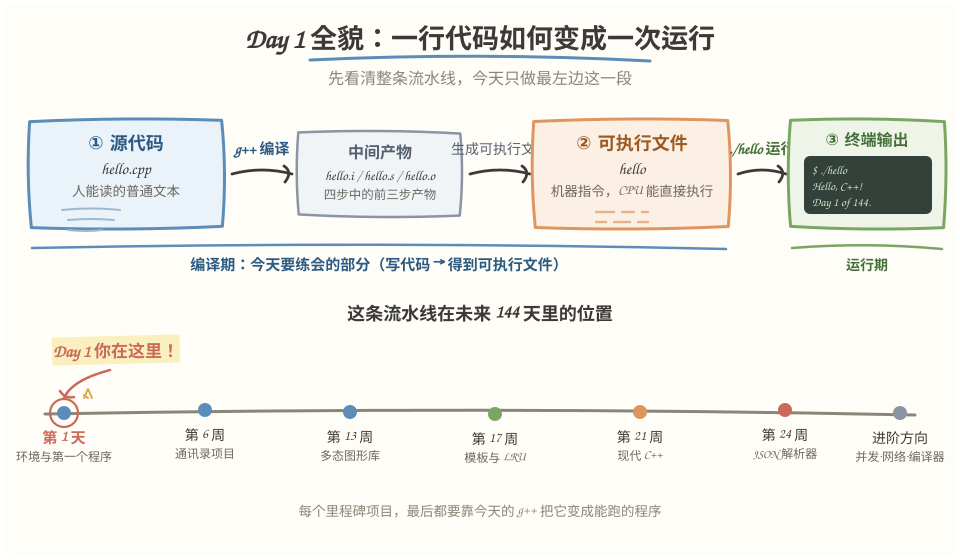
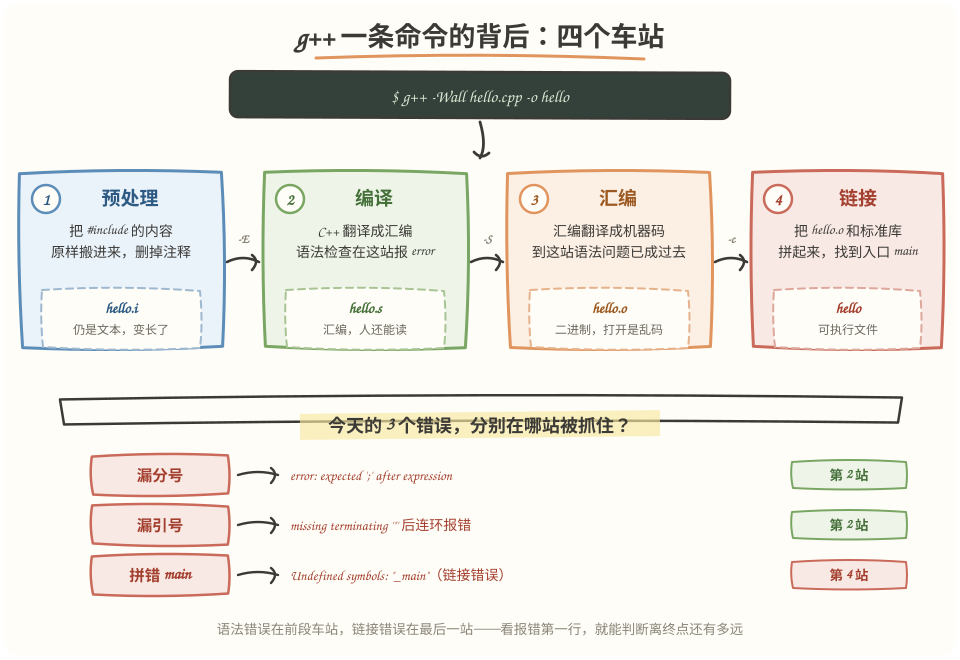
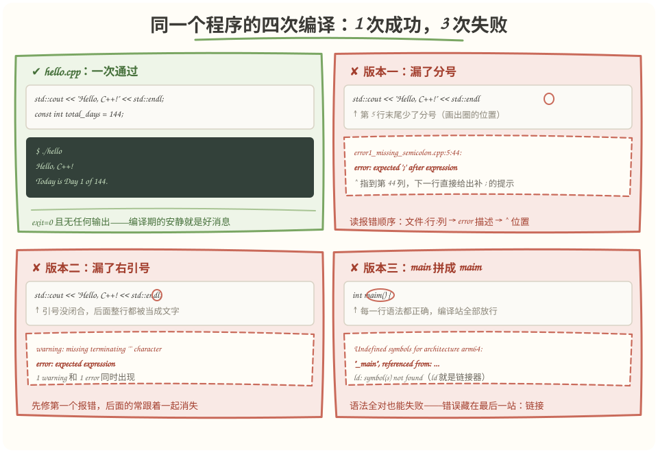

# 第 1 天：把 hello.cpp 变成会动的程序——装好工具链，读懂第一句报错

> **今日目标**：完成本教程后，你能做到：用一条命令把 C++ 源文件编译成可执行程序并运行它；面对编译失败时，能从报错里读出"哪个文件、哪一行、什么问题"；故意制造并修复 3 种最常见的编译错误。
> **预计时间**：学习 25 分钟＋实践 45 分钟
> **前置准备**：一台 macOS / Windows / Linux 电脑，能打开终端（macOS 叫"终端"，Windows 用 PowerShell）；不需要任何编程基础。
> **今日产出**：一个能编译运行的 `hello.cpp`，外加一份记录真实报错的 `error-notes.md`。

## 1. 今天解决什么问题？

第一次动手写代码的人，几乎都会撞上同一堵墙：**写好的代码，电脑根本不认识**。CPU 只执行机器指令，而我们敲下的是给人看的文字，中间必须有一位"翻译官"把 C++ 文本翻译成机器指令——这位翻译官就是编译器（compiler）。

所以第一天不急着学语法，先解决三件更基础的事：

1. 把编译器请进电脑；
2. 让第一段程序完整走完 **编写 → 编译 → 运行** 的闭环；
3. 学会读报错信息，而不是一看到红色输出就慌。

贯穿全文的例子只有一个：6 行的 `hello.cpp`。它输出一句问候，顺便数一数这段旅程一共要走多少天。今天所有命令、所有错误，都围绕它展开。

## 2. 先看全貌：今天的内容位于哪里？



**图 1**：先看上半部分的四个框：`hello.cpp`（源代码）经过 **g++ 编译** 得到 `hello`（可执行文件），再 **运行** 得到终端输出。今天重点练"编译"这一步。下半部分是 144 天学习路线：第 1 天的"跑通工具链"是所有后续里程碑的地基——第 6 周的通讯录、第 24 周的 JSON 解析器，最后都要靠这条命令变成能跑的程序。

整条链路概括成三步：

1. 写 `hello.cpp`：人能读的文本文件；
2. 用 `g++` 把它翻译成可执行文件 `hello`；
3. 在终端里运行 `./hello`，看到输出。

**前置补给（零基础看这里）**：终端（Terminal）是用文字命令和电脑对话的窗口。macOS 在"启动台"搜"终端"即可打开；Windows 推荐 PowerShell。下文命令行开头的 `$` 是提示符，不用自己输入。

## 3. 核心概念：先用直觉，再给准确定义

### 3.1 源文件与可执行文件

- **一句通俗解释**：`.cpp` 是写给人看的"图纸"，可执行文件才是机器能直接开动的"成品"。
- **一个类比**：源文件像一份中文合同，编译器像翻译官，把它译成对方只认的英文版；英文版（可执行文件）可以在任何合适场合直接使用，中文原稿本身对方不认。
- **对应到技术上是**：`hello.cpp` 是 UTF-8 文本，内容是 C++ 语言规则写成的语句；编译器把它整体分析、翻译成 CPU 的机器指令，存进 `hello` 这个二进制文件。注意类比的边界：翻译官不是逐句替换，而是先通读全文（语法检查）、做优化，再生成目标版本——所以它能发现"这句话根本不通"（语法错误）。
- **最小例子**：`hello.cpp` 只有 6 行、一百多个字节；编译出的 `hello` 在本机有几十万字节，里面是 arm64 机器指令。
- **一个常见误解**：双击 `.cpp` 文件不会运行程序——它不是程序，是原料。就像拿着合同原稿念给只懂英文的人听，没有意义。

### 3.2 编译器 g++：一条命令，四个车站

- **一句通俗解释**：`g++` 是启动编译流水线的总开关，一条命令背后其实是四道工序。
- **一个类比**：像一条四站地铁线：预处理站、编译站、汇编站、链接站，原料从第一站上车，成品从第四站下车。
- **对应到技术上是**：预处理（处理 `#include`、删注释）→ 编译（C++ 翻译成汇编，语法检查在这站）→ 汇编（翻译成机器码）→ 链接（拼上标准库，找到入口 `main`）。类比的边界：地铁各站独立售票，而流水线任何一站失败，后面全部停摆。
- **一个重要事实（macOS 用户）**：在 macOS 上执行 `g++ --version`，输出的却是 `Apple clang version ...`——因为 macOS 的 `g++` 实际是 clang++ 编译器的别名。本教程所有输出都在 macOS + Apple clang 21 上真实执行，Linux 上的 GCC 报错措辞会略有不同，但"文件:行号 + 描述"的结构一致。
- **一个常见误解**：以为 `g++ hello.cpp -o hello` 里的 `-o hello` 是"打开文件"。它其实是 `output` 的意思：指定编译产物叫 `hello`。

### 3.3 报错三要素：位置、类别、描述

读报错的固定顺序：**文件名:行号:列号 → error 还是 warning → 描述文字和 ^ 指示的位置**。今天实践部分会拿三条真实报错反复练这个顺序。

## 4. 图解核心机制



**图 2**：输入是左上角命令行里的 `hello.cpp`，输出是最右边的 `hello`。看图时重点对比四个车站的产物：`.i` 还是文本、`.s` 是汇编、`.o` 是二进制、最终 `hello` 才能执行。

按图中编号逐步讲：

1. **预处理**：把 `#include <iostream>` 引入的标准库声明原样搬进源文件，删除注释。产物 `hello.i` 仍是文本，只是变长了很多——本机实测有 59483 行（见 5.4 节），这就是我们从不直接读它的原因。
2. **编译**：把 C++ 翻译成汇编语言，同时做语法检查。**今天制造的语法错误，都在这一站被抓住**。
3. **汇编**：把汇编翻译成机器码，产出目标文件 `hello.o`。到这一站，语法问题已经成为过去。
4. **链接**：把 `hello.o` 和标准库的实现拼在一起，并找到程序入口 `main`。**如果拼错 `main`，前面三站全部放行，到这一站才失败**——图底部三个错误对应的车站就是今天最重要的观察。

为什么要分成四步而不是一步到位？分步让每一步职责单一、工具可替换（不同处理器换汇编器即可），也让我们能用 `-E`、`-S`、`-c` 三个参数"在任何一站下车"观察中间产物——这正是理解编译器的窗口。

## 5. 动手实践：完成一个最小可运行例子

### 5.1 准备环境与目录

先确认编译器到位（三选一，对应你的系统）：

| 系统 | 安装方式 | 验证命令 |
|---|---|---|
| macOS | 终端执行 `xcode-select --install`，装命令行工具 | `g++ --version` |
| Windows | 安装 Visual Studio（勾选 C++ 桌面开发）或 MinGW | `g++ --version` |
| Linux | Debian/Ubuntu 执行 `sudo apt install g++` | `g++ --version` |

本教程的演示环境：macOS 27（arm64），Apple clang 21.0.0，`g++` 为 clang++ 别名。下面所有输出均为本机真实执行结果；你在自己机器上运行时，除报错措辞可能略不同外，行为一致。

创建工作目录并进入（本教程仓库内的相对路径）：

```bash
cd ai-compiler-roadmap/tutorials/day-001/examples
```

### 5.2 编写 hello.cpp

新建 `hello.cpp`，输入以下完整内容（也在本目录 `examples/hello.cpp`）：

```cpp
#include <iostream>

// 第 1 天的主线例子：向世界打招呼，并数一数我们要走多少天
int main() {
    std::cout << "Hello, C++!" << std::endl;
    const int total_days = 144;
    std::cout << "Today is Day 1 of " << total_days << "." << std::endl;
    return 0;
}
```

最重要的三行：

- `#include <iostream>`：把"输入输出流"的声明搬进来，`cout` 才能用——对应图 2 第 1 站干的事；
- `int main() { ... }`：程序入口。链接站（第 4 站）就是靠找它确定"程序从哪开始"；
- `std::cout << "..." << std::endl;`：把文字送到标准输出，`std::endl` 表示换行。`<<` 可以理解为"把左边的东西流向右边"。

### 5.3 编译、运行与观察

```bash
g++ -Wall hello.cpp -o hello
./hello
```

实际执行结果（本机，macOS + Apple clang 21）：

```text
Hello, C++!
Today is Day 1 of 144.
```

编译命令没有任何输出——**编译期的安静就是好消息**。`-Wall` 的意思是打开常用警告（warning），`-o hello` 指定产物名字。

接着做今天最有价值的练习：**故意制造三个错误**。错误版本已放在本目录，逐个编译（以下均为本机真实报错）：

```bash
g++ -Wall error1_missing_semicolon.cpp -o error1
```

```text
error1_missing_semicolon.cpp:5:44: error: expected ';' after expression
    5 |     std::cout << "Hello, C++!" << std::endl
      |                                            ^
      |                                            ;
1 error generated.
```

```bash
g++ -Wall error2_missing_quote.cpp -o error2
```

```text
error2_missing_quote.cpp:5:18: warning: missing terminating '"' character [-Winvalid-pp-token]
    5 |     std::cout << "Hello, C++! << std::endl;
      |                  ^
error2_missing_quote.cpp:5:18: error: expected expression
1 warning and 1 error generated.
```

```bash
g++ -Wall error3_typo_main.cpp -o error3
```

```text
Undefined symbols for architecture arm64:
  "_main", referenced from:
      <initial-undefines>
ld: symbol(s) not found for architecture arm64
clang++: error: linker command failed with exit code 1 (use -v to see invocation)
```



**图 3**：四张卡片对比同一程序的四次命运。左上角成功版输出两行文字；右边三个失败版各自的报错要点、位置和教训都标在卡片里。特别注意右下角：**语法全对也能失败**，`Undefined symbols "_main"` 出现在链接站——它甚至没有 `文件:行号`，因为出问题的不是某一行代码，而是"整个程序缺少入口"。

### 5.4 修改一个参数再观察：-Wall 的价值

用 `warn_unused.cpp`（定义了一个从未使用的变量）做对照实验。先不带 `-Wall`：

```bash
g++ warn_unused.cpp -o warn1
```

```text
（没有任何输出，静默通过，exit=0）
```

再加上 `-Wall`：

```bash
g++ -Wall warn_unused.cpp -o warn2
```

```text
warn_unused.cpp:5:9: warning: unused variable 'unused_backup' [-Wunused-variable]
    5 |     int unused_backup = 42;
      |         ^~~~~~~~~~~~~
1 warning generated.
```

同样的代码，只改一个命令行参数，就多出一条警告。**这就是本计划固定使用 `-Wall` 的原因**：变量没用到、赋值被覆盖这类"不致命但可疑"的代码，默认编译器不吭声，`-Wall` 会把它们全部点亮。从今天起，你的编译命令永远是 `g++ -Wall ...`。

顺手再做一个观察（选做挑战的线索）：看看预处理到底展开了多少行：

```bash
g++ -E hello.cpp | wc -l
```

```text
59483
```

6 行的源文件，预处理后接近 6 万行——都是 `#include <iostream>` 搬进来的标准库声明。

## 6. 常见错误与排查

**错误 1：`zsh: command not found: g++`（Windows 上是 "'g++' 不是内部或外部命令"）**

- 现象：敲任何 g++ 命令都提示找不到命令；
- 原因：编译器没安装，或安装了但不在 PATH（系统的命令搜索路径）里；
- 定位：先执行 `g++ --version`；失败再确认安装步骤是否完整（macOS 是否装完命令行工具、Windows 装 MinGW 后是否配置环境变量）；
- 修复：按 5.1 的表格重装并验证；IDE 内置编译器不影响命令行使用，两者要分清。

**错误 2：`clang: error: no such file or directory: 'hello.cpp'`**

- 现象：编译时说找不到源文件；
- 原因：当前目录不对——终端里"你在哪个目录"和"文件在哪个目录"是两回事；
- 定位：执行 `ls`，看当前目录里有没有 `hello.cpp`；执行 `pwd` 看自己在哪；
- 修复：用 `cd` 进入 examples 目录再编译，或写出完整相对路径。

**错误 3：改了代码，运行结果却没变**

- 现象：修改 `hello.cpp` 后再运行 `./hello`，输出还是旧的；
- 原因：**编译失败时不会更新可执行文件**，你运行的仍是上一次成功编译的旧 `hello`；
- 定位：回想刚才那次编译是否真的成功（有没有 error、是否生成了新文件）；
- 修复：每次改完代码，重新执行编译命令再运行。把"编译＋运行"当成一个固定组合，后面的学习会引入构建工具把这个组合自动化。

## 7. 今日练习

### 必做练习

1. 新建 `hello_you.cpp`：把问候语换成包含你名字的一句话，再把 `144` 改成你给自己定的学习总天数。预期产出：编译运行后打印两行个性化文字。
2. 新建 `error-notes.md`，亲手制造一个本教程没出现过的错误（例如删掉 `int main()` 这一行的右花括号 `}`），把**完整报错**复制进去，并用一句话标注三要素：文件、行号、描述。预期产出：一份属于你自己的报错档案，后面每天都会往里加条目。

### 选做挑战

执行 `g++ -E hello.cpp | wc -l`（本机结果 59483），再用 `g++ -E hello.cpp | head -20` 看看开头 20 行长什么样。思考：为什么 `.i` 文件不适合人直接阅读，却适合机器处理？

## 8. 今日验收

- [ ] 我能用自己的话讲清 `.cpp` 文件和可执行文件的区别，以及"编译"发生在哪一步
- [ ] 我能独立完成 编写 → `g++ -Wall` 编译 → 运行 的完整流程并得到输出
- [ ] 我能按"位置 → 类别 → 描述"的顺序读一条报错，并按 `^` 提示修复
- [ ] 我能说出漏分号、漏引号、拼错 `main` 三种错误分别被流水线的哪一站抓住
- [ ] 我保存了 `examples/hello.cpp` 和自己的 `error-notes.md`

## 9. 一句话总结与明天预告

今天的问题是"电脑不认识我们写的代码"；机制上，`g++` 一条命令背后是预处理、编译、汇编、链接四站流水线，不同错误在不同车站落网；实践上，我们让 `hello.cpp` 完整走通了编译运行闭环，还故意制造并读懂了三种真实报错；验证标准是 `./hello` 的两行输出和 `exit=0`。明天进入 **Day 2：变量与基本类型**——今天代码里的 `const int total_days = 144` 已经埋下伏笔：`int` 是什么？还有哪些类型的"盒子"？为什么未初始化的变量是危险的？
