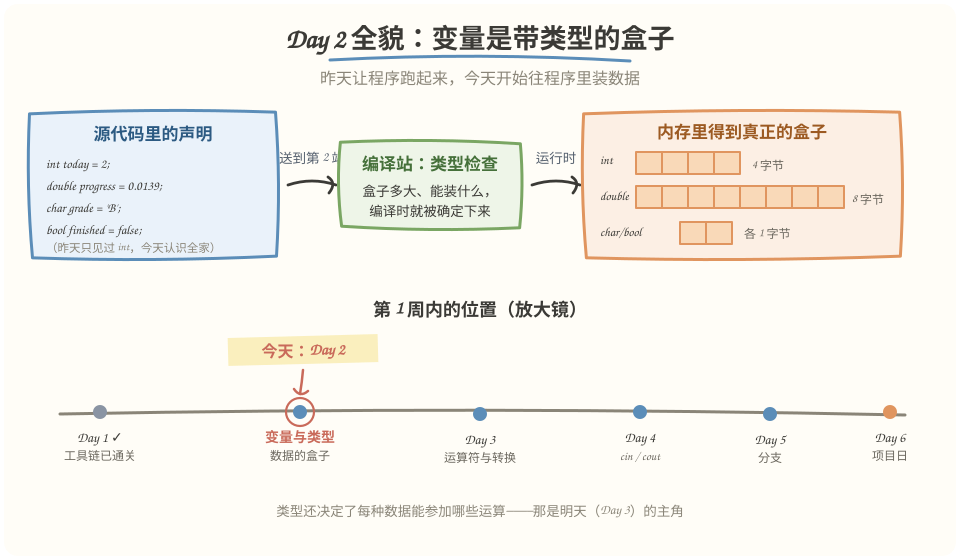
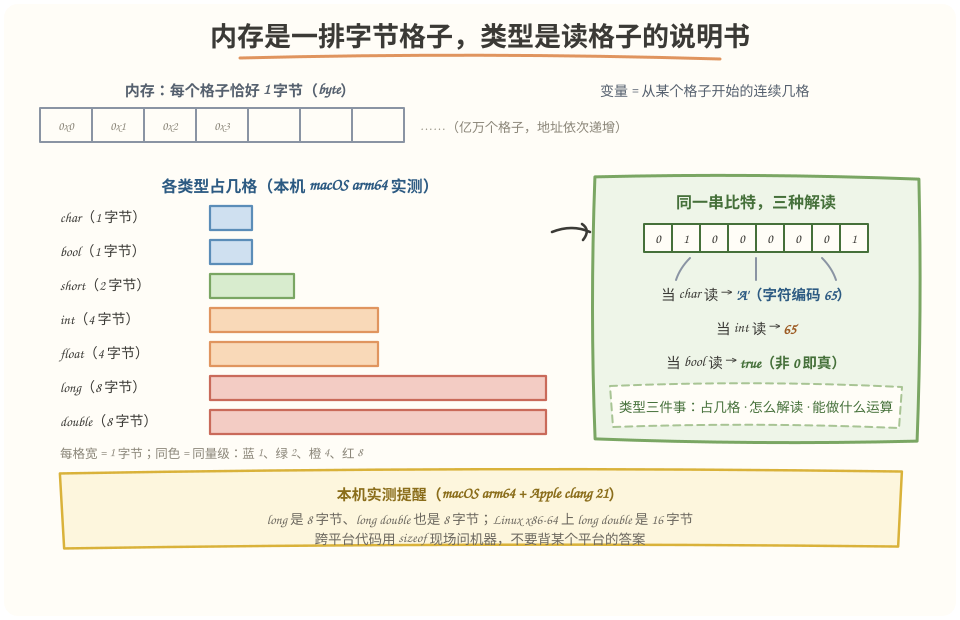
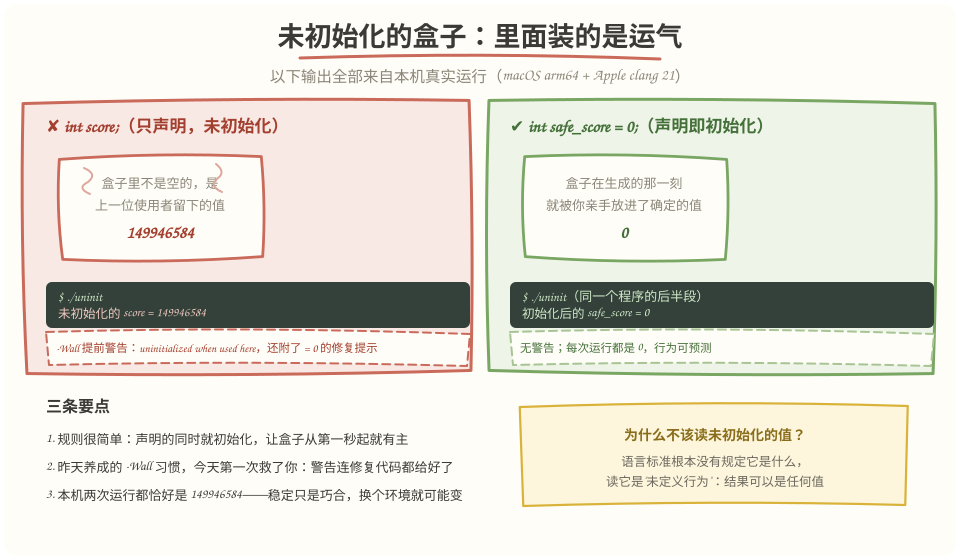

# 第 2 天：变量与基本类型——数据的盒子有大小，装错会出事

> **今日目标**：完成本教程后，你能做到：说出 int / long / double / char / bool 各装什么数据、在本机各占几字节；用 `sizeof` 和 `<climits>` `<cfloat>` 亲手查出大小与极值；解释"未初始化的变量"为什么危险，并养成声明即初始化的习惯。
> **预计时间**：学习 25 分钟＋实践 40 分钟
> **前置准备**：完成 Day 1（会用 `g++ -Wall` 编译运行）；不需要新工具。
> **今日产出**：一个打印本机"类型档案"的 `types_tour.cpp`，和一次记录在案的未初始化对照实验。

## 1. 今天解决什么问题？

昨天的 `hello.cpp` 里有一行 `const int total_days = 144;`——它凭什么知道 144 是个整数而不是文字？如果我想记录"今天的进度是 1.39%"这样的小数、"自评等级 B"这样的字符、"是否完成"这样的是非，又该怎么装？

今天的核心问题只有一个：**程序里的数据住在什么样的盒子里**。盒子选错了，轻则浪费内存，重则精度丢失、读到垃圾值。我们继续沿着一条主线例子走：用 5 个变量、4 种基本类型记录一条"学习档案"（`study_record.cpp`），看看每个值分别住进什么样的盒子、各占多大地方。

## 2. 先看全貌：今天的内容位于哪里？



**图 1**：左边的代码就是今天的主线例子：4 行声明，4 种类型。中间的"编译站"是昨天图 2 流水线的第 2 站——类型检查发生在编译期，所以很多类型错误根本活不到运行。右边是运行时的样子：每个变量在内存里真正占下一串格子。下方路线图提醒我们：今天在"基础语法"周的第 2 站，昨天刚通关工具链。

用三步概括今天的全局：

1. 写声明：`类型 变量名 = 初始值;`，例如 `int today = 2;`；
2. 编译期：编译器登记每个盒子的类型和大小；
3. 运行期：内存里划出格子，值住进去。

## 3. 核心概念：先用直觉，再给准确定义

### 3.1 变量与类型

- **一句通俗解释**：变量（variable）是内存里一个带名字的盒子，类型（type）是这个盒子的规格说明书。
- **一个类比**：搬家时你会买不同的收纳盒——鞋盒、文件盒、首饰盒。`int` 是装整数的盒子，`double` 是装小数的盒子。
- **对应到技术上是**：类型规定了三件事——**盒子占几个字节**（大小）、**比特串怎么解读**（编码方式）、**能参加哪些运算**（比如 `bool` 能做逻辑运算）。类比的边界：收纳盒大小是物理固定的，而类型的大小随平台不同——同样是 `long`，本机和别的机器可能不一样大（见 4 节实测）。
- **最小例子**：`int today = 2;` 一行干了三件事：向编译器申请一个 int 盒子、给它起名 `today`、放入值 2。
- **一个常见误解**：`double progress = 2.0 / 144.0;` 里的 `2.0` 写成 `2` 会怎样？这正是明天"隐式类型转换"的主题，今天先记住：整数和小数是两种盒子，混用会有规则。

### 3.2 字节与 sizeof

- **一句通俗解释**：字节（byte）是内存的最小计价单位，一个字节是 8 个二进制位（bit）；`sizeof` 是询问"这个类型占几字节"的运算符。
- **一个类比**：内存像一整面储物墙，每格恰好 1 字节；`sizeof(int)` 就是问"int 的盒子连占几格"。
- **对应到技术上是**：`sizeof(类型名)` 在**编译期**就算出结果（一个常数），程序运行时根本不用量。注意边界：它问的是"占几格"，不问"值是多少"。
- **最小例子**：`sizeof(today) = 4`——今天主线例子里的 `today` 占 4 字节，即 32 个 bit。

### 3.3 初始化与未初始化

- **一句通俗解释**：初始化（initialization）就是在拿到盒子的第一时间放进确定的值；不初始化的盒子里装的是"上一位使用者留下的东西"。
- **一个类比**：住酒店不换床单——床还是那张床，但上面是什么只有上一个房客知道。
- **对应到技术上是**：读取未初始化的局部变量是**未定义行为**（undefined behavior）——C++ 标准没有规定结果是什么：可能是 0，可能是垃圾数，甚至每次都不同。类比的边界：酒店床单大概率会被换，而未初始化内存**没有任何机制**帮你清理。
- **最小例子**：今天的对照实验 `uninit.cpp`，真实运行读出了 `149946584`。
- **一个常见误解**："我没写值，那它就是 0。"——标准没有这个承诺，编译器也不保证。

## 4. 图解核心机制



**图 2**：上半部分是内存的样子——每个格子恰好 1 字节。左下的彩色条是本机实测的各类型"占地"：蓝 1 格、绿 2 格、橙 4 格、红 8 格。右下的绿色卡片是今天最重要的思想实验：同一串比特 `0100 0001`，当 `char` 读是 `'A'`，当 `int` 读是 `65`，当 `bool` 读是 `true`。**比特本身没有含义，类型赋予它含义。**

按图逐步讲：

1. **先看格子**：内存就是亿万個字节格子排成的大墙，每个变量从某一格开始，连续占用几格；
2. **再看占地**：`int` 占 4 格、`double` 占 8 格——盒子越大能装的精度或范围越大，这也是 `double` 比 `float` 精确的原因（实测：`DBL_DIG = 15` 位有效数字 vs `FLT_DIG = 6` 位）；
3. **最后看解读**：类型是读格子的说明书。同一串比特，说明书不同，读出来的东西完全不同——这解释了为什么"类型错了"往往不是崩溃，而是安静的错值。

黄色提醒框是给跨平台读者的：本机（macOS arm64）实测 `long` 8 字节、`long double` 8 字节；Linux x86-64 上 `long double` 是 16 字节。**结论：用 `sizeof` 现场问机器，不要背某个平台的答案。**

## 5. 动手实践：完成一个最小可运行例子

### 5.1 准备文件

```bash
cd ai-compiler-roadmap/tutorials/day-002/examples
```

本目录已有三个文件：主线例子 `study_record.cpp`、类型档案 `types_tour.cpp`、对照实验 `uninit.cpp`。环境与昨天一致（macOS 27，Apple clang 21）。

### 5.2 编写代码

先看主线例子 `study_record.cpp`（完整代码）：

```cpp
#include <iostream>

// 第 2 天主线例子：用 5 个变量、4 种基本类型记录一条学习档案
int main() {
    const int total_days = 144;      // 整数：学习总天数
    int today = 2;                   // 整数：今天是第几天
    double progress = 2.0 / 144.0;   // 小数：当前进度
    char grade = 'B';                // 字符：今日自评等级
    bool finished = false;           // 布尔：今天的目标是否全部完成

    std::cout << "Day " << today << " of " << total_days << std::endl;
    std::cout << "progress = " << progress << std::endl;
    std::cout << "grade = " << grade << std::endl;
    std::cout << "finished = " << finished << std::endl;
    std::cout << "sizeof(today) = " << sizeof(today) << std::endl;
    return 0;
}
```

关键点：每行声明都遵循 `类型 名字 = 初始值;` 的完整形态——**声明即初始化**，今天结束时你会发现这不是啰嗦而是保命。

### 5.3 运行与观察

```bash
g++ -Wall study_record.cpp -o study_record && ./study_record
```

实际执行结果（本机）：

```text
Day 2 of 144
progress = 0.0138889
grade = B
finished = 0
sizeof(today) = 4
```

三个值得停下来的观察：

1. `progress = 0.0138889`——明明是 2/144 = 0.013888888...，输出只有 6 位有效数字。`cout` 默认就是这样，本周先记住现象，原因属于浮点输出格式化的进阶话题；
2. `finished = 0`——`bool` 打印出来是 `0`/`1` 而不是 `false`/`true`，`false` 在内存里的值就是 0；
3. `sizeof(today) = 4`——`sizeof` 直接在编译期算好了答案。

接着是今天的计划任务：打印各类型大小与极值（`types_tour.cpp` 完整代码见本目录，用了 `<climits>` 和 `<cfloat>` 里的 `INT_MAX`、`LONG_MIN`、`FLT_DIG` 等宏）：

```bash
g++ -Wall types_tour.cpp -o types_tour && ./types_tour
```

实际执行结果（本机）：

```text
== 各类型的大小（字节） ==
char:        1
bool:        1
short:       2
int:         4
long:        8
long long:   8
float:       4
double:      8
long double: 8

== 整数类型的极值 ==
INT_MIN  = -2147483648
INT_MAX  = 2147483647
LONG_MIN = -9223372036854775808
LONG_MAX = 9223372036854775807

== 浮点类型的精度 ==
FLT_DIG（float 有效十进制位数）  = 6
DBL_DIG（double 有效十进制位数） = 15
```

### 5.4 修改一个输入再观察：不初始化会怎样



**图 3**：两个盒子并排对比。左边只声明没初始化，读出 `149946584`；右边初始化为 0，输出永远是 0。下面黄框解释了根本原因：读未初始化的变量是未定义行为，语言标准根本没承诺结果。

对照实验的完整代码 `uninit.cpp` 见本目录，核心就两行：`int score;` 和 `int safe_score = 0;`。编译时先看警告：

```bash
g++ -Wall uninit.cpp -o uninit
```

实际输出（本机，注意这不是 error，程序照样生成）：

```text
uninit.cpp:6:48: warning: variable 'score' is uninitialized when used here [-Wuninitialized]
    6 |     std::cout << "未初始化的 score = " << score << std::endl;
      |                                           ^~~~~
uninit.cpp:5:14: note: initialize the variable 'score' to silence this warning
    5 |     int score;                // 只声明，未初始化：盒子是空的吗？
      |              ^
      |               = 0
1 warning generated.
```

运行两次（真实输出）：

```text
未初始化的 score = 149946584
初始化后的 safe_score = 0
```

两个盒子、同一台机器、同一个程序——读出来的值天差地别。还记得昨天图 2 的四站流水线吗？这个警告来自第 2 站（编译站），`-Wall` 把隐患在编译期就点亮了，甚至贴心地给出了 `= 0` 的修复写法。**昨天养成的 `-Wall` 习惯，今天第一次救了你。**

再用昨天的"报错三要素"读一遍这条警告：位置 `uninit.cpp:6:48`、类别 `warning`、描述 `uninitialized when used here`，外加一条 `note` 修复建议——读警告和读报错是同一套肌肉。

## 6. 常见错误与排查

**错误 1：`progress` 打印出来是 `0.0138889`，以为算错了**

- 现象：期望很多位小数，实际只有 6 位有效数字；
- 原因：`cout` 对浮点数的默认显示精度是 6 位有效数字，**显示**被截断，不代表内存里的值只有这么多；
- 定位：可以先打印 `2.0/144.0*1000000`（得到 13888.9）验证计算本身没问题；
- 修复：本周先接受这一默认行为；想控制显示位数需要 `std::setprecision`（第 4 天讲格式化时会正式介绍）。

**错误 2：把字符装进错误的盒子，`int grade = 'B';` 能编译但输出 `66`**

- 现象：想打印字母 B，结果打印出数字；
- 原因：`'B'` 的本质是字符编码 66，装进 int 盒子后按 int 的说明书解读就是 66——正是图 2"同一串比特不同解读"的现实版；
- 定位：检查声明类型与用途是否匹配；
- 修复：装字符用 `char`，装"字符的编号"才用 `int`。

**错误 3：用 `=` 比较两个值，写成 `finished = true`**

- 现象：本想判断"是否完成"，结果无条件把 `finished` 改成了 true；
- 原因：`=` 是赋值（往盒子里放东西），比较相等是 `==`，明天运算符一节会展开；
- 定位：编译时 `-Wall` 对部分场景会提示；运行时发现分支行为与预期相反时优先检查这里；
- 修复：比较用 `==`。今天先记住口诀：一个等号是"放"，两个等号是"比"。

## 7. 今日练习

### 必做练习

扩展 `types_tour.cpp`：加两行，打印 `sizeof(short)` 和 `sizeof(float)`（如果你在别的平台，顺便打印 `sizeof(long double)`），再打印 `CHAR_MIN` 和 `CHAR_MAX`（在 `<climits>` 里）。预期产出：一份你自己机器的完整"类型档案"，把它抄进你的 `error-notes.md`（改名叫 `notes.md` 也行），注明机器和编译器版本。

### 选做挑战

在 `study_record.cpp` 里再加一个 `float f_progress = 2.0f / 144.0f;`，与 `double progress` 一起打印，观察两者的显示差异；再用 `sizeof` 验证它们的大小。思考：既然 float 更省内存，为什么默认推荐 double？（提示：看 `FLT_DIG` 和 `DBL_DIG` 的差距。）

## 8. 今日验收

- [ ] 我能用自己的话说出类型规定的三件事：占几字节、怎么解读、能做什么运算
- [ ] 我在本机运行了 `types_tour.cpp`，能指出 int 和 long 各占几字节、`INT_MAX` 是多少
- [ ] 我能解释"同一串比特，类型不同解读不同"，并举出 `'B'`/66 的例子
- [ ] 我能说出未初始化变量为什么危险，并且演示了 `-Wall` 如何提前警告它
- [ ] 我保存了 `examples/types_tour.cpp` 和对照实验记录，并坚持"声明即初始化"

## 9. 一句话总结与明天预告

今天的问题是"数据住什么样的盒子"；机制上，类型是盒子的说明书——大小、解读方式、合法运算三合一，同一串比特换个类型读法就完全不同；实践上，我们实测了本机九种类型的大小与极值，还亲眼看到未初始化的盒子读出 `149946584` 这样的垃圾值；验证标准是 `types_tour` 的完整输出和 `-Wall` 的零警告通过。明天进入 **Day 3：运算符、优先级与隐式类型转换**——图 2 里"第三件事：能做什么运算"正式登场，我们将亲手验证整数除法、取余、有符号溢出，以及 `i++` 与 `++i` 的区别。
