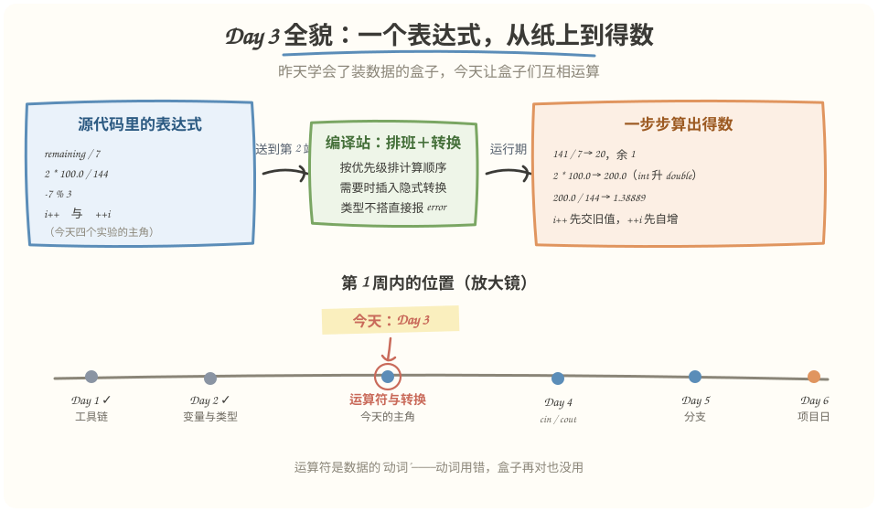
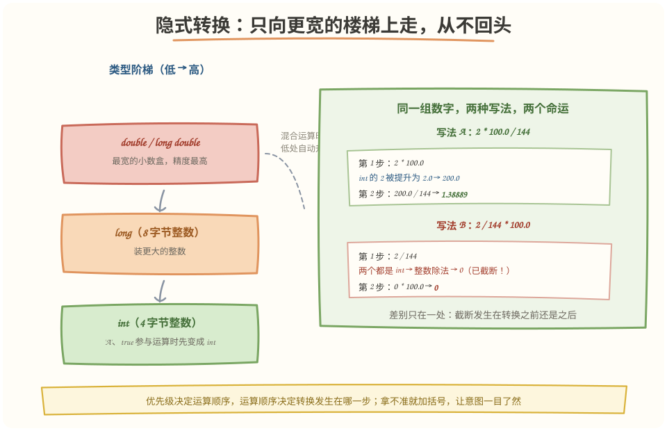
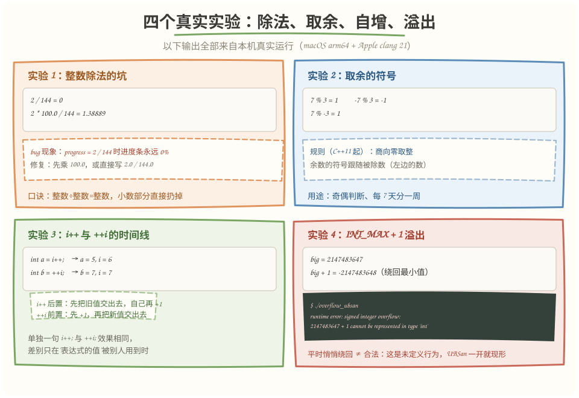

# 第 3 天：运算符与隐式转换——整数除法的坑，与 i++ 的两张面孔

> **今日目标**：完成本教程后，你能做到：解释 `2 / 144` 为什么等于 0 并且知道怎么修；说出取余结果符号的规则；画出 `i++` 与 `++i` 的时间线差异；用 `-fsanitize=undefined` 让有符号溢出现形。
> **预计时间**：学习 25 分钟＋实践 45 分钟
> **前置准备**：完成 Day 1、Day 2（会用 `g++ -Wall` 编译运行，知道类型是盒子的说明书）。
> **今日产出**：一份四个实验的巡礼程序 `ops_tour.cpp`，和一条被 UBSan 抓住的溢出现场记录。

## 1. 今天解决什么问题？

昨天的学习档案里，`progress = 2.0 / 144.0` 特意写了两个 `.0`。如果不写会怎样？直觉告诉我们 2 除以 144 是 0.0138……但 C++ 会给你一个干脆的 `0`。**今天的核心问题：数据之间的"动词"（运算符）有哪些默认规则，它们和直觉差在哪里。**

继续用学习计划当主线：想知道"144 天还剩几周零几天"要用除法和取余；想知道"当前进度百分之几"必须躲开整数除法的坑；想给天数计数又绕不开 `i++` 和 `++i`。四个真实实验，全是本机跑出来的结果。

## 2. 先看全貌：今天的内容位于哪里？



**图 1**：左边是今天的四位主角表达式；中间仍是昨天见过的"编译站"——优先级排序和隐式转换插入都发生在编译期；右边是运行期一步步算出的真实得数。下方路线图：Day 1、Day 2 已通关，今天站在第 3 站。

三步概括今天：

1. 写表达式：运算符把盒子里的值组合起来；
2. 编译期：编译器按**优先级**排计算顺序，按**类型阶梯**插入隐式转换；
3. 运行期：按排好的顺序逐步求值，坑在此时兑现。

## 3. 核心概念：先用直觉，再给准确定义

### 3.1 整数除法：除完就截断

- **一句通俗解释**：两个整数相除，结果还是整数，小数部分**直接扔掉**（向零截断），不是四舍五入。
- **一个类比**：把 2 块钱平均分给 144 个人，每人拿不到整块，于是每人 0 块——钱不会变成一角一分。
- **对应到技术上是**：`int / int` 的类型还是 `int`，数学结果 0.0138…被截断成 0。类比的边界：钱分完可以找零，而整数除法的小数部分是**丢弃**，不是存起来以后还你。
- **最小例子（真实运行）**：`7 / 2 = 3`，`7.0 / 2 = 3.5`——只要有一边是浮点，就按浮点除。
- **常见误解**："后面乘个 100.0 不就补回来了？"——不行！`2 / 144 * 100.0` 先算 `2/144=0`，再乘也是 0（图 2 有完整解剖）。

### 3.2 取余 %：分完剩下的零头

- **一句通俗解释**：`a % b` 是 a 除以 b 的余数，和除法是一对：`a / b * b + a % b == a`。
- **一个类比**：141 天按每周 7 天打包，装满 20 个箱子，剩 1 天进不了整箱——这个 1 就是 `141 % 7`。
- **对应到技术上是**：C++11 起规定**商向零取整**，因此**余数的符号跟随被除数**。本机实测：`-7 % 3 = -1`、`7 % -3 = 1`。类比的边界：箱子比喻里没有负数，负数的"装箱"是数学规则决定的，别靠直觉。
- **最小例子**：`141 / 7 = 20` 周，`141 % 7 = 1` 天——主线程序 `study_math.cpp` 的核心两行。
- **常见误解**：拿 `%` 对 `double` 用——编译器直接拒绝（`invalid operands`），它是整数专属。

### 3.3 优先级与括号：谁先算，听谁的

- **一句通俗解释**：优先级（precedence）是运算符的"排队规则"，`*` `/` 排在 `+` `-` 前面。
- **一个类比**：四则运算里先乘除后加减，小学就学过；括号是"插队许可证"。
- **对应到技术上是**：`1 + 2 * 3 = 7`，`(1 + 2) * 3 = 9`（均为真实输出）。类比的边界：C++ 的优先级表比数学复杂得多（十几级），**记忆策略不是背表，而是拿不准就加括号**。
- **一个重要陷阱**：`=` 是赋值、`==` 才是比较。`if (finished = true)` 会先把 true 塞进 finished 再判断，永远为真——Day 2 埋的这颗雷今天正式排除。

### 3.4 i++ 与 ++i：两张面孔

- **一句通俗解释**：两者都让 i 加 1，区别只在"表达式的值"：`i++` 交出**旧值**，`++i` 交出**新值**。
- **一个类比**：快递寄件。后置 `i++` 像先把当前库存发给你、仓库再进货；前置 `++i` 像先进货、再把新库存发给你。
- **对应到技术上是（真实运行）**：`int a = i++;` 得 `a = 5, i = 6`；`int b = ++i;` 得 `b = 7, i = 7`。类比的边界：单独成句的 `i++;` 和 `++i;` 效果完全一样，差别只在返回值被用到的时候。
- **常见误解**：初学期不必纠结"该用哪个"——**不取值就随便用，要取值时想清楚要旧的还是新的**。

## 4. 图解核心机制



**图 2**：左边是类型阶梯：`char/bool → int → long → double`，混合运算时低处自动升到高处，**从不反向**。右边是今天最重要的一组对照：同样三个数 `2、100.0、144`，写法 A 先乘 `100.0`（int 的 2 被提升成 2.0，一路浮点）得 1.38889；写法 B 先算 `2/144`（两个 int，整数除法当场截断成 0）再乘也是 0。

按图逐步讲：

1. **先看阶梯**：`'A' + 1` 里 char 先升成 int，所以真实输出是 `66`；`7.0 / 2` 里 int 的 2 升成 double，得 3.5；
2. **再看解剖图**：隐式转换发生在**每一步运算之前**，而运算顺序由优先级决定——这就是写法 A 和写法 B 命运分岔的根源；
3. **结论**：想控制结果，要么调整写法（先乘 `100.0`），要么加括号明示意图。黄框里的口诀值得抄进笔记。

## 5. 动手实践：完成一个最小可运行例子

### 5.1 准备文件

```bash
cd ai-compiler-roadmap/tutorials/day-003/examples
```

本目录有四个程序：主线 `study_math.cpp`、巡礼 `ops_tour.cpp`、自增对照 `inc_dec.cpp`、溢出实验 `overflow.cpp`。环境不变（macOS 27，Apple clang 21）。

### 5.2 编写代码

主线例子 `study_math.cpp`（完整代码）：

```cpp
#include <iostream>

// 第 3 天主线例子：学习计划里的数学报表
int main() {
    const int total_days = 144;
    int today = 3;
    int remaining = total_days - today;
    int weeks_left = remaining / 7;               // 整数除法：还剩几个完整周
    int leftover_days = remaining % 7;            // 取余：零头几天
    double percent = today * 100.0 / total_days;  // 先乘 100.0，让除法变浮点

    std::cout << "remaining = " << remaining << " 天" << std::endl;
    std::cout << "weeks_left = " << weeks_left << " 周 + " << leftover_days << " 天" << std::endl;
    std::cout << "percent = " << percent << " %" << std::endl;
    return 0;
}
```

关键一行是 `today * 100.0 / total_days`：先乘 `100.0` 把左边提升成 double，后面的除法自然是浮点除。把它改成 `today / total_days * 100.0` 试试——这正是 5.4 节的对照实验。

### 5.3 运行与观察

```bash
g++ -Wall study_math.cpp -o study_math && ./study_math
```

实际执行结果（本机）：

```text
remaining = 141 天
weeks_left = 20 周 + 1 天
percent = 2.08333 %
```

接着跑巡礼程序（完整代码见 `ops_tour.cpp`，四个小节对应今天的四组概念）：

```bash
g++ -Wall ops_tour.cpp -o ops_tour && ./ops_tour
```

实际执行结果（本机）：

```text
== 整数除法 vs 浮点除法 ==
7 / 2           = 3
7.0 / 2         = 3.5
2 / 144         = 0
2 * 100.0 / 144 = 1.38889

== 取余的符号 ==
7 % 3  = 1
-7 % 3 = -1
7 % -3 = 1

== 字符参与运算 ==
'A' + 1 = 66
char next = B

== 优先级与括号 ==
1 + 2 * 3   = 7
(1 + 2) * 3 = 9
```

值得停下来的三处：`'A' + 1` 打印出 `66`（char 升 int，昨天"同一串比特不同解读"的运算版）；`char next = 'A' + 1` 打印出 `B`（装回 char 盒子又按字符解读）；取余的符号果然跟随被除数。

再看自增对照（`inc_dec.cpp`）：

```bash
g++ -Wall inc_dec.cpp -o inc_dec && ./inc_dec
```

```text
a = 5, i = 6
b = 7, i = 7
```



**图 3**：四张卡片就是今天的全部实验。左上：两种除法写法的命运对照；右上：取余符号规则；左下：`i++` 与 `++i` 的时间线；右下：溢出实验——注意黑底卡片里 UBSan 的现场报告，它指出问题发生在 `overflow.cpp` 第 8 行第 24 列。

### 5.4 修改一个参数再观察：让溢出现形

`overflow.cpp` 做了一件昨天预告过、今天必须亲眼确认的事：

```bash
g++ -Wall overflow.cpp -o overflow && ./overflow
```

```text
big = 2147483647
big + 1 = -2147483648
```

2147483647 加 1 变成 -2147483648——看起来像"绕回了最小值"。但请注意：**有符号整数溢出是未定义行为**，"绕回"只是这台机器这次编译的表现，不是语言的承诺。加一个编译参数再跑：

```bash
g++ -Wall -fsanitize=undefined overflow.cpp -o overflow_ubsan && ./overflow_ubsan
```

实际输出（本机，运行时报告在 stderr）：

```text
big = 2147483647
big + 1 = -2147483648
```

```text
overflow.cpp:8:24: runtime error: signed integer overflow: 2147483647 + 1 cannot be represented in type 'int'
SUMMARY: UndefinedBehaviorSanitizer: undefined-behavior overflow.cpp:8:24
```

`-fsanitize=undefined`（UBSan）在运行期盯住这类未定义行为并当场报告——位置精确到 `8:24`，和 Day 1 学的报错三要素一个读法。这个参数和 `-Wall` 一样，值得在做练习时常开。

## 6. 常见错误与排查

**错误 1：进度百分比算出来是 0**

- 现象：`percent = today / total_days * 100;` 输出 `0`；
- 原因：`today / total_days` 是整数除法（3/144=0），乘 100 也还是 0——截断发生在转换之前；
- 定位：把中间量单独打印（`std::cout << today / total_days`），看到 0 就确认了；
- 修复：先乘 `100.0` 或改写分子分母为浮点（`today * 100.0 / total_days`）。

**错误 2：`error: invalid operands to binary expression ('double' and 'double')`**

- 现象：对两个 double 用 `%` 编译失败；
- 原因：`%` 只接受整数类型操作数；
- 定位：看报错指向的行，检查 `%` 两边的类型；
- 修复：要判断浮点"整除"得用 `std::fmod`（进阶话题，本周先记住 `%` 是整数专属）。

**错误 3：`if (count = 5)` 永远为真**

- 现象：分支总是执行，和你预期的"等于 5 才执行"不符；
- 原因：`=` 是赋值，把 5 塞进 count 后整个表达式的值是 5（非 0 即真）；
- 定位：`-Wall` 会提示 `using the result of an assignment as a condition`（部分场景）；人工检查条件里是不是单等号；
- 修复：比较用 `==`。口诀再念一遍：一个等号是"放"，两个等号是"比"。

## 7. 今日练习

### 必做练习

写 `weeks_report.cpp`：把 `study_math.cpp` 抄过来，故意把 percent 那行改成错误写法 `today / total_days * 100.0`，运行确认输出 0，再改回正确写法。两个版本的代码和输出都抄进 `notes.md`，用一句话解释差别发生的原因。预期产出：一段"踩坑+修复"的完整记录。

### 选做挑战

把 `overflow.cpp` 里的 `int` 换成 `unsigned int`、`INT_MAX` 换成 `UINT_MAX`（`<climits>` 里有）。无符号溢出是**定义良好**的绕回行为（不是未定义行为）。开 UBSan 重跑，观察它是否还报告。思考：为什么标准对有符号和无符号的态度不同？

## 8. 今日验收

- [ ] 我能解释 `2 / 144 = 0` 的原因，并给出两种修复写法
- [ ] 我能说出取余符号的规则，并预测 `-7 % 3` 和 `7 % -3` 的结果
- [ ] 我能画出 `a = i++` 与 `b = ++i` 的时间线，标注 a、b、i 各自的值
- [ ] 我用 `-fsanitize=undefined` 亲眼看过一次溢出报告，并能读出位置信息
- [ ] 我把今天的四个实验代码和真实输出保存进了 `examples/` 和 `notes.md`

## 9. 一句话总结与明天预告

今天的问题是"运算符的默认规则和直觉差在哪"；机制上，优先级决定顺序、类型阶梯决定转换，截断可能发生在转换之前；实践上，我们用四个真实实验看清了整数除法、取余符号、自增时序和溢出现场；验证标准是每条输出都能用自己的话解释成因。明天进入 **Day 4：cin / cout、输入校验与基本格式化**——程序将从"只会自说自话"变成"能和你对话"，今天 `progress = 0.0138889` 只有 6 位有效数字的悬念也将正式揭晓。
