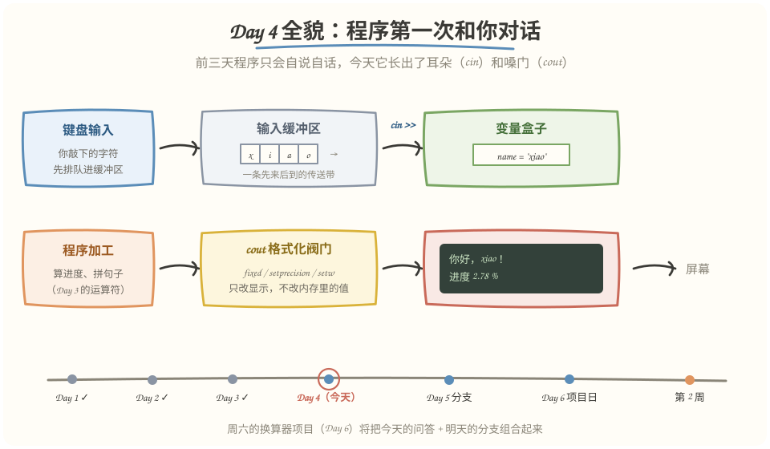
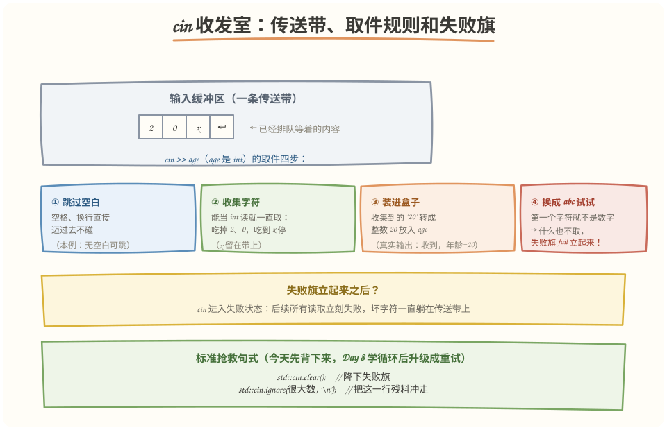
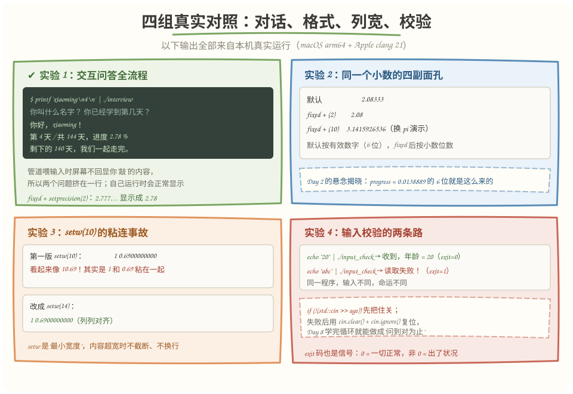

# 第 4 天：cin 与 cout——程序第一次和你对话

> **今日目标**：完成本教程后，你能做到：写出读取姓名和数字的交互式问答程序；用 `if (!(std::cin >> x))` 把住输入关，并说出失败后 `clear()`＋`ignore()` 的抢救句式；用 `fixed`、`setprecision`、`setw` 控制输出的显示格式。
> **预计时间**：学习 25 分钟＋实践 45 分钟
> **前置准备**：完成 Day 1~3；知道整数除法的坑（今天的进度百分比还会用到）。
> **今日产出**：一个能对话、会校验、格式漂亮的 `interview.cpp`，外加一条被校验拦下的非法输入记录。

## 1. 今天解决什么问题？

前三天的程序都在"自说自话"：数据写死在代码里，改一个数字要重新编译。今天给它长出**耳朵**（`cin`，读你敲的键盘）和**嗓门**（`cout`，把话说漂亮）。核心问题两个：

1. **输入不可信**：你请用户输入年龄，他却敲了 `abc`——程序要能发现并应对，而不是当场"神志不清"；
2. **显示不可控**：昨天结尾留的悬念——`progress = 0.0138889` 为什么只有 6 位？想显示 `2.78 %` 怎么办？

主线例子依然是学习档案：程序问你的名字和学到第几天，然后打印一份格式规整的进度报告。

## 2. 先看全貌：今天的内容位于哪里？



**图 1**：上半部分是一条完整的对话管道：键盘敲下的字符先排进**输入缓冲区**（一条传送带），`cin >>` 从带上取字符装进变量盒子，程序用 Day 3 的运算符加工，结果经过**格式化阀门**（`fixed`/`setprecision`/`setw`）由 `cout` 送到屏幕。下半部分：今天站在第 4 站，周六的换算器项目会把"问答 + 分支"组合起来。

三步概括：

1. `cin >> 变量`：从传送带取一段字符，试着装进盒子；
2. 校验：装不进去就立"失败旗"，程序要检查并抢救；
3. `cout` + 操纵符：控制显示格式，**只改显示，不改内存里的值**。

## 3. 核心概念：先用直觉，再给准确定义

### 3.1 输入缓冲区：先来后到的传送带

- **一句通俗解释**：你敲的键并不会立刻被程序拿走，而是先排队进一条"传送带"（输入缓冲区，buffer），`cin` 按顺序从上面取。
- **一个类比**：快递柜。包裹（字符）先被塞进柜子排队，收件人（`cin`）凭单号按顺序取。
- **对应到技术上是**：`cin >> x` 会跳过开头的空白（空格、换行），一直读到"再读一个就不是这种类型了"为止，剩下的字符留在带上等下一次读取。类比的边界：快递柜是人挑包裹，而 `cin >>` 的取件规则**完全由变量的类型决定**——int 只认数字，`std::string`（装文字的盒子，Day 16 专门讲）见空格就停。
- **最小例子**：一次输入 `20x`，`cin >> int` 取走 `20`，`x` 留在带上（图 2 第 ② 步）。
- **常见误解**：以为 `cin >> a >> b` 必须分两行输入——其实空格隔开就行，`cin` 自己会跳空白。

### 3.2 读取失败与失败旗

- **一句通俗解释**：取件类型对不上时，`cin` 什么也不取，立起一面**失败旗**（fail 状态），之后所有读取都会立刻失败。
- **一个类比**：收银台验钞机遇到假币"咔"地卡住并亮红灯——不处理掉假币，后面排队的人一个都过不去。
- **对应到技术上是**：`if (!(std::cin >> age))` 一行同时完成"读取＋检查"；失败后用 `std::cin.clear()` 降旗、`std::cin.ignore(一个大数, '\n')` 冲走本行残料。类比的边界：验钞机会把假币吐出来，而 `cin` 的坏字符**留在带上**，必须主动 ignore 掉。
- **真实例子**：`echo "abc" | ./input_check` 输出"输入的不是整数，读取失败！"且 `exit=1`。
- **常见误解**："失败时 age 会被填成 0 或 -1 吧？"——C++11 起失败会把变量写成 0，但**判断成败永远该看旗子，不看值**。

### 3.3 格式化操纵符：只改显示的阀门

- **一句通俗解释**：`<iomanip>` 里的操纵符（manipulator）像一组阀门，控制数字**怎么显示**，不改动内存里的值。
- **一个类比**：水还是那缸水，龙头拧大开小只是出水量不同。
- **对应到技术上是**：默认显示 6 位**有效数字**；`std::fixed` 切成定点模式（按小数位数），`std::setprecision(n)` 在定点模式下保留 n 位小数；`std::setw(n)` 给**下一项**至少 n 个字符的宽度（右对齐）。类比的边界：`fixed` 和 `setprecision` 是**拧上就常开**的（影响后续所有输出），`setw` 只影响紧跟的下一项——这是初学最容易踩的差异。
- **最小例子（真实运行）**：同一个 `3.1415926535...`，默认 `3.14159`，`fixed+setprecision(2)` 显示 `3.14`。
- **常见误解**："显示 2.08 说明内存里就是 2.08"——错，内存里还是 2.777…，阀门只管显示。

## 4. 图解核心机制



**图 2**：上半部分把 `cin >> age`（int）拆成四步：①跳过空白 → ②收集能当 int 读的字符（吃到 `x` 停，`x` 留在带上）→ ③把 "20" 转成整数装盒。右边的红色卡片是换 `abc` 进来的命运：第一步就卡住，**失败旗立起来**。下半部分两张卡片分别回答"旗子立了会怎样"（后续读取全部失败）和"标准抢救句式"（`clear()` 降旗 + `ignore()` 冲残料）。

按图逐步讲：

1. **传送带**：`20x↵` 四个字符排队在带上，`cin` 永远从最左边开始；
2. **取件规则由类型决定**：int 认数字、string 认非空白——同一个带上内容，读的变量类型不同，结果就不同（呼应 Day 2"类型是说明书"）；
3. **失败旗是总闸**：旗子立着，后面的 `cin >>` 连看都不看带上有什么；`clear()` 是唯一降旗方式；
4. **ignore 冲掉残料**：只降旗不冲残料，下次读取还会撞上 `abc`。今天先背固定句式，Day 8 学完 `while` 循环，就能升级成"问到对为止"的重试。

## 5. 动手实践：完成一个最小可运行例子

### 5.1 准备文件

```bash
cd ai-compiler-roadmap/tutorials/day-004/examples
```

三个程序：主线 `interview.cpp`、格式巡礼 `format_tour.cpp`、输入校验 `input_check.cpp`。环境不变（macOS 27，Apple clang 21）。

### 5.2 编写代码

主线例子 `interview.cpp`（完整代码）：

```cpp
#include <iostream>
#include <iomanip>
#include <string>

// 第 4 天主线例子：交互式问答——姓名 + 进度 + 自我介绍
int main() {
    std::string name;
    int days = 0;

    std::cout << "你叫什么名字？ ";
    std::cin >> name;
    std::cout << "你已经学到第几天？ ";
    std::cin >> days;

    const int total = 144;
    double percent = days * 100.0 / total;

    std::cout << std::fixed << std::setprecision(2);   // 保留 2 位小数显示
    std::cout << "你好，" << name << "！" << std::endl;
    std::cout << "第 " << days << " 天 / 共 " << total << " 天，进度 "
              << percent << " %" << std::endl;
    std::cout << "剩下的 " << total - days << " 天，我们一起走完。" << std::endl;
    return 0;
}
```

三个关键点：`std::string` 装文字（`cin >>` 见空格停，今天先用，Day 16 详解）；`days * 100.0` 沿用 Day 3 的整数除法修复；`fixed << setprecision(2)` 拧开定点两位小数的阀门。

### 5.3 运行与观察

```bash
g++ -Wall interview.cpp -o interview
./interview
```

演示时用管道喂输入并记录（本机真实执行；自己运行时输入会正常回显）：

```bash
printf 'xiaoming\n4\n' | ./interview
```

```text
你叫什么名字？ 你已经学到第几天？ 你好，xiaoming！
第 4 天 / 共 144 天，进度 2.78 %
剩下的 140 天，我们一起走完。
```

注意 `2.78 %`——`4*100.0/144 = 2.777…` 被阀门显示成两位小数。Day 2 的悬念正式揭晓：**默认显示是 6 位有效数字**。再看格式巡礼（`format_tour.cpp` 完整代码见本目录）：

```bash
g++ -Wall format_tour.cpp -o format_tour && ./format_tour
```

实际执行结果（本机）：

```text
== 默认显示（6 位有效数字） ==
3.14159
2.08333
== fixed + setprecision(2) ==
3.14
2.08
== fixed + setprecision(10) ==
3.1415926536
== setw(14) 表格对齐 ==
           Day       Percent
             1  0.6900000000
            12  8.3300000000
```



**图 3**：左上是完整的对话现场；右上是同一个小数的几副面孔——注意 `fixed` 一旦拧上，`setprecision` 的含义就从"有效数字"变成"小数位数"；左下是 `setw(10)` 的真实事故现场；右下是输入校验的两条命运分岔。

### 5.4 修改一个输入再观察：合法 vs 非法

`input_check.cpp` 的核心是那行 `if (!(std::cin >> age))`（`if` 明天才正式学，今天先当固定句式用）。两条路都真实跑一遍：

```bash
echo "20" | ./input_check
```

```text
请输入你的年龄： 收到，年龄 = 20
```

```bash
echo "abc" | ./input_check
```

```text
请输入你的年龄： 输入的不是整数，读取失败！
```

第一条 `exit=0`，第二条 `exit=1`——退出码本身就是信号（Day 1 见过 `exit=1`，那时是编译失败，这里是程序主动报告）。如果去掉 `if` 检查、输入又是 `abc`，程序会拿着 0 继续往下跑，把垃圾值当真年龄用——这就是"输入不可信，进门先检查"的含义。

## 6. 常见错误与排查

**错误 1：输入一次字母，后续所有读取集体失灵**

- 现象：第一个输入敲了字母，后面每个 `cin >>` 都直接跳过，程序"疯了"；
- 原因：失败旗立着，后续读取看都不看就直接失败；
- 定位：在每次读取后打印 `std::cin.fail()`（失败时打印出 1）；
- 修复：`std::cin.clear(); std::cin.ignore(10000, '\n');` 降旗＋冲残料（图 2 底部的句式）。

**错误 2：想输入带空格的名字，只拿到前一半**

- 现象：输入 `Xiao Ming`，`name` 里只有 `Xiao`；
- 原因：`cin >>` 见空白就停，`Ming` 留在传送带上；
- 定位：在读取后立刻打印变量内容；
- 修复：读整行用 `std::getline(std::cin, name)`（混用 `>>` 和 `getline` 还有残留换行的坑，Day 17 字符串专题统一讲）。

**错误 3：`setw` 没对齐，甚至数字粘在一起**

- 现象：`setw(10) << 1 << setw(10) << 0.69` 打出 `         10.6900000000`，像 10.69；
- 原因：`0.6900000000` 已经 12 个字符，超过最小宽度 10，setw 不截断也不换行，两列就粘上了（真实事故见 5.3 与图 3 左下）；
- 定位：数一数单元格内容实际占几列；
- 修复：把宽度放大到容得下最长内容（本例改 `setw(14)`），列与列自然分开。再记住：**setw 只影响下一项**，每列都要写。

## 7. 今日练习

### 必做练习

扩展 `interview.cpp` 成三问：名字、天数、今日自评等级（A~F 的一个字母，用 `char` 读入）。输出格式要求：等级用 `setw(6)` 右对齐、进度保留 1 位小数。预期产出：一次完整对话 + 满足全部格式要求的输出，把代码和输出抄进 `notes.md`。

### 选做挑战

把 Day 2 的 `types_tour.cpp` 输出用 `setw` 重排成一张对齐的表（类型名一列、大小一列），并把 `FLT_DIG`、`DBL_DIG` 用 `fixed + setprecision(0)` 显示。观察：整数用 setw 有变化吗？（提示：setw 对所有类型都生效，右对齐。）

## 8. 今日验收

- [ ] 我能用自己的话讲清"输入缓冲区是传送带，cin 按类型取件"
- [ ] 我能独立写出问答程序，并用管道喂输入的方式记录真实输出
- [ ] 我能解释失败旗机制，并默写 `clear()` + `ignore()` 抢救句式
- [ ] 我能说出默认 6 位有效数字、fixed 后按小数位、setw 只影响下一项这三条规则
- [ ] 我保存了 `examples/interview.cpp` 和非法输入的现场记录

## 9. 一句话总结与明天预告

今天的问题是"程序如何与你对话、如何不信错输入"；机制上，字符在缓冲区排队、`cin` 按类型取件、失败旗把住总闸、格式化阀门只改显示；实践上，问答程序跑通了完整管道，非法输入被拦下并返回 `exit=1`；验证标准是两路输入的真实输出对比。明天进入 **Day 5：if / else、switch 与比较逻辑**——今天 `if (!(cin >> age))` 这句"先斩后奏"的固定句式将得到完整解释，程序也将第一次学会"看情况办事"。
