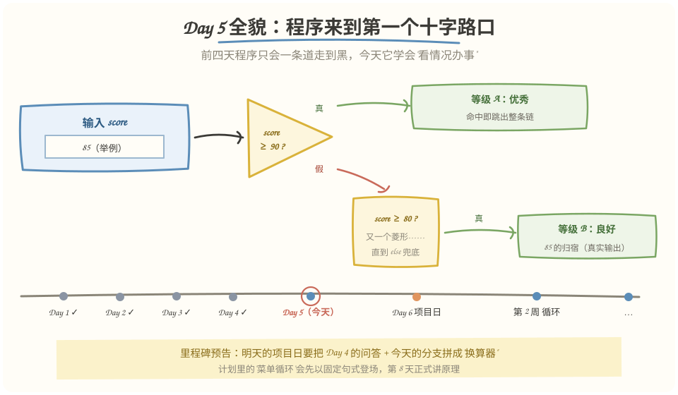
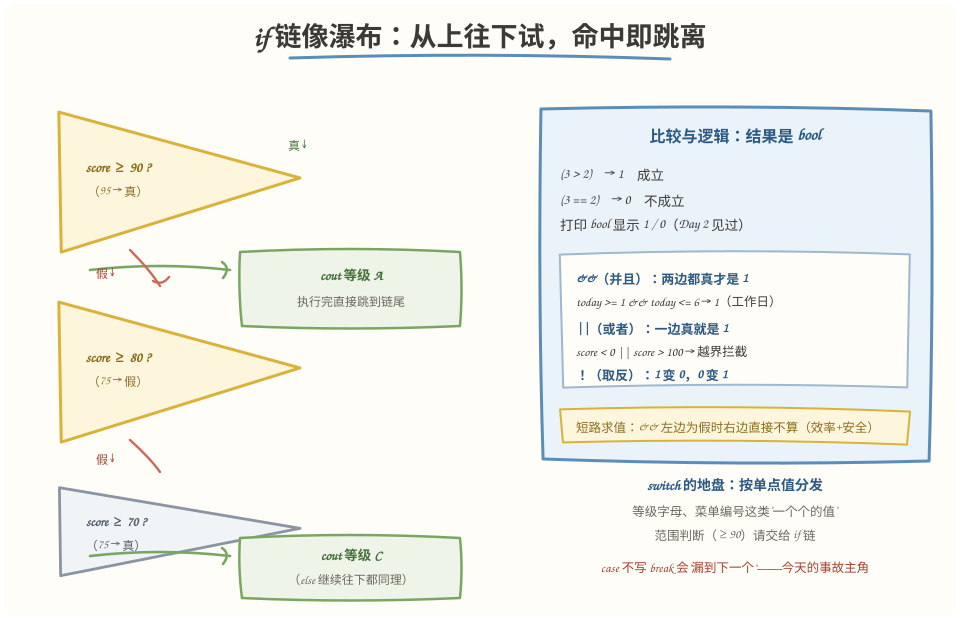
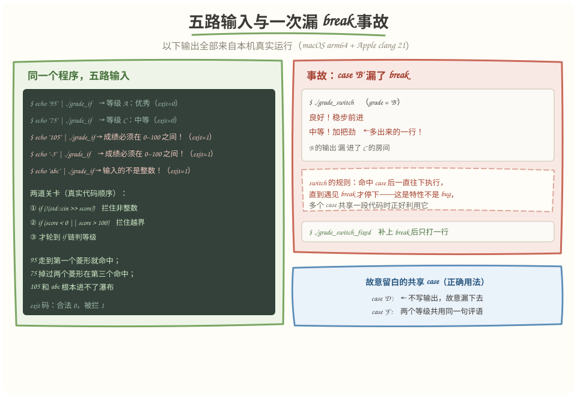

# 第 5 天：if / else 与 switch——程序的第一个十字路口

> **今日目标**：完成本教程后，你能做到：用 `if / else if / else` 链实现成绩等级判定；用 `||`、`&&`、`!` 组合条件并在越界输入时拦截；解释 switch 的 fall-through 规则，说出漏写 `break` 的后果并知道何时故意利用它。
> **预计时间**：学习 25 分钟＋实践 45 分钟
> **前置准备**：完成 Day 1~4（尤其 Day 4 的输入校验句式——今天第一次完整解释它）。
> **今日产出**：一个带两道输入关卡的成绩判定程序，和一次漏 `break` 的真实事故记录。

## 1. 今天解决什么问题？

Day 4 的 `if (!(std::cin >> age))` 当时被当成"固定句式"背了下来。今天正式回答三个问题：`if` 到底怎么工作？多个条件怎么组合？按值分发为什么有 switch 这个专门工具？

主线场景是计划里指定的练习：**成绩等级判定（含非法输入处理）**。输入一个 0~100 的成绩，程序输出等级；输入越界或根本不是数字，程序要礼貌地拦下而不是给出垃圾结果。同一个程序喂五种输入，今天你会看到五种命运。

## 2. 先看全貌：今天的内容位于哪里？



**图 1**：数据从左边的盒子出发，遇到黄色菱形（判断）就分流：真走一条路、假走下一条，直到命中输出框。注意菱形是**串着**的——第一个没命中才轮到第二个，这正是"瀑布"结构。下方路线图：Day 1~4 已通关，明天项目日把问答+分支组装成换算器。

三步概括今天：

1. 比较运算符（`>=`、`==`、`!=`…）算出一个 `bool`：真 1 假 0；
2. `if` 看 bool 决定走哪条路；`else` 兜底；
3. 按"一个个的值"分发（菜单编号、等级字母）用 switch；按"范围"判断用 if 链。

## 3. 核心概念：先用直觉，再给准确定义

### 3.1 if / else if / else：瀑布式检查

- **一句通俗解释**：`if` 链像一串从上到下的检查站，第一个条件成立的站执行完就**整链跳出**，后面的站看都不看。
- **一个类比**：机场安检口开了好几条通道，地勤从第一条开始问你符合条件吗，一旦放行进入某条通道，就再也不会去别的通道。
- **对应到技术上是**：`if (a) {...} else if (b) {...} else {...}` 逐条求值，命中即选中那个分支，然后跳到链尾继续。类比的边界：安检通道是并排的，而 if 链是**有顺序的**——把 `score >= 60` 写在最前面，后面的 `>= 90` 就永远轮不到，这是新手最常见的顺序错误。
- **最小例子（真实运行）**：输入 95，在第一个菱形 `score >= 90` 命中，输出"等级 A"；输入 75，掉过前两个菱形，在 `score >= 70` 命中，输出"等级 C"。
- **常见误解**：以为每个 `else if` 都会被独立检查——只有前面的全不成立才会轮到它。

### 3.2 逻辑运算符 &&、||、!

- **一句通俗解释**：`&&` 是"并且"（两边都真才真），`||` 是"或者"（一边真就真），`!` 是"取反"。
- **一个类比**：进门要**同时**有工牌和预约（`&&`）；食堂**或者**刷饭卡**或者**扫码都行（`||`）。
- **对应到技术上是**：三个运算符的结果都是 bool。本机实测：`today >= 1 && today <= 6` 得 1，`today == 6 || today == 7` 得 0（today=5），取反后变 1。类比的边界：C++ 还有按位运算 `&`、`|`（长得很像，含义完全不同，进阶阶段再碰，今天只用双符号版）。
- **一个重要特性——短路求值**：`&&` 左边是假时右边**直接不算**（结果已定）；`||` 左边是真时同理。Day 16 之后会看到它"保护性提问"的用法。
- **常见误解**：把数学写法 `0 <= score <= 100` 直接搬进来——它居然能编译！但含义是先算 `0 <= score` 得 0/1，再拿这个 0/1 和 100 比，永远为真。必须写成 `score >= 0 && score <= 100`。

### 3.3 switch：按单点值分发

- **一句通俗解释**：switch 拿一个整数类值（int、char、枚举）逐个对 case 标签"对暗号"，对上就从那里开始执行。
- **一个类比**：一排贴了编号的房间（case 'A'、case 'B'……），拿号码牌进门，从这间开始**一直往前走**，直到看见"出口"（break）才离开。
- **对应到技术上是**：命中 case 后顺序执行，**遇 break 才停**；没命中走 `default`。类比的边界：房间比喻里"往前走"是物理空间，代码里是**接着执行下一个 case 的语句体**，哪怕标签对不上——这就是 fall-through。
- **最小例子（真实事故）**：`grade_switch.cpp` 里 case 'B' 故意漏了 break，输出两行（"良好"漏进"中等"的房间）；补上 break 的 `grade_switch_fixed.cpp` 只输出一行。
- **何时用 switch**：判断"是不是某个具体值"（菜单 1/2/3、字母等级）；判断"范围"（`>= 90`）老老实实用 if 链——switch 的 case 标签不能写范围。

## 4. 图解核心机制



**图 2**：左边是瀑布：95 在第一个菱形就被接住；75 连掉两级在第三个菱形命中——每个菱形只有**上方全假**才轮到它。右边蓝卡是三个逻辑运算符的真实输出；黄卡标注了短路求值；底部两行是 switch 的适用边界。

按图逐步讲：

1. **先看顺序**：菱形从上到下排列，条件范围必须**从窄到宽**（`>= 90` 在 `>= 80` 前面）。写反了，宽的会把窄的活全抢了；
2. **再看结果**：比较和逻辑运算的产物是 bool，打印出来就是 1/0（Day 2 学过 bool 盒子，今天看到它被生产出来）；
3. **最后看短路**：`score < 0 || score > 100` 里左边成立时右边不再计算——省时间，后面还能保护危险操作；
4. **switch 的房间规则**：进门后一直往前走，break 是出口；故意不写出口让两间房共享家具（`case 'D':` 直接漏到 `case 'F':`）是合法且常用的技巧。

## 5. 动手实践：完成一个最小可运行例子

### 5.1 准备文件

```bash
cd ai-compiler-roadmap/tutorials/day-005/examples
```

四个程序：主线 `grade_if.cpp`、事故版 `grade_switch.cpp`、修复版 `grade_switch_fixed.cpp`、真值巡礼 `compare_tour.cpp`。环境不变（macOS 27，Apple clang 21）。

### 5.2 编写代码

主线例子 `grade_if.cpp`（完整代码）：

```cpp
#include <iostream>

// 第 5 天主线例子：成绩等级判定（含非法输入处理）
int main() {
    int score = 0;
    std::cout << "请输入成绩（0~100）：";

    if (!(std::cin >> score)) {                 // 第一关：是不是整数
        std::cout << "输入的不是整数！" << std::endl;
        return 1;
    }
    if (score < 0 || score > 100) {             // 第二关：范围合法吗（|| 有一个成立就拦）
        std::cout << "成绩必须在 0~100 之间！" << std::endl;
        return 1;
    }

    if (score >= 90) {
        std::cout << "等级 A：优秀" << std::endl;
    } else if (score >= 80) {
        std::cout << "等级 B：良好" << std::endl;
    } else if (score >= 70) {
        std::cout << "等级 C：中等" << std::endl;
    } else if (score >= 60) {
        std::cout << "等级 D：及格" << std::endl;
    } else {
        std::cout << "等级 F：不及格" << std::endl;
    }
    return 0;
}
```

Day 4 那句 `if (!(std::cin >> score))` 现在能读明白了：`cin >> score` 本身产生一个"流状态"，套上 `!` 就是问"读取失败了吗"。`||` 组成的第二关拦下越界值。注意 if 链的顺序：`>= 90` 最窄的在最前。

### 5.3 运行与观察

```bash
g++ -Wall grade_if.cpp -o grade_if
```

五路输入全部真实执行：

```text
$ echo "95" | ./grade_if
请输入成绩（0~100）：等级 A：优秀        （exit=0）

$ echo "75" | ./grade_if
请输入成绩（0~100）：等级 C：中等        （exit=0）

$ echo "105" | ./grade_if
请输入成绩（0~100）：成绩必须在 0~100 之间！ （exit=1）

$ echo "-3" | ./grade_if
请输入成绩（0~100）：成绩必须在 0~100 之间！ （exit=1）

$ echo "abc" | ./grade_if
请输入成绩（0~100）：输入的不是整数！     （exit=1）
```

再看真值巡礼（`compare_tour.cpp`）：

```bash
g++ -Wall compare_tour.cpp -o compare_tour && ./compare_tour
```

```text
1
0
1
1
0
1
```

六行依次对应：`3>2`、`3==2`、`3!=2`、`today>=1 && today<=6`（today=5）、`today==6 || today==7`、以及后者的取反——bool 的世界只有 0 和 1。



**图 3**：左边黑底卡片是五路输入的完整战报：两路合法（exit=0）分别命中不同菱形，三路非法分别被两道关卡拦下（exit=1）。右边红卡是今天的事故：漏写 break 的 switch 打出两行，修复后一行。

### 5.4 修改一个输入再观察：漏 break 的两种命运

```bash
g++ -Wall grade_switch.cpp -o grade_switch && ./grade_switch
```

```text
良好！稳步前进
中等！加把劲
```

```bash
g++ -Wall grade_switch_fixed.cpp -o grade_switch_fixed && ./grade_switch_fixed
```

```text
良好！稳步前进
```

两个文件只差一个 `break;`。输出从一行变两行，而且**编译器一声不吭**（fall-through 是合法语法）——这类"不报错的错"只能靠运行观察发现。对比之下，`case 'D':` 后面不写语句直接漏到 `case 'F':` 是**故意**的共享技巧：D 和 F 用同一句评语。

## 6. 常见错误与排查

**错误 1：if 链顺序写反，宽条件挡住窄条件**

- 现象：输入 95 却输出"等级 B"甚至更低；
- 原因：`score >= 60` 写在了 `>= 90` 前面，95 在第一站就被接走；
- 定位：把每个条件单独打印（`std::cout << (score >= 60)`）确认命中位置；
- 修复：范围条件**从窄到宽**排列，或者全部改用 `score >= 80 && score < 90` 的显式区间。

**错误 2：数学式连写 `0 <= score <= 100` 悄悄变成"永真"**

- 现象：输入 9999 也通过了范围检查；
- 原因：先算 `0 <= score` 得 0 或 1，再拿它和 100 比较，必然成立；
- 定位：对越界值单测这行表达式；
- 修复：写成 `score >= 0 && score <= 100`。这坑太常见，值得抄进 `notes.md`。

**错误 3：switch 忘写 break，输出多出一段**

- 现象：命中某个 case 后，下一个 case 的输出也跟着冒出来；
- 原因：fall-through 规则——命中后顺序执行直到 break；
- 定位：数一数输出行数和预期分支数是否一致；
- 修复：补 `break;`。故意共享时写注释说明"此处故意漏下"，给未来的自己留话。

## 7. 今日练习

### 必做练习

把 `grade_if.cpp` 改成"学习状态判定"：输入已学天数（1~144），输出阶段名（1~36 基础语法、37~72 指针与内存、49~78 面向对象、79~102 STL 与泛型、103~126 现代 C++、127~144 综合实战），非法输入照旧拦截。预期产出：六段映射 + 两道关卡，用至少四个输入值（每段一个 + 一个非法）记录真实输出到 `notes.md`。

### 选做挑战

给 `grade_switch.cpp` 增加从 1 到 7 的星期编号输入，用 switch 输出"工作日/周末"（1~5 工作日，6、7 周末，用共享 case）。体会：为什么这个任务适合 switch，而"阶段判定"适合 if 链？

## 8. 今日验收

- [ ] 我能用自己的话讲清 if 链"从上到下、命中即跳出"的瀑布规则
- [ ] 我能默写两道输入关卡并用 `||` 拦截越界值
- [ ] 我能解释 `0 <= x <= 100` 为什么是坑，并写出正确版本
- [ ] 我能说出 fall-through 的规则、漏 break 的现象和故意共享的用法
- [ ] 我保存了五路输入的战报和漏 break 事故记录

## 9. 一句话总结与明天预告

今天的问题是"程序如何看情况办事"；机制上，比较和逻辑运算产出 bool，if 链瀑布式检查、命中即跳，switch 按单点值分发、break 是出口；实践上，成绩判定程序用两道关卡拦下了非数字和越界，还亲手制造并修复了一次 fall-through 事故；验证标准是五路输入的 exit 码与输出对照。明天是**第一个项目日：换算器小程序**——把 Day 4 的问答、今天的分支，加上一个"菜单循环"固定句式，拼出第一个像样的多分支交互程序。
