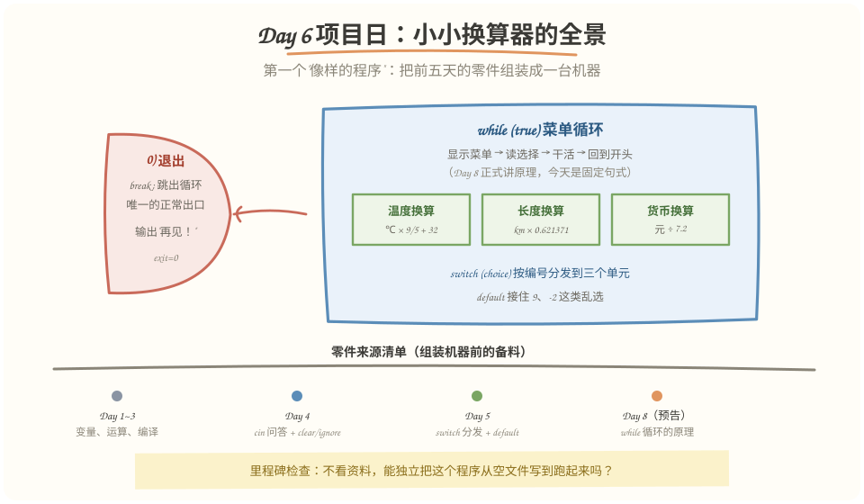
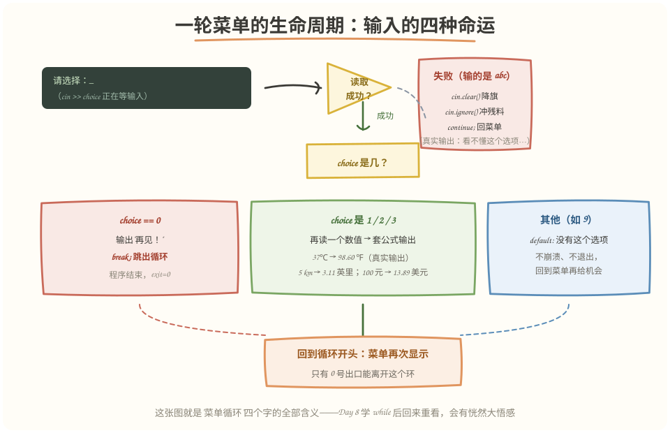
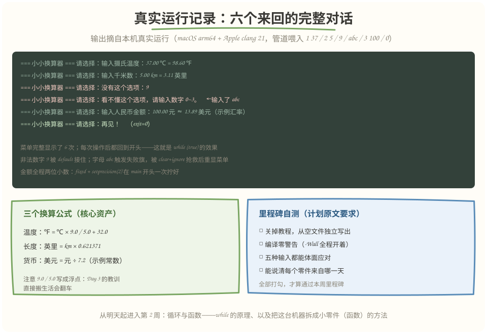

# 第 6 天（项目日）：换算器小程序——把前五天的零件组装成机器

> **今日目标**：完成本教程后，你能做到：不看资料，从空文件独立写出"菜单循环 + 三种换算 + 输入防护"的完整程序；说出程序里每个零件分别来自前五天的哪一课；用一组覆盖正常/非法输入的脚本验证程序行为。
> **预计时间**：学习 15 分钟＋实践 60 分钟（项目日实践加重）
> **前置准备**：完成 Day 1~5；今天不引入任何新知识，只做"组装"。
> **今日产出**：一个 60 行左右、`-Wall` 零警告、能体面应对乱输入的换算器，和一份六回合真实对话记录。

## 1. 今天解决什么问题？

单课的知识点是零件，真实程序是机器。今天的问题是：**零件散着的时候都会，能不能组装出一台完整的？** 计划给本周定的里程碑是"能独立编译运行多分支程序"，检验方式很具体：菜单循环 + 温度/货币/长度换算，面对乱敲键盘的用户不崩溃、不乱算。

这台机器用到的零件清单：Day 2 的类型和常量（汇率、系数）、Day 3 的浮点运算（`9.0/5.0` 不写成 `9/5`）、Day 4 的 `cin` 问答和 `clear()+ignore()` 抢救、Day 5 的 `switch` 分发和 `default` 兜底。唯一的"新句式"是 `while (true)` 菜单循环——计划特意安排它今天登场，原理 Day 8 讲，先照固定句式写。

## 2. 先看全貌：今天的内容位于哪里？



**图 1**：蓝色大环是 `while (true)` 菜单循环：显示菜单 → 读选择 → switch 分发到三个绿色换算单元 → 回到开头。红色出口盒是唯一的正常离开方式：输入 0，`break` 跳出。底部是零件来源清单——今天不造新零件，只组装。黄色提醒条是里程碑检验标准：**不看资料能不能独立写出来**。

整台机器三步概括：

1. 循环显示菜单，读一个选项编号；
2. 编号合法就再读一个数值、套公式输出；不合法就兜底提示；
3. 输入 0 才退出循环，程序结束。

## 3. 核心概念：先用直觉，再给准确定义

### 3.1 菜单循环 while (true)：今天先当固定句式

- **一句通俗解释**：`while (true)` 让一段代码**永远重复执行**，直到遇到 `break` 才停下。
- **一个类比**：餐厅前台循环接待：问需求 → 办事 → 说"下一位"，直到下班（`break`）。
- **对应到技术上是**：圆括号里的 `true` 表示"条件永远成立"，循环体反复执行；`break` 是唯一的正常出口。类比的边界：前台下班有时刻表，而 `while (true)` 没有——**忘了写 `break` 路径，程序就永远停不下来**（好在我们的菜单有 0 号出口）。
- **最小例子**：本项目的主体就是一个 `while (true)` 包着菜单和 switch。
- **一个说明**：循环是下周（Day 7~8）的正课，今天**只需要**记住这组三件套的形状：`while (true) { ... continue; ... break; ... }`。

### 3.2 continue 与 break：环里的两个岔口

- **一句通俗解释**：`continue` 是"这一轮不干了，直接回菜单"；`break` 是"下班走人"。
- **一个类比**：验票发现票不对（输入不是数字），请观众回去重拿票（continue）；观众说"不看了"（输入 0），开门送客（break）。
- **对应到技术上是**：`continue` 跳过本轮剩余语句、立刻开始下一轮循环；`break` 彻底跳出循环体。今天程序里各用了一次：抢救完传送带后 `continue` 回菜单；`choice == 0` 时 `break` 退出。
- **常见误解**：以为 `continue` 会退出程序——它只是"跳过这一轮"，循环还在。

### 3.3 组装思维：先骨架后血肉

- **一句通俗解释**：写这种程序别一行行顺着敲，先把"骨架"（循环+分发）搭好，再往 case 里填"血肉"（读数、公式、输出）。
- **一个类比**：先立房梁再砌墙，而不是从门口一块砖开始糊。
- **对应到技术上是**：骨架 20 行（菜单、读取、校验、switch 空壳、退出），血肉 3 × 5 行（每个 case 一段）。骨架先编译通过，再逐个填充测试——这是第 2 周讲函数、第 5 周讲多文件之前最实用的工程习惯。
- **最小例子**：5.2 节的完整代码就按这个顺序排布，注释里标了骨架和血肉的分界。

## 4. 图解核心机制



**图 2**：从顶部的"请选择："开始追踪一次输入的四种命运：失败（abc）→ 抢救传送带 → `continue` 回菜单；0 → 输出再见 → `break` 出环；1/2/3 → 读数值 → 套公式输出 → 自然流回菜单；其他（如 9）→ `default` 提示 → 回菜单。**四种命运里有三种都回到循环开头**——这张图就是"菜单循环"四个字的全部含义。

按图逐步讲：

1. **读取成功与否是第一道分岔**：失败路径必须先 `clear()` 再 `ignore()`（Day 4 的句式），否则下一轮还会撞上同一个 `abc`；
2. **0 号出口检查在 switch 之前**：先判 `choice == 0` 再 switch，逻辑更清晰（switch 里也可以处理，但出口放门口更好找）；
3. **default 的价值**：乱选不崩溃、不退出，给用户重新选择的机会——"体面应对"就是这意思；
4. **回环箭头**：每个 case 结束后自然落到循环末尾，回到开头重新显示菜单——真实运行里菜单出现了 6 次，对应 6 次输入。

## 5. 动手实践：完成一个最小可运行例子

### 5.1 准备文件

```bash
cd ai-compiler-roadmap/tutorials/day-006/examples
```

### 5.2 编写代码

完整程序 `converter.cpp`（约 60 行，建议先自己敲骨架再对照）：

```cpp
#include <iostream>
#include <iomanip>

// 第 6 天项目日：小小换算器
// 组合了：Day 4 的问答与输入校验 + Day 5 的 switch 分支 + 菜单循环（Day 8 正式讲）
int main() {
    std::cout << std::fixed << std::setprecision(2);   // 全程保留 2 位小数显示

    while (true) {                                     // 菜单循环：0 才会 break 出去
        std::cout << "\n=== 小小换算器 ===" << std::endl;
        std::cout << "1) 摄氏 → 华氏" << std::endl;
        std::cout << "2) 千米 → 英里" << std::endl;
        std::cout << "3) 人民币 → 美元（示例汇率 7.2）" << std::endl;
        std::cout << "0) 退出" << std::endl;
        std::cout << "请选择：";

        int choice = 0;
        if (!(std::cin >> choice)) {                   // 不是数字：抢救传送带，重来
            std::cin.clear();
            std::cin.ignore(10000, '\n');
            std::cout << "看不懂这个选项，请输入数字 0~3。" << std::endl;
            continue;                                  // 跳回循环开头重新显示菜单
        }

        if (choice == 0) {
            std::cout << "再见！" << std::endl;
            break;                                     // 唯一的正常出口
        }

        double value = 0.0;
        switch (choice) {
            case 1:
                std::cout << "输入摄氏温度：";
                std::cin >> value;
                std::cout << value << " ℃ = " << value * 9.0 / 5.0 + 32.0 << " ℉" << std::endl;
                break;
            case 2:
                std::cout << "输入千米数：";
                std::cin >> value;
                std::cout << value << " km = " << value * 0.621371 << " 英里" << std::endl;
                break;
            case 3:
                std::cout << "输入人民币金额：";
                std::cin >> value;
                std::cout << value << " 元 ≈ " << value / 7.2 << " 美元（示例汇率）" << std::endl;
                break;
            default:
                std::cout << "没有这个选项：" << choice << std::endl;
        }
    }
    return 0;
}
```

三处细节值得停一停：`fixed << setprecision(2)` 在 `main` 开头拧一次、全程生效（Day 4 说过的"常开阀门"）；`9.0 / 5.0` 写成浮点，`9 / 5` 会整数除法得 1（Day 3 的坑）；`value / 7.2` 的 7.2 是**示例常数**，真实汇率天天变，别拿它理财。

### 5.3 运行与观察

```bash
g++ -Wall converter.cpp -o converter
./converter
```

用脚本一次喂六回合输入（本机真实执行；自己运行时可逐个敲）：

```bash
printf '1\n37\n2\n5\n9\nabc\n3\n100\n0\n' | ./converter
```

实际输出（节选，完整六回合每回合都重显菜单）：

```text
=== 小小换算器 ===
1) 摄氏 → 华氏
2) 千米 → 英里
3) 人民币 → 美元（示例汇率 7.2）
0) 退出
请选择：输入摄氏温度：37.00 ℃ = 98.60 ℉
```

```text
请选择：输入千米数：5.00 km = 3.11 英里
请选择：没有这个选项：9
请选择：看不懂这个选项，请输入数字 0~3。
请选择：输入人民币金额：100.00 元 ≈ 13.89 美元（示例汇率）
请选择：再见！
```

`exit=0`——正常经 0 号出口离场。



**图 3**：黑底卡片是六回合的对话摘录（乱选 9 和乱敲 abc 的红色行都被体面接住）；左下绿色卡是三个换算公式——程序的核心资产；右下蓝色卡是里程碑自测清单，四项全勾才算通过本周项目日。

### 5.4 修改一个输入再观察：边界值

再试一组有讲究的输入：`1\n-40\n0\n`（本机真实输出 `-40.00 ℃ = -40.00 ℉`）——零下 40 度是摄氏华氏数值相等的神奇点，顺手验证公式没写反。然后试 `3\n0\n0\n`：0 元换算得 0.00 美元，合法但不值得跑银行；程序对"合法但没意义"的输入不会多嘴——要不要加最小金额检查，留作选做挑战。

## 6. 常见错误与排查

**错误 1：case 里忘了 break，选 1 连着执行换算 2**

- 现象：选 1 温度换算完，紧接着又提示"输入千米数"；
- 原因：Day 5 的 fall-through——switch 命中后一直执行到 break；
- 定位：看输出比预期多的那段从哪个 case 开始；
- 修复：每个 case 末尾补 `break;`。

**错误 2：菜单只显示一次就退出**

- 现象：做完一次换算程序就结束了；
- 原因：switch 或 if 写在了 `while` 循环**外面**，整个主体只执行了一遍；
- 定位：数花括号——循环体应该把菜单显示、读取、分发全部包住；
- 修复：把主体移进 `while (true) { ... }` 的大括号里。

**错误 3：输完 abc 后死循环刷屏**

- 现象：输入字母后菜单疯狂重复打印；
- 原因：只 `clear()` 没-ignore（或都没做），坏字符还在传送带上，每轮读取都立刻失败、立刻回到菜单；
- 定位：观察刷屏的提示是不是同一句"看不懂"；
- 修复：`clear()` 和 `ignore(10000, '\n')` 成对出现，缺一不可（Day 4 黄卡句式的完整版）。

## 7. 今日练习

### 必做练习

给换算器加第 4 项：**千克 ↔ 磅**（1 kg = 2.20462 磅，双向各算一遍输出）。要求：菜单、switch、输出格式与现有三项完全一致，加完后用包含 4、abc、0 的脚本记录完整对话到 `notes.md`。预期产出：四项目录的新版程序 + 一份真实对话记录。

### 选做挑战

把货币换算改成**双向**：先问"1) 元→美元 2) 美元→元"再读金额（提示：嵌套 switch 或用 if）；再给金额加合法性检查（负数拦截，Day 5 的 `||` 句式）。这个挑战会提前摸到"函数该出场了"的痛感——同样的事写第二遍时，你会由衷期待 Day 9。

## 8. 今日验收

- [ ] 我能不看教程，从空文件独立写出这台换算器并编译通过（-Wall 零警告）
- [ ] 我能指着代码说出每个零件来自哪一天（类型/运算/问答/分支/循环句式）
- [ ] 我的程序对乱数字、乱字母都有体面回应，不存在崩溃或死循环
- [ ] 我用脚本记录了至少五回合的真实对话并保存到 notes.md
- [ ] 我完成了必做练习（第 4 项换算）并验证了输出

## 9. 一句话总结与明天预告

今天的问题是"零件都会，机器能不能组装出来"；机制上，菜单循环 + switch 分发 + 两道输入防护构成一台能持续服务的机器；实践上，60 行的换算器通过了六回合混合输入的真实考验，`exit=0` 走正门离场；验证标准是里程碑清单四项全勾。第 1 周到此收官——明天进入 **第 2 周 · Day 7：for 循环与嵌套循环**，九九乘法表和星号金字塔会把"重复"这件事从固定句式升级成真本领，`while (true)` 的原理也将在 Day 8 揭晓。
