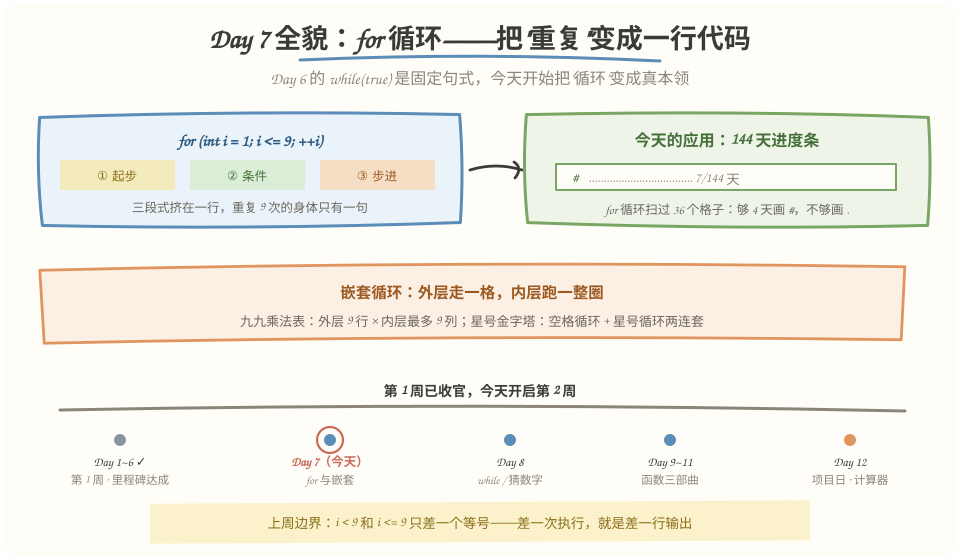
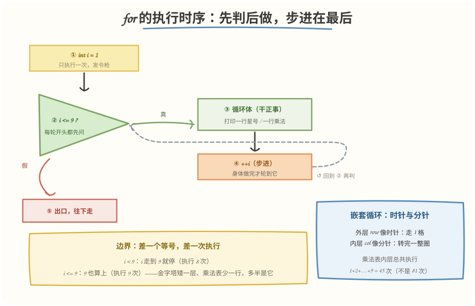
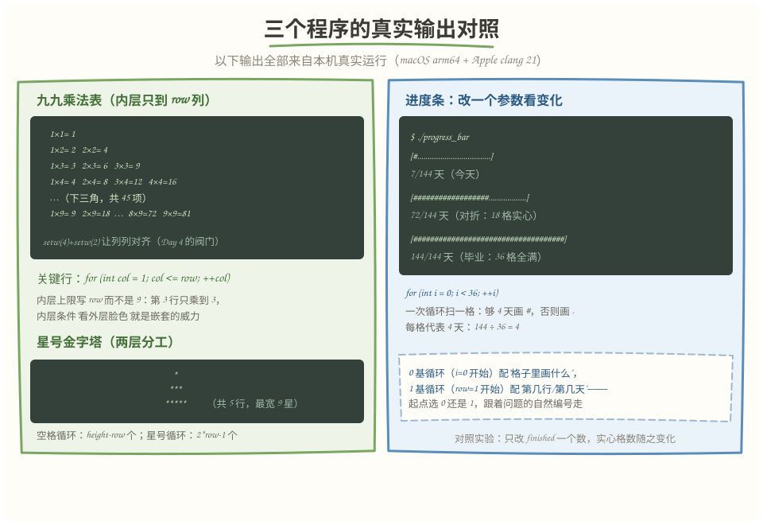

# 第 7 天：for 循环与嵌套循环——把"重复"变成一行代码

> **今日目标**：完成本教程后，你能做到：按顺序说出 for 三段式的执行时序；预测 `i < n` 与 `i <= n` 的执行次数差异；用嵌套循环独立写出九九乘法表和星号金字塔；解释内层循环条件"看外层脸色"的写法。
> **预计时间**：学习 25 分钟＋实践 45 分钟
> **前置准备**：完成 Day 1~6；记得 Day 6 里 `while (true)` 那个"固定句式"——今天开始把它变成真本领。
> **今日产出**：九九乘法表、星号金字塔，和一个能改参数观察变化的 144 天进度条程序。

## 1. 今天解决什么问题？

Day 6 的换算器里有一句 `while (true)`，当时只背形状不讲原理。今天正面回答：**程序怎么把"同一件事做 N 遍"写成一行**？以及它的高级形态：**一件事的每一遍里还嵌着另一件小事**（每行乘法里要打若干个算式、金字塔每行要先打空格再打星号）。

今天三个产出全部围绕这条主线：九九乘法表（嵌套循环的经典）、星号金字塔（两层循环分工）、学习计划进度条（单层循环的实用应用——进度条会陪着接下来 137 天的每一天）。

## 2. 先看全貌：今天的内容位于哪里？



**图 1**：左上是 for 的三段式——起步（发令枪）、条件（每轮先问）、步进（身体做完才轮到）。右上是今天的明星应用：144 天进度条，`[#...........................]` 里每个格子都由一次循环画出。下方橙色卡预告今天的重头戏：嵌套循环。路线图显示第 1 周收官，今天开启第 2 周（循环与函数）。

三步概括今天：

1. for 把"重复 N 次"压缩成 `for (int i = 1; i <= N; ++i) { ... }`；
2. 执行时序固定：起步一次 → 条件 → 身体 → 步进 → 再条件……条件为假才出门；
3. 嵌套 = 外层走一格、内层转一整圈。

## 3. 核心概念：先用直觉，再给准确定义

### 3.1 for 三段式：一行写完"重复"

- **一句通俗解释**：`for (A; B; C)` 里，A 是发令枪（只响一次），B 是每轮开跑前的资格审查，C 是每轮跑完后的例行打卡。
- **一个类比**：操场跑 9 圈——起跑线集合一次（A），每圈出发前问"够 9 圈了吗"（B），每跑完一圈计圈器 +1（C）。
- **对应到技术上是**：`for (int i = 1; i <= 9; ++i)` 的执行顺序是 `int i = 1` 一次 → 判 `i <= 9` → 身体 → `++i` → 再判……直到条件为假。类比的边界：计圈器自动 +1，而 `++i` 是**身体执行完之后**才做——把步进想象成"跑完才计圈"，顺序就锁死了。
- **最小例子**：`for (int i = 0; i < 5; ++i) std::cout << "*";` 打印 5 个星号。
- **常见误解**：以为条件为假时身体还会再执行一次"收尾"——不会，条件为假直接出门，身体一次都不多跑。

### 3.2 边界与起点：差一个等号，差一次执行

- **一句通俗解释**：`i < 9` 是"到 9 就停"（跑 8 次），`i <= 9` 是"9 也算上"（跑 9 次）。
- **一个类比**：电影院第 9 排之前坐 vs 第 9 排也算——一字之差，一排之差。
- **对应到技术上是**：金字塔矮一层、乘法表少一行，八成是这里差了个 `=`。另一个同源问题是从 0 还是从 1 起：本机 144 天进度条扫格子用 `i = 0`（格子天然 0 基），打印"第几天"用 `row = 1`（人类天然 1 基）。类比的边界：两个起点都合法，**跟着问题的自然编号走**才不容易错。
- **最小例子**：`for (int i = 0; i < 36; ++i)` 恰好执行 36 次，不多不少。
- **常见误解**：背"循环从 0 开始"——错，起点是你自己写的 `int i = ?`。

### 3.3 嵌套循环：时针与分针

- **一句通俗解释**：外层循环每走一步，内层循环完整转一圈。
- **一个类比**：时针（外层）走一格，分针（内层）转满 60 格；时针走完 12 格，分针共转了 720 格。
- **对应到技术上是**：外层 `row` 控制行，内层 `col` 控制列；内层执行总数 = 各轮内层次数之和。九九乘法表内层上限写 `col <= row`（第 3 行只乘到 3），总执行次数是 1+2+…+9 = **45 次**，不是 9×9 = 81 次。类比的边界：分针转圈时长固定，而内层次数可以**每轮不同**——上限"看外层的脸色"正是乘法表下三角的秘密。
- **最小例子**：`for (row) { for (col <= row) { 打印一项 } 换行 }`——换行放在内层结束之后、外层身体之内。
- **常见误解**：换行写错位置——写在内层里每项都换行（变竖排），写在外层外整表只有一行。

## 4. 图解核心机制



**图 2**：左边按 ①②③④⑤ 追踪一次完整循环：`int i = 1` 只执行一次；绿色菱形每轮先判；身体做完才橙色步进；虚线箭头回到菱形再判；红色"假"箭头通向唯一出口。右边蓝卡是嵌套的时针分针模型，附上乘法表内层 45 次的账本。下方黄卡是今天的头号陷阱：`<` 与 `<=` 的一字之差。

按图逐步讲：

1. **先判后做**：条件为假时身体一次都不执行（连第一次也不）——`for (int i = 10; i < 9; ++i)` 的身体 0 次；
2. **步进在最后**：身体和步进严格轮流，中间不会插队；
3. **嵌套看账本**：估算内层总次数（1+2+…+9 = 45），能帮你预判输出规模，也是第 2 周末算法效率的启蒙；
4. **换行的位置**是嵌套结构的一部分：外层身体 = [内层整圈 + 换行]。

## 5. 动手实践：完成一个最小可运行例子

### 5.1 准备文件

```bash
cd ai-compiler-roadmap/tutorials/day-007/examples
```

### 5.2 编写代码

九九乘法表 `mult_table.cpp`（完整代码）：

```cpp
#include <iostream>
#include <iomanip>

// 九九乘法表：嵌套循环的经典
int main() {
    for (int row = 1; row <= 9; ++row) {          // 外层：第几行
        for (int col = 1; col <= row; ++col) {    // 内层：这一行乘到几
            std::cout << std::setw(4) << col << "×" << row << "="
                      << std::setw(2) << row * col;
        }
        std::cout << std::endl;                   // 一行打完才换行
    }
    return 0;
}
```

三个关键点：内层上限是 `row` 不是 9（下三角）；`setw` 让列对齐（Day 4 阀门复用）；换行在内层结束之后。星号金字塔 `star_pyramid.cpp` 和进度条 `progress_bar.cpp` 的完整代码都在本目录——金字塔是"空格循环 + 星号循环"两连套，进度条是"单层循环 + 双分支画格子"。

### 5.3 运行与观察

```bash
g++ -Wall mult_table.cpp -o mult_table && ./mult_table
```

实际执行结果（本机，节选）：

```text
   1×1= 1
   1×2= 2   2×2= 4
   1×3= 3   2×3= 6   3×3= 9
   1×4= 4   2×4= 8   3×4=12   4×4=16
   …
   1×9= 9   2×9=18   3×9=27   4×9=36   5×9=45   6×9=54   7×9=63   8×9=72   9×9=81
```

```bash
g++ -Wall star_pyramid.cpp -o star_pyramid && ./star_pyramid
```

```text
    *
   ***
  *****
 *******
*********
```



**图 3**：左边是乘法表的列对齐细节（`setw(4)` 垫出等号前的空隙）和金字塔的两层分工（空格 `height-row` 个、星号 `2*row-1` 个）；右边是进度条的三个参数版本——今天的对照实验主角。

### 5.4 修改一个参数再观察：进度条长大

```bash
g++ -Wall progress_bar.cpp -o progress_bar && ./progress_bar
```

只改 `finished` 一个数，三个版本的真实输出（本机）：

```text
finished = 7   →  [#...................................]  7/144 天
finished = 72  →  [##################..................] 72/144 天
finished = 144 →  [####################################] 144/144 天
```

同一个 36 格的条，实心格数 `finished * 36 / 144` 随参数变化：7 天占 1 格，72 天恰好半条 18 格，144 天满格。**每格代表 4 天**（144÷36）——想加分辨率就把 `bar_width` 调大，代价是终端宽度，这也是真实工程里的取舍。这个程序建议留着：以后每天学完，改一个数字看条变长，是最好的正反馈。

## 6. 常见错误与排查

**错误 1：循环多跑或少跑一次（off-by-one）**

- 现象：金字塔 5 行只打出 4 行，或乘法表多出一行 `1×10=10`；
- 原因：`<=` 写成 `<`（少一次）或 `<` 写成 `<=`（多一次）；
- 定位：在身体里打印 `i`（`std::cout << "i=" << i`）看实际跑到几；
- 修复：口诀"到 n 就停用 `<`，n 也算上用 `<=`"；改完重新数输出行数。

**错误 2：内层循环的变量写错成外层的（或反之）**

- 现象：乘法表变成全等的方阵，或编译报 `expected ')'`；
- 原因：内层上限写成了常量 9（方阵），或内外层共用了同一个变量名 `i`（互相踩踏，`-Wshadow` 会给 shadow 警告——仅 `-Wall` 不够，Day 11 会展开）；
- 定位：检查内外层变量名和内层条件里的变量；
- 修复：外层 `row`、内层 `col` 命名分开，内层条件 `col <= row`。

**错误 3：嵌套里忘了换行或换行位置不对**

- 现象：所有数字挤在一行，或每个数字独占一行；
- 原因：`std::endl` 写在内层身体里（每项一换）或写在外层循环之后（全部打完才一换）；
- 定位：盯着 `endl` 的花括号层级数一遍；
- 修复：换行放在"内层结束之后、外层身体之内"——一行的事干完才换行。

## 7. 今日练习

### 必做练习

把金字塔改造成"数字金字塔"：第 1 行打 1 个 1，第 2 行打 2 个 2……第 5 行打 5 个 5（保持居中的空格缩进）。预期产出：5 行数字塔 + 代码，抄进 `notes.md` 并标注内外层各控制什么。

### 选做挑战

把进度条改成"双进度条"：一行显示学习进度（finished 天），下一行显示本周进度（今天在一周 7 天里的位置）。提示：两个 for 各画一条；周条的格子数自定，但要注明每格代表几天。完成后你会得到一个能天天用的学习仪表盘雏形——Day 12 项目日会把它变成计算器的一部分素材。

## 8. 今日验收

- [ ] 我能不看图默画 for 三段式的执行时序，说清"先判后做、步进最后"
- [ ] 我能预测 `i < 5`、`i <= 5`、`i = 0; i < 5` 各执行几次
- [ ] 我独立写出了九九乘法表（下三角、列对齐）和星号金字塔
- [ ] 我能解释内层条件 `col <= row` 为什么能形成下三角，并算出内层总次数 45
- [ ] 我保存了进度条程序并实测了至少三个参数版本

## 9. 一句话总结与明天预告

今天的问题是"重复怎么写成一行"；机制上，for 三段式按"起步→条件→身体→步进"的固定时序运转，嵌套循环外走一格内转一圈；实践上，乘法表、金字塔、进度条三个程序各自验证了一种典型结构；验证标准是输出行数、列数和实心格数都与手算一致。明天 **Day 8：while / do-while 与 break / continue**——猜数字游戏登场，Day 6 埋的 `while (true)` 句式将得到完整原理，随机数也会第一次露面。
