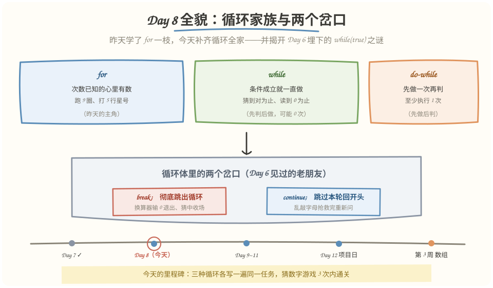
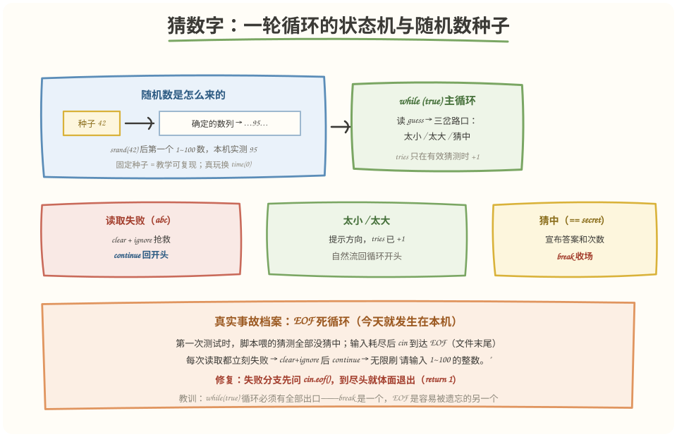
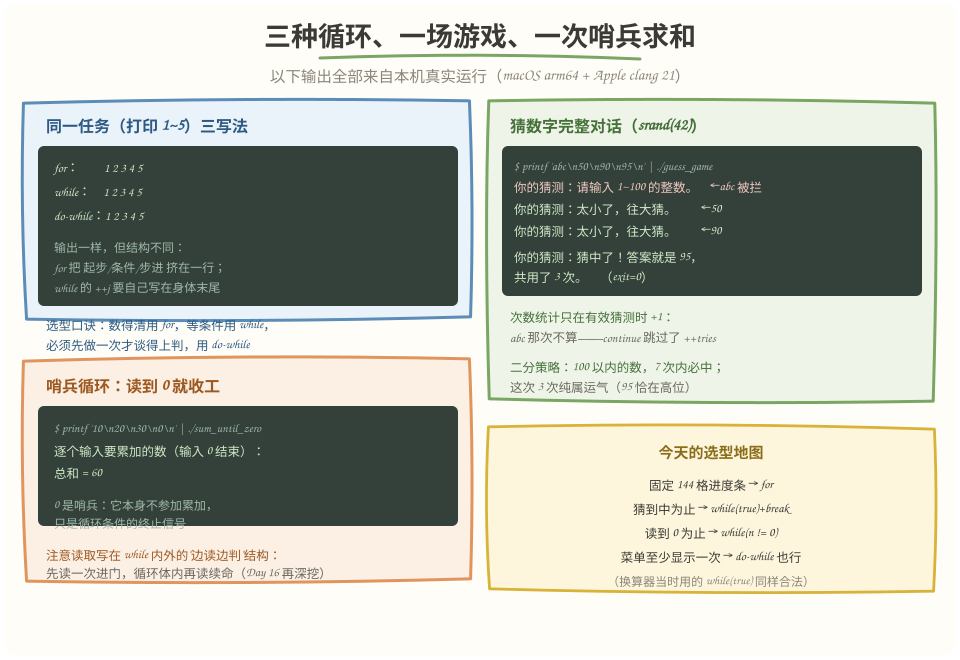

# 第 8 天：while / do-while 与 break / continue——猜数字游戏

> **今日目标**：完成本教程后，你能做到：说出 for / while / do-while 的分工口诀并各写一遍同一任务；解释 break 与 continue 的区别；用 `srand`+`rand` 生成随机数并说明固定种子的意义；说出 while(true) 循环的两个出口（break 和 EOF）缺一不可。
> **预计时间**：学习 25 分钟＋实践 45 分钟
> **前置准备**：完成 Day 7（for 三段式时序）；记得 Day 6 换算器里的 `while (true)` 固定句式——今天揭底。
> **今日产出**：一个带次数统计、输入防护、EOF 保护的猜数字游戏，和三种循环的同任务对照。

## 1. 今天解决什么问题？

昨天 for 一枝独秀，但"猜到对为止""读到 0 为止"这类**次数未知**的重复它写起来别扭。今天的问题是：**循环家族还有哪些成员，各自适合什么场合**？以及一个严肃的问题：**`while (true)` 这种"永远循环"怎么保证出得去**——教程编写过程中本机就真实踩了一次死循环（后面会完整复盘）。

主角是计划指定的练习：猜数字游戏（随机数 + 次数统计）。它会综合今天全部知识点：while 主循环、if 三岔路、break 收场、continue 处理乱输入、EOF 保护。

## 2. 先看全貌：今天的内容位于哪里？



**图 1**：上面三张卡片是循环三兄弟——for（数得清）、while（等条件）、do-while（先做一次再判）。下面灰色大卡是循环体里的两个岔口：`break` 彻底跳出（Day 6 换算器输 0 退出）、`continue` 跳过本轮回开头（抢救乱输入后重新问）——Day 6 的固定句式今天全部认领完毕。

三步概括今天：

1. 三种循环表达同一种"重复"，区别只在**何时判条件**；
2. break / continue 是循环体内的岔口，一个出走、一个回头；
3. `while (true)` 是"条件恒真"的特例，出口必须自己造。

## 3. 核心概念：先用直觉，再给准确定义

### 3.1 while：条件循环

- **一句通俗解释**：`while (条件)` 就是"只要条件还成立，就一直做"。
- **一个类比**：自助餐厅门口排队——只要队里还有人（条件成立）就继续放行，队空了就停。
- **对应到技术上是**：先判后做，条件为假时身体**一次都不执行**（队一开始就空，直接收摊）。Day 7 的 for 本质上就是 while 加了起步和步进的外挂。类比的边界：排队人数会自己变，而 while 的条件里**必须有变量在身体里被改变**，否则永远真或永远假。
- **最小例子**：`while (n != 0) { sum += n; std::cin >> n; }`——读到 0 就停的哨兵循环。
- **常见误解**：身体里忘了更新条件变量（忘了 `++i` 或忘了再读入），循环永不结束。

### 3.2 do-while：先做后判

- **一句通俗解释**：`do {...} while (条件);` 先干一轮，干完再问"还继续吗"。
- **一个类比**：试吃——先尝一口（必须的），好吃再买整份（条件决定后续）。
- **对应到技术上是**：身体**至少执行一次**，这是它和 while 的唯一本质区别。类比的边界：如果第一轮就可能不该做（比如用户直接输入 0），do-while 就会把不该做的做一遍——先做后判是双刃剑。
- **最小例子**：打印 1~5 的 do-while 版本，输出与 for/while 完全相同（真实输出见 5.3）。
- **常见误解**：忘了 do-while 末尾的**分号**——`while (k <= 5)` 后面必须有 `;`，漏了编译报错。

### 3.3 随机数：种子与伪随机

- **一句通俗解释**：`rand()` 产出的是"伪随机数"——由种子（seed）决定的一条固定数列。
- **一个类比**：抽奖箱里其实是一本写好号码的书，`srand(42)` 就是翻到第 42 版；同一版翻出来的序列永远相同。
- **对应到技术上是**：`std::srand(42)` 播种后，`std::rand() % 100 + 1` 产生 1~100 的数；本机实测第一个数是 **95**。类比的边界：这本书不是真随机——安全相关场景绝不能用 `rand()`（现代 C++ 有 `<random>`，进阶阶段介绍）。
- **一个工程取舍**：教程用固定种子 42 换来**可复现**（同一平台、同一 C 库下你跑也是 95；`rand()` 的数列随 libc 实现而异，换平台数字会变但程序行为不变）；真玩游戏换 `std::time(nullptr)` 当种子，每局不同。
- **常见误解**：以为 `% 100` 得到 1~100——它是 0~99，所以必须 `+1`。

## 4. 图解核心机制



**图 2**：左上蓝卡是随机数的来源：种子 42 → 确定数列 → 本机第一个数 95。右边绿卡是主循环状态机：读 guess → 三岔路（太小/太大/猜中）。下排三张卡是三种命运：失败走 clear+ignore+continue；偏了走提示自然回流；猜中走 break 收场。底部橙卡是今天的**真实事故档案**——必须完整读一遍。

按图逐步讲：

1. **次数统计的位置有讲究**：`++tries` 放在读取成功之后、比较之前——乱输入被 continue 拦走，不会虚增次数；
2. **三岔路覆盖所有情况**：太小/太大/猜中，`if / else if / else` 一条不漏（Day 5 瀑布的复习）；
3. **EOF 是第二出口**：管道喂完或用户按 Ctrl+D 时，`cin` 到达文件末尾（EOF），每次读取都立刻失败。失败分支里若只做 clear+ignore，就会无限刷提示——本机真实踩坑，修复是先问 `std::cin.eof()`，到尽头就 `return 1` 体面退场；
4. **while(true) 的契约**：条件恒真，出口全靠自己在身体里造。break 是明门，EOF 是暗门，**两扇都要锁好**。

## 5. 动手实践：完成一个最小可运行例子

### 5.1 准备文件

```bash
cd ai-compiler-roadmap/tutorials/day-008/examples
```

三个程序：三写法对照 `loop_compare.cpp`、主角 `guess_game.cpp`、哨兵求和 `sum_until_zero.cpp`。环境不变（macOS 27，Apple clang 21）。

### 5.2 编写代码

主角 `guess_game.cpp`（完整代码）：

```cpp
#include <iostream>
#include <cstdlib>

// 第 8 天主线例子：猜数字游戏（随机数 + 次数统计）
// 注意：srand(42) 是固定种子——每次运行答案都相同，方便教学复现；
// 想要每局不同，把 42 换成 std::time(nullptr)（<ctime> 头文件）
int main() {
    std::srand(42);                             // 播下随机种子
    int secret = std::rand() % 100 + 1;         // 1 ~ 100 的随机数
    int guess = 0;
    int tries = 0;

    std::cout << "我想好了一个 1~100 的数，猜猜看！" << std::endl;
    while (true) {
        std::cout << "你的猜测：";
        if (!(std::cin >> guess)) {             // 乱敲字母：抢救后重来
            if (std::cin.eof()) {               // 输入流已到尽头（如管道喂完）
                std::cout << "\n输入结束，还没猜中就散场了。" << std::endl;
                return 1;
            }
            std::cin.clear();
            std::cin.ignore(10000, '\n');
            std::cout << "请输入 1~100 的整数。" << std::endl;
            continue;
        }

        ++tries;                                // 有效猜测才计数
        if (guess < secret) {
            std::cout << "太小了，往大猜。" << std::endl;
        } else if (guess > secret) {
            std::cout << "太大了，往小猜。" << std::endl;
        } else {
            std::cout << "猜中了！答案就是 " << secret
                      << "，共用了 " << tries << " 次。" << std::endl;
            break;                              // 命中，退出循环
        }
    }
    return 0;
}
```

结构对照 Day 6 换算器：`while (true)` 外壳、`if (!(cin >> ...))` 抢救、switch/if 三岔路、break 出口——零件全认识，只是这次每一段你都知道**为什么**。

### 5.3 运行与观察

三种循环的同任务对照（`loop_compare.cpp`）：

```bash
g++ -Wall loop_compare.cpp -o loop_compare && ./loop_compare
```

实际执行结果（本机）：

```text
== for（已知次数首选） ==
1 2 3 4 5 
== while（先判后做） ==
1 2 3 4 5 
== do-while（先做后判，至少一次） ==
1 2 3 4 5 
```

三行输出一模一样——区别全在结构：for 把三段挤一行，while 的 `++j` 要自己写，do-while 保证至少做一次。

再跑主角（本机真实执行；答案 95 来自固定种子 42，同一平台同一 C 库下你跑也是 95）：

```bash
g++ -Wall guess_game.cpp -o guess_game
printf 'abc\n50\n90\n95\n' | ./guess_game
```

```text
我想好了一个 1~100 的数，猜猜看！
你的猜测：请输入 1~100 的整数。
你的猜测：太小了，往大猜。
你的猜测：太小了，往大猜。
你的猜测：猜中了！答案就是 95，共用了 3 次。
```

`exit=0`。注意次数是 3 不是 4——`abc` 被 continue 拦下，没走到 `++tries`。



**图 3**：左上是三写法对照；右边是游戏完整战报（abc 被拦、50/90 偏小、95 命中）；左下是哨兵循环：读到 0 停，0 本身不参加累加；右下黄卡是今天的选型地图——四类任务各配哪种循环。

最后是哨兵求和（`sum_until_zero.cpp`）：

```bash
g++ -Wall sum_until_zero.cpp -o sum_until_zero
printf '10\n20\n30\n0\n' | ./sum_until_zero
```

```text
逐个输入要累加的数（输入 0 结束）：
总和 = 60
```

### 5.4 修改一个参数再观察：换种子，换命运

把 `std::srand(42)` 改成 `std::srand(7)` 再编译运行，还是喂 `50`（本机真实输出）：

```text
我想好了一个 1~100 的数，猜猜看！
你的猜测：猜中了！答案就是 50，共用了 1 次。
```

同一个 `50`，种子 42 时被判"太小"（答案 95），种子 7 时一击命中（答案恰好是 50）——**数列换了，同一个输入的命运就换了**。想每局都换，就用 `std::srand(std::time(nullptr))`（记得 `#include <ctime>`）。这也解释了为什么教程坚持固定种子：可复现是教学的生命线。

## 6. 常见错误与排查

**错误 1：EOF 死循环（本机今天的真实事故）**

- 现象：管道喂入结束后，程序无限刷"请输入 1~100 的整数。"；
- 原因：cin 到达 EOF 后每次读取立刻失败，clear+ignore 后 continue 回到开头，又立刻失败——死循环；
- 定位：观察刷屏内容是不是同一句提示；在失败分支打印 `std::cin.eof()`（EOF 时为 1）确认；
- 修复：失败分支先判 `if (std::cin.eof()) return 1;`。真实交互里用户按 Ctrl+D 也会触发同一场景。

**错误 2：do-while 末尾漏分号**

- 现象：`} while (k <= 5)` 后面没写 `;`，编译报 `expected ';'`；
- 原因：do-while 是语句，必须以分号收尾；
- 定位：看报错行号指向的位置；
- 修复：补 `;`。这是 do-while 独有的坑，for 和 while 都没有。

**错误 3：循环体里忘了更新条件变量**

- 现象：while 版打印 1~5 的程序只打 `1 1 1 1 1 ...` 停不下来；
- 原因：身体里漏写 `++j`，条件 `j <= 5` 永远成立；
- 定位：在身体里打印循环变量，看它是否纹丝不动；
- 修复：确认身体里至少有一处改变条件变量（计数、读入或 break）。

## 7. 今日练习

### 必做练习

给猜数字游戏加"猜数上限"：最多 7 次机会（`tries >= 7` 且未猜中时输出"机会用完，答案是 X"并退出）。提示：在 else 分支里先判次数再判大小，或者把 while(true) 改成 `while (tries < 7)`——两种都试，记录输出差异到 `notes.md`。预期产出：一局 7 次耗尽的完整对话。

### 选做挑战

把猜数字改造成"人机互换"：你心里想一个 1~100 的数，程序用二分法猜，你输入 `h`（太大了）/`l`（太小了）/`y`（对了）作答（`char` 读入 + switch）。做完你会亲身体会二分为什么 7 次必中——顺便给 Day 3 的逻辑运算和今天的 do-while 都来一次综合复习。

## 8. 今日验收

- [ ] 我能默写三种循环的分工口诀，并把同一任务各写一遍
- [ ] 我能解释 break 与 continue 的区别，各指出今天代码里的一处使用
- [ ] 我能说出 srand 固定种子和 time 种子的取舍，并演示换种子后答案变化
- [ ] 我能复述 EOF 死循环的成因和修复方法，并指出自己的程序里哪扇"暗门"可能漏锁
- [ ] 我保存了带次数统计与完整防护的猜数字游戏

## 9. 一句话总结与明天预告

今天的问题是"次数未知的重复怎么写、怎么停"；机制上，三兄弟只在判条件的时机上分家，break/continue 是体内的两个岔口，EOF 是容易被遗忘的第二出口；实践上，猜数字游戏三猜通关、哨兵求和正确收 60，还复盘了一次真实的 EOF 死循环事故；验证标准是三种循环同任务输出一致、游戏对乱输入和输入耗尽都有体面回应。明天进入 **Day 9：函数——定义、值传递、返回值**，把猜数字的"三岔路比较"拆成可复用的小零件，第 2 周从"会循环"迈向"会拆分"。
