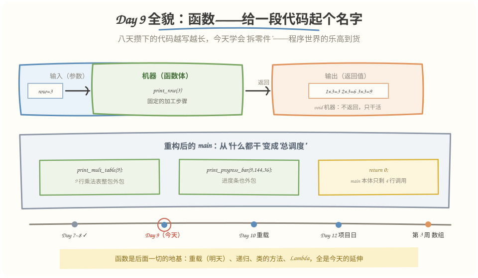
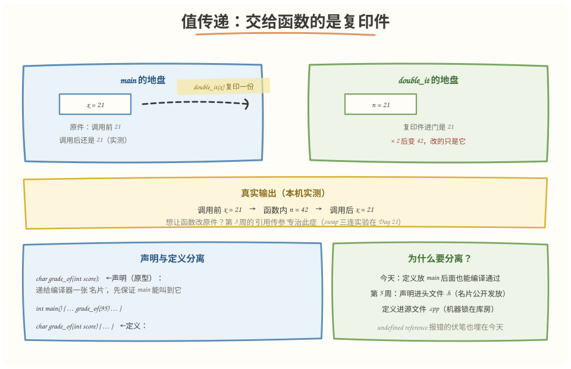
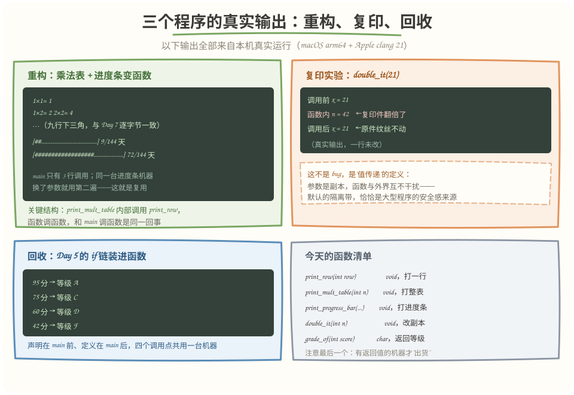

# 第 9 天：函数——给一段代码起个名字

> **今日目标**：完成本教程后，你能做到：独立定义带参数和返回值的函数；用"值传递是复印件"解释为什么函数内改参数不影响外界；把 Day 7 的乘法表和进度条重构进函数；说出声明（原型）和定义的区别及分离写法。
> **预计时间**：学习 25 分钟＋实践 45 分钟
> **前置准备**：完成 Day 1~8；手边留着 Day 7 的乘法表代码（今天要重构它）。
> **今日产出**：一份重构后的"函数版"乘法表＋进度条，一个值传递复印实验，一个有返回值的 `grade_of` 函数。

## 1. 今天解决什么问题？

到昨天为止，所有代码都挤在 `main` 一个函数里——八天攒下来，main 越来越像一个什么都自己干的老板。今天的问题是：**怎么把一段会反复用到的代码打包成一个"零件"，起个名字，随叫随到**？

计划指定的练习正好是检验：把乘法表重构为函数。重构（refactor）的意思是**功能不变、结构变好**：重构后输出和 Day 7 逐字节一致，但 main 从三十行变成三行调用。另外还要回收 Day 5 的成绩判定 if 链——装进函数后它变成一台"输入分数、吐出等级"的机器。

## 2. 先看全貌：今天的内容位于哪里？



**图 1**：上面三张卡片是一台函数机器的解剖：输入（参数 `row=3`）→ 加工（函数体 `print_row`）→ 输出（返回值；`void` 机器只干活不返回）。下面的灰色大卡是重构后的 main：三行调用，把乘法表和进度条整包"外包"。路线图：第 2 周函数三部曲（Day 9~11）开篇。

三步概括今天：

1. 定义函数：`返回类型 名字(参数表) { 身体 }`；
2. 调用函数：`名字(实参)`——实参被**复制**给形参（值传递）；
3. 声明与定义可以分离：先递"名片"（原型），机器后到。

## 3. 核心概念：先用直觉，再给准确定义

### 3.1 函数：命名的小机器

- **一句通俗解释**：函数（function）是把一段固定流程打包、起名、留出输入口的代码零件。
- **一个类比**：全自动豆浆机——倒进豆子（参数），按下开关（调用），机器按固定流程加工，出豆浆（返回值）。你不需要每次都研究它内部怎么转。
- **对应到技术上是**：`void print_row(int row)` 里，`void` 是不返回东西的机器；`char grade_of(int score)` 里，`char` 是返回一个字符的机器，身体里 `return 'A';` 就是出货口。类比的边界：豆浆机只能放豆子，而函数参数可以是任意类型组合、数量也可以是零个或多个。
- **最小例子**：`print_progress_bar(72, 144, 36)` 一行就画一条进度条——Day 7 里同样的事要写十行。
- **常见误解**："函数必须返回点什么"——`void` 函数只干活不出货（比如打印），同样常用。

### 3.2 值传递：复印件进厂

- **一句通俗解释**：调用函数时，实参的值被**复制一份**交给形参——函数拿到的是复印件，改烂了原件也无损。
- **一个类比**：把身份证复印件交给办证窗口——窗口在复印件上怎么涂改，你家里的原件不受影响。
- **对应到技术上是**：`double_it(x)` 时新建变量 `n`，把 `x` 的值抄进去；函数返回后 `n` 连同复印件一起销毁。本机实测：调用前 `x=21`，函数内 `n` 变 42，调用后 `x` 还是 21。类比的边界：复印件对"防止误改原件"是保护，但当你**就是想**让函数改原件（比如 swap 两个数）时，它就成了障碍——第 3 周的引用传参专治此症，Day 21 做 swap 三连实验。
- **最小例子**：见 5.3 的复印实验。
- **常见误解**："我在函数里把 n 改成 42 了，x 怎么没变"——没变才是对的，变了才要报警。

### 3.3 声明与定义分离：名片和机器

- **一句通俗解释**：声明（原型）是递给编译器的名片——"有这台机器，长这样"；定义是机器本体——"步骤全在这里"。
- **一个类比**：餐厅菜单上写着"本店供应拉面"（声明），后厨的面灶在另一处（定义）。点单只看菜单，不必进后厨。
- **对应到技术上是**：`char grade_of(int score);` 以分号结尾就是声明；带 `{ ... }` 的才是定义。main 里调用时编译器只需见过名片。类比的边界：名片可以发很多张（头文件里放声明，第 5 周正式做），**机器只能造一台**——同一函数定义两次会报 `redefinition` 错误。
- **最小例子**：`grade_function.cpp` 的结构——声明在文件头，main 在中间，定义在最后。
- **常见误解**："定义写在 main 后面就找不到"——只要 main 之前有声明，后置定义完全合法；真正找不到的是**连声明都没有**（报 `use of undeclared identifier`）。

## 4. 图解核心机制



**图 2**：上半部分是复印过程：左边 main 的地盘里 `x = 21` 是原件，调用 `double_it(x)` 时复印一份交给右边的 `n`；函数内 `n` 翻倍成 42，黄框里是三行真实输出——**原件自始至终是 21**。下半部分左边是分离结构的三段式（声明 → main 调用 → 定义），右边解释为什么要分离：今天为了定义后置，第 5 周为了拆多文件（声明进 `.h`、定义进 `.cpp`），`undefined reference` 这类链接错误的伏笔也埋在这里。

按图逐步讲：

1. **复印发生在调用的瞬间**：每次调用都复一次印、函数结束后销毁——所以 `print_progress_bar` 能被反复调用且互不干扰；
2. **两个"地盘"是隔离的**：main 看不到 `n`，`double_it` 看不到 `x` 的名字，只见过复印件的值——隔离带正是大型程序不怕互相踩踏的原因；
3. **名片先到、机器后到**：编译器从上往下读文件，见到调用时只核名片；机器本体在哪、甚至在哪**个文件**里，是链接阶段的事（Day 1 四站流水线的第 4 站）；
4. **返回值是函数与外界唯一的"正门出货"**：想交出结果，用 `return`；想改原件，等引用传参。

## 5. 动手实践：完成一个最小可运行例子

### 5.1 准备文件

```bash
cd ai-compiler-roadmap/tutorials/day-009/examples
```

三个程序：重构主角 `refactor_table.cpp`、复印实验 `value_copy.cpp`、回收主角 `grade_function.cpp`。环境不变（macOS 27，Apple clang 21）。

### 5.2 编写代码

重构主角 `refactor_table.cpp`（完整代码）：

```cpp
#include <iostream>
#include <iomanip>

// 打印乘法表的某一行（第 row 行，乘到 row 为止）
void print_row(int row) {
    for (int col = 1; col <= row; ++col) {
        std::cout << std::setw(4) << col << "×" << row << "="
                  << std::setw(2) << row * col;
    }
    std::cout << std::endl;                   // 一行打完才换行
}

// 打印整张 n×n 乘法表
void print_mult_table(int n) {
    for (int row = 1; row <= n; ++row) {
        print_row(row);                       // 函数也可以调用函数
    }
}

// 打印学习进度条：已完成 finished / 共 total，条宽 bar_width 格
void print_progress_bar(int finished, int total, int bar_width) {
    int full = finished * bar_width / total;
    std::cout << "[";
    for (int i = 0; i < bar_width; ++i) {
        if (i < full) {
            std::cout << "#";
        } else {
            std::cout << ".";
        }
    }
    std::cout << "] " << finished << "/" << total << " 天" << std::endl;
}

int main() {
    print_mult_table(9);                      // main 只剩调度，一眼看懂
    print_progress_bar(9, 144, 36);
    print_progress_bar(72, 144, 36);
    return 0;
}
```

注意三层结构：`main` 调 `print_mult_table`，`print_mult_table` 调 `print_row`——函数调用函数，和 main 调函数是同一回事。重构的判据在 5.3：**输出与 Day 7 完全一致**。

### 5.3 运行与观察

```bash
g++ -Wall refactor_table.cpp -o refactor_table && ./refactor_table
```

实际执行结果（本机，节选）：

```text
   1×1= 1
   1×2= 2   2×2= 4
   …
   1×9= 9   2×9=18   3×9=27   4×9=36   5×9=45   6×9=54   7×9=63   8×9=72   9×9=81
[##..................................] 9/144 天
[##################..................] 72/144 天
```

和 Day 7 对比：九行乘法一字不差，进度条第二次出场（9/144 是 2 格实心）——同一台机器换参数用两遍，这就是复用。接着是复印实验（`value_copy.cpp`，完整代码见本目录）：

```bash
g++ -Wall value_copy.cpp -o value_copy && ./value_copy
```

```text
调用前 x = 21
函数内 n = 42
调用后 x = 21
```

三行输出就是值传递的全部真相。最后是回收主角（`grade_function.cpp`）：

```bash
g++ -Wall grade_function.cpp -o grade_function && ./grade_function
```

```text
95 分 → 等级 A
75 分 → 等级 C
60 分 → 等级 D
42 分 → 等级 F
```



**图 3**：左上是重构战报（输出与 Day 7 一致、main 只剩 3 行调用）；右上橙卡是复印实验的三行铁证；左下是 `grade_of` 的四条产线（Day 5 的 if 链装进机器后，四个调用点共用一台）；右下是今天的函数清单——注意最后一个有返回值，前四个是 `void`。

### 5.4 修改一个输入再观察：进度条换参数

把 main 里最后两行改成 `print_progress_bar(144, 144, 36);` 再编译（本机真实输出）：

```text
[####################################] 168/144 天
```

函数体一行没动，只换实参——144 天毕业当天的满格条就位。这正是函数的用途：**流程写一次，数据喂千遍**。再试试把 `bar_width` 换成 18：每格代表 8 天，9 天占 1 格，条变短了——参数是机器的旋钮，拧一下换个形态。

## 6. 常见错误与排查

**错误 1：`error: use of undeclared identifier 'grade_of'`**

- 现象：调用函数时编译器说不认识这个名字；
- 原因：定义在 main 之后，但 main 之前没有声明——编译器从上往下读，见到调用时名片还没递到；
- 定位：看报错行号，检查调用点之前有没有原型声明；
- 修复：在文件开头加 `char grade_of(int score);`，或把定义整体搬到 main 之前。

**错误 2：`error: non-void function does not return a value`（或返回值类型对不上）**

- 现象：声明返回 `char`，某个分支却忘了 `return`；
- 原因：`if … return …` 链漏了兜底分支，或返回的类型与声明不符；
- 定位：`-Wall` 会直接指出缺 return 的函数；
- 修复：像 `grade_of` 那样最后放一个无条件 `return 'F';` 兜底——每个非 void 函数的每条出路都必须出货。

**错误 3：以为函数改了参数，回来发现"没生效"**

- 现象：在函数里 `n = n * 2`，调用后外面的变量纹丝不动；
- 原因：值传递——改的是复印件（今天的复印实验就是它）；
- 定位：在函数内外分别打印同一个值对比；
- 修复：需要"结果"就用返回值接住（`x = double_it(x);` 风格）；需要"就地修改"等第 21 天的引用传参，本周先记住这是隔离特性而非 bug。

## 7. 今日练习

### 必做练习

把 Day 6 换算器的三个 case 提取成三个函数：`c_to_f(double c)`（返回换算结果）、`km_to_mile(double km)`、`cny_to_usd(double cny)`，main 的 switch 里各用一行调用。预期产出：换算器 v2——功能与 Day 6 完全一致（用同一组输入记录输出对照），main 明显变短，代码抄进 `notes.md`。

### 选做挑战

写一个 `bool is_valid_score(int score)` 函数（范围 0~100 返回真），再让 `grade_of` 的调用点先用它把关、不合法就打印提示。两个函数串联成一条"流水线"——这是第 3 周把整个成绩系统拆成多函数的预演。

## 8. 今日验收

- [ ] 我能不看资料写出"声明在前、定义在后"的完整函数程序
- [ ] 我能用复印件类比解释值传递，并复述 21→42→21 实验的三行输出
- [ ] 我完成了乘法表重构，且输出与 Day 7 逐字节一致
- [ ] 我能说出 void 与有返回值函数的区别，以及 return 的兜底要求
- [ ] 我理解声明与定义分离是为第 5 周多文件做的铺垫

## 9. 一句话总结与明天预告

今天的问题是"重复的流程怎么打包复用"；机制上，函数是命名的小机器——参数复印进厂、返回值正门出货、声明是名片定义是本体；实践上，乘法表重构后输出零变化而 main 缩到三行，复印实验 21→42→21 证明了值传递的隔离性；验证标准是"功能不变的 重构 + 一机多用的复用"。明天 **Day 10：函数重载与默认参数**——同一个名字 `print` 怎么既能打整数又能打小数，`greet` 怎么做到"不传参也有默认问候"，函数家族的便利贴来了。
