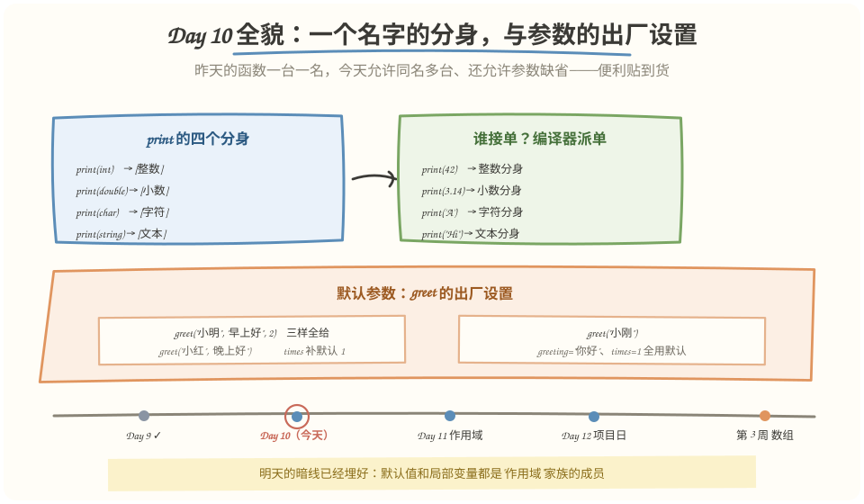
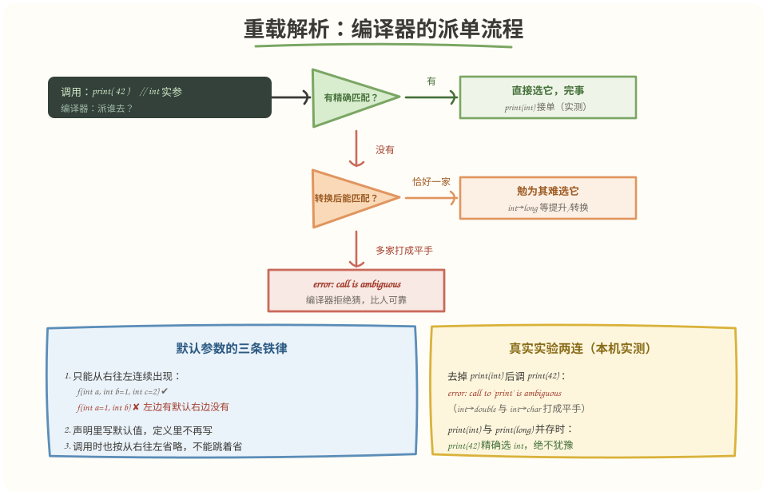
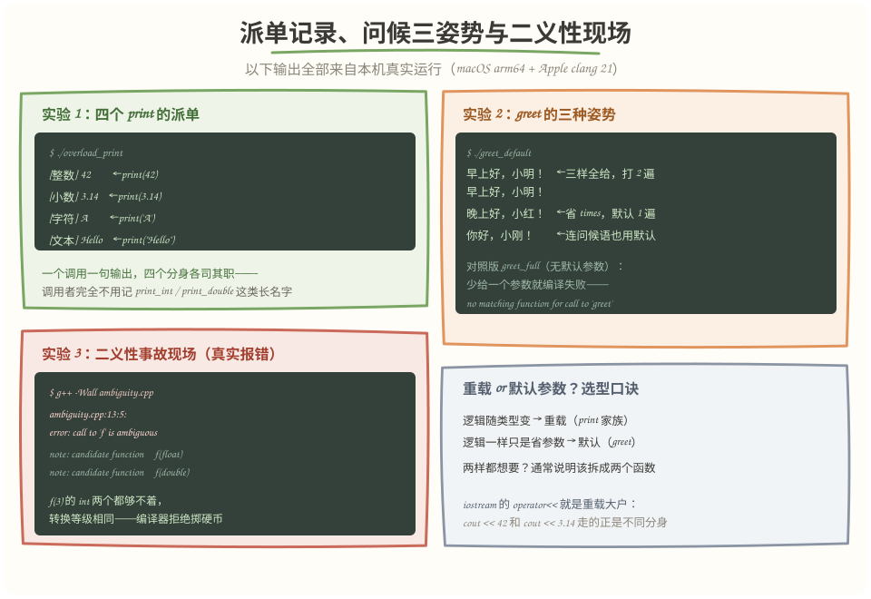

# 第 10 天：函数重载与默认参数——一个名字的分身，参数的出厂设置

> **今日目标**：完成本教程后，你能做到：写出同名不同参的重载函数并预测每个调用命中哪个分身；解释重载解析的"精确匹配优先、平手即报错"规则；给函数参数设默认值并说出三条铁律；判断一个需求该用重载还是默认参数。
> **预计时间**：学习 25 分钟＋实践 40 分钟
> **前置准备**：完成 Day 9（函数定义、值传递、声明与定义分离）。
> **今日产出**：四个 `print` 分身、一个三姿势调用的 `greet`，和一次真实的二义性编译错误记录。

## 1. 今天解决什么问题？

昨天的函数一台一名：想打印不同类型就得记住 `print_int`、`print_double`、`print_char` 一串名字，又长又容易选错。今天解决两个便利性问题：**同一个名字能不能按参数自动派单**（重载 overload）？**常用的参数能不能不写、让函数自己用默认值**（默认参数 default argument）？

你会发现一个惊喜：其实从 Day 1 起你每天都在用重载——`std::cout << 42` 和 `std::cout << 3.14` 走的就是不同分身。今天把这个机制从"用"升级到"造"。

## 2. 先看全貌：今天的内容位于哪里？



**图 1**：左边是 `print` 的四个分身（同名、参数类型不同）；右边是编译器按实参类型派单的记录。下方橙色卡是默认参数：`greet` 的后两个参数带出厂设置，调用时可省略——从右往左省，一次比一次短。路线图：函数三部曲第 2 站，明天收尾。

三步概括今天：

1. 重载：同名函数靠**参数表**区分（类型、个数、顺序）；
2. 解析：编译器按"精确匹配 > 唯一转换 > 报错"派单；
3. 默认参数：参数表**从右往左**连续带默认值，调用时同样从右往左省略。

## 3. 核心概念：先用直觉，再给准确定义

### 3.1 重载：同名不同参

- **一句通俗解释**：重载（overload）让同一个函数名拥有多个版本，编译器看你传什么就派哪个。
- **一个类比**：公司前台一个名字"总机"，你报"找销售"转销售、报"找技术"转技术——名字一个，分机多个。
- **对应到技术上是**：区分重载的是**参数表**（个数、类型、顺序），**返回类型不算数**——只改返回类型会报错。本机实测四分身各接一单：`print(42)→[整数]`、`print(3.14)→[小数]`、`print('A')→[字符]`、`print("Hello")→[文本]`。类比的边界：总机可以人肉模糊判断，编译器只按固定规则精确裁决，裁决不了就直接报错（见 3.2）。
- **最小例子**：`std::cout << 42` 与 `std::cout << 3.14`——`<<` 对不同类型就是不同重载。
- **常见误解**："返回类型不同也算重载"——不算。`int f(int)` 和 `double f(int)` 并存直接编译错误。

### 3.2 重载解析：精确优先，平手报错

- **一句通俗解释**：编译器派单时先找参数**一模一样**的，找不到才考虑"转换后能用"的，如果转换候选打成平手就拒绝猜测。
- **一个类比**：分配快递——地址完全一致的直接派；没有完全一致的看哪家能转送；两家转送费一样又都不认领，退回寄件人。
- **对应到技术上是**：本机两组真实实验——`print(int)` 与 `print(long)` 并存时，`print(42)` 毫不犹豫选 `int`（精确匹配碾压转换）；而**去掉 `print(int)` 后**，`print(42)` 直接报 `call to 'print' is ambiguous`（`int→double` 与 `int→char` 都是"转换"级，平手）。类比的边界：这套规则是**编译期**完成的，零运行时开销——和后面学的多态（运行期拍板）是两码事。
- **最小例子**：见 5.4 的对照实验。
- **常见误解**："ambiguous 是编译器笨"——恰恰是它严谨：宁可停下问你，也不猜。

### 3.3 默认参数：出厂设置

- **一句通俗解释**：参数可以带默认值，调用时不填就自动用默认——像设备的出厂设置。
- **一个类比**：电饭煲有"快煮/精煮/预约"三个旋钮，出厂默认快煮——只按启动键也能煮出饭。
- **对应到技术上是**：`void greet(const std::string& name, const std::string& greeting = "你好", int times = 1)`，三种调用姿势都合法（全给、省一个、只给名字）。类比的边界：旋钮是**按位置**对应的，调用时只能**从右往左省**，不能跳着省（`greet(, "加油", 2)` 不存在这种写法）。
- **三条铁律**：①默认值只能出现在参数表**最右侧且连续**（`f(int a, int b = 1)` ✔，`f(int a = 1, int b)` ✘）；②默认值写在**声明**里，定义里不再写；③调用时按从左往右的顺序给，缺的用默认补。
- **常见误解**：声明和定义里都写默认值——重复定义默认值会报错（`redefinition of default argument`）。

## 4. 图解核心机制



**图 2**：上半部分是派单流程图：调用 `print(42)` → 有精确匹配吗？有就直接选（绿色路径，实测选 `print(int)`）→ 没有则问转换后能匹配吗？恰好一家就勉为其难（橙色路径）→ 多家平手就亮红牌 `error: call is ambiguous`。下半部分左边是默认参数三条铁律；右边黄卡是两组真实实验的结论。

按图逐步讲：

1. **精确匹配是快车道**：类型一字不差直接命中，转换候选根本不看；
2. **转换要分等级**：`int→long`、`int→double`、`int→char` 都是"转换"这一级——两个同级候选就是平手；
3. **平手不是随机选**：而是编译错误。`ambiguity.cpp` 的 `f(float)`/`f(double)` 被 `f(3)` 同时够着，本机报错原文见 5.3；
4. **默认参数与位置强绑定**：从右往左连续出现、调用从右往左省略——两条规则一体两面。

## 5. 动手实践：完成一个最小可运行例子

### 5.1 准备文件

```bash
cd ai-compiler-roadmap/tutorials/day-010/examples
```

四个程序：`overload_print.cpp`（四分身）、`greet_full.cpp`（无默认对照版）、`greet_default.cpp`（默认参数版）、`ambiguity.cpp`（故意的二义性）。环境不变（macOS 27，Apple clang 21）。

### 5.2 编写代码

四分身 `overload_print.cpp`（完整代码）：

```cpp
#include <iostream>
#include <string>

// 第 10 天主角一：三个重载的 print——同一个名字，按参数各就各位
void print(int value) {
    std::cout << "[整数] " << value << std::endl;
}

void print(double value) {
    std::cout << "[小数] " << value << std::endl;
}

void print(char value) {
    std::cout << "[字符] " << value << std::endl;
}

void print(const std::string& value) {
    std::cout << "[文本] " << value << std::endl;
}

int main() {
    print(42);            // 精确匹配 print(int)
    print(3.14);          // 精确匹配 print(double)
    print('A');           // 精确匹配 print(char)
    print("Hello");       // 匹配 print(string)
    return 0;
}
```

（`const std::string&` 这种参数写法今天先照抄——引用传参第 3 周正式讲，现在只需知道它让 string 高效进厂。）默认参数版 `greet_default.cpp` 的关键一行：

```cpp
void greet(const std::string& name, const std::string& greeting = "你好", int times = 1);
```

### 5.3 运行与观察

```bash
g++ -Wall overload_print.cpp -o overload_print && ./overload_print
```

```text
[整数] 42
[小数] 3.14
[字符] A
[文本] Hello
```

```bash
g++ -Wall greet_default.cpp -o greet_default && ./greet_default
```

```text
早上好，小明！
早上好，小明！
晚上好，小红！
你好，小刚！
```

对照版 `greet_full.cpp`（无默认参数）必须三样全给才能编译；少给一个就是 `no matching function for call to 'greet'`。最后是事故现场（**预期编译失败**）：

```bash
g++ -Wall ambiguity.cpp -o ambiguity
```

实际报错（本机）：

```text
ambiguity.cpp:13:5: error: call to 'f' is ambiguous
   13 |     f(3);      // int → float 和 int → double 都是"转换"，不分胜负
      |     ^
ambiguity.cpp:4:6: note: candidate function
    4 | void f(float x) {
      |     ^
ambiguity.cpp:8:6: note: candidate function
    8 | void f(double x) {
      |     ^
1 error generated.
```



**图 3**：左上是四分身的派单记录；右上是 `greet` 三姿势（同一函数、三种长度调用）；左下黑底卡是二义性报错原文——注意两行 `note: candidate function` 把平手双方都列了出来，这就是排查起点；右下是选型口诀。

### 5.4 修改一个参数再观察：拆掉一个分身

把 `overload_print.cpp` 里的 `print(int)` 整个删掉再编译（本机真实结果）：

```text
error: call to 'print' is ambiguous
```

昨天四路畅通的 `print(42)` 突然没人接了——`int→double` 和 `int→char` 两个转换候选打成平手，编译器亮红牌。反过来做加法实验：给 `overload_print.cpp` 再加一个 `print(long)` 分身，`print(42)` 依然选 `[整数]`（精确匹配压过一切转换，本机实测 `[整数] 42`）。**删一分身看出平手陷阱，加一分身看出精确优先**——两次改动，两条规则全部落地。

## 6. 常见错误与排查

**错误 1：`error: call to 'f' is ambiguous`**

- 现象：加了新重载后，原本正常的调用突然编译失败；
- 原因：新候选与旧候选对某个调用打成平手（常见：float/double 并存、int/long 并存后又被整型调用）；
- 定位：读报错下方列出的 `candidate function`，平手双方都在里面；
- 修复：二选一——删掉多余的重载，或把调用处的实参写明确（`f(3.0)` 明确指名 double）。

**错误 2：`error: redefinition of default argument`**

- 现象：声明和定义里都写了 `= "你好"`；
- 原因：默认值只允许出现一次，规范位置是声明；
- 定位：报错会指向第二次出现的位置；
- 修复：定义里删掉默认值，只留参数名。

**错误 3：默认参数放中间导致编译失败**

- 现象：`void f(int a = 1, int b)` 编译报错；
- 原因：铁律①——默认值必须从参数表最右端起连续排列；
- 定位：看报错行参数表，找到"左边有默认、右边没有"的断层；
- 修复：把有默认值的参数整体挪到最右边。

## 7. 今日练习

### 必做练习

给 Day 9 的换算器函数加重载版"菜单打印"：`void show_menu(char style)`，`style='c'` 打中文菜单、`'e'` 打英文菜单（内容自拟，各 4 行）；再给 `print_progress_bar` 加默认参数 `bar_width = 36`，让 `print_progress_bar(72, 144)` 也能编译。预期产出：两种风格菜单的真实输出 + 一次"省略默认参数"的成功调用，抄进 `notes.md`。

### 选做挑战

造一个故意的二义性再修复它：写 `void report(int pages)` 和 `void report(double percent)`，先调 `report(10)` 验证能编译（精确匹配），再删掉 `report(int)` 看它是否变二义性（本篇 5.4 已验证过类似情形，注意 `int→double` 只剩一家时**不会**二义——想想为什么，再用实验证明）。

## 8. 今日验收

- [ ] 我能写出同名不同参的重载，并预测每个调用命中哪个分身
- [ ] 我能复述派单规则：精确匹配优先、平手报 ambiguous、报错里的 candidate 是排查起点
- [ ] 我能默写默认参数三条铁律，并解释"从右往左"为什么不可违反
- [ ] 我亲手制造并读懂了一次二义性编译错误
- [ ] 我能判断一个需求该用重载（逻辑随类型变）还是默认参数（只是省参数）

## 9. 一句话总结与明天预告

今天的问题是"名字能不能少记几个、参数能不能少写几个"；机制上，重载靠参数表区分、编译器按精确优先派单、平手即报错，默认参数从右往左补出厂设置；实践上，四分身各接一单、greet 三姿势全部命中、二义性事故现场完整记录；验证标准是每次调用前能预测命中谁。明天 **Day 11：作用域与生命周期、static 局部变量**——函数体内的变量活多久、谁能看见谁，调用计数器实验会揭示"每次调用都归零"和"static 记住上次"的差别，函数三部曲收官。
