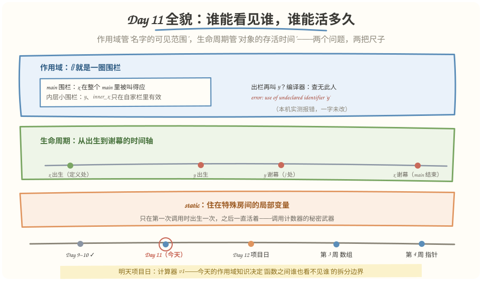
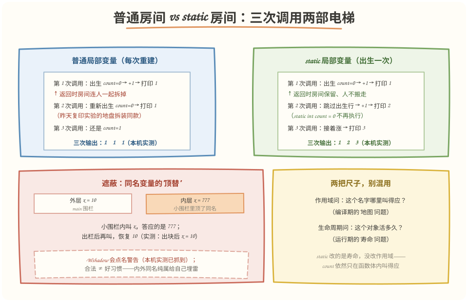
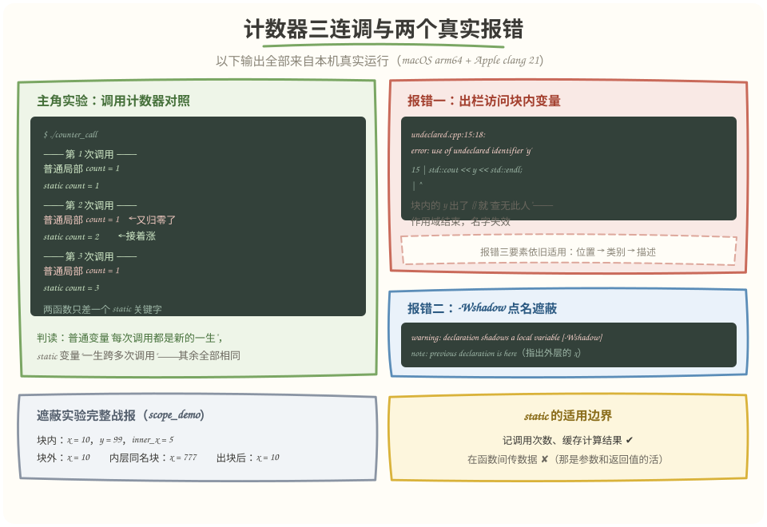

# 第 11 天：作用域与生命周期——谁能看见谁，谁能活多久

> **今日目标**：完成本教程后，你能做到：说出作用域和生命周期分别回答什么问题；解释块内变量出 `{}` 后为何报 `undeclared identifier`；演示内层同名变量的遮蔽行为并用 `-Wshadow` 抓出来；用"调用计数器对照实验"讲清普通局部变量和 static 局部变量的区别。
> **预计时间**：学习 25 分钟＋实践 40 分钟
> **前置准备**：完成 Day 9~10（函数、值传递——今天会反复引用"地盘"和"复印"的比喻）。
> **今日产出**：一个三块合一的作用域演示程序、一个计数器对照程序，和两条真实报错/警告记录。

## 1. 今天解决什么问题？

Day 9 的复印实验里说过"main 和函数各有各的地盘"。今天把"地盘"说精确：**作用域（scope）管名字的可见范围，生命周期（lifetime）管对象的存活时间**——两个常被混为一谈的概念，其实是两把不同的尺子。

今天还要回答一个工程味十足的问题：`static int count = 0;` 只比 `int count = 0;` 多一个关键字，为什么三次调用的输出一个是 `1 1 1`、一个是 `1 2 3`？计划指定的练习"调用计数器函数观察区别"正是为此准备的对照实验。

## 2. 先看全貌：今天的内容位于哪里？



**图 1**：蓝色卡是作用域——`{}` 就是一圈围栏，main 的大围栏套着内层小围栏；出去再叫 `y`，编译器回一句 `use of undeclared identifier 'y'`（本机实测原文）。绿色卡是生命周期——时间轴上每个变量从定义处出生、到 `}` 处谢幕。橙色卡预告 static：住在特殊房间里的局部变量。路线图：函数三部曲最后一站，明天项目日收官。

三步概括今天：

1. 作用域是**编译期地图**：名字在哪对 `{}` 里叫得应；
2. 生命周期是**运行期寿命**：对象从出生到销毁；
3. static 延长寿命但不扩大作用域。

## 3. 核心概念：先用直觉，再给准确定义

### 3.1 作用域：围栏与名字

- **一句通俗解释**：作用域是一个名字"叫得应"的范围，边界就是包裹它的 `{}`。
- **一个类比**：小区门禁卡——你楼的卡刷得开自己楼的门，刷不开隔壁楼；出了小区（最外层 `{}`），哪栋楼都不认。
- **对应到技术上是**：`{ int y = 99; }` 里的 y 只在这对花括号内有效；出了花括号再写 `y`，编译器报 `error: use of undeclared identifier 'y'`（本机实测）。类比的边界：门禁卡丢失后可以补办，而**作用域一结束名字彻底消失**，同名再声明也是"新的一个人"。
- **最小例子**：`scope_demo.cpp` 的第一个块——块内三个变量都打印正常，块外只认得 `x`。
- **常见误解**："缩进决定作用域"——错，是**花括号**决定。缩进只是给人看的排版。

### 3.2 遮蔽：同名变量的顶替

- **一句通俗解释**：内层围栏里声明了和外层同名的变量，内层看到的是"顶替者"，外层原件被暂时挡住。
- **一个类比**：班里有个"小明"，隔壁班也有个"小明"——在隔壁班教室里喊小明，应声的是隔壁班那位；回到自己班，还是自己班那位。
- **对应到技术上是**：本机实测——内层 `int x = 777;` 块内打印 777，出块后外层 `x` 恢复 10，**毫发无损**（原件根本没被动过）。类比的边界：人耳能靠语境分辨两个小明，编译器只会机械地选"最近的那层"——这正是危险所在。
- **一条警告**：默认 `-Wall` 不抓遮蔽，加 `-Wshadow` 才点名。本机实测它给出 `warning: declaration shadows a local variable` 并用 `note` 指出外层声明位置。
- **常见误解**："遮蔽会改掉外层变量"——不会，只是看不见；出块即恢复。

### 3.3 生命周期与 static：寿命的两档

- **一句通俗解释**：普通局部变量的寿命只有一次调用；`static` 局部变量出生一次、活到程序结束。
- **一个类比**：普通变量是酒店客房——退房（函数返回）就清空给下一位；static 变量是自己的家——出门（返回）东西都留着，回来接着用。
- **对应到技术上是**：`static int count = 0;` 的初始化**只在第一次调用时执行一次**，之后的调用直接跳过这行、沿用上次的值。本机实测：普通版三连调输出 `1 1 1`，static 版输出 `1 2 3`。类比的边界：家还是在家所在的小区里——static **没有扩大作用域**，`count` 依然只在函数体内叫得应（想跨函数共享数据，用参数和返回值，别用全局变量）。
- **适用边界**：记调用次数、缓存重复计算的结果 ✔；把 static 当函数间传话筒 ✘。
- **常见误解**："static 的变量所有函数都能看见"——不能，可见范围没变，变的只是寿命。

## 4. 图解核心机制



**图 2**：上半部分是两部"电梯"并排对比：左边普通房间每次调用重建（第 1 次打印 1、返回即拆、第 2 次重新出生又打印 1）；右边 static 房间出生一次（第 1 次打印 1、返回保留、第 2 次跳过出生行打印 2、第 3 次 3）。左下红卡是遮蔽机制：外层 x=10 的小围栏里冒出 x=777 的顶替者，出栏恢复；虚线框里是 `-Wshadow` 的警告提醒。右下黄卡把两把尺子钉死：作用域是编译期地图问题，生命周期是运行期寿命问题——static 只改后者。

按图逐步讲：

1. **先看左电梯的"拆装"节奏**：每次调用复印进厂（Day 9）、返回即拆——这就是普通局部变量的宿命，也解释了为什么 `1 1 1`；
2. **再看右电梯的"跳过出生行"**：`static int count = 0;` 从第二次调用起整行跳过——这是 `1 2 3` 的全部秘密；
3. **遮蔽是"最近围栏优先"**：编译器从最内层向外找名字，找到就用——所以规范建议内外别同名，`-Wshadow` 常开；
4. **两把尺子合起来量 static**：作用域还是函数体（编译期不变），寿命延长到程序结束（运行期变长）——概念对齐，就不会再混。

## 5. 动手实践：完成一个最小可运行例子

### 5.1 准备文件

```bash
cd ai-compiler-roadmap/tutorials/day-011/examples
```

两个程序：`scope_demo.cpp`（块作用域＋遮蔽两节实验）、`counter_call.cpp`（计数器对照主角）。环境不变（macOS 27，Apple clang 21）。

### 5.2 编写代码

主角 `counter_call.cpp`（完整代码）：

```cpp
#include <iostream>

// 实验三（今天的主角）：普通局部 vs static 局部
void normal_counter() {
    int count = 0;                    // 每次调用都重新出生、重新归零
    ++count;
    std::cout << "普通局部 count = " << count << std::endl;
}

void static_counter() {
    static int count = 0;             // 只出生一次；之后调用不再执行这行
    ++count;
    std::cout << "static   count = " << count << std::endl;
}

int main() {
    for (int i = 1; i <= 3; ++i) {
        std::cout << "—— 第 " << i << " 次调用 ——" << std::endl;
        normal_counter();
        static_counter();
    }
    return 0;
}
```

两个函数除了 `static` 关键字**逐字相同**——对照实验的唯一变量原则。`scope_demo.cpp` 的结构见本目录：两个内层块分别演示"出栏即失效"和"同名遮蔽"，关键行都有注释。

### 5.3 运行与观察

```bash
g++ -Wall scope_demo.cpp -o scope_demo && ./scope_demo
```

实际执行结果（本机）：

```text
块内：x = 10，y = 99，inner_x = 5
块外：x = 10
内层同名块：x = 777
出块后：x = 10
```

```bash
g++ -Wall counter_call.cpp -o counter_call && ./counter_call
```

实际执行结果（本机）：

```text
—— 第 1 次调用 ——
普通局部 count = 1
static   count = 1
—— 第 2 次调用 ——
普通局部 count = 1
static   count = 2
—— 第 3 次调用 ——
普通局部 count = 1
static   count = 3
```



**图 3**：左上是计数器对照的完整战报——两个函数只差一个关键字，命运分岔从第 2 次调用开始；右上是"出栏访问 y"的真实报错（三要素：`undeclared.cpp:15:18` → `error` → `use of undeclared identifier 'y'`）；右中蓝卡是 `-Wshadow` 的警告原文；左下是遮蔽实验四行输出。

### 5.4 修改一行再观察：两个加料实验

**实验 A（出栏访问，预期编译失败）**：把 `scope_demo.cpp` 复制一份改名 `undeclared.cpp`（原文件保持不动，实验 B 还要用），将第 15 行那句注释换成一个真实的访问（`std::cout << y;` 放在块外），重新编译它：

```text
undeclared.cpp:15:18: error: use of undeclared identifier 'y'
   15 |     std::cout << y << std::endl;
      |                  ^
1 error generated.
```

**实验 B（打开遮蔽雷达）**：给 `scope_demo.cpp` 加一个编译参数再编：

```bash
g++ -Wall -Wshadow scope_demo.cpp -o scope_demo
```

```text
scope_demo.cpp:20:13: warning: declaration shadows a local variable [-Wshadow]
   20 |         int x = 777;                  // 故意与外层同名：遮蔽（shadowing）
      |             ^
scope_demo.cpp:6:9: note: previous declaration is here
    6 |     int x = 10;                       // 外层（main 全范围可见）
      |         ^
1 warning generated.
```

两段都是本机真实输出。实验 A 证明作用域是硬边界（编译期就拦下）；实验 B 证明遮蔽虽合法但可被雷达点名——`note` 直接告诉你外层原件在哪。

## 6. 常见错误与排查

**错误 1：`error: use of undeclared identifier 'y'`**

- 现象：在块外（或 `if`/`for` 之后）使用块内声明的变量；
- 原因：作用域已结束，名字失效——`if (…) { int y; }` 之后 y 就不存在了；
- 定位：从报错行往上找最近的 `}`，确认变量声明是否在那对花括号里；
- 修复：把声明提到需要使用的最外层块开头（同时注意初始化路径完整）。

**错误 2：遮蔽导致"改了没反应"**

- 现象：在内层块给同名变量赋值，出块后发现外层变量没变；
- 原因：改的是顶替者，不是原件（今天的遮蔽实验：777 与 10 互不干扰）；
- 定位：加 `-Wshadow` 重编，警告会把两层声明都指出来；
- 修复：内层换一个名字；真想操作外层变量就直接用，别重新声明。

**错误 3：把 static 当全局变量的替代品到处"串数据"**

- 现象：函数 A 里 `static int state;`，函数 B 想读它读不到，索性复制粘贴；
- 原因：static 只延长寿命，不扩大作用域——B 里根本叫不应这个名字；
- 定位：检查函数间数据流动是否都走了参数/返回值；
- 修复：数据要流动就用参数传入、返回值传出；static 只用于函数**自己**的跨调用状态（如计数器）。

## 7. 今日练习

### 必做练习

给 Day 9 的 `print_progress_bar` 加一个 static 计数器：每被调用一次，`call_count` 加一，并在条末尾打印 `(第 N 次打印)`。预期产出：连调三次（参数随意），输出里的 N 依次是 1、2、3；再回答：如果把 static 去掉会变成什么？（先预测，再实验验证，抄进 `notes.md`。）

### 选做挑战

写一个 `visit_id()` 函数：每次调用返回一个递增的编号（1、2、3…），main 里连调 5 次打印。再改造：让它从 100 开始编号。提示：`static int id = 100; ++id;` 的顺序要想清楚——第一次返回的是 101 还是 100？用实验证明你的推理。

## 8. 今日验收

- [ ] 我能用自己的话说出作用域和生命周期分别回答什么问题
- [ ] 我能演示"出栏即失效"：块内变量出 `{}` 后访问会报什么错
- [ ] 我能解释遮蔽行为，并知道用 `-Wshadow` 把它抓出来
- [ ] 我能复述计数器实验：普通版 `1 1 1`、static 版 `1 2 3`，并解释差异根源
- [ ] 我能说出 static 的适用边界：记状态 ✔、跨函数传数据 ✘

## 9. 一句话总结与明天预告

今天的问题是"名字在哪有效、对象活多久"；机制上，作用域是编译期的围栏地图、生命周期是运行期的寿命刻度，static 延长寿命却不越权扩大可见范围；实践上，遮蔽实验（777 与 10）、计数器对照（1 1 1 对 1 2 3）、两条真实报错全部落地；验证标准是三次调用前能预测两边各打印什么。明天是**第 2 周收官项目日：命令行计算器 v1**——四则运算、循环计算、输入校验、拆分成多个函数，把 Day 9~11 的函数三部曲一次性组装成第 2 周的里程碑作品。
