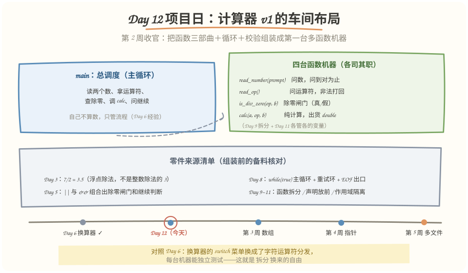
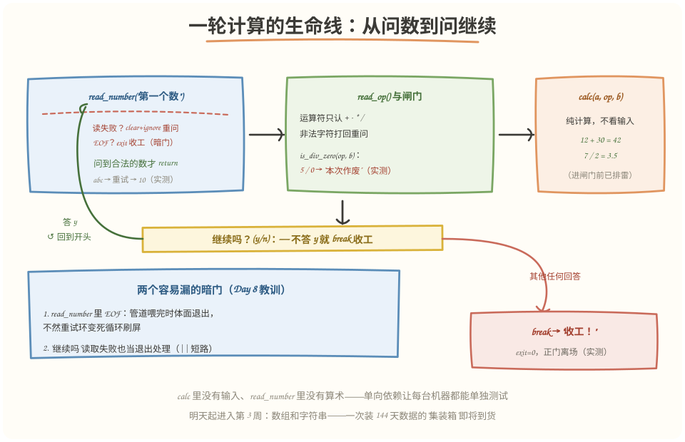
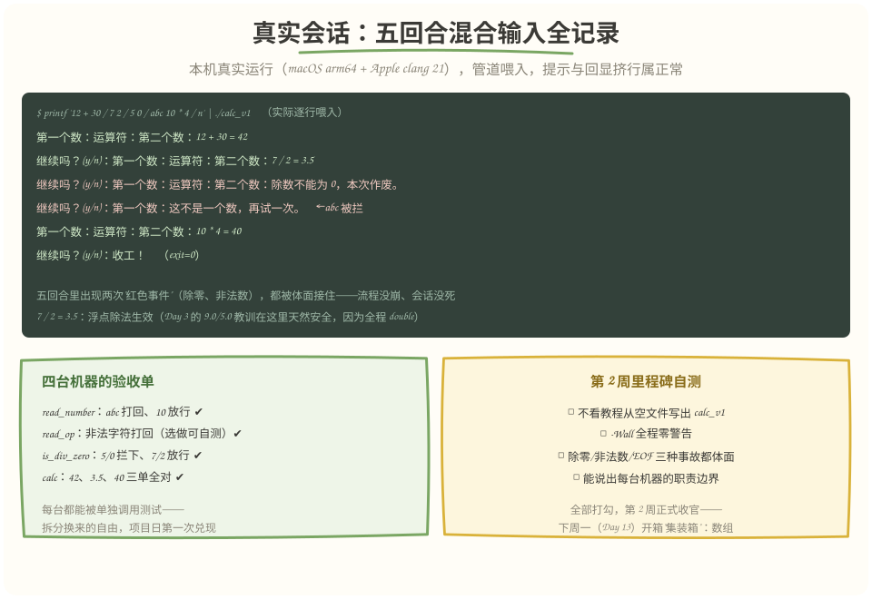

# 第 12 天（项目日）：命令行计算器 v1——四则运算、循环计算、函数拆分

> **今日目标**：完成本教程后，你能做到：不看资料从空文件写出支持 `+ - * /` 的循环计算器；把读数、读运算符、除零检查、计算拆成四台独立函数并说出各自的职责边界；让除零、非法输入、输入耗尽三种事故都得到体面处理。
> **预计时间**：学习 15 分钟＋实践 60 分钟（项目日实践加重）
> **前置准备**：完成 Day 9~11（函数三部曲）；今天是第 2 周收官，不引入新知识，只做组装。
> **今日产出**：一个约 80 行、`-Wall` 零警告、四函数分工的计算器，和一份五回合混合输入的真实会话记录。

## 1. 今天解决什么问题？

Day 6 的换算器已经会"菜单循环"，但所有逻辑挤在 main 里，switch 分支越长越长。今天的问题是：**一台多函数机器怎么拆才干净**？计划给出的规格是命令行计算器 v1：`+ - * /` 四则运算、循环计算、输入校验、拆分为多个函数。

拆分的验收标准很实在：**每台机器都能被单独调用、单独测试**——`calc` 里没有任何输入代码，`read_number` 里没有任何算术，职责像车间工位一样单向不交叉。

## 2. 先看全貌：今天的内容位于哪里？



**图 1**：左边蓝色是 main——只管流程不算数（Day 6 的老经验）；右边绿色是四台机器：`read_number`（问到对为止）、`read_op`（非法打回）、`is_div_zero`（除零闸门）、`calc`（纯计算出货）。下方灰卡是零件来源清单——Day 3 的浮点除法、Day 5 的逻辑运算、Day 8 的循环三件套、Day 9~11 的函数三部曲，全部到齐。

整台机器三步概括：

1. 读入两个数和一个运算符（各带自己的校验环）；
2. 除零闸门放行后交给 `calc`，打印结果；
3. 问"继续吗"，不是 y 就收工。

## 3. 核心概念：先用直觉，再给准确定义

### 3.1 职责拆分：一台机器一件事

- **一句通俗解释**：把 main 的"大杂烩"拆成几台小机器，每台只干一件事、干好一件事。
- **一个类比**：餐厅不让厨师兼职收银——点单（read）、验券（校验）、烹炒（calc）各有专人，出了问题一眼知道找谁。
- **对应到技术上是**：`read_number` 只负责"拿到一个合法的数"，`calc` 只负责"算出结果"——它们互相不知道对方的实现，只通过**参数和返回值**交流。类比的边界：餐厅员工可以口头传话，函数之间**只有参数/返回值这一条正规信道**（Day 11 的作用域隔离保证了这一点）。
- **拆分的好处（今天兑现）**：想测 `calc`，写三行调用就行，不必模拟整个交互。
- **常见误解**："函数越多越好"——拆到"每台能独立测试、名字能说清职责"就停，过度拆分反而难读。

### 3.2 重试环：问到对为止

- **一句通俗解释**：读输入的函数自带小循环——读不到合法值就抢救传送带、再问一次。
- **一个类比**：银行柜员收单据——姓名栏空了就退回让你重填，不会拿张烂单子往下走。
- **对应到技术上是**：`read_number` 内部是 `while (true) + if (cin >> v) return v;` 的结构——Day 8 的抢答三件套（`clear`＋`ignore`＋继续问）从"main 里的一段"升级为"函数自带的能力"。EOF 暗门同样要锁：管道喂完时 `std::exit(0)` 体面收场（`std::exit` 来自 `<cstdlib>`，作用是在任何函数里直接结束整个程序）。
- **真实效果**：会话里输入 `abc`，得到"这不是一个数，再试一次"，紧接着 `10` 放行。
- **常见误解**："校验写在 main 里也一样"——能跑，但 main 又变成大杂烩，且第二个项目想复用问数逻辑时只能复制粘贴。

### 3.3 除零闸门：计算前排雷

- **一句通俗解释**：除法且除数为 0 是唯一必须在**计算前**拦下的错误，闸门函数返回真/假。
- **一个类比**：过安检——危险品（除零）在登机前拦下，而不是起飞后处理。
- **对应到技术上是**：`is_div_zero(op, b)` 就是 `op == '/' && b == 0`（Day 5 逻辑运算的组合拳）。拦下后**本次作废、会话继续**——比直接崩溃优雅得多。类比的边界：安检拦人后要重新排队，而我们的会话直接回到"继续吗"，选择权交给用户。
- **一个设计取舍**：为什么不让 `calc` 自己报错？因为它的返回类型是 `double`，没有多余的"错误通道"——检查前置到闸门函数，`calc` 保持纯计算。（更现代的错误处理方式如 `std::optional`，第 21 周见。）
- **常见误解**：只判 `b == 0` 不判运算符——那会把 `5 + 0` 也拦下。

## 4. 图解核心机制



**图 2**：从左到右追一轮计算：蓝色 `read_number`（内嵌红色重试环与 EOF 暗门）→ 绿色 `read_op` 与除零闸门 → 橙色 `calc` 纯计算出货 → 黄色"继续吗"分岔：答 y 沿绿线回到开头，其他任何回答走红线 `break` 收工。左下蓝卡特别标出**两个容易漏的暗门**——Day 8 的 EOF 死循环教训在这里全部兑现。

按图逐步讲：

1. **问数机器自带重试**：`abc` 被拦、`10` 放行——main 里一行 `double a = read_number("第一个数");` 拿到的必然是合法数，后续代码从此干净；
2. **闸门在计算之前**：`5 / 0` 进不了 `calc`——错误在源头被挡，不在下游补救；
3. **`calc` 是纯函数**：同样的参数永远得到同样的结果，没有任何输入输出副作用——今天它是四台机器里唯一能"闭着眼睛测"的；
4. **两条退出路径都要体面**：明门是"继续吗"不答 y（`break`），暗门是 EOF（`std::exit(0)`）——第 2 周的最后一块拼图。

## 5. 动手实践：完成一个最小可运行例子

### 5.1 准备文件

```bash
cd ai-compiler-roadmap/tutorials/day-012/examples
```

### 5.2 编写代码

完整程序 `calc_v1.cpp`（约 80 行，建议先自己搭骨架：声明区四张名片 → main 主循环 → 四个定义）：

```cpp
#include <iostream>
#include <string>
#include <cstdlib>

// ===== 第 12 天项目日：命令行计算器 v1 =====
// 组装清单：Day 8 循环与输入抢救 + Day 9 函数拆分 + Day 10 默认参数
//           + Day 11 作用域（每个函数各管各的变量）+ Day 3 除法陷阱 + Day 5 逻辑运算

double read_number(const std::string& prompt);   // 声明区：四台机器先递名片
char read_op();
bool is_div_zero(char op, double b);
double calc(double a, char op, double b);

int main() {
    std::cout << "=== 命令行计算器 v1（+ - * /）===" << std::endl;
    while (true) {
        double a = read_number("第一个数");
        char op = read_op();
        double b = read_number("第二个数");

        if (is_div_zero(op, b)) {                // 除零是唯一要在计算前拦的错
            std::cout << "除数不能为 0，本次作废。" << std::endl;
        } else {
            std::cout << a << " " << op << " " << b << " = "
                      << calc(a, op, b) << std::endl;
        }

        std::cout << "继续吗？(y/n)：";
        char again = 0;
        if (!(std::cin >> again) || again != 'y') {   // 不答 y 就收工（|| 短路）
            std::cout << "收工！" << std::endl;
            break;
        }
    }
    return 0;
}

// 读一个数：问不到合法的数就一直问（Day 8 的重试环）
double read_number(const std::string& prompt) {
    double value = 0.0;
    while (true) {
        std::cout << prompt << "：";
        if (std::cin >> value) {
            return value;                        // 读到了，立刻出货
        }
        if (std::cin.eof()) {                    // 输入流到头（如管道喂完）
            std::cout << "\n输入结束，收工。" << std::endl;
            std::exit(0);                        // 在函数里结束整个程序
        }
        std::cin.clear();                        // 抢救三件套（Day 4/8）
        std::cin.ignore(10000, '\n');
        std::cout << "这不是一个数，再试一次。" << std::endl;
    }
}

// 读一个运算符：+ - * / 之外的都打回
char read_op() {
    char op = 0;
    while (true) {
        std::cout << "运算符(+ - * /)：";
        if (std::cin >> op) {
            if (op == '+' || op == '-' || op == '*' || op == '/') {
                return op;
            }
            std::cout << "只支持 + - * /，再试一次。" << std::endl;
        } else {
            if (std::cin.eof()) {
                std::cout << "\n输入结束，收工。" << std::endl;
                std::exit(0);
            }
            std::cin.clear();
            std::cin.ignore(10000, '\n');
        }
    }
}

// 除零检查：除法且除数为 0 才拦（&& 与 || 的组合拳）
bool is_div_zero(char op, double b) {
    return op == '/' && b == 0;
}

// 纯计算：调用前已保证 op 合法、无除零
double calc(double a, char op, double b) {
    if (op == '+') return a + b;
    if (op == '-') return a - b;
    if (op == '*') return a * b;
    return a / b;                                // 走到这里一定是合法除法
}
```

### 5.3 运行与观察

```bash
g++ -Wall calc_v1.cpp -o calc_v1
./calc_v1
```

演示用管道一次喂入五回合（本机真实执行）：

```bash
printf '12\n+\n30\ny\n7\n/\n2\ny\n5\n/\n0\ny\nabc\n10\n*\n4\nn\n' | ./calc_v1
```

实际输出（提示语与喂入回显挤在一行是管道演示的正常现象）：

```text
=== 命令行计算器 v1（+ - * /）===
第一个数：运算符(+ - * /)：第二个数：12 + 30 = 42
继续吗？(y/n)：第一个数：运算符(+ - * /)：第二个数：7 / 2 = 3.5
继续吗？(y/n)：第一个数：运算符(+ - * /)：第二个数：除数不能为 0，本次作废。
继续吗？(y/n)：第一个数：这不是一个数，再试一次。
第一个数：运算符(+ - * /)：第二个数：10 * 4 = 40
继续吗？(y/n)：收工！
```

`exit=0`。注意 `7 / 2 = 3.5`——全程 `double`，Day 3 的整数除法陷阱在这里天然不存在。



**图 3**：黑底卡是完整会话——两次"红色事件"（除零、非法数）都被体面接住；左下绿卡是四台机器的验收单（每台都能单独测）；右下黄卡是第 2 周里程碑自测清单，四项全勾才算收官。

### 5.4 修改一个输入再观察：三种事故一个不落

再单独喂三种典型输入（本机真实结果）：只喂 `5 / 0` 后跟 `n`——得到"除数不能为 0，本次作废"后正常收工；只喂 `abc`——重试提示后等待（管道下因 EOF 体面退出，输出"输入结束，收工"）；直接 Ctrl+D（或空管道）——同样走 EOF 暗门，无死循环。**三种事故路径全部体面**，这就是 Day 8 教训在今天项目里的完整兑现。

## 6. 常见错误与排查

**错误 1：`calc` 里做了输入，测试时没法单独调用**

- 现象：想测 `calc(1, '+', 2)` 却被迫走完整交互；
- 原因：职责越界——计算函数里混进了 cin/cout；
- 定位：检查 `calc` 的函数体有没有 `std::cin`；
- 修复：输入全部上移到 `read_number`/`read_op`，`calc` 只吃参数吐结果。

**错误 2：忘了除零检查，`5 / 0` 输出了 `inf`**

- 现象：除零没崩，打出 `inf`（无穷大）；
- 原因：**浮点**除以零在 IEEE 规则下得到 inf 而不是崩溃——"没报错"不等于"正确"；注意整数除零是未定义行为，比 inf 严重得多；
- 定位：看输出是否出现 `inf`/`nan`；
- 修复：计算前过 `is_div_zero` 闸门（今天的做法）。

**错误 3："继续吗"读字符吃到了换行，直接退出了**

- 现象：刚算完一单就被"收工"；
- 原因：上一轮残留的换行被 `cin >> again` 之前的某次读取消费错位——`>>` 会跳空白，通常不会；真遇到时多半是前面用了 `getline` 混搭（Day 17 专题）；
- 定位：在读取后立刻打印 `again` 的值检查；
- 修复：本项目全程用 `>>`，保持风格统一即可；混搭场景等 Day 17 的专门解法。

## 7. 今日练习

### 必做练习

给计算器 v1 加**取余运算 `%`**（提示：整数才支持 `%`，所以要新写 `read_int_number`——读到 int 为止；`is_div_zero` 的闸门规则原样复用）。用 `10 % 3`、`7 % 3`、`5 % 0` 三组输入记录真实输出到 `notes.md`。预期产出：五运算符版计算器＋一份三组对照记录。

### 选做挑战

给计算器加**历史记录**：一个 `static` 计数器（Day 11）记录本次运行算了多少单，收工时打印"本次共计算 N 单"。再想想：为什么用 static 而不是 main 里的局部变量传进函数？（答案方向：历史状态属于整个会话，而 calc 不该知道它——这正是"谁的状态谁保管"。）

## 8. 今日验收

- [ ] 我能不看教程从空文件写出这台计算器并 `-Wall` 零警告
- [ ] 我能说出四台机器各自的职责边界和"单向依赖"的方向
- [ ] 我的程序对除零、非法数、EOF 三种事故都有体面回应（实测记录在案）
- [ ] 我理解为什么 `calc` 保持纯计算、错误检查放在闸门函数
- [ ] 我完成了必做练习（加 `%`）并用三组输入验证

## 9. 一句话总结与明天预告

今天的问题是"多函数机器怎么拆才干净"；机制上，职责单向不交叉——读数管校验、闸门管排雷、calc 管纯算、main 管流程，函数间只走参数和返回值；实践上，五回合混合会话两起"事故"全被体面接住，`exit=0` 收工；验证标准是四台机器验收单全勾。第 2 周到此收官——明天进入 **第 3 周 · Day 13：数组**——一次装下 144 天成绩的"集装箱"到货，越界的危险、遍历与统计也将逐一登场。
