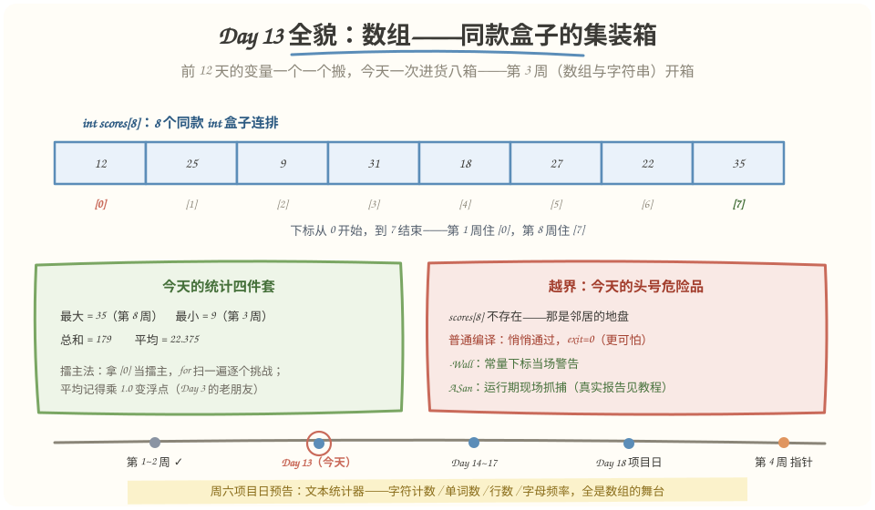
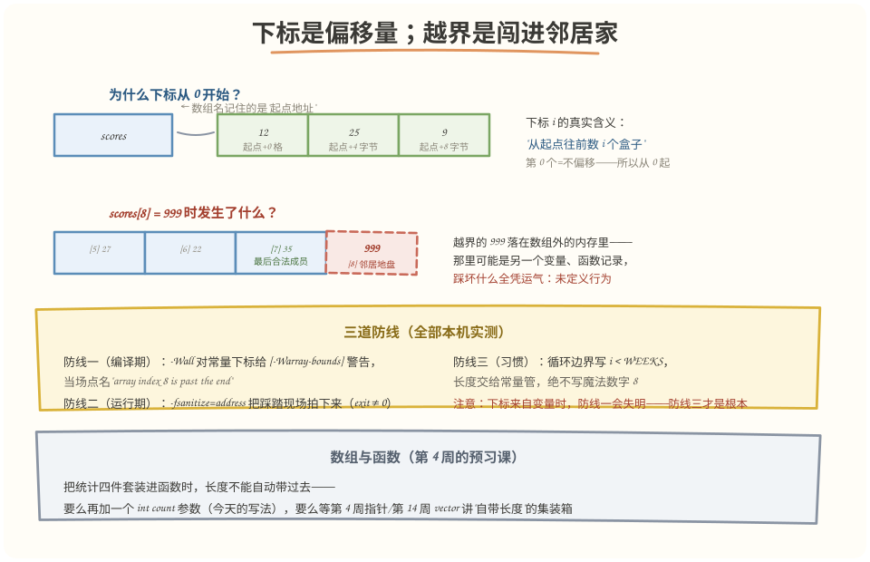
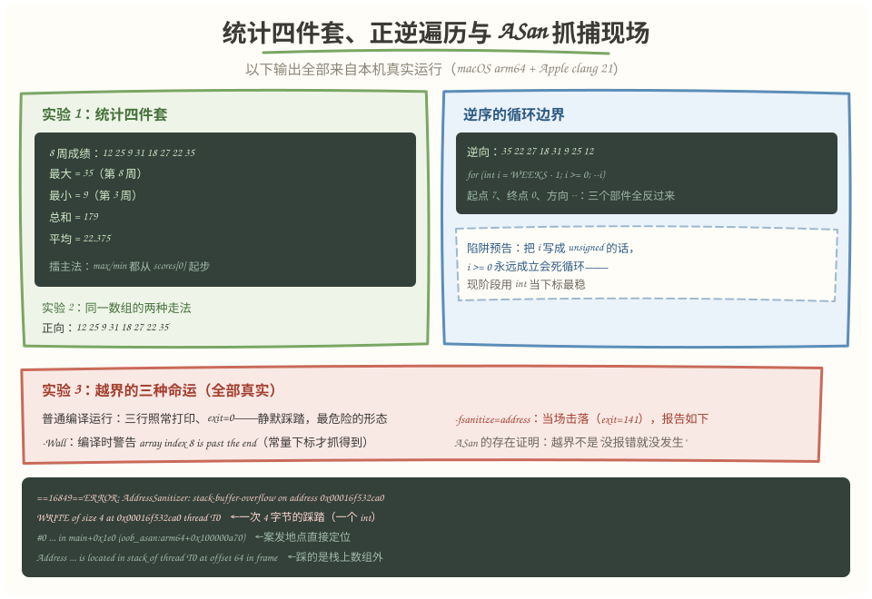

# 第 13 天：数组——同款盒子的集装箱，与越界的危险

> **今日目标**：完成本教程后，你能做到：定义并初始化数组、用标准 for 遍历；用"擂主法"求最大/最小/总和/平均；正序和逆序走同一个数组；解释下标为什么从 0 开始、越界为什么危险，并用 `-Wall` 与 ASan 亲手抓一次越界。
> **预计时间**：学习 25 分钟＋实践 45 分钟
> **前置准备**：完成 Day 1~12（循环是今天的发动机；`-fsanitize` 在 Day 3、Day 8 用过兄弟版 UBSan）。
> **今日产出**：8 周成绩的统计四件套程序、正逆遍历对照，和一次被 ASan 当场击落的越界现场记录。

## 1. 今天解决什么问题？

到目前为止每个变量都要单独起名——想记录 8 周的刷题量就得 `w1, w2, …, w8` 八个名字，求个最大值得写八层比较。今天的问题是：**同类型的一批数据怎么打包管理**？

答案是数组（array）：8 个同款 int 盒子连成一排，一个名字 `scores` 加下标 `[i]` 全管。主线例子贯穿全天：8 周成绩 `{12, 25, 9, 31, 18, 27, 22, 35}`，统计四件套（最大/最小/平均/逆序）正好是计划指定的练习。同时要正面处理计划点名的"越界的危险"——今天你会亲眼看到一次静默的内存踩踏和一次被 ASan 当场击落的同一行为。

## 2. 先看全貌：今天的内容位于哪里？



**图 1**：上面是 8 个连排的 int 盒子，下标从 `[0]` 编到 `[7]`——第 1 周住 `[0]`、第 8 周住 `[7]`，差一位是永恒的换算。左下绿卡是今天的统计四件套（全部真实输出）；右下红卡是头号危险品：`scores[8]` 不存在，普通编译静默通过，`-Wall` 能警告常量下标，ASan 运行期抓捕。路线图：第 3 周（数组与字符串）开箱。

三步概括今天：

1. 定义：`int scores[8] = {…}`，长度必须是编译期常量；
2. 遍历：`for (int i = 0; i < 8; ++i)`，下标从 0 到"长度减一"；
3. 安全：越界是未定义行为，靠"常量管长度 + `-Wall` + ASan"三道防线。

## 3. 核心概念：先用直觉，再给准确定义

### 3.1 数组与下标：集装箱与房间号

- **一句通俗解释**：数组是一排**同类型**盒子的连排仓库，下标是房间号。
- **一个类比**：酒店一层楼 8 间房——房号从 0 编到 7，"301 房"不存在就是不存在，硬闯会出事。
- **对应到技术上是**：`int scores[WEEKS]` 申请 8 个连续的 int 盒子（8×4=32 字节连成一片）；`scores[i]` 按"起点往前数 i 个盒子"定位。类比的边界：酒店可以改房号，数组的**长度在定义时就锁死**，不能中途加房间（想伸缩等第 14 周的 `vector`）。
- **最小例子**：`scores[0]` 是 12，`scores[7]` 是 35——一排盒子一次取名。
- **常见误解**："数组有 8 个元素，所以最大下标是 8"——最大下标是 **7**；长度 8、末下标 7，这就是越界高发区。

### 3.2 遍历与擂主法

- **一句通俗解释**：遍历（traverse）就是按下标从头到尾走一遍；求最大/最小用"擂主法"。
- **一个类比**：选身高最高的同学——先让第一位站上擂台，其余人逐个挑战，比他高就换人；走完全排，台上就是最高的。
- **对应到技术上是**：`max_val = scores[0]` 起步，`for` 扫描逐个 `if (scores[i] > max_val)` 换擂主。**擂主必须从真实元素起步**——写成 `= 0` 的话，全负数数组会得到错误的 0。类比的边界：擂台赛人可以并列，`>` 换主则保证**留下最早出现的最大值**（换成 `>=` 留最晚的）。
- **最小例子（真实运行）**：8 周成绩最大 35（第 8 周）、最小 9（第 3 周）、总和 179、平均 22.375。
- **常见误解**：平均写成 `sum / WEEKS`——整数除法得 22（Day 3 的坑），要乘 `1.0` 变浮点。

### 3.3 越界：未定义行为的三种面孔

- **一句通俗解释**：下标超出 0~7 的范围就是越界（out of bounds）——写到了不属于数组的地盘。
- **一个类比**：住 7 号房却把行李堆进 8 号"房间"——那可能是隔壁住户的客厅，堆完没被发现不代表没闯祸。
- **对应到技术上是**：越界读写是**未定义行为**（Day 2、Day 3 见过这个词）。本机实测三种面孔：普通编译运行**静默通过**（exit=0，最危险）；`-Wall` 对**常量下标**给出 `[-Warray-bounds]` 警告；`-fsanitize=address`（ASan）在运行期把踩踏现场拍下来（`stack-buffer-overflow`，`WRITE of size 4`，exit=141）。类比的边界：隔壁住户可能永远不投诉（程序"正常"跑完），也可能当晚找上门（崩溃、数据错乱）——**没报错不等于没出事**。
- **最小例子**：`scores[8] = 999;`——三种命运见 5.3/5.4。
- **常见误解**："编译器会帮我检查下标"——不会：`scores[i]` 的 i 是运行期的值，编译器看不见；即便常量下标也只是警告不是错误。

## 4. 图解核心机制



**图 2**：上半部分解释 0 起点的来历：数组名记住的是起点地址，下标 i 的含义是"从起点偏移 i 个盒子"——第 0 个元素不偏移，所以从 0 起。中间红色部分画出 `scores[8] = 999` 的去向：落点在数组**外**的内存，踩坏什么全凭运气。下方黄卡是三道防线（全部本机实测过）；灰卡预告明天的话题——数组传给函数时长度不会自动跟过去。

按图逐步讲：

1. **先看偏移**：`scores[2]` 就是"起点 + 2 个盒子"——理解了偏移，`[0]` 起点就不再反直觉；
2. **再看落点**：越界写入的 999 不在集装箱里——它可能覆盖旁边的变量，也可能碰到只读区域直接崩溃；
3. **防线一有盲区**：`-Wall` 只能抓**写死的常量下标**（`scores[8]`），下标来自变量（`scores[i]`）时它失明；
4. **防线三是根本**：循环边界永远写 `i < WEEKS`、长度交给常量管理——从源头不给越界留门。

## 5. 动手实践：完成一个最小可运行例子

### 5.1 准备文件

```bash
cd ai-compiler-roadmap/tutorials/day-013/examples
```

三个程序：主线 `week_stats.cpp`、`reverse_print.cpp`、危险品 `out_of_bounds.cpp`。环境不变（macOS 27，Apple clang 21）。

### 5.2 编写代码

主线 `week_stats.cpp`（完整代码）：

```cpp
#include <iostream>

// 第 13 天主线例子：8 周刷题成绩的一站式统计
int main() {
    const int WEEKS = 8;                       // 数组长度用常量管起来
    int scores[WEEKS] = {12, 25, 9, 31, 18, 27, 22, 35};

    int max_val = scores[0];                  // 拿第 0 个当擂主，逐个挑战
    int min_val = scores[0];
    int sum = 0;
    for (int i = 0; i < WEEKS; ++i) {         // 标准遍历：i 从 0 到 WEEKS-1
        if (scores[i] > max_val) {
            max_val = scores[i];
        }
        if (scores[i] < min_val) {
            min_val = scores[i];
        }
        sum += scores[i];
    }

    std::cout << "8 周成绩：";
    for (int i = 0; i < WEEKS; ++i) {
        std::cout << scores[i] << " ";
    }
    std::cout << std::endl;
    std::cout << "最大 = " << max_val << "（第 8 周）" << std::endl;
    std::cout << "最小 = " << min_val << "（第 3 周）" << std::endl;
    std::cout << "总和 = " << sum << std::endl;
    std::cout << "平均 = " << sum * 1.0 / WEEKS << std::endl;   // 乘 1.0 变浮点（Day 3）
    return 0;
}
```

关键点全在注释里：长度交给 `const int WEEKS`；擂主从 `scores[0]` 起步；遍历边界 `i < WEEKS`；平均乘 `1.0`。逆序版 `reverse_print.cpp` 见本目录——`for (int i = WEEKS - 1; i >= 0; --i)`，起点、终点、步进三个部件全部反过来。

### 5.3 运行与观察

```bash
g++ -Wall week_stats.cpp -o week_stats && ./week_stats
```

实际执行结果（本机）：

```text
8 周成绩：12 25 9 31 18 27 22 35 
最大 = 35（第 8 周）
最小 = 9（第 3 周）
总和 = 179
平均 = 22.375
```

```bash
g++ -Wall reverse_print.cpp -o reverse_print && ./reverse_print
```

```text
正向（第 1 周 → 第 8 周）：12 25 9 31 18 27 22 35 
逆向（第 8 周 → 第 1 周）：35 22 27 18 31 9 25 12 
```



**图 3**：左上是统计战报；右上蓝卡点出逆序循环的三个部件（起点 7、终点 0、`--i`）和一个前瞻陷阱；下半红卡与黑底长条是越界的完整档案——尤其是最后一行 ASan 报告的解读。

### 5.4 修改一个下标再观察：越界的三种命运

危险品程序 `out_of_bounds.cpp` 的核心就一行 `scores[8] = 999;`（合法范围 0~7）。三种编译运行方式，三种命运（全部本机真实）：

**命运一：普通编译运行——静默通过**

```bash
g++ -Wall out_of_bounds.cpp -o oob && ./oob
```

```text
scores[7] = 35（最后一个合法成员）
现在往 scores[8] 写入 999……
写完了，程序还在跑——但没有报错不等于没出事
```

`exit=0`。看似无事，实际 999 已写进数组外的内存——**最危险的形态就是没有症状**。（编译时 `-Wall` 对这种常量下标会给出警告，见命运二。）

**命运二：`-Wall` 的警告（编译期，常量下标专属）**

```text
out_of_bounds.cpp:10:5: warning: array index 8 is past the end of the array (that has type 'int[8]') [-Warray-bounds]
   10 |     scores[8] = 999;                          // 越界！写进了邻居的地盘
      |     ^      ~
out_of_bounds.cpp:6:5: note: array 'scores' declared here
```

注意：警告点名的条件是下标**写死**成常量；`scores[i]` 这种运行期下标它看不见——所以这条防线有盲区。

**命运三：ASan 当场击落（运行期）**

```bash
g++ -Wall -fsanitize=address out_of_bounds.cpp -o oob_asan && ./oob_asan
```

```text
==16849==ERROR: AddressSanitizer: stack-buffer-overflow on address 0x00016f532ca0
WRITE of size 4 at 0x00016f532ca0 thread T0
    #0 0x0001008cca70 in main+0x1e0 (oob_asan:arm64+0x100000a70)
    ...
```

程序被中止（`exit=141`），报告精确到"一次 4 字节的写入踩在了栈上数组之外"。三种命运对照出一个结论：**越界从来不是"没报错就没发生"，只是有没有被看见**。

## 6. 常见错误与排查

**错误 1：循环边界写 `i <= WEEKS`（多跑一格）**

- 现象：统计结果异常偏大，或程序偶发崩溃；
- 原因：`i` 跑到 8，`scores[8]` 越界——读到了邻居的值加进 sum；
- 定位：把循环里的 `i` 和 `scores[i]` 一起打印，看最后一轮的下标；
- 修复：边界固定写 `i < 长度`，长度永远来自常量，不手敲数字。

**错误 2：擂主初始化成 0，遇到全负数组失效**

- 现象：一组负数求最大，结果输出 0；
- 原因：`max_val = 0` 起步时擂主不在参赛选手里——没人能挑战成功；
- 定位：把数组改成全负数复现；
- 修复：擂主必须从**真实元素**起步（`scores[0]`）。

**错误 3：平均输出 22 而不是 22.375**

- 现象：平均值被截断成整数；
- 原因：`sum / WEEKS` 是整数除法（Day 3 老朋友）；
- 定位：对比 `sum / WEEKS` 与 `sum * 1.0 / WEEKS`；
- 修复：乘 `1.0` 提升为浮点再除。

## 7. 今日练习

### 必做练习

写 `second_max.cpp`：找 8 周成绩的**第二名**（提示：一次遍历同时维护最大和次大两个擂主——`max_val` 和 `second_val` 都从 `scores[0]` 起步时要想清楚并列情况怎么处理）。预期产出：输出 `第二名 = 31`，并用改成 `{5,5,5,5,5,5,5,5}` 的数组再跑一次，说明结果为什么合理。

### 选做挑战

把统计四件套装进函数：`int max_of(int a[], int count)`（数组参数怎么写先照抄——`int a[]` 是第 4 周指针的伏笔，今天只管用）。在 main 里分别传 `scores` 全 8 个和前 4 个（`count=4`），观察"长度不跟着数组走、要单独传"的现象——这正是图 2 灰卡预告的内容。

## 8. 今日验收

- [ ] 我能定义、初始化数组并用标准 for 遍历，说出末下标与长度的关系
- [ ] 我能解释下标从 0 开始的偏移量理由
- [ ] 我用擂主法算出了最大/最小/总和/平均，并知道擂主要从真实元素起步
- [ ] 我能写出正序和逆序两种循环，并指出三个部件各怎么变
- [ ] 我亲手制造了越界并看到了三种命运：静默、警告、ASan 击落

## 9. 一句话总结与明天预告

今天的问题是"一批同类型数据怎么打包管理"；机制上，数组是连续的同款盒子、下标是偏移量、越界是闯进邻居家（未定义行为）；实践上，统计四件套和正逆遍历全部落地，还用三道防线围观了一次真实的内存踩踏；验证标准是每次遍历前能说出下标范围。明天 **Day 14：多维数组**——盒子升级成表格，3 行 4 列的矩阵怎么存、怎么双重循环遍历、怎么转置和相乘（计划里的矩阵乘法正好是本 skill 开篇提过的经典例子）。
