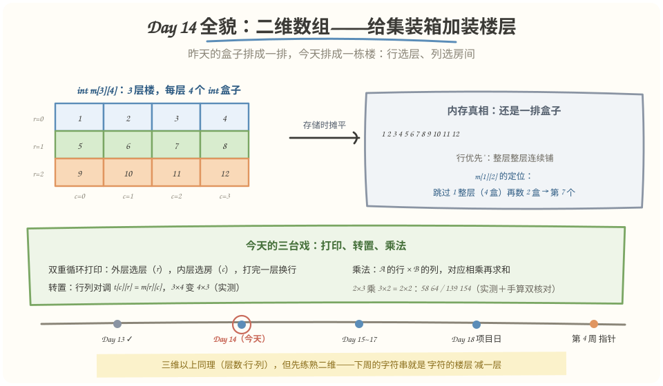
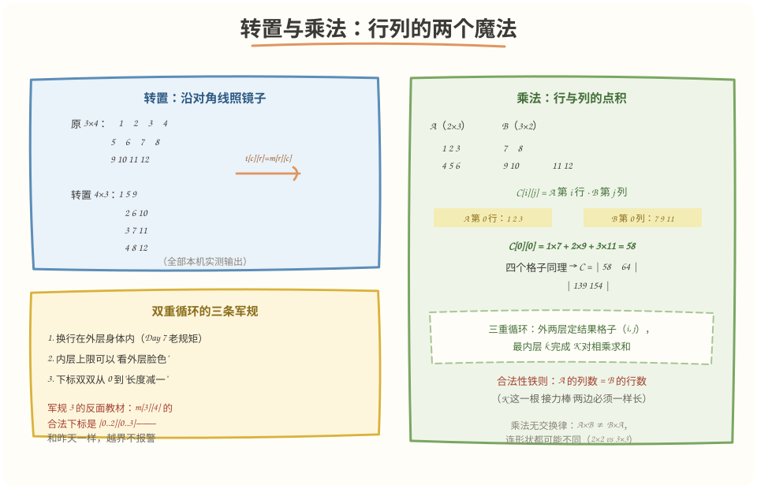
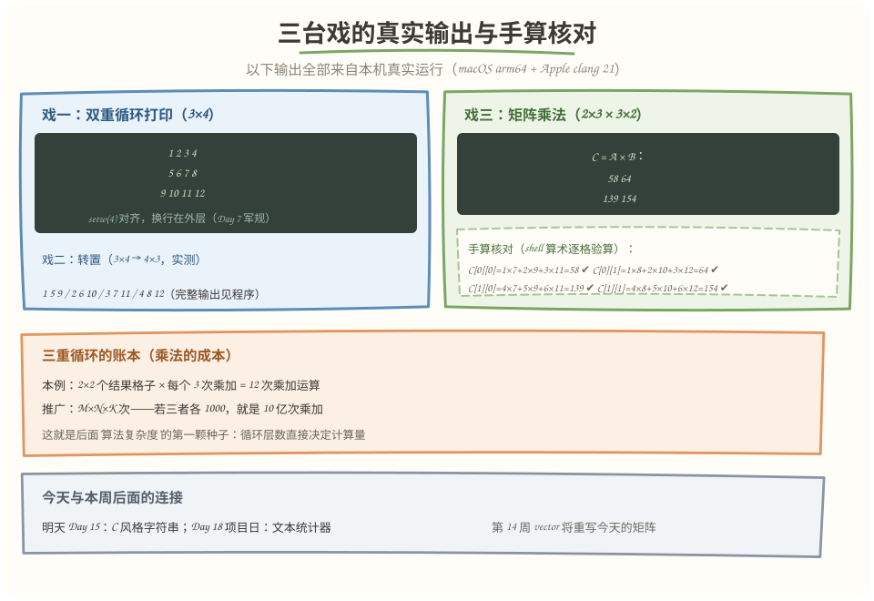

# 第 14 天：多维数组——矩阵的转置与乘法

> **今日目标**：完成本教程后，你能做到：定义并初始化二维数组、用双重循环按行列打印；解释 `m[1][2]` 在内存里的定位方式；独立写出矩阵转置（行列对调）和矩阵乘法（行×列点积）；说出矩阵乘法的合法性铁则。
> **预计时间**：学习 25 分钟＋实践 45 分钟
> **前置准备**：完成 Day 13（一维数组与下标偏移）和 Day 7（嵌套循环——今天是它的主场）。
> **今日产出**：矩阵打印、转置、乘法三个程序，输出全部经手算逐格核对。

## 1. 今天解决什么问题？

一维数组解决了"一批成绩"，但成绩单天生是**表格**：3 个学生 × 4 门课就是一张 3 行 4 列的矩阵。今天的问题是：**表格怎么存、怎么走、怎么算**？

三个任务层层递进：先把表格漂亮地打印出来（双重循环），再做转置（行列互换，`3×4` 变 `4×3`），最后挑战矩阵乘法——计划指定的练习里最硬的一关，也是本 skill 开篇举例时用过的经典例子：**2×3 矩阵乘 3×2 矩阵**。三重循环将第一次登场，它同时也是"计算量"的第一课。

## 2. 先看全貌：今天的内容位于哪里？



**图 1**：左边把 `int m[3][4]` 画成一栋三层楼：行 `r` 选层、列 `c` 选房间，`m[1][2]` 就是"1 层 2 号房"里的 7。右边灰卡是内存真相：**所谓二维，在内存里仍是摊平的一排盒子**，按"行优先"整层整层连续铺——`m[1][2]` 的定位 = 跳过 1 整层（4 盒）再数 2 盒。下方绿卡预告三台戏。路线图：第 3 周第 2 站。

三步概括今天：

1. 定义：`int m[ROWS][COLS]`，两维长度都是编译期常量；
2. 遍历：外层走行、内层走列，换行放外层身体内；
3. 计算：转置是下标对调，乘法是行与列的点积。

## 3. 核心概念：先用直觉，再给准确定义

### 3.1 二维数组：楼层模型

- **一句通俗解释**：二维数组是"数组的数组"——每层是一条一维数组，整栋楼共用一个名字。
- **一个类比**：宿舍楼——`m[1][2]` 读作"1 层 2 号房"；先定位层（行），再定位房（列）。
- **对应到技术上是**：`int m[3][4]` 申请 12 个连续 int；`m[r][c]` 的实际位置是"起点 + r×4 + c 个盒子"（图 1 右卡的定位公式）。类比的边界：宿舍楼各层物理分离，而内存里**层与层是无缝连排的**——这也是"行优先"的来历。
- **最小例子**：`m[1][2]` 的值是 7（跳过 4 盒再数 2 盒，正是第 7 个盒子）。
- **常见误解**：`m[3][4]` 是"3 行 4 列"没错，但**合法下标是 `[0..2][0..3]`**——昨天的越界军规在两个维度上同时生效。

### 3.2 转置：沿对角线照镜子

- **一句通俗解释**：转置（transpose）就是行列互换——原第 r 行变成新第 r 列。
- **一个类比**：把表格沿主对角线对折照镜子：原来"1 层"横着读，镜子后竖着读。
- **对应到技术上是**：核心一行 `t[c][r] = m[r][c];`——**下标对调，数值原样搬运**。新矩阵维度也对调：`int t[COLS][ROWS]`（4×3）。类比的边界：镜子是即时成影，而程序需要**先建好新矩阵再逐格搬运**——原矩阵一个字节都不会变。
- **最小例子（真实运行）**：3×4 转置成 4×3，第 0 行 `1 2 3 4` 变成第 0 列 `1 5 9`。
- **常见误解**：转置后还用 `ROWS×COLS` 遍历新矩阵——维度已对调，循环边界必须跟着换成 `COLS×ROWS`。

### 3.3 矩阵乘法：行与列的点积

- **一句通俗解释**：`C[i][j]` = A 的第 i 行与 B 的第 j 列**对应相乘再求和**。
- **一个类比**：点菜对账——A 的第 i 行是各桌点的份数，B 的第 j 列是各桌单价，对应相乘再全加起来就是第 i 桌在第 j 道菜上的总价。
- **对应到技术上是**：`c[i][j] += a[i][k] * b[k][j];` 套在三重循环里：外两层（i, j）选定结果格子，最内层 k 完成 K 对乘加。本机实测 2×3 × 3×2 = `[[58, 64], [139, 154]]`，并用 shell 算术逐格手算核对一致。类比的边界：对账是"份数×单价"一组数，点积要求**两边一样长**——这就是合法性铁则。
- **两条铁律**：①A 的列数必须等于 B 的行数（K 这根接力棒两边一样长），否则数学上就没定义；②乘法**无交换律**——`A×B` 和 `B×A` 不仅数值不同，连形状都可能不同。
- **常见误解**："矩阵乘法就是对应元素相乘"——那是**逐元素乘**（另一种运算）；矩阵乘法是行×列的点积，形状规则完全不同。

## 4. 图解核心机制



**图 2**：左边蓝卡是转置：原矩阵、箭头上的核心代码 `t[c][r] = m[r][c]`、转置结果三段对照——注意 3×4 的行变 4×3 的列。右边绿卡是乘法全景：上方 A、B 两矩阵，中间两块黄色高亮分别是"A 第 0 行"和"B 第 0 列"，点积算式 `1×7 + 2×9 + 3×11 = 58` 一目了然；虚线框解释三重循环分工；底部两条铁律。左下黄卡是双重循环的三条军规（含越界警示）。

按图逐步讲：

1. **先看转置的下标对调**：`t[c][r] = m[r][c]` 只有一个赋值号之差，维度声明和循环边界却全要对调——**三个地方**（声明、外层上限、内层上限）都要跟着变；
2. **再看点积的"接力棒"**：k 在 A 里选列、在 B 里选行——同一根 k 必须贯穿到底，这就是"A 列数 = B 行数"的代码体现；
3. **三重循环的账本**：本例 2×2×3 = 12 次乘加；若 M、N、K 各为 1000，就是 10 亿次——循环层数直接决定计算量，这是算法复杂度的第一颗种子；
4. **军规别忘**：换行在外层身体内、内层上限可以看外层脸色、两个维度都从 0 到"长度减一"。

## 5. 动手实践：完成一个最小可运行例子

### 5.1 准备文件

```bash
cd ai-compiler-roadmap/tutorials/day-014/examples
```

三个程序：`matrix_print.cpp`、`matrix_transpose.cpp`、`matrix_mul.cpp`。环境不变（macOS 27，Apple clang 21）。

### 5.2 编写代码

乘法主角 `matrix_mul.cpp`（完整代码）：

```cpp
#include <iostream>
#include <iomanip>

// 第 14 天例子三：矩阵乘法——2×3 乘 3×2 得 2×2
// C[i][j] = A 的第 i 行 与 B 的第 j 列 对应相乘再求和
int main() {
    const int M = 2;                            // A 的行数
    const int K = 3;                            // A 的列数 = B 的行数（必须相等）
    const int N = 2;                            // B 的列数
    int a[M][K] = {
        {1, 2, 3},
        {4, 5, 6},
    };
    int b[K][N] = {
        { 7,  8},
        { 9, 10},
        {11, 12},
    };
    int c[M][N] = {{0}};                        // 结果先清零

    for (int i = 0; i < M; ++i) {               // 三重循环：结果共 M×N 个格子
        for (int j = 0; j < N; ++j) {
            for (int k = 0; k < K; ++k) {       // 每个格子 = K 对元素相乘求和
                c[i][j] += a[i][k] * b[k][j];
            }
        }
    }

    std::cout << "C = A × B：" << std::endl;
    for (int i = 0; i < M; ++i) {
        for (int j = 0; j < N; ++j) {
            std::cout << std::setw(6) << c[i][j];
        }
        std::cout << std::endl;
    }
    return 0;
}
```

关键点：`c` 先清零（`{{0}}`）再累加；三重循环每层管一件事；`+=` 累加点积。打印与转置程序结构类似，完整代码见本目录。

### 5.3 运行与观察

```bash
g++ -Wall matrix_print.cpp -o matrix_print && ./matrix_print
```

实际执行结果（本机）：

```text
   1   2   3   4
   5   6   7   8
   9  10  11  12
```

```bash
g++ -Wall matrix_transpose.cpp -o matrix_transpose && ./matrix_transpose
```

```text
原矩阵 3×4：
   1   2   3   4
   5   6   7   8
   9  10  11  12
转置后 4×3：
   1   5   9
   2   6  10
   3   7  11
   4   8  12
```

```bash
g++ -Wall matrix_mul.cpp -o matrix_mul && ./matrix_mul
```

```text
C = A × B：
    58    64
   139   154
```



**图 3**：左上双重循环打印（`setw(4)` 对齐）；右上乘法输出加四格手算核对——`C[0][0]=1×7+2×9+3×11=58`、`C[0][1]=64`、`C[1][0]=139`、`C[1][1]=154`，程序与手算逐格一致；下方橙卡是三重循环的账本（12 次乘加的来历与 10 亿次的外推）。

### 5.4 修改一个输入再观察：换 B 验证乘法语义

把 `b` 的数据整体换成 `{{1,0},{0,1},{0,0}}`（B 的第 0 列是 `1,0,0`、第 1 列是 `0,1,0`）再编译运行，本机真实输出：

```text
C = A × B：
     1     2
     4     5
```

逐格手算核对：`C[0][0] = 1×1+2×0+3×0 = 1`、`C[0][1] = 1×0+2×1+3×0 = 2`、`C[1][0] = 4`、`C[1][1] = 5`——程序与手算完全一致。**结果的含义很漂亮：C 恰好是 A 的前两列**。这个 B 相当于一个"截取器"：第 0 列 `1,0,0` 只放行 A 的第 0 列，第 1 列 `0,1,0` 只放行 A 的第 1 列，A 的第 2 列被 `0,0` 整列筛掉。

顺带预告一条数学性质：如果 B 是**方阵形状的单位矩阵**（对角线全 1、其余全 0），那么 A×B = A 原封不动——单位矩阵在矩阵世界扮演数字 1 的角色（选做挑战里亲手验证）。今天先记住观察方法：**换一个 B，逐格手算一遍，结论从对照中自己长出来**。

## 6. 常见错误与排查

**错误 1：转置后循环边界没换，输出越界或错乱**

- 现象：转置输出残缺、多行或程序异常退出；
- 原因：新矩阵是 `t[COLS][ROWS]`，打印却还用 `ROWS` 当外层上限；
- 定位：对照声明和两处循环上限，三个地方的维度要对调齐；
- 修复：声明、外层、内层三处同步换成 `COLS × ROWS`。

**错误 2：乘法写成"对应元素相乘" `c[i][j] = a[i][j] * b[i][j]`**

- 现象：形状能对上时结果却和手算对不上；
- 原因：矩阵乘法是行×列点积（三重循环），不是逐元素乘；
- 定位：检查有没有最内层 k 循环——没有 k 的"乘法"多半是逐元素乘；
- 修复：套上三重循环，用 `a[i][k] * b[k][j]` 累加。

**错误 3：形状不合法仍硬乘（A 2×3 乘 B 2×2）**

- 现象：编译能过（数组维度都合法），运行结果全是垃圾；
- 原因：A 的列数 3 ≠ B 的行数 2——数学上无定义，代码里 k 会越界读 B；
- 定位：用常量声明维度（`M/K/N`），肉眼核对"A 列 = B 行"；
- 修复：调整数据形状使其合法；养成"先写维度注释再写数据"的习惯。

## 7. 今日练习

### 必做练习

写 `matrix_add.cpp`：同形状矩阵相加（`3×4 + 3×4`），双重循环 `c[r][c] = a[r][c] + b[r][c]`。自拟两组数据，手算两格核对程序输出。预期产出：加法程序 + 一行"程序 = 手算"的核对记录抄进 `notes.md`。

### 选做挑战

把今天的乘法改成 `3×3 乘 3×3`（数据自拟），并在结果里找规律：如果 B 取单位矩阵（对角线 1 其余 0），输出应该就是 A 自己——用程序验证这条数学性质。再想想：为什么单位矩阵在矩阵世界扮演的角色和数字 1 一样？

## 8. 今日验收

- [ ] 我能定义并初始化二维数组，说出 `m[1][2]` 的定位公式（跳 1 层再数 2 盒）
- [ ] 我能默写双重循环的三条军规，并解释换行为什么放在外层身体内
- [ ] 我独立完成了转置：下标对调 + 三处维度同步对调
- [ ] 我独立完成了乘法：三重循环 + 点积累加，输出经手算逐格核对
- [ ] 我能说出乘法两条铁律：A 列 = B 行；乘法无交换律

## 9. 一句话总结与明天预告

今天的问题是"表格怎么存、怎么走、怎么算"；机制上，二维数组是摊平存储的楼层（行优先），转置靠下标对调，乘法靠行×列点积配三重循环；实践上，打印、转置、乘法三台戏全部落地且经手算核对，还经历了一次"口述与代码不符"的现场排错；验证标准是每格输出都能手算复现。明天 **Day 15：C 风格字符串**——字符数组加 `'\0'` 结尾的古老设计、`strlen`/`strcpy` 的危险性，以及手写 `my_strlen`、`my_strcmp` 的练习。
