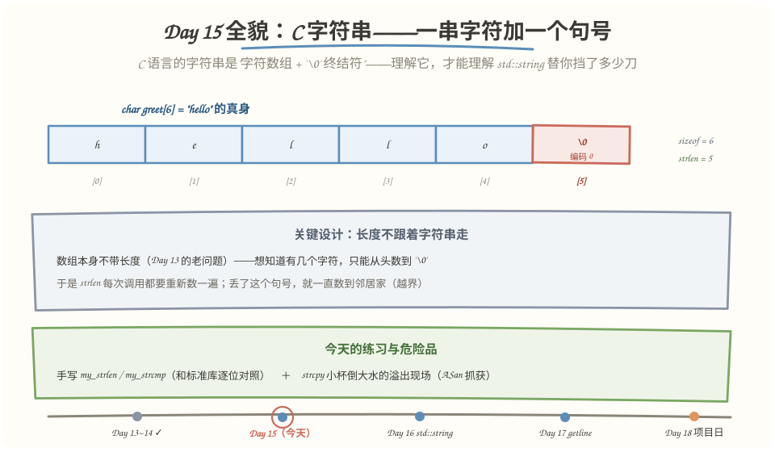
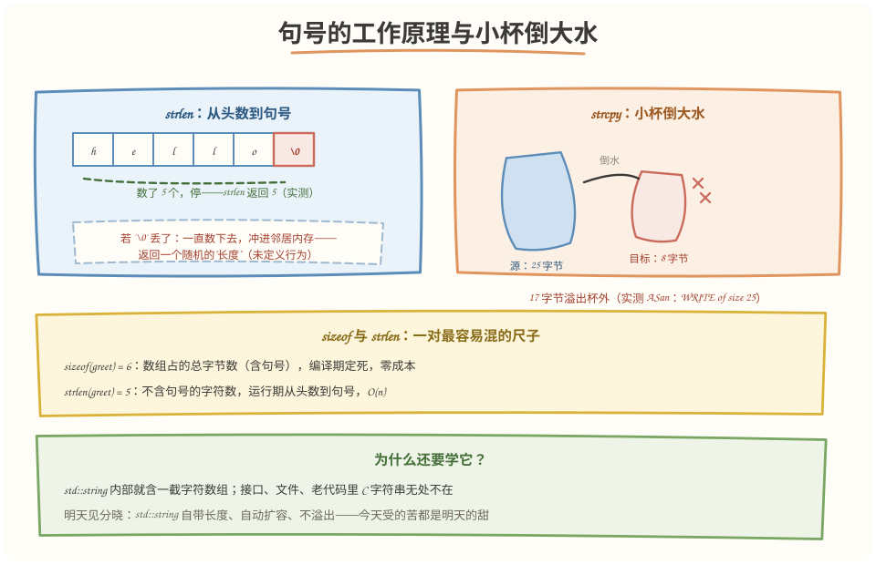
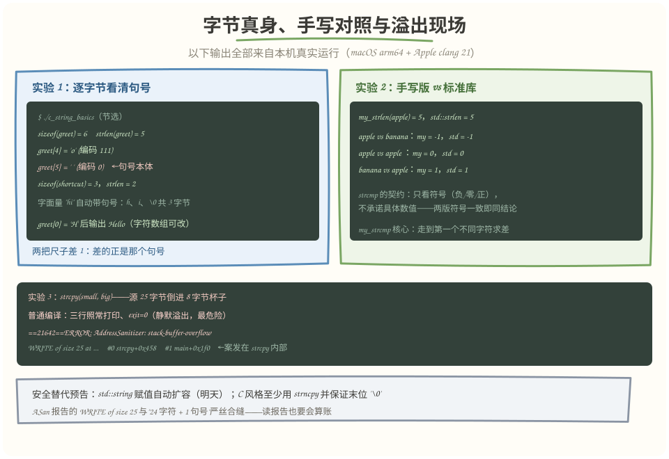

# 第 15 天：C 风格字符串——一串字符加一个句号

> **今日目标**：完成本教程后，你能做到：画出 `"hello"` 在内存里的字节真身（含 `'\0'`）；区分 `sizeof` 和 `strlen` 这两把尺子；手写 `my_strlen` 和 `my_strcmp` 并与标准库逐位对照；解释 `strcpy` 为什么危险，并用 ASan 亲手抓一次缓冲区溢出。
> **预计时间**：学习 25 分钟＋实践 45 分钟
> **前置准备**：完成 Day 13~14（字符数组就是"元素类型为 char 的数组"）；ASan 在 Day 13 已用过。
> **今日产出**：字节真身观察、手写双函数对照实验，和一次 `WRITE of size 25` 的溢出现场记录。

## 1. 今天解决什么问题？

前两天的数组装的是 `int`，今天把元素换成 `char`——但 C 风格字符串（C-string）比"字符数组"多一条规矩：**结尾必须有一个编码为 0 的字符 `'\0'`（终结符，昵称"句号"）**。因为数组不带长度（Day 13 的老问题），所有 C 字符串函数都靠这个句号判断"到头了"。

今天解决三件事：看清句号的真身；亲手写一遍 `my_strlen`/`my_strcmp`（计划指定的练习）体会句号怎么用；再用 ASan 围观 `strcpy` 把 25 字节倒进 8 字节杯子的经典事故。理解了今天的苦，明天 `std::string` 的甜才有分量。

## 2. 先看全貌：今天的内容位于哪里？



**图 1**：上面是 `"hello"` 的真身：6 个格子，前 5 个是字符，第 6 格是红色的句号（编码 0）——`sizeof` 数格子得 6，`strlen` 数字符得 5，两把尺子差的正是句号。灰色卡点出关键设计：**长度不跟着字符串走**，想知道几个字符只能从头数到句号。路线图：第 3 周第 3 站，明天 `std::string` 接棒。

三步概括今天：

1. C 字符串 = 字符数组 + `'\0'` 终结符；
2. `sizeof` 是编译期的"占几格"，`strlen` 是运行期的"数到句号"；
3. 所有不带边界检查的 C 函数（`strcpy` 等）都以溢出为耻——ASan 现场作证。

## 3. 核心概念：先用直觉，再给准确定义

### 3.1 终结符 '\0'：字符串的句号

- **一句通俗解释**：`'\0'` 是编码为 0 的字符，放在字符串末尾宣告"到此为止"。
- **一个类比**：阅卷老师在答案最后画个句号——后面就算还有字，也不算答案的一部分。
- **对应到技术上是**：`char greet[6] = {'h','e','l','l','o','\0'}`；写字面量 `"hi"` 时编译器**自动**补句号（占 3 字节）。`cout << greet` 逐字符打印到句号停。类比的边界：句号不是"打印出来的符号"，**它自己不显示**——本机实测 `greet[5]` 打印为空白、编码是 0。
- **最小例子**：`sizeof(shortcut) = 3`，`strlen(shortcut) = 2`——一句之差，一目了然。
- **常见误解**：`"hello"` 占 5 字节——占 **6** 字节；忘算句号是 C 字符串 bug 的头号来源。

### 3.2 sizeof 与 strlen：两把不同的尺子

- **一句通俗解释**：`sizeof` 量"集装箱多大"（含句号），`strlen` 量"货物几个"（不含句号）。
- **一个类比**：快递箱 6 升 vs 里面货物的实际体积 5 升——箱子不会因为货少而变小。
- **对应到技术上是**：`sizeof` 在**编译期**定死（数组声明多大就是多大，零成本）；`strlen` 在**运行期**从头数到句号（O(n)——每次调用都重新数！）。本机实测：`sizeof(greet)=6`、`strlen(greet)=5`。类比的边界：`sizeof` 量的是**数组**；如果拿到的是指针（第 4 周见），`sizeof` 只剩指针自己那 8 字节——这也是常见坑。
- **常见误解**：循环里写 `for (i = 0; i < strlen(s); ++i)`——每圈都重数一遍，长字符串慢一个数量级；先存下来 `int n = strlen(s)` 再用。

### 3.3 strcpy 的危险：小杯倒大水

- **一句通俗解释**：`strcpy(dst, src)` 把 src 整串倒进 dst，**完全不看 dst 的杯子多大**。
- **一个类比**：25 升水倒进 8 升的杯子——桌面（邻近内存）遭殃，倒水的人毫无察觉。
- **对应到技术上是**：本机实测：源 24 字符 + 句号 = 25 字节，目标 `char small[8]`，`strcpy` 后普通编译**静默通过**（exit=0）；加 `-fsanitize=address` 后当场击落——`WRITE of size 25`、案发栈里直接写着 `strcpy`。类比的边界：水洒了看得见，内存溢出**看不见**——这正是它四十年来养蛊无数的原因。
- **安全姿势**：明天起用 `std::string` 赋值（自动扩容）；必须用 C 风格时，先 `strlen` 比对目标容量，或用带边界的 `strncpy` 并亲手补末位句号。
- **常见误解**："程序跑通了就是没溢出"——Day 13 的结论原样适用：**没报错不等于没出事**。

## 4. 图解核心机制



**图 2**：左上蓝卡演示 `strlen` 的工作：从头数到红色句号停，得 5；下方虚线框是丢句号的后果——一直数进邻居内存，返回一个随机"长度"（未定义行为）。右上橙卡是小杯倒大水：25 字节源、8 字节目标、17 字节溢出杯外——对应 ASan 报告的 `WRITE of size 25`。下方黄卡把两把尺子钉死，绿卡说明为什么还要学它。

按图逐步讲：

1. **先看数数**：`strlen` 的每一步都是"看一眼当前字符，不是 0 就 +1"——`my_strlen` 的三行循环就是这么来的；
2. **再看丢句号**：句号是唯一的停车标志，丢了就冲出数组（Day 13 的越界军规在字符世界里原样生效）；
3. **倒水账**：25 字节写入 8 字节杯子 = 17 字节泼在栈上邻居的地盘——ASan 报告的字节数要会自己算：**24 字符 + 1 句号 = 25**；
4. **两把尺子分工**：要容量（分配内存、声明数组）用 `sizeof`；要字符数（打印、遍历、逻辑判断）用 `strlen`。

## 5. 动手实践：完成一个最小可运行例子

### 5.1 准备文件

```bash
cd ai-compiler-roadmap/tutorials/day-015/examples
```

三个程序：`c_string_basics.cpp`、`my_strlen_strcmp.cpp`、`strcpy_danger.cpp`。环境不变（macOS 27，Apple clang 21）。

### 5.2 编写代码

手写双函数 `my_strlen_strcmp.cpp`（完整代码）：

```cpp
#include <iostream>
#include <cstring>

// 手写 my_strlen 与 my_strcmp，再和标准库版本对照
int my_strlen(const char s[]) {
    int n = 0;
    while (s[n] != '\0') {        // 从头数到终结符
        ++n;
    }
    return n;
}

int my_strcmp(const char a[], const char b[]) {
    int i = 0;
    while (a[i] != '\0' && a[i] == b[i]) {   // 一起走到第一个不同的字符
        ++i;
    }
    return (unsigned char)a[i] - (unsigned char)b[i];   // 差值：负/零/正
}

void show_cmp(const char* label, const char a[], const char b[]) {
    int mine = my_strcmp(a, b);
    int lib = std::strcmp(a, b);
    std::cout << label << "：my_strcmp = " << mine
              << "，std::strcmp = " << lib << "（符号一致即同结论）" << std::endl;
}

int main() {
    const char apple[] = "apple";
    const char banana[] = "banana";
    const char apple2[] = "apple";

    std::cout << "my_strlen(apple) = " << my_strlen(apple)
              << "，std::strlen = " << std::strlen(apple) << std::endl;

    show_cmp("apple vs banana", apple, banana);   // 期望负：'a'-'b'
    show_cmp("apple vs apple ", apple, apple2);   // 期望 0
    show_cmp("banana vs apple", banana, apple);   // 期望正
    return 0;
}
```

`my_strlen` 的 while 就是图 2 数数过程的直译。`my_strcmp` 走到第一对不同字符求编码差——`'a'-'b' = -1`。`(unsigned char)` 的强转是防止负编码干扰（中文等多字节字符的场景，进阶话题，先照抄）。

### 5.3 运行与观察

```bash
g++ -Wall c_string_basics.cpp -o csb && ./csb
```

实际执行结果（本机，节选）：

```text
greet 内容：hello
sizeof(greet) = 6（数组占的字节数）
strlen(greet) = 5（数到 '\0' 为止的长度）
sizeof(shortcut) = 3，strlen(shortcut) = 2
greet[4] = 'o' (编码 111)
greet[5] = ' ' (编码 0)
改完后：Hello
```

第 5 格打印为空白、编码 0——句号本尊。`greet[0] = 'H'` 一改，输出变 `Hello`：字符数组可写。

```bash
g++ -Wall my_strlen_strcmp.cpp -o myss && ./myss
```

```text
my_strlen(apple) = 5，std::strlen = 5
apple vs banana：my_strcmp = -1，std::strcmp = -1（符号一致即同结论）
apple vs apple ：my_strcmp = 0，std::strcmp = 0（符号一致即同结论）
banana vs apple：my_strcmp = 1，std::strcmp = 1（符号一致即同结论）
```



**图 3**：左上逐字节观察（句号的编码 0 清晰可见）；右上四组对照全部符号一致——**strcmp 的契约只承诺符号**（负/零/正），不承诺具体数值；下方黑底长条是 `strcpy` 溢出的双命运。

### 5.4 修改一个输入再观察：溢出的两种命运

危险品 `strcpy_danger.cpp`：源 `"0123456789abcdefghijklmn"`（24 字符 + 句号 = 25 字节）倒进 `char small[8]`。

```bash
g++ -Wall strcpy_danger.cpp -o sd && ./sd
```

```text
源串长度 = 24
目标杯子大小 = 8 字节
现在 strcpy(small, big)……
程序还在跑（普通编译下没有报错）
```

`exit=0`——17 字节泼在邻居地盘上，悄无声息。加雷达再跑：

```bash
g++ -Wall -fsanitize=address strcpy_danger.cpp -o sd_asan && ./sd_asan
```

```text
==21642==ERROR: AddressSanitizer: stack-buffer-overflow on address 0x00016f7b2ca8
WRITE of size 25 at 0x00016f7b2ca8 thread T0
    #0 0x000100e42af0 in strcpy+0x458 (libclang_rt.asan_osx_dynamic.dylib:arm64e+0x3aaf0)
    #1 0x00010064ca80 in main+0x1f0 (sd_asan:arm64+0x100000a80)
```

两个细节值得读出来：`WRITE of size 25` 与我们手算的"24 字符 + 1 句号"严丝合缝；调用栈第 0 帧就是 `strcpy` 内部——**案发地点与凶器一并记录在案**。

## 6. 常见错误与排查

**错误 1：忘给句号留位置，`char s[5] = "hello"` 编译报错**

- 现象：数组初始化列表超长；
- 原因：`"hello"` 需要 6 字节（5 字符 + 句号），杯子只有 5；
- 定位：报错直接指向该行；数字符时默念"+1 句号"；
- 修复：`char s[6]`，或者干脆 `char s[] = "hello"` 让编译器自己算。

**错误 2：循环条件里反复调 `strlen`，长字符串越跑越慢**

- 现象：处理几万字符时明显卡顿；
- 原因：每圈条件判断都从头数一遍句号，O(n²)；
- 定位：看循环条件里有没有函数调用；
- 修复：进循环前 `int n = strlen(s);` 存下来用。

**错误 3：`strcmp(a, b) == -1` 判断"小于"**

- 现象：在别的编译器上突然不成立；
- 原因：标准只承诺**负数**，`-1` 是 libc++ 的巧合（本机恰好是 -1）；
- 定位：检查所有对 strcmp 返回值的比较；
- 修复：写 `< 0`、`== 0`、`> 0`——今天的对照实验里两版数值恰好一致，但契约只认符号。

## 7. 今日练习

### 必做练习

手写 `my_strcpy(dst, src)`（循环复制直到把句号也拷过去），先用足够大的目标数组验证结果正确；再故意把目标缩小到装不下，开 ASan 围观自己的函数被击落（对照今天 `strcpy` 的报告格式）。预期产出：正确版输出 + 一次自己制造的被 ASan 拦截的溢出，抄进 `notes.md`。

### 选做挑战

写 `my_strcat(dst, append)`：把 append 接到 dst 句号的位置（提示：先用 `my_strlen` 找到句号，从那里开始覆盖着拷）。想清楚：dst 的杯子必须装得下"原串 + 追加串 + 1 个句号"。

## 8. 今日验收

- [ ] 我能画出任意字面量的字节真身，标出句号的位置和编码
- [ ] 我能一口气说出 sizeof 与 strlen 的三个区别：含不含句号、编译期还是运行期、成本
- [ ] 我手写的 my_strlen / my_strcmp 与标准库符号逐组一致，能解释 strcmp 只认符号
- [ ] 我能复述 strcpy 溢出事故的账本：25 字节写进 8 字节杯子
- [ ] 我能读懂 ASan 报告里的 WRITE 大小和案发调用栈

## 9. 一句话总结与明天预告

今天的问题是"没有长度字段的字符串怎么活"；机制上，句号 `'\0'` 是唯一的停车标志，sizeof 量杯子、strlen 数货物，不带边界检查的 strcpy 以溢出为耻；实践上，字节真身、手写双函数、ASan 击落溢出三组实验全部落地；验证标准是任何字面量都能报出"占几字节、字符几个"。明天 **Day 16：std::string**——自带长度、自动扩容、随取随用的现代字符串：拼接、`substr`、`find`、`size`，还有统计元音和反转单词两个练习等着兑现今天的伏笔。
