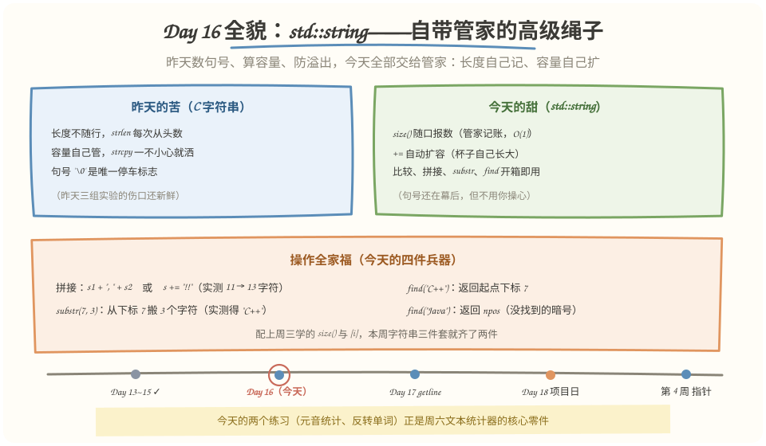
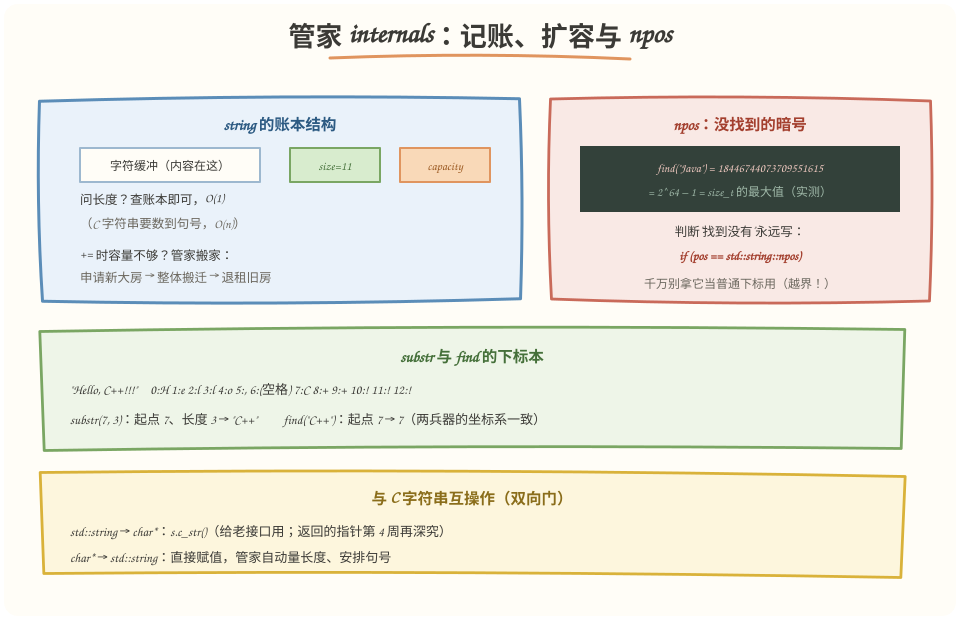
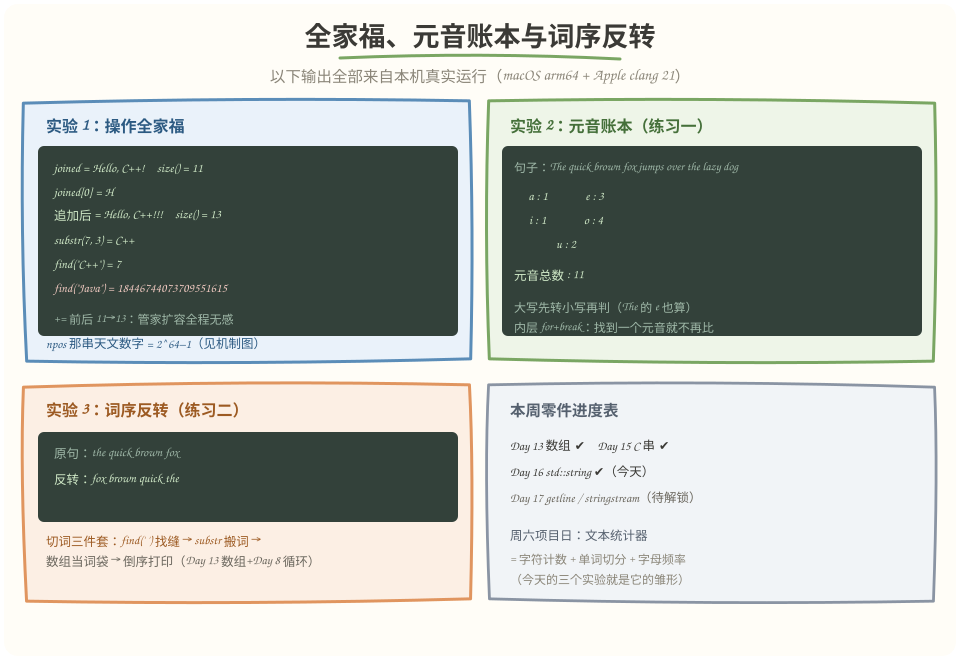

# 第 16 天：std::string——自带管家的现代字符串

> **今日目标**：完成本教程后，你能做到：用 `+`/`+=`/`substr`/`find`/`size`/`[i]` 熟练操作 std::string；说出它和 C 字符串在长度、容量、安全上的三点差别；正确使用 `npos` 判断"没找到"；独立完成元音统计和单词反转两个练习。
> **预计时间**：学习 25 分钟＋实践 45 分钟
> **前置准备**：完成 Day 15（知道句号、strlen、溢出的苦）；Day 4 起就一直在用 `std::string` 装名字，今天正式认识它。
> **今日产出**：操作全家福巡礼、元音账本、词序反转，三个程序全部真实运行。

## 1. 今天解决什么问题？

昨天的三组实验把 C 字符串的苦尝了个遍：长度要数、容量要算、复制要防洒。今天的问题很直接：**有没有一种字符串，这些事都不用我操心**？

有，就是从 Day 4 起默默帮你装名字的 `std::string`。它自带一个"管家"：长度记在账本上（`size()` 随口报数）、容量不够自动搬家扩容（`+=` 随便加）、比较和查找开箱即用。今天把它的四件兵器（拼接、`substr`、`find`、`size`）练熟，并用计划指定的两个练习——统计元音字母、反转单词——把它们串成实战。周六的文本统计器项目，零件就是今天这三样。

## 2. 先看全貌：今天的内容位于哪里？



**图 1**：左边蓝卡是昨天的伤口（长度不随行、容量自己管、句号是唯一停车标志）；右边绿卡是今天的甜（`size()` 记账 O(1)、`+=` 自动扩容、全家桶开箱即用）。橙色卡列出四件兵器，配实测数字。路线图：第 3 周倒数第二站，明天 getline 后就是项目日。

三步概括今天：

1. `std::string` 是自带长度与容量管理的字符串对象；
2. 四件兵器：`+`/`+=` 拼接、`substr(起,长)` 取段、`find(子串)` 找位置、`size()` 报长度；
3. `find` 没找到返回 `npos`——判断成败必须和它比。

## 3. 核心概念：先用直觉，再给准确定义

### 3.1 自带长度：管家记账

- **一句通俗解释**：`size()` 是管家账本上的数字，问就答，不用数。
- **一个类比**：快递面单上印着件数——扫一眼就知道，不用开箱清点。
- **对应到技术上是**：string 内部维护 size（字符数）和 capacity（预留容量）两个字段；`size()` 是 O(1)。而 C 字符串的 `strlen` 要从头数到句号，O(n)。类比的边界：面单可能写错，**账本与内容永远同步**——每次修改管家都会自己更新。
- **最小例子（真实运行）**：`"Hello, C++!"` 的 `size() = 11`；`+= "!!"` 后 13——扩容全程无感。
- **常见误解**：`size()` 返回的字符数**不含**幕后句号（句号还在，但属于实现细节，你不用数它）。

### 3.2 自动扩容：杯子自己长大

- **一句通俗解释**：`+=` 追加时若容量不够，string 自动"搬家"——申请更大的新空间、整体搬迁、释放旧空间。
- **一个类比**：换更大的办公室——搬家公司全包，你只管继续办公。
- **对应到技术上是**：追加操作均摊成本低，但**搬家那一趟**要整串复制——在超大循环里疯狂 `+=` 时值得留心（进阶话题"reserve 预留"，先埋个名字）。类比的边界：办公室搬家你看得见，string 搬家**对用户完全透明**——这正是昨天 strcpy 之苦的解药。
- **最小例子**：`joined += "!!"` 从 11 字符到 13 字符，一行完成。
- **常见误解**："扩容了旧数据会丢"——不会，搬迁是先复制再退租。

### 3.3 find 与 npos：找得到给下标，找不到给暗号

- **一句通俗解释**：`find(子串)` 返回子串**起点下标**；没找到返回特殊值 `std::string::npos`。
- **一个类比**：图书检索——查到了给你书架号，查不到给你一张"馆藏无此书"的回执（npos），而不是随手写个错号。
- **对应到技术上是**：本机实测 `find("C++") = 7`；`find("Java")` 打印出 `18446744073709551615`——这串天文数字就是 `npos`，等于 **2⁶⁴−1**（`size_t` 的最大值）。类比的边界：npos 是合法的"回执"但**不是合法下标**——拿它去 `[pos]` 访问就是越界。
- **标准判法**：`if (pos == std::string::npos)`；反过来 `if (pos != std::string::npos)` 才是"找到了"。
- **常见误解**：`if (find(x))`——find 找到位置 0 时返回 0（假！），没找到返回巨大非零（真！）——判断完全反了。

### 3.4 substr：按下标取一段

- **一句通俗解释**：`substr(起点, 长度)` 从字符串里搬出一段副本。
- **一个类比**：从长胶带上按刻度剪一截。
- **对应到技术上是**：`substr(7, 3)` 从下标 7 起取 3 个字符得 `"C++"`——**起点和 find 的坐标系一致**（find 给的就是 substr 要的）。类比的边界：剪胶带不伤原件，substr 也**返回副本**，原串不动（想改原串要用下标 `[i]`）。
- **常见误解**：第二参数以为是"终点下标"——是**长度**；`substr(7, 3)` 取的是 7、8、9 三个位置。

## 4. 图解核心机制



**图 2**：左上蓝卡是 string 的账本结构：字符缓冲（内容）＋ size（长度）＋ capacity（容量）三个字段——问长度查账本（O(1)），容量不够管家搬家（申请、搬迁、退租三步）。右上红卡是 npos 的真身：实测打印 `18446744073709551615` = 2⁶⁴−1，标准判法一行。下方绿卡把 `"Hello, C++!!!"` 的下标本铺开，substr 与 find 的坐标系对齐。

按图逐步讲：

1. **先看账本**：size 和 capacity 分开记——容量常比长度大（预留空间），这是"搬家不频繁"的秘密；
2. **再看搬家**：`+=` 触发扩容时的三步曲对用户透明——对比昨天 strcpy 的"手动核算容量"，甜苦立见；
3. **npos 别当下标**：它是 size_t 的最大值哨兵，唯一正确用法是与 find 的返回值做相等比较；
4. **坐标系一致**：`find("C++") = 7`、`substr(7, 3) = "C++"`——find 的结果直接喂给 substr，这是"定位-截取"连招。

## 5. 动手实践：完成一个最小可运行例子

### 5.1 准备文件

```bash
cd ai-compiler-roadmap/tutorials/day-016/examples
```

三个程序：`string_tour.cpp`（全家福）、`vowel_count.cpp`（练习一）、`reverse_words.cpp`（练习二）。环境不变（macOS 27，Apple clang 21）。

### 5.2 编写代码

全家福 `string_tour.cpp`（完整代码）：

```cpp
#include <iostream>
#include <string>

// std::string 全家福：长度、下标、拼接、substr、find
int main() {
    std::string s1 = "Hello";
    std::string s2 = "C++";
    std::string joined = s1 + ", " + s2 + "!";     // + 号直接拼接

    std::cout << "joined = " << joined << std::endl;
    std::cout << "size() = " << joined.size() << "（自带长度，不用数句号）" << std::endl;
    std::cout << "第一个字符 joined[0] = " << joined[0] << std::endl;

    joined += "!!";                                 // += 追加，自动扩容
    std::cout << "追加后 = " << joined << "，size() = " << joined.size() << std::endl;

    std::string sub = joined.substr(7, 3);          // 从下标 7 起，取 3 个字符
    std::cout << "substr(7, 3) = " << sub << std::endl;

    std::size_t pos = joined.find("C++");           // 找子串，返回下标
    std::cout << "find(\"C++\") = " << pos << std::endl;

    std::size_t miss = joined.find("Java");
    std::cout << "find(\"Java\") = " << miss << "（npos：没找到的暗号）" << std::endl;
    return 0;
}
```

### 5.3 运行与观察

```bash
g++ -Wall string_tour.cpp -o st && ./st
```

实际执行结果（本机）：

```text
joined = Hello, C++!
size() = 11（自带长度，不用数句号）
第一个字符 joined[0] = H
追加后 = Hello, C++!!!，size() = 13
substr(7, 3) = C++
find("C++") = 7
find("Java") = 18446744073709551615（npos：没找到的暗号）
```

```bash
g++ -Wall vowel_count.cpp -o vc && ./vc
```

```text
句子：The quick brown fox jumps over the lazy dog
a : 1
e : 3
i : 1
o : 4
u : 2
元音总数 : 11
```

```bash
g++ -Wall reverse_words.cpp -o rw && ./rw
```

```text
原句：the quick brown fox
反转：fox brown quick the
```



**图 3**：左上全家福（npos 那串天文数字就是 2⁶⁴−1 的真身）；右上元音账本——大写先转小写再判（`The` 的 e 也计入），内层循环配 `break` 找到即止；左下词序反转——`find(' ')` 找缝、`substr` 搬词、数组当词袋、倒序打印四步流水；右下是本周零件进度表。

### 5.4 修改一个输入再观察：反转程序的边界测试

把 `reverse_words.cpp` 的句子换成 `"hello"`（单词、无空格，本机真实输出）：

```text
原句：hello
反转：hello
```

再换成 `"a  b"`（中间**两个**空格，本机真实输出）：

```text
原句：a  b
反转：b a
```

两次都正确：单词条直接原样输出；连续空格被 `if (space > start)` 那行跳过——词袋里不会出现空词。边界测试不是锦上添花：周六的文本统计器要处理任意用户输入，今天先把"空缝"这颗雷排掉。

## 6. 常见错误与排查

**错误 1：`if (find(x))` 判断"找到了"**

- 现象：子串恰在开头（返回 0）时判断为"没找到"，子串不存在时反而为"找到"；
- 原因：0 是假、npos 是非零真值——逻辑整个反了；
- 定位：搜代码里所有 `find` 出现的 if 条件；
- 修复：`if (s.find(x) != std::string::npos)` 才是"找到"。

**错误 2：把 substr 第二参数当终点下标**

- 现象：想取下标 7 到 9，写 `substr(7, 9)` 得到一长串；
- 原因：第二参数是**长度**——7 起取 9 个字符；
- 定位：数一数结果字符数是不是恰好等于第二参数；
- 修复：终点 9 − 起点 7 = 长度 3，写 `substr(7, 3)`。

**错误 3：循环里用 `int` 接 `size()`，编译警告类型不匹配**

- 现象：`-Wall` 下出现 sign-compare 警告；
- 原因：`size()` 返回 `std::size_t`（无符号），和 int 比较有隐患；
- 定位：看警告行；
- 修复：用 `std::size_t i` 当下标（今天的写法），或先 `int n = (int)s.size()` 明确转换。Day 13 埋的"unsigned 倒序死循环"伏笔在这里正式兑现——倒序循环要格外小心。

## 7. 今日练习

### 必做练习

扩展 `vowel_count.cpp`：加上辅音总数和空格数的统计（提示：`else if (c >= 'a' && c <= 'z')` 算辅音；`c == ' '` 算空格）。预期产出：元音 11、辅音 24、空格 8——先用笔在句子上数一遍，再和程序对账（句子共 43 字符 = 11 + 24 + 8，`size()` 可验总账）。

### 选做挑战

写 `reverse_chars.cpp`：把**字符串本身**倒过来（`"hello"` → `"olleh"`，注意和今天的"词序反转"不同——这是字符级反转）。提示：下标 `i` 和 `size()-1-i` 互换，循环到一半就停。想想：为什么循环到 `size()/2` 而不是 `size()`？（到头会把换过的又换回去。）

## 8. 今日验收

- [ ] 我能说出 std::string 相对 C 字符串的三点优势：长度 O(1)、自动扩容、操作安全
- [ ] 我能用 `+`、`+=`、`substr`、`find`、`size`、`[i]` 各写一行真实可跑的操作
- [ ] 我能解释 npos 是什么（2⁶⁴−1）、为什么不能当下标用、标准判法怎么写
- [ ] 我的元音统计和手数一致，反转程序通过了单词/连续空格两个边界测试
- [ ] 我知道本周零件表：数组 ✔ C 串 ✔ string ✔，明天 getline 补最后一块

## 9. 一句话总结与明天预告

今天的问题是"字符串的苦活能不能外包"；机制上，string 用账本（size/capacity）加搬家（自动扩容）替你管长度和容量，find/npos 给了安全的查找契约；实践上，全家福、元音账本、词序反转三组实验全部落地并通过边界测试；验证标准是每个操作都能报出真实下标和长度。明天 **Day 17：getline 与 stringstream**——读入带空格的整行、按任意分隔符切词：`cin >>` 见空格就停的老问题将得到完整解法，周六文本统计器的最后一块零件到位。
