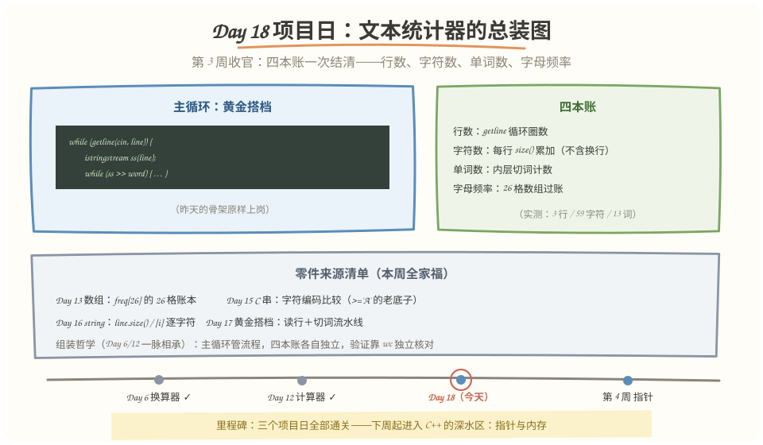
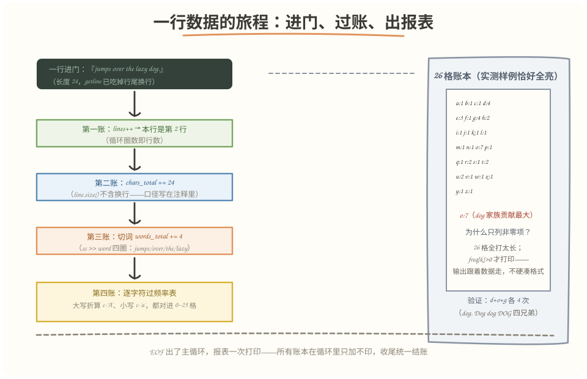
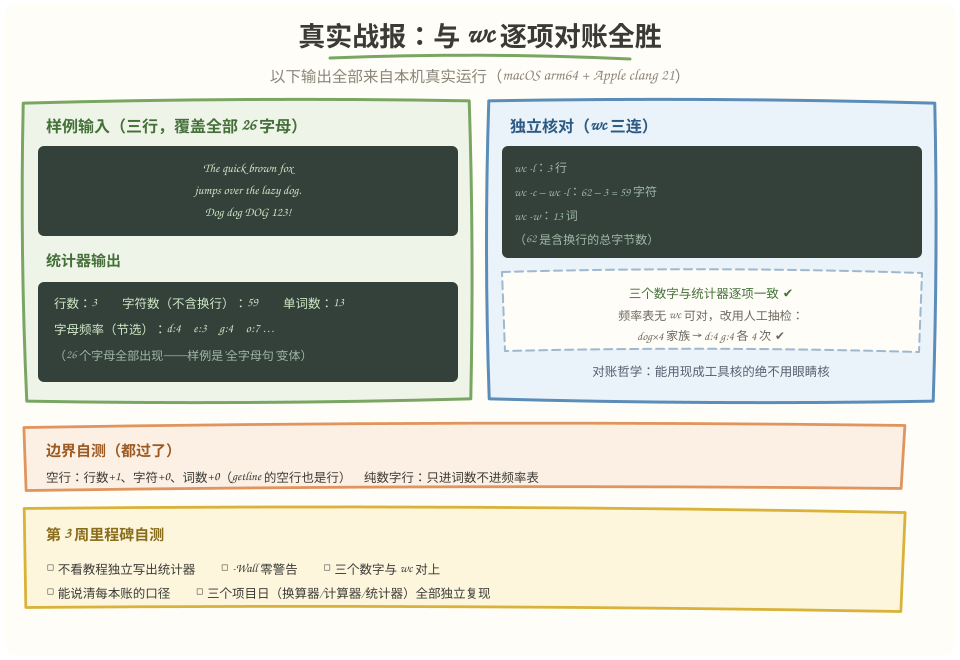

# 第 18 天（项目日）：文本统计器——行数、字符数、单词数、字母频率

> **今日目标**：完成本教程后，你能做到：不看资料独立写出四账合一的文本统计器；说清每本账的统计口径（字符数为何不含换行、123! 为何算单词）；用 `wc -l/-c/-w` 对自己的程序做独立核对；对空行、纯数字行等边界给出正确预测。
> **预计时间**：学习 15 分钟＋实践 60 分钟（项目日实践加重）
> **前置准备**：完成 Day 13~17——今天的每一块零件本周都练过，只差组装。
> **今日产出**：一个 50 余行、`-Wall` 零警告的统计器，三个数字与 `wc` 逐项对上，边界自测通过。

## 1. 今天解决什么问题？

第 3 周攒了四块零件：数组（26 格账本）、C 字符串（字符编码比较的老底子）、std::string（`size()`/`[i]`）、getline+stringstream（读行切词流水线）。今天的问题是计划指定的收官组装：**文本统计器**——给任意一段文本，结清四本账：行数、字符数、单词数、各字母频率。

项目日的验收标准沿用 Day 6/12 的传统：独立复现 + 独立核对。今天的新武器是**用 `wc` 做裁判**——行数、字符数、词数三个数字全部和系统工具对上，才允许自己相信自己。

## 2. 先看全貌：今天的内容位于哪里？



**图 1**：左边是主循环——昨天黄金搭档的骨架原样上岗（外层 getline 读行、内层 ss 切词、EOF 出口）；右边是四本账：行数数循环圈、字符数累加 `size()`、词数数切词圈、频率表用 Day 13 的 26 格数组。下方灰卡是零件来源清单。路线图：三个项目日全部通关，下周进入指针深水区。

三步概括今天：

1. 读行：`while (getline(cin, line))`，循环圈数即行数；
2. 过账：每行先 `chars += size()`，再切词计数，再逐字符进频率表；
3. 结账：EOF 出循环后统一打印报表（循环里只加不印）。

## 3. 核心概念：先用直觉，再给准确定义

### 3.1 统计口径：先说清楚，数字才有意义

- **一句通俗解释**：口径就是"数什么、不数什么"的约定——没口径的数字没法对账。
- **一个类比**：报告"到场人数"前先说清楚：含不含工作人员？含不含小孩？
- **对应到技术上是**：本程序四条口径写在注释里——行数含空行；字符数是各行长度之和**不含换行**（getline 已把换行符吃掉）；单词按任意空白切分（`123!` 算一个词）；频率只统计英文字母、大小写合并。类比的边界：口径没有对错，**只有"说没说"和"守没守"**——`wc -c` 含换行，对账时就要减去行数，这正是核对时动手换算的原因。
- **一个数字的来历**：样例总字节 62、行数 3，字符数 = 62 − 3 = 59 ✔ 与程序输出一致。
- **常见误解**："字符数和 wc -c 一样"——差着每行一个换行符；不对口径直接对数字，必错。

### 3.2 平行账本：循环里只加不印

- **一句通俗解释**：四本账在循环里只做加法，报表等 EOF 出循环后一次打印。
- **一个类比**：收银员白天只扫码记账，打烊后统一出日报——不会每卖一件就打印一次小票汇总。
- **对应到技术上是**：`lines/chars/words/freq` 都是循环外的累加器，循环体内只见 `++` 和 `+=`；打印集中在末尾。类比的边界：调试时可以临时在循环里打印（看每行的过账），**交付版必须收拢**——否则长文本刷屏且报表难找。
- **常见误解**：把打印写进循环，输出和账目搅在一起——打印归打印、记账归记账。

### 3.3 独立核对：让 wc 当裁判

- **一句通俗解释**：自己的程序自己夸不算数，拿现成的系统工具对数字。
- **一个类比**：自己算的账请会计师事务所审计——审计方和记账方必须独立。
- **对应到技术上是**：`wc -l` 对行数；`wc -c` 减行数对字符数；`wc -w` 对词数。频率表没有 wc 可对，改用人工抽检（`dog. Dog dog DOG` 四兄弟 → d、g 各 4 次）。类比的边界：wc 的口径和我们的**几乎**一致但不完全相同（换行、多字节字符），对不上的第一反应是**查口径差异**而不是怀疑 wc。
- **实测结果**：3 行、59 字符、13 词，三项全对。
- **常见误解**：对不上就改自己的程序去凑 wc——先换算口径，真错了再改。

## 4. 图解核心机制



**图 2**：左边跟踪一行 `jumps over the lazy dog.` 的完整旅程：进门（getline 吃掉换行）→ 第一账 `lines++` → 第二账 `chars += 24` → 第三账切词 `words += 5` → 第四账逐字符过频率表（大写折 `c-'A'`、小写 `c-'a'`，都对进 0~25 格）。右边是 26 格账本的实测结果——样例恰好是全字母句变体，26 格全亮，`o:7` 一枝独秀（dog 家族贡献最大）。

按图逐步讲：

1. **进门先记账**：getline 一回来，行数先 +1——空行也是行（getline 拿到长度 0 的合法行）；
2. **三本账共用一趟循环**：字符数、词数、频率都在**同一轮**主循环里结清，不跑三遍——一遍扫描、四账同结；
3. **频率的折算**：`'D'-'A'` 和 `'d'-'a'` 都落在 3 号格——大小写合并的实现就这一行减法；
4. **非零才打印**：26 格全列太长，`freq[k] > 0` 才输出——报表跟着数据走。

## 5. 动手实践：完成一个最小可运行例子

### 5.1 准备文件

```bash
cd ai-compiler-roadmap/tutorials/day-018/examples
```

### 5.2 编写代码

完整程序 `text_stats.cpp`（50 余行）：

```cpp
#include <iostream>
#include <sstream>
#include <string>

// ===== 第 18 天项目日：文本统计器 =====
// 统计口径（先说清楚，数字才有意义）：
//   行数   = getline 读到的行数（空行也算一行）
//   字符数 = 各行长度之和，不含换行符
//   单词数 = 按"任意空白"切分出的词数（标点跟着词走，123! 也算一个词）
//   字母频率 = 只统计英文字母，大小写合并计数
int main() {
    std::string line;
    int lines = 0;
    int chars_total = 0;
    int words_total = 0;
    int freq[26] = {0};                       // Day 13 的数组：26 格字母账本

    std::cout << "请输入文本（Ctrl+D 或管道结束）：" << std::endl;
    while (std::getline(std::cin, line)) {    // 黄金搭档外层：读行
        ++lines;
        chars_total += (int)line.size();      // 换行符不计入（getline 已丢弃）

        std::istringstream ss(line);          // 黄金搭档内层：切词
        std::string word;
        while (ss >> word) {
            ++words_total;
        }

        for (std::size_t i = 0; i < line.size(); ++i) {   // 逐字符过账
            char c = line[i];
            if (c >= 'A' && c <= 'Z') {
                ++freq[c - 'A'];              // 大写折算到 0~25
            } else if (c >= 'a' && c <= 'z') {
                ++freq[c - 'a'];              // 小写天然在 0~25
            }
        }
    }

    std::cout << "\n===== 统计结果 =====" << std::endl;
    std::cout << "行数：" << lines << std::endl;
    std::cout << "字符数（不含换行）：" << chars_total << std::endl;
    std::cout << "单词数：" << words_total << std::endl;

    std::cout << "字母频率（只列出现过的）：" << std::endl;
    for (int k = 0; k < 26; ++k) {
        if (freq[k] > 0) {
            char letter = 'a' + k;
            std::cout << "  " << letter << " : " << freq[k] << std::endl;
        }
    }
    return 0;
}
```

结构回顾：口径注释在头、四本账声明在循环外、循环体三段过账、报表收尾——Day 6 的"先骨架后血肉"到今天已经是肌肉记忆。

### 5.3 运行与观察

```bash
g++ -Wall text_stats.cpp -o ts
printf 'The quick brown fox\njumps over the lazy dog.\nDog dog DOG 123!\n' | ./ts
```

实际执行结果（本机）：

```text
===== 统计结果 =====
行数：3
字符数（不含换行）：59
单词数：13
字母频率（只列出现过的）：
  a : 1
  b : 1
  …（26 个字母全部出现）
  d : 4
  g : 4
  o : 7
  …
```



**图 3**：左上是样例（三行，恰好覆盖全部 26 个字母）和统计器输出；右上是 `wc` 三连的独立核对——`wc -l` = 3、`wc -c` − 行数 = 62 − 3 = 59、`wc -w` = 13，三项与程序逐项一致；下方橙卡是边界自测、黄卡是里程碑清单。

### 5.4 修改一个输入再观察：边界自测

两组边界输入（本机真实结果）：**空行**——喂 `abc⏎⏎xyz⏎`（中间空行），输出行数 3、字符数 6、单词数 2：空行让行数 +1、字符和词数 +0，与口径注释一字不差。**纯数字与符号行**——喂 `123 456!⏎...⏎`，输出行数 2、字符数 11、单词数 3、频率表**一个字母都没有**：数字和标点只进词数账和字符账，不进频率表。两组边界都在写代码前先预测、跑完对答案——这是从 Day 16 反转程序开始养成的习惯。

## 6. 常见错误与排查

**错误 1：字符数和 `wc -c` 对不上，差了行数**

- 现象：程序 59，wc -c 是 62；
- 原因：口径差异——wc 统计**所有字节**（含换行），我们不含换行；
- 定位：做减法 `wc -c − 行数` 再对；
- 修复：不是程序错，是口径换算没做；把口径写进注释就能避免慌乱。

**错误 2：频率表把大写漏了或分开记了**

- 现象：`Dog` 的 D 没进 d 格，或 D 和 d 分占两套表；
- 原因：忘了 `c - 'A'` 折算，或给大写单开了一个 26 格数组；
- 定位：用 `Dog dog DOG` 三连抽检 d 格是否恰为 3（样例再加 dog. 是 4）；
- 修复：大写减 `'A'`、小写减 `'a'`，同进一张 26 格表。

**错误 3：把打印写进了主循环，报表被刷屏淹没**

- 现象：每读一行就打一段统计，最后的总账难找；
- 原因：记账和打印没分离（3.2 的平行账本原则）；
- 定位：检查循环体内有没有 cout；
- 修复：循环里只 `++`/`+=`，报表统一搬到循环后。

## 7. 今日练习

### 必做练习

给统计器加第五本账：**出现频率最高的字母**（提示：结账时扫一遍 freq[26] 取最大——Day 13 擂主法原样复用；并列时报告最早出现的那个）。预期产出：样例运行末尾多一行 `冠军字母：o（7 次）`，并用抽检解释为什么是它。

### 选做挑战

改成"分词频率版"：统计每个**单词**出现的次数（大小写合并），按出现次数从高到低输出前三名。提示：两个平行数组 `string words[200]` + `int counts[200]`（Day 17 选做挑战的延续）；排序可以用 Day 13 的擂台法做三轮。做完你会得到一个迷你"热词榜"——词频统计正是搜索引擎和输入法的地基。

## 8. 今日验收

- [ ] 我能不看教程独立写出统计器，`-Wall` 零警告
- [ ] 我能背出四本账的口径，并对"wc -c 为何要减行数"给出换算
- [ ] 我的三个数字与 wc 逐项一致，频率表经人工抽检
- [ ] 我预测并验证了空行、纯数字行两组边界的行为
- [ ] 我完成了必做练习（冠军字母），三个项目日均能独立复现

## 9. 一句话总结与明天预告

今天的问题是"四块零件能不能装成一台像样的机器"；机制上，黄金搭档一趟循环四账同结、口径先行、wc 独立裁判；实践上，3 行 59 字符 13 词三项对账全胜，边界自测全过，第 3 周在三个项目日的全胜中收官；验证标准是每个数字都有两个独立来源。明天进入 **第 4 周 · Day 19：指针概念**——取地址 `&`、解引用 `*`、`nullptr`，C++ 深水区开潜：变量住在哪、地址长什么样、指针如何指房门牌。
