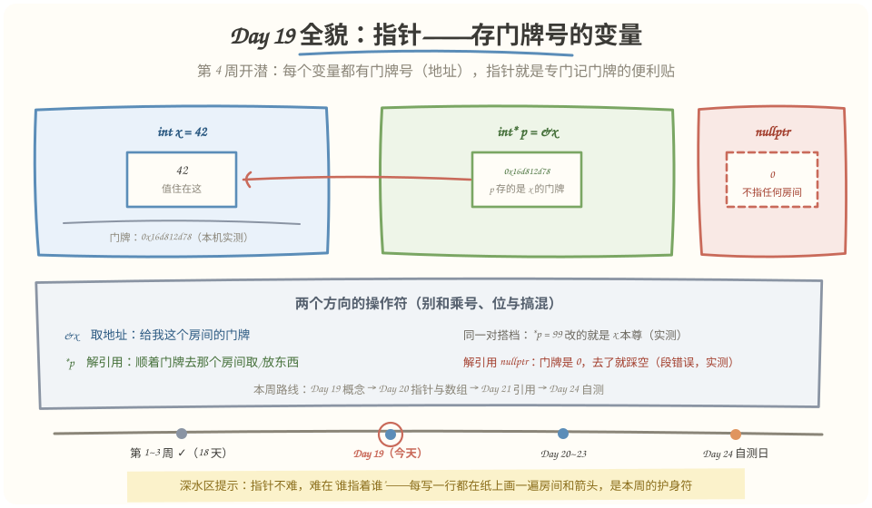
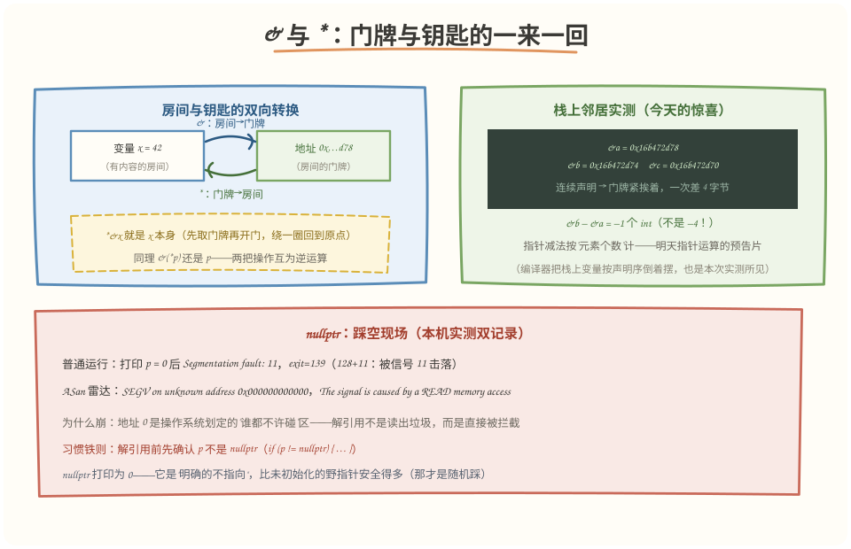
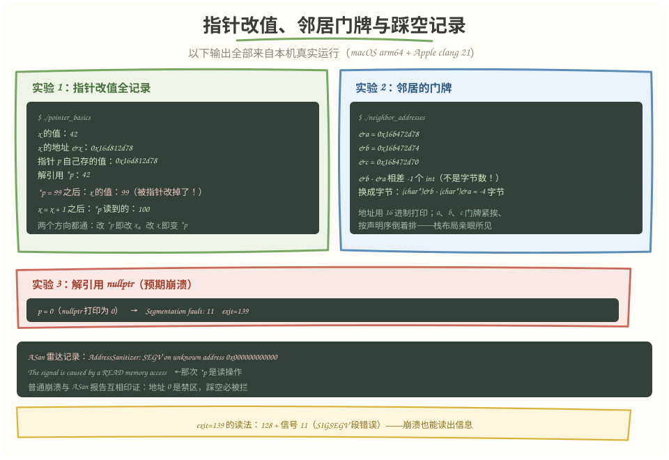

# 第 19 天：指针概念——取地址、解引用、nullptr

> **今日目标**：完成本教程后，你能做到：画出"变量房间 + 指针便利贴"的关系图；用 `&` 取地址、`*` 解引用，并演示通过指针改掉另一个变量的值；解释指针减法为什么按"元素个数"计；说出解引用 `nullptr` 的真实后果（本机实测段错误，exit=139）。
> **预计时间**：学习 30 分钟＋实践 40 分钟（深水区第一天，多画图）
> **前置准备**：完成 Day 1~18；Day 13 的"下标是偏移量"是今天的地基。
> **今日产出**：指针改值全记录、邻居门牌观察、一次亲手制造的段错误（含 ASan 报告）。

## 1. 今天解决什么问题？

第 4 周开潜。计划给本周的定位是"第一阶段难关，慢下来"——今天只解决一个核心问题：**指针到底是什么**。

一句话版本：每个变量住在内存的某个房间里，房间有门牌号（地址）；**指针就是专门记门牌号的变量**。取地址 `&` 把门牌抄给你，解引用 `*` 顺着门牌去房间里取放东西。今天的三个实验围绕这个模型展开：顺着门牌改值（改的还是本尊）、观察邻居的门牌（栈布局亲眼所见）、故意踩空门牌 0（看段错误长什么样）。

## 2. 先看全貌：今天的内容位于哪里？



**图 1**：左边蓝卡是变量 x 的房间（值 42 住在里面，门牌 `0x16d812d78`——本机实测）；中间绿卡是指针 p 的房间，里面**不存 42，存的是 x 的门牌**；右边红卡是 nullptr——一张写着 0 的空便利贴，不指向任何房间。下方灰卡把两个操作符钉死：`&` 房间→门牌，`*` 门牌→房间，互为逆运算。

三步概括今天：

1. `&x` 取地址：拿到 x 房间的门牌（十六进制打印）；
2. `*p` 解引用：顺着 p 存的门牌去 x 房间取/放东西——`*p = 99` 改的就是 x 本尊；
3. `nullptr` 是"明确的不指向"，解引用它 = 踩空 = 段错误。

## 3. 核心概念：先用直觉，再给准确定义

### 3.1 地址与取地址 &

- **一句通俗解释**：地址（address）是变量在内存中的门牌号；`&x` 就是查 x 的门牌。
- **一个类比**：酒店前台问"8316 房住的是谁"是访问变量，问"张先生住几号房"就是取地址。
- **对应到技术上是**：本机实测 `&x` 打印 `0x16d812d78`（十六进制，`0x` 开头）。类比的边界：门牌是酒店定的，地址是**操作系统分配的**——每次运行都可能不同（今天两次实验的地址就不同），别背具体数字、要背关系。
- **最小例子**：`std::cout << &x` 打印一串十六进制。
- **常见误解**：把 `&` 当成"且"（逻辑与）——单独用在变量前是取地址；`&&` 才是逻辑与（Day 5），`&` 还有位与身份（进阶），看语境。

### 3.2 指针与解引用 *

- **一句通俗解释**：指针（pointer）是存地址的变量；`*p` 是"顺着 p 里的门牌去那个房间"。
- **一个类比**：p 是一张写着朋友家地址的便利贴。看便利贴（打印 p）看到的是地址；按地址上门（`*p`）见到的是朋友本人。
- **对应到技术上是**：`int* p = &x;` 声明 p 是"指向 int 的指针"；`*p` 读到 42；`*p = 99` 把 x 改成 99；此后 `x = x + 1`，`*p` 读到 100——**同一个房间，两个入口**。本组全部实测。类比的边界：便利贴可以抄给别人（指针赋值）、可以换一张地址（重新指向），但**类型要对上**——`int*` 只能指 int 的房间。
- **互逆关系**：`*&x` 就是 x（取门牌再开门，回到原点）；`&*p` 还是 p。
- **常见误解**："指针就是另一个副本"——恰恰相反，它不复制内容，只记位置；这正是 Day 9 值传递"改不动原件"的解药伏笔（Day 21 引用正式回收）。

### 3.3 nullptr：明确的不指向

- **一句通俗解释**：`nullptr` 是"这张便利贴不写任何地址"，打印出来是 0。
- **一个类比**：通讯录里存了"暂无号码"——明确没有，而不是存了个乱码号码。
- **对应到技术上是**：本机实测——解引用 nullptr，程序打印到"现在解引用空指针……"后**当场崩溃**：`Segmentation fault: 11`、`exit=139`（= 128 + 信号 11）；ASan 雷达给出 `SEGV on unknown address 0x000000000000 … READ memory access`。原因：地址 0 是操作系统划的禁区，访问即被拦。类比的边界："暂无号码"拨出去是空号提示音，而**解引用 nullptr 是直接炸机**——不是优雅报错。
- **习惯铁则**：指针用 nullptr 初始化（`int* p = nullptr;`）、解引用前先判空（`if (p != nullptr)`）。
- **常见误解**："nullptr 和未初始化指针差不多"——差很远：nullptr 是**明确的**不指向（可判空），未初始化指针是**随机门牌**（野指针），踩到哪算哪，比 nullptr 危险得多。

## 4. 图解核心机制



**图 2**：左上蓝卡是双向转换图：`&` 把房间变门牌（上行），`*` 把门牌变房间（下行），虚线框标注互逆恒等式（`*&x` 就是 x）。右上绿卡是邻居门牌的实测：a、b、c 三个 int 的地址 `0x…d78 / d74 / d70` 紧挨着，每差 4 字节；且 `&b - &a = -1`——**指针减法按元素个数计**，这是明天指针运算的预告片。下方红卡是踩空现场的双记录（普通崩溃 + ASan）与四行结论。

按图逐步讲：

1. **先画房间再写代码**：每行指针代码都问自己"p 现在存的是谁的门牌"——纸上的房间和箭头是本周护身符；
2. **邻居地址说明两件事**：变量在栈上紧挨着排（连续声明只差一个元素大小）；编译器把先声明的放高地址（本机实测 a 最高）——顺序细节因平台而异，**紧挨着**才是普遍规律；
3. **减法按元素计**：`&b - &a = -1` 而 `(char*)&b - (char*)&a = -4`——指针的算术带着"类型步长"，明天正式展开；
4. **踩空的读法**：`exit=139` 拆成 128+11（信号 11 = SIGSEGV）——崩溃信息也能读出结构，别只看"程序挂了"。

## 5. 动手实践：完成一个最小可运行例子

### 5.1 准备文件

```bash
cd ai-compiler-roadmap/tutorials/day-019/examples
```

三个程序：`pointer_basics.cpp`、`neighbor_addresses.cpp`、危险品 `nullptr_crash.cpp`。环境不变（macOS 27，Apple clang 21）。

### 5.2 编写代码

主角 `pointer_basics.cpp`（完整代码）：

```cpp
#include <iostream>

// 指针第一课：取地址 &、解引用 *、通过指针改变量
int main() {
    int x = 42;
    int* p = &x;                 // p 是指针：存的是 x 的地址（& 是取地址）

    std::cout << "x 的值：" << x << std::endl;
    std::cout << "x 的地址 &x：" << &x << std::endl;
    std::cout << "指针 p 自己存的值：" << p << "（就是 x 的地址）" << std::endl;
    std::cout << "解引用 *p（顺着地址取东西）：" << *p << std::endl;

    *p = 99;                     // 顺着地址写东西：改的就是 x 本尊
    std::cout << "\n执行 *p = 99 之后：" << std::endl;
    std::cout << "x 的值：" << x << "（被指针改掉了！）" << std::endl;

    x = x + 1;                   // 直接改 x，*p 跟着变（同一个房间）
    std::cout << "执行 x = x + 1 之后：" << std::endl;
    std::cout << "*p 读到的：" << *p << std::endl;
    return 0;
}
```

`int* p` 读作"p 是指向 int 的指针"——星号贴着类型名写是常见风格，贴着变量名写（`int *p`）也完全等价，选一种坚持即可。

### 5.3 运行与观察

```bash
g++ -Wall pointer_basics.cpp -o pb && ./pb
```

实际执行结果（本机）：

```text
x 的值：42
x 的地址 &x：0x16d812d78
指针 p 自己存的值：0x16d812d78（就是 x 的地址）
解引用 *p（顺着地址取东西）：42

执行 *p = 99 之后：
x 的值：99（被指针改掉了！）
执行 x = x + 1 之后：
*p 读到的：100
```

邻居观察（地址每次运行都会变，看关系别背数字）：

```bash
g++ -Wall neighbor_addresses.cpp -o na && ./na
```

```text
&a = 0x16b472d78
&b = 0x16b472d74
&c = 0x16b472d70
&b - &a 相差 -1 个 int（不是字节数！）
换成字节：(char*)&b - (char*)&a = -4 字节
```



**图 3**：左上是改值全记录（`*p = 99` 与 `x = x+1` 双向都通）；右上是邻居门牌（三个地址紧挨、按声明序倒排）；下半红卡与黑底长条是踩空的双记录——普通崩溃的 `Segmentation fault: 11` 与 ASan 的 `SEGV on unknown address 0x0` 互相印证。

### 5.4 修改一个输入再观察：故意踩空

危险品 `nullptr_crash.cpp` 的核心两行：`int* p = nullptr;` 和 `std::cout << *p;`。运行（预期崩溃）：

```bash
g++ -Wall nullptr_crash.cpp -o nc && ./nc
```

```text
p = 0（nullptr 打印为 0）
现在解引用空指针……
Segmentation fault: 11
```

`exit=139`。"这行永远执行不到"的输出确实没出现——程序死在 `*p` 那一行。再开雷达：

```bash
g++ -Wall -fsanitize=address nullptr_crash.cpp -o nc_asan && ./nc_asan
```

```text
AddressSanitizer:DEADLYSIGNAL
==27373==ERROR: AddressSanitizer: SEGV on unknown address 0x000000000000
==27373==The signal is caused by a READ memory access.
```

对比 Day 13/15 的越界（悄悄踩、雷达才发现）和 Day 3 的有符号溢出（UB 但通常能跑）：**空指针解引用是"当场暴毙"型**——操作系统直接拦截，连悄悄的机会都没有。三类事故摆在一起，"未定义行为"这个词的分量就具体了。

## 6. 常见错误与排查

**错误 1：`error: indirection requires pointer operand`**

- 现象：对普通变量写 `*x`；
- 原因：`*` 只能解引用指针——x 是 int 不是门牌；
- 定位：看报错行的 `*` 作用在什么类型的变量上；
- 修复：先取地址再解引用（`*&x` 合法但多余，直接用 x）。

**错误 2：指针没初始化就解引用，结果随机崩溃**

- 现象：有时崩有时不崩，行为漂移；
- 原因：野指针——未初始化的 p 存着随机门牌，踩到哪算哪；
- 定位：检查所有指针声明处有没有 `= nullptr` 或 `= &某变量`；
- 修复：**声明即初始化**（今天铁则）；崩了反而是好事，不崩的野指针更毒。

**错误 3：把打印指针和解引用搞混，输出一串十六进制还以为程序坏了**

- 现象：`cout << p` 打出 `0x16d812d78`；
- 原因：打印的是 p 存的门牌（地址），不是指向的内容；
- 定位：想要内容就加 `*`——`cout << *p`；
- 修复：看见 `0x` 开头就该意识到"这是地址"。

## 7. 今日练习

### 必做练习

写 `swap_two.cpp` 的前奏：两个 int 变量 a、b，一个指针 p——先指向 a 打印 `*p`，再让 p 改指向 b（`p = &b`）再打印 `*p`。观察同一张便利贴换地址后解引用结果的变化。预期产出：两行不同的 `*p` 输出 + 一句手绘的房间箭头图说明（文字描述即可），抄进 `notes.md`。

### 选做挑战

打印 `sizeof(int*)`、`sizeof(double*)`、`sizeof(char*)`（本机 arm64 上都是 8）。想想：为什么不同类型的指针大小相同？（提示：门牌号本身不关心房间里住的类型——大小取决于"地址有多长"，而不是"指着什么"。）

## 8. 今日验收

- [ ] 我能画出 x、p、nullptr 三者的房间/便利贴关系图
- [ ] 我能说出 & 与 * 的方向并验证过 `*&x` 恒等式
- [ ] 我实测了 `*p = 99` 改的就是 x 本尊、改 x 后 `*p` 同步变
- [ ] 我能解释指针减法为什么按元素个数计（今天的 -1 int / -4 字节）
- [ ] 我亲手制造了一次段错误，能读出 exit=139 = 128 + SIGSEGV(11)

## 9. 一句话总结与明天预告

今天的问题是"指针到底是什么"；机制上，指针是存门牌的变量——`&` 抄门牌、`*` 上门取放、nullptr 是明确的空；实践上，改值双向验证、邻居门牌紧挨（减法按元素计）、踩空当场暴毙三组实验落地；验证标准是每行指针代码都能在纸上画出"谁指着谁"。明天 **Day 20：指针与数组**——数组名会退化成首元素门牌、`p+1` 按步长跳格、仅用指针遍历数组求和：Day 13"下标是偏移量"的下半场正式开演。
