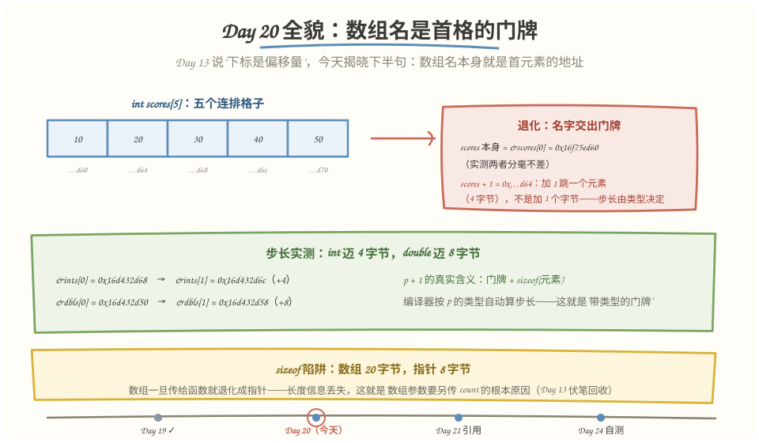
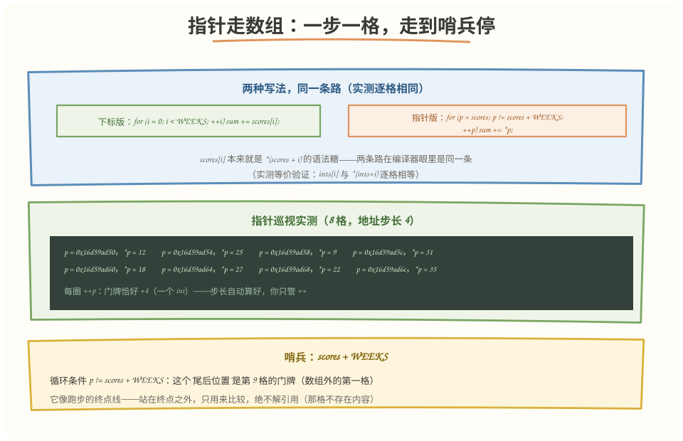
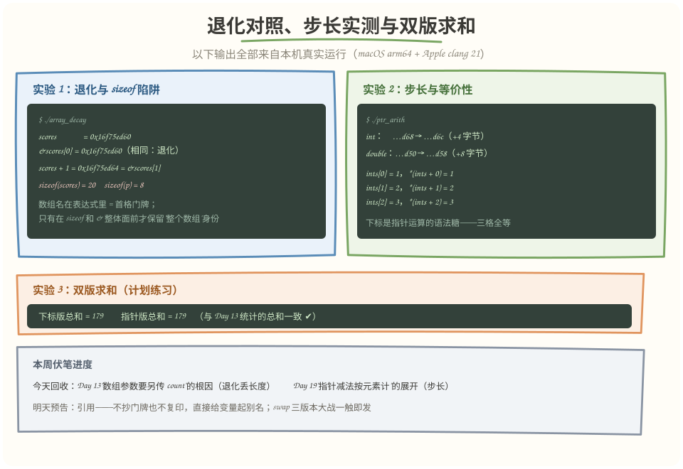

# 第 20 天：指针与数组——数组退化、指针运算

> **今日目标**：完成本教程后，你能做到：演示数组名退化为首元素地址（`a == &a[0]`）；解释 `p + 1` 跳多远由什么决定（实测 int 步长 4、double 步长 8）；说出 `a[i]` 就是 `*(a + i)` 的语法糖；独立完成"仅用指针遍历数组求和"，并用下标版对照验证。
> **预计时间**：学习 25 分钟＋实践 45 分钟
> **前置准备**：完成 Day 19（& 取地址、* 解引用、指针减法按元素计的伏笔）。
> **今日产出**：退化与 sizeof 陷阱演示、步长实测、双版求和（179 = 179），全部真实运行。

## 1. 今天解决什么问题？

Day 13 讲数组时留了两句伏笔："下标是偏移量"和"数组传给函数要另传 count"。今天两句一起回收：**数组名在表达式里会退化（decay）成首元素的地址**——所以 `scores[i]` 从编译器角度看就是 `*(scores + i)`；也正因退化把"整个数组"身份缩成了"一个门牌"，长度信息随之丢失，函数里才必须另传 count。

计划指定的练习"仅用指针遍历数组求和"是今天的收官实验：不用任何下标，让指针从首格一步步走到哨兵，和下标版结果分毫不差。

## 2. 先看全貌：今天的内容位于哪里？



**图 1**：上面是 5 个连排格子的 `int scores[5]`，每格标着实测门牌（`…d60` 到 `…d70`，一格差 4）；右侧红卡是退化：`scores` 本身 = `&scores[0]`（实测分毫不差），`scores + 1` 跳到第二格。绿卡是步长实测（int +4、double +8）；黄卡是 sizeof 陷阱——数组 20 字节、指针 8 字节，Day 13 伏笔的根因。

三步概括今天：

1. 退化：数组名在表达式里 = 首元素地址（例外：`sizeof` 和 `&数组名` 面前保留整体身份）；
2. 运算：`p + 1` = 门牌 + `sizeof(元素)`——步长由类型自动决定；
3. 等价：`a[i]` ≡ `*(a + i)`——下标是指针运算的语法糖。

## 3. 核心概念：先用直觉，再给准确定义

### 3.1 数组退化：名字交出门牌

- **一句通俗解释**：数组名用在表达式里时，编译器把它换成"第 0 格的门牌"。
- **一个类比**：整栋楼有个总名"3 号楼"，但快递员问路时你只会说"3 号楼 101"——总名在实践中总被翻译成第一个门牌。
- **对应到技术上是**：本机实测 `scores` 与 `&scores[0]` 都打印 `0x16f75ed60`；`int* p = scores;` 合法且等价于 `p = &scores[0]`。类比的边界：楼名不会消失，而数组名有**两个例外**不退化——`sizeof(scores)` 仍是整个数组的大小（实测 20）、`&scores` 取的是"整个数组的地址"（数值上等于首格但类型不同，进阶话题）。
- **常见误解**："`p = scores` 是把数组复制给指针"——没有复制，只是抄了个门牌；数组还在原地，p 只是多了一条看它的路。

### 3.2 指针运算：一步一格

- **一句通俗解释**：`p + 1` 不是地址加 1 个字节，而是**跳过一个元素**。
- **一个类比**：楼房门牌按"户"编——3 号楼的下一户是 3+1 户，不管每户占多大面积。
- **对应到技术上是**：`p + 1` 的真实含义是"门牌数值 + sizeof(元素)"。本机实测：int 数组相邻两格差 4（`…d68 → …d6c`），double 数组差 8（`…d50 → …d58`）。昨天"指针减法按元素计"今天有了完整解释：加减都按元素个数，字节换算编译器包办。类比的边界：门牌类比里"下一户"总有意义，而指针**走出数组边界再解引用**就是越界（Day 13 军规照旧）——`scores + WEEKS` 这个尾后位置只用来当终点线，绝不解引用。
- **最小例子**：巡视输出里 `++p` 每圈门牌恰好 +4。
- **常见误解**：想按字节走写成 `(char*)p + 1`——类型一换步长就变（昨天实验用过），不是不行，是要想清楚。

### 3.3 下标是语法糖：a[i] ≡ *(a + i)

- **一句通俗解释**：`a[i]` 是 `*(a + i)` 的亲切写法——先偏移 i 格，再顺门牌取值。
- **一个类比**：`a[i]` 像门牌号的简称，`*(a + i)` 是它的全称"从首户数过 i 户的那家"。
- **对应到技术上是**：本机实测三格全等：`ints[0] = *(ints+0) = 1`、`ints[1] = *(ints+1) = 2`、`ints[2] = *(ints+2) = 3`。类比的边界：语法糖不改变语义但**改变可读性**——按下标思考更直观，按指针思考更接近机器；两种都要能读会写。
- **一个冷知识**：既然 `a[i]` 是 `*(a + i)`，加法可交换，所以 `i[a]` 也合法（但别这么写）——理解规则的最好证据是知道它的边角。
- **常见误解**：以为下标和指针是两套机制——同一机制两种皮。

## 4. 图解核心机制



**图 2**：上半部分把两种写法并排：下标版（绿框）和指针版（橙框）走的是同一条路——`scores[i]` 本就是 `*(scores + i)`。下半部分是指针巡视的实测表：8 格门牌 `0x…d50` 到 `0x…d6c`，每圈 `++p` 恰好 +4；黄卡解释哨兵 `scores + WEEKS`——第 9 格（数组外第一格）的门牌，只当终点线、绝不解引用。

按图逐步讲：

1. **先对齐两种写法**：把指针版的 `p` 想象成"走动中的 i"——下标版是"格子不动我报数"，指针版是"我走到格门前"；
2. **步长自动化**：`++p` 你只写两个加号，加 4 还是加 8 由 p 的类型决定——这就是"带类型的门牌"的含义；
3. **哨兵的规矩**：`p != scores + WEEKS` 里的 `+ WEEKS` 是指针运算（跳 8 格），不是字节加法；尾后位置解引用 = 越界，ASan 随时埋伏；
4. **退化例外记两条**：`sizeof(数组名)` 和 `&数组名` 之外，数组名一律当首格门牌用。

## 5. 动手实践：完成一个最小可运行例子

### 5.1 准备文件

```bash
cd ai-compiler-roadmap/tutorials/day-020/examples
```

三个程序：`array_decay.cpp`、`ptr_arith.cpp`、`pointer_sum.cpp`。环境不变（macOS 27，Apple clang 21）。

### 5.2 编写代码

求和主角 `pointer_sum.cpp`（完整代码）：

```cpp
#include <iostream>

// 计划练习：仅用指针遍历数组求和（不用下标！）
int main() {
    const int WEEKS = 8;
    int scores[WEEKS] = {12, 25, 9, 31, 18, 27, 22, 35};

    int sum_index = 0;                                  // 下标版（对照组）
    for (int i = 0; i < WEEKS; ++i) {
        sum_index += scores[i];
    }

    int sum_pointer = 0;                                // 指针版（今天的主角）
    for (int* p = scores; p != scores + WEEKS; ++p) {   // 从首格走到尾格的下一格
        sum_pointer += *p;                              // 解引用取当前格的值
    }

    std::cout << "下标版总和 = " << sum_index << std::endl;
    std::cout << "指针版总和 = " << sum_pointer << std::endl;

    // 指针版逐格巡视：地址和值一起看
    std::cout << "指针巡视：" << std::endl;
    for (int* p = scores; p != scores + WEEKS; ++p) {
        std::cout << "  p = " << p << "，*p = " << *p << std::endl;
    }
    return 0;
}
```

`for` 的三段式在指针版里换了零件：起步是 `p = scores`（首格门牌）、条件是 `p != scores + WEEKS`（哨兵）、步进是 `++p`（跳一格）——结构没变，单位从"下标"换成了"门牌"。

### 5.3 运行与观察

```bash
g++ -Wall array_decay.cpp -o array_decay && ./array_decay
```

实际执行结果（本机）：

```text
scores        = 0x16f75ed60
&scores[0]    = 0x16f75ed60（两者相同：退化）
scores + 1    = 0x16f75ed64
&scores[1]    = 0x16f75ed64（加 1 跳一个元素）
sizeof(scores) = 20（整个数组 5×4 字节）
sizeof(p)      = 8（指针自己只有 8 字节）
退化陷阱：数组传给函数后，函数里 sizeof 拿到的只是指针大小！
```

```bash
g++ -Wall ptr_arith.cpp -o ptr_arith && ./ptr_arith
```

```text
int 数组：
  &ints[0] = 0x16d432d68
  &ints[1] = 0x16d432d6c（差 4 字节 = 1 个 int）
double 数组：
  &dbls[0] = 0x16d432d50
  &dbls[1] = 0x16d432d58（差 8 字节 = 1 个 double）
等价验证：
  ints[0] = 1，*(ints + 0) = 1
  ints[1] = 2，*(ints + 1) = 2
  ints[2] = 3，*(ints + 2) = 3
```



**图 3**：左上退化实验（`scores` 与 `&scores[0]` 分毫不差、sizeof 20 vs 8）；右上步长与等价性（int +4、double +8，三格全等）；下半橙卡是双版求和的战报。右下灰卡是本周伏笔进度——两笔旧账今天结清，明天 swap 之战开场。

### 5.4 修改一个输入再观察：换 double 再走一遍

把 `pointer_sum.cpp` 的数组改成 `double prices[4] = {9.9, 19.5, 4.5, 3.0}`（`WEEKS` 相应改成 4），指针版循环里 `int* p` 相应改成 `double* p`，两个累加变量 `sum_index`、`sum_pointer` 也要改成 `double`——保持 `int` 会被截断成 35（本机真实输出）：

```text
下标版总和 = 36.9
指针版总和 = 36.9
```

门牌步长自动从 4 变 8（巡视地址每圈 +8），代码一行步长逻辑都没写——**类型换了，步长跟着换，这就是指针运算的全部自动化**。顺带一提：`36.9` 是 `9.9+19.5+4.5+3.0` 的浮点累加结果，末位可能有舍入（Day 2 的 6 位有效数字显示），但两版路径相同、结果必然一致。

## 6. 常见错误与排查

**错误 1：在函数里 `sizeof(数组参数)` 得到 8，算出"元素 2 个"**

- 现象：传 5 个元素的数组，函数里 `sizeof(a)/sizeof(a[0])` 得 2；
- 原因：参数里的 `int a[]` 实为 `int*`——退化后只剩门牌（8 字节）；
- 定位：打印 `sizeof(a)` 一验便知；
- 修复：长度作参数另传（Day 13 的做法）；根治等第 14 周 `vector`（自带长度）。

**错误 2：对哨兵位置解引用，读到垃圾或崩溃**

- 现象：循环写成 `p <= scores + WEEKS`（把终点线当格子踩）；
- 原因：`scores + WEEKS` 是数组外第一格——解引用即越界；
- 定位：数一数输出行数是否比元素多一行；
- 修复：条件用 `!=` 或 `<`，终点线只看不踩（今天代码的写法）。

**错误 3：`int* p = &scores;` 类型不匹配的警告**

- 现象：编译警告 pointer type mismatch；
- 原因：`&scores` 是"整个数组的地址"（类型 `int(*)[5]`），不是首元素地址；
- 定位：看警告里的两个类型；
- 修复：用 `p = scores` 或 `p = &scores[0]`——今天场景要的是元素门牌。

## 7. 今日练习

### 必做练习

写 `pointer_max.cpp`：把 Day 13 的擂主法改造成纯指针版——不用下标，用 `for (int* p = scores; p != scores + WEEKS; ++p)` 找 8 周成绩的最大值和最小值。预期产出：最大 35、最小 9（与 Day 13 一致），并回答：擂主变量还需要下标吗？

### 选做挑战

用指针逆序打印数组：从 `scores + WEEKS - 1`（最后一格）倒着走到 `scores`。提示：`for (int* p = scores + WEEKS - 1; p >= scores; --p)`——注意 `p` 用 `int*` 而非无符号类型（Day 13 埋的"倒序死循环"伏笔在指针世界的对应物：指针没有无符号问题的烦恼，但条件方向别写反）。

## 8. 今日验收

- [ ] 我能演示并解释数组退化：`scores` 与 `&scores[0]` 相同，两个例外是什么
- [ ] 我能说出 `p + 1` 的步长由什么决定，并报出 int 和 double 的实测步长
- [ ] 我验证过 `a[i]` 与 `*(a + i)` 逐格相等，能解释"下标是语法糖"
- [ ] 我独立完成了纯指针求和，与下标版结果一致（179 = 179）
- [ ] 我能解释哨兵 `scores + WEEKS` 为什么只当终点线、绝不解引用

## 9. 一句话总结与明天预告

今天的问题是"数组和指针是什么关系"；机制上，数组名退化成首格门牌、指针运算按元素步长跳格、下标本是指针运算的糖衣；实践上，退化对照、步长实测、双版求和三组实验落地，还顺手换了 double 复验步长自动化；验证标准是每行指针代码能同时用下标和门牌两种语言读出来。明天 **Day 21：引用**——给变量起别名，`swap` 三版本大战（值/指针/引用）一触即发：Day 9"复印件改不动原件"的欠账，两种货币一次还清。
