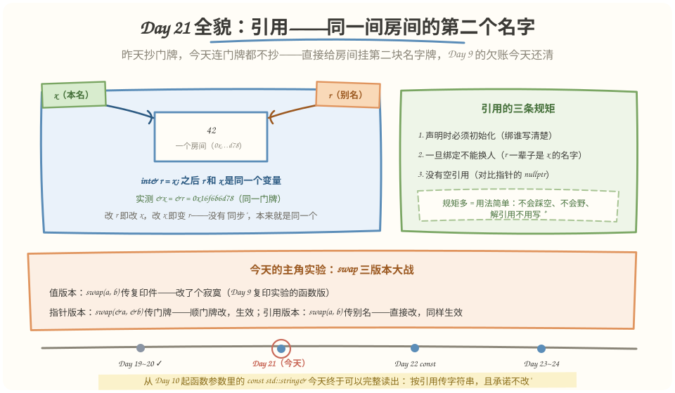
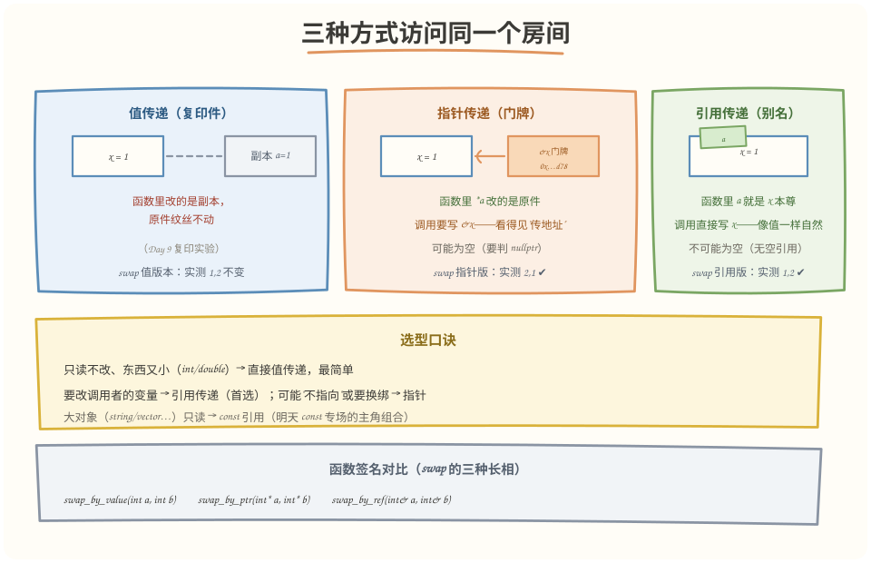
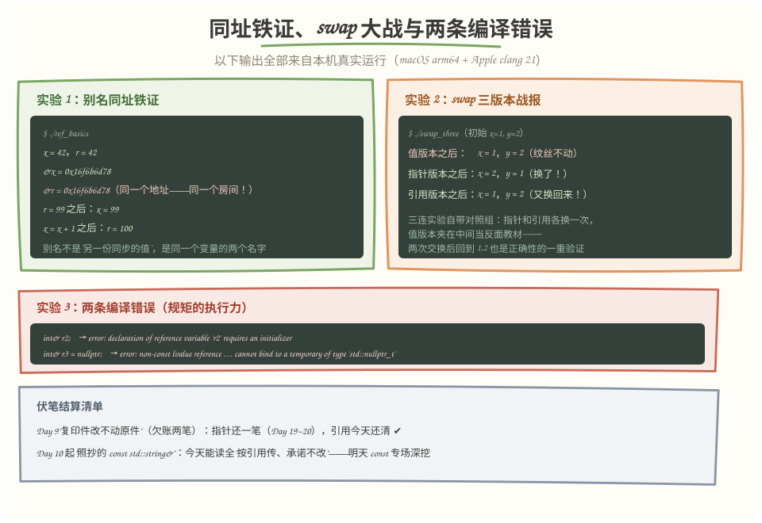

# 第 21 天：引用——同一间房间的第二个名字

> **今日目标**：完成本教程后，你能做到：用"别名"模型解释引用（实测 `&x == &r`）；说出引用三条规矩（必须初始化、不能换绑、无空引用）；完整复现 swap 三版本大战并解释每种的行为；给出"值/指针/引用"的选型口诀。
> **预计时间**：学习 25 分钟＋实践 45 分钟
> **前置准备**：完成 Day 19~20（指针的门牌模型是今天的对照系）；记得 Day 9 的复印实验——欠账今天还清。
> **今日产出**：同址铁证、swap 三版本战报、两条真实编译错误记录。

## 1. 今天解决什么问题？

Day 9 的复印实验留下欠账：值传递改不动原件。Day 19~20 用指针还了一半——传门牌可以改，但调用处要写 `&x`、函数里要写 `*a`，还得防空指针。今天的问题：**有没有更轻的方式**？

有，就是引用（reference）：`int& r = x;` 给 x 再挂一块名字牌。r 不是新变量、不占新房间——**它就是 x 本人**。用引用传参，函数里写的 `a` 就是调用者的变量本尊：不用取地址、不用解引用、不可能为空。swap 三版本大战是今天的验收仪式。

## 2. 先看全貌：今天的内容位于哪里？



**图 1**：左边是别名模型：一个房间挂两块名字牌（x 本名、r 别名）——本机实测两块牌后面是**同一个门牌** `0x16f6b6d78`。右边绿卡是引用三条规矩：必须初始化、不能换绑、无空引用——规矩多恰恰是用法简单的原因。下方橙卡预告 swap 三版本。底部黄条点破：从 Day 10 起参数里照抄的 `const std::string&` 今天终于能读全。

三步概括今天：

1. `int& r = x;`：r 是 x 的别名，同一变量两个名字；
2. 引用传参：函数直接操作调用者的变量（改别名 = 改本尊）；
3. 选型：小东西只读用值；要改用引用；可能空/要换绑用指针。

## 3. 核心概念：先用直觉，再给准确定义

### 3.1 引用：别名，不是新盒子

- **一句通俗解释**：引用是给已存在的变量起的**另一个名字**——不是副本、不是地址，就是名字。
- **一个类比**：同事张三外号"老张"——叫张三或老张，应门的都是同一个人；给老张发工资，张三的账户就多了钱。
- **对应到技术上是**：`int& r = x;` 后 `&x` 与 `&r` 打印**同一个地址**（实测 `0x16f6b6d78`）；`r = 99` 后 x 变 99，`x = x + 1` 后 r 读到 100。类比的边界：外号可以随便起随便改口，引用**一旦绑定终身不换**——`r = y` 不是"让 r 改指 y"，而是"把 y 的值赋给 x"！这是引用最反直觉的一处，务必画房间图想清楚。
- **最小例子**：三行验证——`r = 99;`、打印 x、打印 `&r`。
- **常见误解**："r 是 x 的同步副本"——没有同步这回事，**本来就是同一个变量**。

### 3.2 引用传参：别名进函数

- **一句通俗解释**：调用 `f(x)` 时若参数是 `int& a`，函数里的 a 就是 x 的别名——改 a 即改 x。
- **一个类比**：公司前台有个联系人叫"研发部对接人"——这个称呼指向的就是那位工程师本人，前台给他发通知，本人就收到了。
- **对应到技术上是**：`swap_by_ref(int& a, int& b)` 里交换 a、b，调用者的 x、y 应声而换（实测 2,1）。对比指针版：调用处**不用写 `&`**、函数体**不用写 `*`**、**不用判空**——三处省心。类比的边界：别名进函数的代价是**看签名才能知道会改**（调用处长得和值传递一模一样），所以工程惯例是：改别人变量的函数要起显眼的名字（如 `swap_`、`sort_`），或用明天的 const 表态不改。
- **最小例子**：swap 引用版三行函数体，和初学者直觉写的一模一样——之所以"直觉写法"在引用版里直接就对了，是因为直觉里我们本来就想改那两个变量。
- **常见误解**："引用传递比值传递慢（多了别名机制）"——不会；编译器底层就是传地址，只是语法上替你藏好了。

### 3.3 三条规矩与指针的分工

- **一句通俗解释**：引用必须初始化、不能换绑、没有空引用——三条规矩换来"永不踩空"的安全。
- **一个类比**：指针像可换电池的手电（灵活但可能没装电池），引用像接线式台灯（插上就不换插座，永远有电）。
- **对应到技术上是**：`int& r2;` 编译报错 `requires an initializer`；`int& r3 = nullptr;` 报错 `cannot bind to a temporary of type 'std::nullptr_t'`（两条都是本机实测原文）。分工口诀：**要改且必有对象 → 引用；可能"没有"或要中途换绑 → 指针**。类比的边界：台灯不能搬到别的插座，引用也不能换绑——需要"重新指向"的场合（如遍历数组的游标）只能用指针。
- **常见误解**："引用是指针的语法糖"——底层常实现为地址，但**语义不同**：指针是变量（有自己的地址），引用只是名字（`&r` 打印出来是 x 的地址，不是 r 的）。

## 4. 图解核心机制



**图 2**：三张卡片并排对比同一件事——把 x 交到函数手里：左卡值传递（复印件，函数改副本、原件不动）；中卡指针传递（门牌，调用写 `&x`、函数写 `*a`、可能为空）；右卡引用传递（别名，函数体里 a 就是 x，调用像值一样自然、不可能空）。下方黄卡是选型口诀，灰卡把 swap 的三种函数签名并列。

按图逐步讲：

1. **先看左卡的"改了个寂寞"**：swap 值版本实测 x、y 纹丝不动——Day 9 复印实验的函数版复现；
2. **中卡看两条额外成本**：调用处 `&` 和函数体 `*` 是指针版的"仪式感"，判空是它的安全税；
3. **右卡的别名直达**：没有中间层，函数体写法和直觉一致——但**读签名才知道会改**，命名要诚实；
4. **选型口诀背下来**：小而只读→值；要改→引用；可空/换绑→指针；大对象只读→const 引用（明天主角）。

## 5. 动手实践：完成一个最小可运行例子

### 5.1 准备文件

```bash
cd ai-compiler-roadmap/tutorials/day-021/examples
```

两个程序：`ref_basics.cpp`（别名铁证）、`swap_three.cpp`（三版本大战主角）。

### 5.2 编写代码

主角 `swap_three.cpp`（完整代码）：

```cpp
#include <iostream>

// 主角：swap 三版本大战（值 / 指针 / 引用）
void swap_by_value(int a, int b) {      // 值传递：拿到的是复印件（Day 9）
    int t = a;
    a = b;
    b = t;
}

void swap_by_ptr(int* a, int* b) {      // 指针传递：拿到门牌，顺门牌去改
    int t = *a;
    *a = *b;
    *b = t;
}

void swap_by_ref(int& a, int& b) {      // 引用传递：拿到别名，改别名就是改本尊
    int t = a;
    a = b;
    b = t;
}

int main() {
    int x = 1, y = 2;

    swap_by_value(x, y);
    std::cout << "值版本之后：  x = " << x << "，y = " << y << "（纹丝不动）" << std::endl;

    swap_by_ptr(&x, &y);                // 注意：要传地址
    std::cout << "指针版本之后：x = " << x << "，y = " << y << "（换了！）" << std::endl;

    swap_by_ref(x, y);                  // 注意：直接传变量
    std::cout << "引用版本之后：x = " << x << "，y = " << y << "（又换回来！）" << std::endl;
    return 0;
}
```

三个函数体**逻辑一字不差**（都是三行交换），差别全在参数表：`int a`（复印件）、`int* a`（门牌）、`int& a`（别名）——对照实验的唯一变量原则再次生效。

### 5.3 运行与观察

```bash
g++ -Wall ref_basics.cpp -o rb && ./rb
```

实际执行结果（本机）：

```text
x = 42，r = 42
&x = 0x16f6b6d78
&r = 0x16f6b6d78（同一个地址——同一个房间！）
r = 99 之后：x = 99
x = x + 1 之后：r = 100
```

```bash
g++ -Wall swap_three.cpp -o sw && ./sw
```

```text
值版本之后：  x = 1，y = 2（纹丝不动）
指针版本之后：x = 2，y = 1（换了！）
引用版本之后：x = 1，y = 2（又换回来！）
```



**图 3**：左上是别名同址铁证（`&x` 与 `&r` 一模一样）；右上是三版本战报——指针和引用各换一次、值版夹在中间当反面教材，**两次交换后回到 1,2 本身就是一重正确性验证**；下半红卡是两条编译错误的原文。

### 5.4 修改一行再观察：规矩的执行力

把 `ref_basics.cpp` 里的两行注释各放开一次（预期编译失败，本机实测）：

**实验 A：引用不初始化**

```text
error: declaration of reference variable 'r2' requires an initializer
   18 |     int& r2;
      |          ^~
```

**实验 B：绑定 nullptr**

```text
error: non-const lvalue reference to type 'int' cannot bind to a temporary of type 'std::nullptr_t'
```

两条错误把"三条规矩"中的两条变成了看得见的红字：**必须在出生时绑定**、**不能绑"没有"**（第三条"不能换绑"没有对应的编译错误——`r = y` 是合法赋值，只是含义是"把 y 赋给 x"，这正是 3.1 强调的最反直觉处）。

## 6. 常见错误与排查

**错误 1：以为 `r = y` 是让 r 改绑 y**

- 现象：写了 `int& r = x; r = y;` 之后发现 x 变成了 y 的值；
- 原因：引用不能换绑——`r = y` 是赋值语句，把 y 的值写进 r 所绑定的 x；
- 定位：打印 x、y、r 三者对账；
- 修复：要"可换绑的引用"不存在，需要换绑就用指针 `p = &y`。

**错误 2：swap 写了引用版，调用处习惯性加了 `&`**

- 现象：`swap_by_ref(&x, &y)` 编译报错（类型不匹配）；
- 原因：参数是 `int&`，实参应传 int 变量本身；`&x` 是地址（`int*`）；
- 定位：看报错的两个类型；
- 修复：去掉 `&`，直接传变量。

**错误 3：返回局部变量的引用**

- 现象：函数返回 `int&`，返回的是函数内局部变量，调用方拿到后值飘忽；
- 原因：局部变量出函数就销毁，别名指向了已拆的房间（悬空引用，未定义行为）；
- 定位：检查返回类型带 `&` 的函数，返回的是不是局部变量；
- 修复：返回**值**（拷贝出来），或返回生命周期更长的对象（第 10 周类成员常见）。

## 7. 今日练习

### 必做练习

写 `min_max_ref.cpp`：函数签名 `void min_max(const int scores[], int count, int& out_min, int& out_max)`——一次遍历，通过两个引用参数"带出"最小值和最大值（Day 13 擂主法 + Day 20 指针遍历 + 今天引用输出，三合一）。预期产出：8 周成绩输出最小 9、最大 35，与 Day 13 一致。

### 选做挑战

把 Day 9 的 `double_it` 改成引用版：`void double_it(int& n) { n *= 2; }`，调用 `double_it(x)` 后打印 x。对比 Day 9 的复印版（调用后 x 不变），用一句话向自己解释这两天的本质区别（答案方向：复印件 vs 名字）。

## 8. 今日验收

- [ ] 我能画出别名模型并复述同址铁证（`&x` 与 `&r` 相同）
- [ ] 我能说出引用三条规矩，其中两条有编译错误作证、一条是赋值陷阱
- [ ] 我独立复现了 swap 三版本，能解释每个版本的行为和调用长相差别
- [ ] 我能背出选型口诀：小只读→值、要改→引用、可空/换绑→指针
- [ ] 我知道"返回局部变量的引用"是悬空雷，能识别

## 9. 一句话总结与明天预告

今天的问题是"不改原件的轻量通道存不存在"；机制上，引用是别名——同址同值同生命，三条规矩换永不说空；实践上，同址铁证、swap 三版大战、两条编译错误全部落地，Day 9 的复印欠账正式结清；验证标准是看到任何函数签名能读出"复印件/门牌/别名"哪一种。明天 **Day 22：const 与指针/引用的四种组合**——"指向常量的指针""常量指针"一字之差天壤之别，还有从 Day 10 用到今天的 `const std::string&` 的完整解读。
