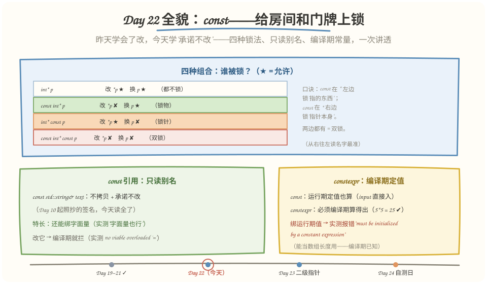
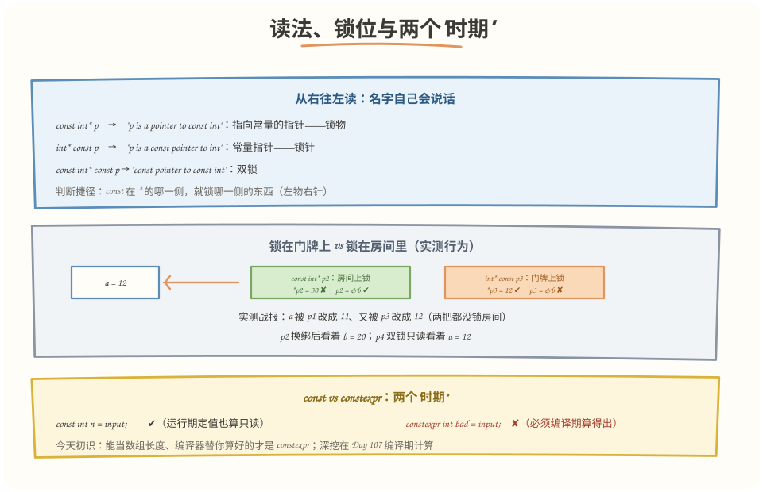
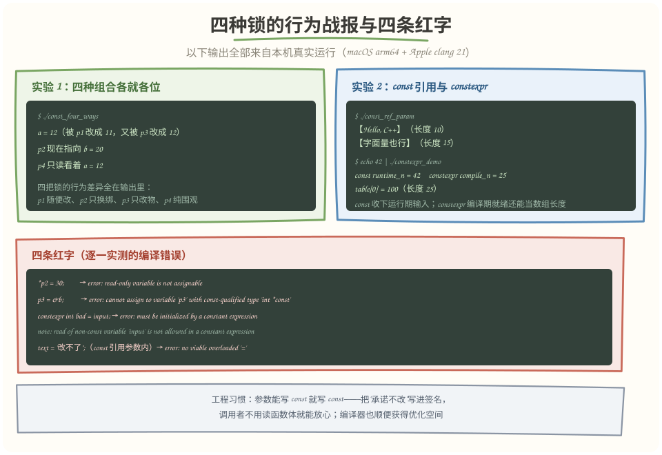

# 第 22 天：const 与指针/引用的四种组合——给房间和门牌上锁

> **今日目标**：完成本教程后，你能做到：写出 const 与指针的四种组合并说出各自锁住了什么；用"从右往左读"法解析任何 const 声明；解释 `const std::string&` 参数的双重含义（不拷贝 + 承诺不改）；说出 const 和 constexpr 的"两个时期"差别。
> **预计时间**：学习 30 分钟＋实践 40 分钟
> **前置准备**：完成 Day 19~21（门牌、别名模型是今天的锁位图基础）。
> **今日产出**：四种锁的行为战报、四条真实编译错误、const 引用与 constexpr 的初识实验。

## 1. 今天解决什么问题？

前三天学会了"改"：指针能改、引用能改。今天反向：**怎么承诺不改**。C++ 的答案叫 const——它可以锁"指的东西"（房间）、锁"指针本身"（门牌）、或双锁，还能给引用戴只读镣铐。四种组合一字排开，是 C++ 声明语法的著名难关，也是计划指定的练习"手写并解释每种的含义"。

顺带两件事：从 Day 10 照抄到今天的 `const std::string&` 今天讲透；constexpr 初识——它和 const 的差别不在"只读"，在"**什么时候**定值"。

## 2. 先看全貌：今天的内容位于哪里？



**图 1**：蓝色大表是四种组合的锁位：`int* p` 都不锁、`const int* p` 锁物、`int* const p` 锁针、`const int* const p` 双锁——右侧口诀"const 在 * 左边锁物、右边锁针"。左下绿卡是 const 引用（只读别名，还能绑字面量）；右下黄卡是 constexpr（必须编译期算得出）。

三步概括今天：

1. 判断捷径：看 const 在 `*` 的哪一侧——左物右针，两边都有双锁；
2. 从右往左读声明，名字自己会说话；
3. const 引用 = 不拷贝 + 承诺不改；constexpr = 编译期常量。

## 3. 核心概念：先用直觉，再给准确定义

### 3.1 四种组合：两把锁的排列

- **一句通俗解释**：const 能锁两样东西——房间里的内容、门牌的指向；两把锁各锁不锁，共四种组合。
- **一个类比**：储物柜——"柜内物品不许动"是一种锁（锁物），"钥匙不许换柜子"是另一种（锁针），两个都贴是双锁，都不贴就是普通指针。
- **对应到技术上是**（全部本机实测）：`int* p1` 改物换绑都行；`const int* p2` 的 `*p2 = 30` 编译报错但 `p2 = &b` 合法；`int* const p3` 反过来（`*p3 = 12` ✔、`p3 = &b` ✘）；`const int* const p4` 全锁。类比的边界：贴了"物品不许动"的柜子，**换个柜子看**完全可以（p2 能换绑）——锁的是"这间房的内容"，不是"你的眼睛"。
- **最小例子**：`const int* p2 = &a; p2 = &b;` 合法且常见——"只读游标"扫数组的标配写法。
- **常见误解**："`const int* p` 表示 p 指向的变量从此是常量"——不是！a 本身还能被别的路径改（p3 就改了它）；const 只约束**通过这把门牌**的操作。

### 3.2 读法：从右往左，名字自己说话

- **一句通俗解释**：把声明从右往左读成英语，const 归属自然清晰。
- **一个类比**：中文地址从大到小读，英文从小到大读——`int* const p` 倒过来念 "p is a const pointer to int"。
- **对应到技术上是**：`const int* p` = "p is a pointer to const int"（指向常量的整数）；`int* const p` = "p is a const pointer to int"。类比的边界：读法是辅助，**判断捷径（左物右针）**更快——面试和读码两把工具都备着。
- **常见误解**：`const int* p` 和 `int const* p` 以为是两种东西——完全相同（const 和 int 谁前谁后无所谓，看它俩整体在 `*` 的哪边）。

### 3.3 const 引用：只读别名

- **一句通俗解释**：`const int& r` 是"只能看、不能通过它改"的别名。
- **一个类比**：博物馆讲解员的讲解词——可以指认展品（读），不能把展品拿出来改（写）。
- **对应到技术上是**：`const std::string& text` 作参数一箭双雕——**不拷贝**（引用的 Day 21 优势）+ **承诺不改**（const 的表态）；实测它还能绑字面量（普通引用不行，这是 const 引用的独家特权）。函数体内 `text = "改不了";` 编译报错 `no viable overloaded '='`。类比的边界：只读别名锁的是"这条通道"——变量本人通过别的名字照样能改。
- **常见误解**："`const string&` 和 `string` 传参差不多"——差一次完整拷贝：字符串很长时，前者只递别名（快），后者整串复印（慢）。

### 3.4 constexpr 初识：编译期常量

- **一句通俗解释**：constexpr 要求值在**编译期**就算出来；const 只要求"定了就不改"，运行期定也行。
- **一个类比**：菜谱上的"3 人份"（印出来就定了，constexpr）vs 桌上实际来了几位客人（开饭才知道，const 可以收下这个数）。
- **对应到技术上是**：实测 `const int runtime_n = input;` ✔（收下运行期输入）；`constexpr int bad = input;` ✘，报错 `must be initialized by a constant expression`，note 更直白：`read of non-const variable 'input' is not allowed`。`constexpr int compile_n = 5 * 5;` ✔ 且能当数组长度（编译期已知）。类比的边界：这是初识——`constexpr` 函数、编译期计算的深水区在 Day 107。
- **常见误解**："const 就是编译期常量"——不一定！`const int n = input;` 完全合法，它只是"只读"，不是"编译期"。

## 4. 图解核心机制



**图 2**：上半部分是从右往左读法的三行范例和"左物右针"捷径；中间灰卡把锁画在门牌和房间上——绿框（锁物）与橙框（锁针）并排，配实测战报（a 被 p1、p3 各改一次，p2 换绑看 b，p4 纯围观）；下方黄卡是 const 与 constexpr 的"两个时期"对照表。

按图逐步讲：

1. **先用捷径定位锁**：看到声明先找 `*`——左边有 const 锁物，右边有 const 锁针，一眼定位；
2. **再用实测验证行为**：四种组合各做了合法操作（非法的被编译器拦下，红字见 5.3）——**理解 + 验证**双保险；
3. **const 引用看双重收益**：签名 `const std::string&` 一行字同时表达"不拷贝"和"不改你"——这是现代 C++ 参数表的默认审美；
4. **两个时期分清楚**：const 管"改不改"，constexpr 管"何时定值"——两个维度正交，四个象限都存在。

## 5. 动手实践：完成一个最小可运行例子

### 5.1 准备文件

```bash
cd ai-compiler-roadmap/tutorials/day-022/examples
```

三个程序：`const_four_ways.cpp`、`const_ref_param.cpp`、`constexpr_demo.cpp`。

### 5.2 编写代码

主角 `const_four_ways.cpp`（完整代码）：

```cpp
#include <iostream>

// const 与指针的四种组合：谁被锁，读法见注释
int main() {
    int a = 10;
    int b = 20;

    int* p1 = &a;                    // 指针、指向物都不锁
    *p1 = 11;                        // ✔ 可以改指向物
    p1 = &b;                         // ✔ 可以换指向

    const int* p2 = &a;              // 【指向常量的指针】锁物不锁针
    // *p2 = 30;                     // ✘ 改指向物：编译错误
    p2 = &b;                         // ✔ 可以换指向

    int* const p3 = &a;              // 【常量指针】锁针不锁物
    *p3 = 12;                        // ✔ 可以改指向物
    // p3 = &b;                      // ✘ 换指向：编译错误

    const int* const p4 = &a;        // 【双锁】针物全锁
    // *p4 = 40;                     // ✘ 编译错误
    // p4 = &b;                      // ✘ 编译错误

    std::cout << "a = " << a << "（被 p1 改成 11，又被 p3 改成 12）" << std::endl;
    std::cout << "p2 现在指向 b = " << *p2 << std::endl;
    std::cout << "p4 只读看着 a = " << *p4 << std::endl;
    return 0;
}
```

四个指针、每把锁的非法操作都注释在位——它们是 5.4 的实验素材。

### 5.3 运行与观察

```bash
g++ -Wall const_four_ways.cpp -o cf && ./cf
```

实际执行结果（本机）：

```text
a = 12（被 p1 改成 11，又被 p3 改成 12）
p2 现在指向 b = 20
p4 只读看着 a = 12
```

```bash
g++ -Wall const_ref_param.cpp -o cr && ./cr
```

```text
【Hello, C++】（长度 10）
【字面量也行】（长度 15）
```

```bash
echo 42 | g++ -Wall constexpr_demo.cpp -o cx && echo 42 | ./cx
```

```text
输入一个数：const runtime_n = 42
constexpr compile_n = 25
table[0] = 100（长度 25）
```



**图 3**：左上四组合战报（p1 随便改、p2 只换绑、p3 只改物、p4 纯围观）；右上是 const 引用与 constexpr 实验；下半红卡是四条编译错误的原文——每条红字对应一把锁或一条时期的规矩。

### 5.4 修改一行再观察：四条红字逐一验证

把注释里的非法操作各放开一次（本机实测，全部编译失败）：

**探针 A：改"指向常量的指针"的物**

```text
error: read-only variable is not assignable
```

**探针 B：换"常量指针"的指向**

```text
error: cannot assign to variable 'p3' with const-qualified type 'int *const'
```

**探针 C：constexpr 绑运行期输入**

```text
error: constexpr variable 'bad' must be initialized by a constant expression
note: read of non-const variable 'input' is not allowed in a constant expression
```

**探针 D：const 引用参数内赋值**

```text
error: no viable overloaded '='
```

四条红字各守一关：A 守"锁物"、B 守"锁针"、C 守"编译期"、D 守"只读别名"。注意 D 的措辞最有意思——string 的赋值是运算符重载（Day 10 埋过伏笔），const 挡住了那个"可行的 ="。

## 6. 常见错误与排查

**错误 1：想用 `int*` 接住 `const int*`，编译警告**

- 现象：`const int* cp = &a; int* p = cp;` 报错；
- 原因：把"承诺只读"的门牌塞给"可写"门牌，承诺会破产——编译器不放行；
- 定位：看报错里的类型不匹配方向；
- 修复：保持 `const int*` 一路传递；确要写得先想清楚为什么。

**错误 2：`const int* p` 和 `int* const p` 记混**

- 现象：该锁针的锁了物（或反之），运行行为和预期相反；
- 原因：位置差一个星号；
- 定位：用"左物右针"口诀当场检查；
- 修复：写声明时从右往左默读一遍再定稿。

**错误 3：把 constexpr 当"更严格的 const"用于运行期配置**

- 现象：`constexpr int n = user_input;` 编译失败；
- 原因：constexpr 要编译期已知，用户输入天然是运行期；
- 定位：报错 note 会直说"read of non-const variable is not allowed"；
- 修复：运行期配置用 const（或普通变量）；编译期常量（数组长度、固定换算系数）才上 constexpr。

## 7. 今日练习

### 必做练习

计划指定练习"手写并解释每种"：不看资料，白纸写出四种组合，每种配一句中文解释和一个合法操作、一个非法操作；写完和 `const_four_ways.cpp` 对照，错一处就重写一遍。预期产出：一张白纸照片级的声明表抄进 `notes.md`。

### 选做挑战

把 Day 12 计算器的 `read_number` 签名改成 `const std::string& prompt`（今天知道为什么了），再给 `calc` 的参数考虑：`calc(double a, char op, double b)` 里 a、b、op 要不要 const？分别想想"拷贝便宜吗、要改吗"，得出结论并写进注释。

## 8. 今日验收

- [ ] 我能默写四种组合并说出各自锁住什么（左物右针口诀）
- [ ] 我能用"从右往左读"解析任意 const 声明
- [ ] 我能说出 `const std::string&` 的双重含义，并实测过它绑字面量
- [ ] 我能区分 const（只读，运行期可定值）和 constexpr（编译期必须已知）
- [ ] 我亲手触发过四条编译错误，能对号入座到四条规矩

## 9. 一句话总结与明天预告

今天的问题是"怎么承诺不改"；机制上，const 按位置锁物锁针、const 引用不拷贝加只读、constexpr 卡编译期，四条红字是四把锁的执行力；实践上，四组合战报、const 引用与 constexpr 实验全部落地；验证标准是看到任何 const 声明三秒内说出锁了谁。明天 **Day 23：二级指针与指针数组 vs 数组指针**（了解级）——门牌指向门牌的套娃世界，画图仍然是护身符。
