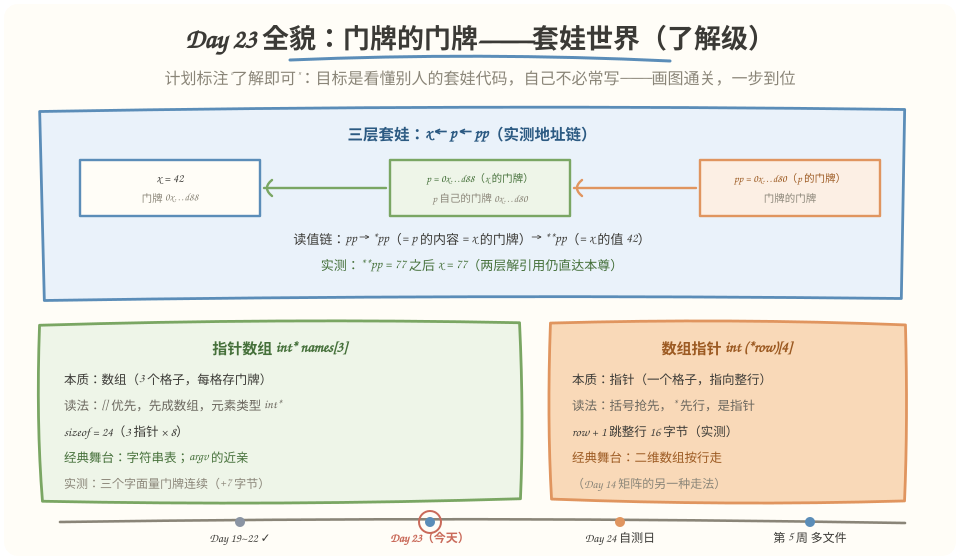
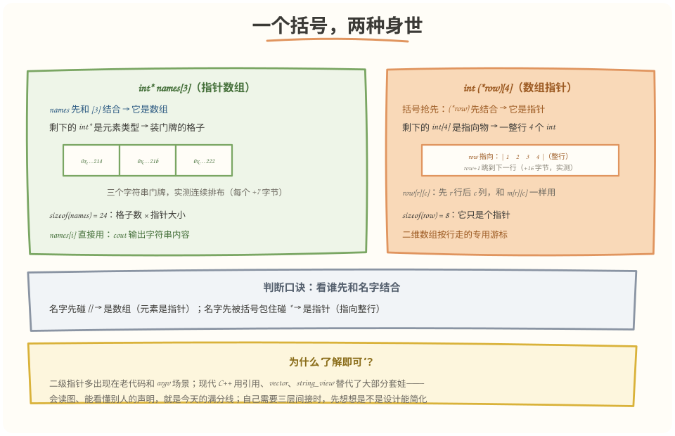
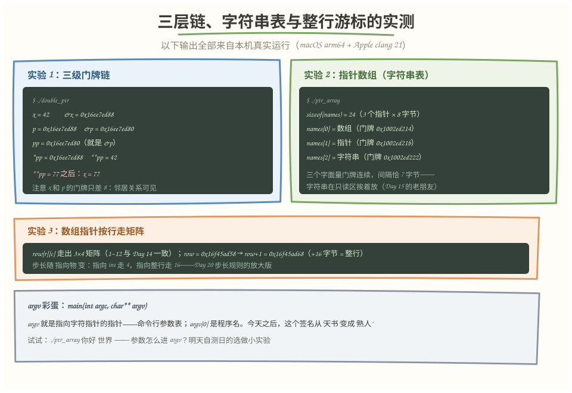

# 第 23 天：二级指针与指针数组/数组指针——套娃世界（了解级）

> **今日目标**：完成本教程后，你能做到：画出 x → p → pp 的三层门牌链并读出 `*pp`、`**pp` 各是什么；用"谁先结合"口诀区分 `int* a[3]`（指针数组）和 `int(*a)[4]`（数组指针）；说出 `row+1` 为什么跳 16 字节；见到 `char** argv` 不再心虚。
> **预计时间**：学习 20 分钟＋实践 30 分钟（了解级，画图为主）
> **前置准备**：完成 Day 19~22（门牌、步长、锁位模型全数就位）。
> **今日产出**：三层链实测、字符串指针表、整行游标走矩阵——三个"看得懂就赢"的实验。

## 1. 今天解决什么问题？

计划给今天标了"了解即可"——这四个字是重要提示：**目标是看懂，不是常写**。现实世界里你会遇到两类套娃：别人的老代码里有 `int**`（二级指针），库接口里有 `int (*row)[4]`（数组指针）；而现代 C++ 用引用和容器替掉了大部分这些写法。

今天解决"看懂"问题：指针自己也是变量（也住房间），所以也有门牌——门牌的门牌就是二级指针。沿着这条链把三种容易混淆的声明一次画清，明天自测日正好检验。

## 2. 先看全貌：今天的内容位于哪里？



**图 1**：上半部分是三层门牌链：x（门牌 `0x…d88`）← p（存 x 的门牌，自己门牌 `0x…d80`）← pp（存 p 的门牌）——`pp → *pp → **pp` 一层层顺藤摸瓜。左下绿卡是指针数组（本质数组，格子装门牌）；右下橙卡是数组指针（本质指针，指向整行）。两者只差一对括号。

三步概括今天：

1. `int** pp = &p;`：pp 存 p 的门牌，`**pp` 直达 x；
2. `int* a[3]` 是**数组**（元素是指针），`int (*a)[4]` 是**指针**（指向整行）——看名字先和谁结合；
3. 步长随指向物变：指向 int 走 4，指向整行走 16（实测）。

## 3. 核心概念：先用直觉，再给准确定义

### 3.1 二级指针：门牌的门牌

- **一句通俗解释**：指针也是变量，也住在内存的房间里，所以它也有门牌——存"指针的门牌"的变量就是二级指针。
- **一个类比**：通讯录问题——你有一个记电话号的便签（p）；别人问你"便签放哪了"，答案（pp）指向的是便签的位置，不是电话本人。
- **对应到技术上是**：本机实测——x 门牌 `0x16ee7ed88`，p 存着它；p 自己门牌 `0x16ee7ed80`，pp 存着它。读值链：`pp` 是 p 的门牌，`*pp` 是 p 的内容（= x 的门牌），`**pp` 是 x 的值 42；`**pp = 77` 后 x 变 77（两层解引用仍直达本尊）。类比的边界：便签可以无限套（三级四级指针语法上存在），但**每多一层，可读性断崖下降**——真实代码超过两层就该重构了。
- **常见误解**："`**pp` 是两个数相乘"——不是；是"解引用两次"的连锁开门。
- **为什么了解即可**：二级指针的传统用途（函数里修改指针本身）如今多被 `int*&`（指针的引用）或容器替代；它的现存主舞台是 `char** argv`。

### 3.2 指针数组 vs 数组指针：一个括号两种身世

- **一句通俗解释**：`int* a[3]` 是"3 个格子的数组，每格存门牌"；`int (*a)[4]` 是"1 个指针，一指就是 4 个 int 的整行"。
- **一个类比**：`[]` 像后缀优先抢答——名字先碰到 `[]`，它就是数组；括号像保护罩，让 `*` 插队先行，它就是指针。
- **对应到技术上是**：`int* names[3]`：`sizeof` = 24（3 指针×8），实测三个字符串门牌连续（+7 字节，字面量在只读区挨着放）；`int (*row)[4]`：`sizeof` = 8（就是个指针），实测 `row+1` 从 `0x…d58` 跳到 `0x…d68`（+16 = 整行 4 个 int）。类比的边界：两种声明都合法且各有用途——字符串表天然是指针数组；二维数组按行走天然用数组指针。
- **常见误解**：以为两者只是写法偏好——**身份完全不同**（数组 vs 指针），sizeof、传参、运算行为全不一样。

### 3.3 argv：今天知识的最著名舞台

- **一句通俗解释**：`main(int argc, char** argv)` 的 argv 是"字符串门牌的数组（的指针）"——命令行参数表。
- **一个类比**：程序开门营业时，操作系统递进来一张清单：第 0 项是店名（程序名），后面是顾客点的单（参数）。
- **对应到技术上是**：`argv[0]` 是程序名，`argv[1]` 起是参数，`argc` 是总数。今天之后这个签名从"天书"变"熟人"：`char**` 就是"指向 char 指针的指针"，参数表用指针数组的退化形态传入。类比的边界：argv 的具体玩法（遍历参数、解析选项）属于命令行编程专题，此刻能读签名即达标。
- **常见误解**：`char** argv` 和 `char* argv[]` 在参数表里等价——对，又见退化（Day 20）。

## 4. 图解核心机制



**图 2**：左卡解析 `int* names[3]`：名字先和 `[3]` 结合 → 数组，元素类型 `int*`，三格门牌实测连续；右卡解析 `int (*row)[4]`：括号抢先 → 指针，指向物是"整行 4 个 int"，`row+1` 实测 +16 字节；`row[r][c]` 用起来和 `m[r][c]` 一样。下方灰卡是判断口诀，黄卡解释"为什么了解即可"。

按图逐步讲：

1. **先判身份再读声明**：看名字先和谁结合（`[]` 或被括号包住的 `*`），身份一定性，sizeof、传参行为全部随之确定；
2. **三层链按"顺藤摸瓜"读**：`pp` 顺一层是 `*pp`（p 的内容），再顺一层是 `**pp`（x 的值）——每层一个门牌一次开门；
3. **步长看指向物**：指向 int 走 4、指向整行走 16——Day 20 的步长规则在二维世界自然放大；
4. **遇到套娃先画图**：纸上画房间和箭头，三层以内的任何声明都能三分钟读懂——这是本日也是本周的护身符。

## 5. 动手实践：完成一个最小可运行例子

### 5.1 准备文件

```bash
cd ai-compiler-roadmap/tutorials/day-023/examples
```

三个程序：`double_ptr.cpp`、`ptr_array.cpp`、`array_ptr.cpp`。

### 5.2 编写代码

三层链 `double_ptr.cpp`（完整代码）：

```cpp
#include <iostream>

// 二级指针：门牌也有自己的门牌
int main() {
    int x = 42;
    int* p = &x;          // p 存 x 的门牌
    int** pp = &p;        // pp 存 p 的门牌（指针也是变量，也住房间）

    std::cout << "x = " << x << std::endl;
    std::cout << "&x = " << &x << std::endl;
    std::cout << "p = " << p << "（x 的门牌）" << std::endl;
    std::cout << "&p = " << &p << "（p 自己的门牌）" << std::endl;
    std::cout << "pp = " << pp << "（就是 &p）" << std::endl;

    std::cout << "*pp = " << *pp << "（顺着 pp 拿到 p 的内容 = x 的门牌）" << std::endl;
    std::cout << "**pp = " << **pp << "（再顺一层，拿到 x 的值）" << std::endl;

    **pp = 77;            // 两层解引用，改的还是 x 本尊
    std::cout << "**pp = 77 之后：x = " << x << std::endl;
    return 0;
}
```

另两个程序见本目录：`ptr_array.cpp` 用 `const char* names[3]` 存三个字符串门牌；`array_ptr.cpp` 用 `int (*row)[4]` 走 Day 14 的矩阵。

### 5.3 运行与观察

```bash
g++ -Wall double_ptr.cpp -o dp && ./dp
```

实际执行结果（本机）：

```text
x = 42
&x = 0x16ee7ed88
p = 0x16ee7ed88（x 的门牌）
&p = 0x16ee7ed80（p 自己的门牌）
pp = 0x16ee7ed80（就是 &p）
*pp = 0x16ee7ed88（顺着 pp 拿到 p 的内容 = x 的门牌）
**pp = 42（再顺一层，拿到 x 的值）
**pp = 77 之后：x = 77
```



**图 3**：左上三级门牌链（注意 x 和 p 的门牌只差 8——邻居关系肉眼可见）；右上是字符串指针表（三个字面量门牌连续、间隔 7 字节）；下半橙卡是数组指针走矩阵 + 整行跳 16 字节；灰卡是 argv 彩蛋。

```bash
g++ -Wall ptr_array.cpp -o pa && ./pa
```

```text
sizeof(names) = 24（3 个指针 × 8 字节）
names[0] = 数组（门牌 0x1002ed214）
names[1] = 指针（门牌 0x1002ed21b）
names[2] = 字符串（门牌 0x1002ed222）
```

```bash
g++ -Wall array_ptr.cpp -o ap && ./ap
```

```text
用数组指针走矩阵：
   1   2   3   4
   5   6   7   8
   9  10  11  12
row + 1 跳多远？
  row    = 0x16f45ad58
  row+1  = 0x16f45ad68（跳过整行 16 字节 = 4 个 int）
```

### 5.4 修改一个输入再观察：参数真的进了 argv

写一个两行探针程序 `argv_probe.cpp`，编译到 `/tmp/argv_probe` 后运行 `/tmp/argv_probe 你好 世界`（本机真实输出）：

```cpp
#include <iostream>
int main(int argc, char** argv) {
    std::cout << "argc = " << argc << std::endl;
    for (int i = 0; i < argc; ++i) std::cout << "argv[" << i << "] = " << argv[i] << std::endl;
    return 0;
}
```

```bash
g++ -Wall argv_probe.cpp -o /tmp/argv_probe && /tmp/argv_probe 你好 世界
```

```text
argc = 3
argv[0] = /tmp/argv_probe
argv[1] = 你好
argv[2] = 世界
```

命令行上的三个词原样出现在参数表里——`char**` 的"字符串门牌数组"身份眼见为实。argv[0] 是程序自身路径，argc 把它也算在内（共 3）。

## 6. 常见错误与排查

**错误 1：`int* a, b;` 以为声明了两个指针**

- 现象：b 其实是普通 int；
- 原因：`*` 只修饰紧跟的那个名字；
- 定位：写声明时一行一个指针；
- 修复：分行声明，或统一用 `int* a; int* b;` 的风格。

**错误 2：把 `int (*a)[4]` 写成 `int* a[4]`，编译不报错但行为全错**

- 现象：本想按行走矩阵，sizeof 却是 32（数组）不是 8（指针）；
- 原因：一对括号决定身世——漏了括号，数组冒充指针；
- 定位：`sizeof` 一测便知（数组 32 vs 指针 8）；
- 修复：补括号 `int (*a)[4]`，用"括号抢先"口诀自查。

**错误 3：二级指针解引用层数搞错，拿到一串十六进制**

- 现象：打印 `**pp` 少写了一个 `*`，输出地址；
- 原因：一层 `*` 只开一扇门；
- 定位：看到 `0x` 开头就知道还差一层；
- 修复：画链图数一数从 pp 到 int 要开几扇门。

## 7. 今日练习

### 必做练习

计划指定练习"画出每个变量的内存示意图"：对照 `double_ptr.cpp` 的实测输出，手绘三层图——三个房间（x、p、pp）各自的门牌和内容，箭头标出 `pp → p → x` 的指向链。预期产出：一张能对着讲解的示意图（纸拍照或文字描述均可），附三行实测地址。

### 选做挑战

给 `ptr_array.cpp` 加命令行参数支持：`main(int argc, char* argv[])`，把每个参数用 `argv[i]` 打印出来（参考 5.4 的探针）。再用 `const char*` 数组存一周七天缩写，按 `argv[1]` 给的数字（1~7）打印星期——指针数组和 argv 一次练齐。

## 8. 今日验收

- [ ] 我能画出 x → p → pp 三层链，读出 `*pp` 和 `**pp` 各是什么
- [ ] 我能用"谁先结合"口诀区分指针数组和数组指针，并用 sizeof 验证身份
- [ ] 我能解释 `row+1` 为什么跳 16 字节（指向物是整行）
- [ ] 我看到 `char** argv` 能说出它是什么、argv[0] 是谁
- [ ] 我知道今天的满分线是"看得懂"，也知道自己不需要常写套娃

## 9. 一句话总结与明天预告

今天的问题是"套娃声明怎么读懂"；机制上，指针也是变量故有门牌的门牌，括号决定名字和谁先结合从而决定身世，步长随指向物放大；实践上，三层链、字符串表、整行游标三组实验全部落地，argv 彩蛋验明正身；验证标准是任何三层以内的声明画图三分钟能读懂。明天是**第 4 周自测日**：不看资料写引用版 swap、指针遍历、const 组合，再对着镜子讲一遍"指针和引用的区别"——本周功力，闭卷见真章。
