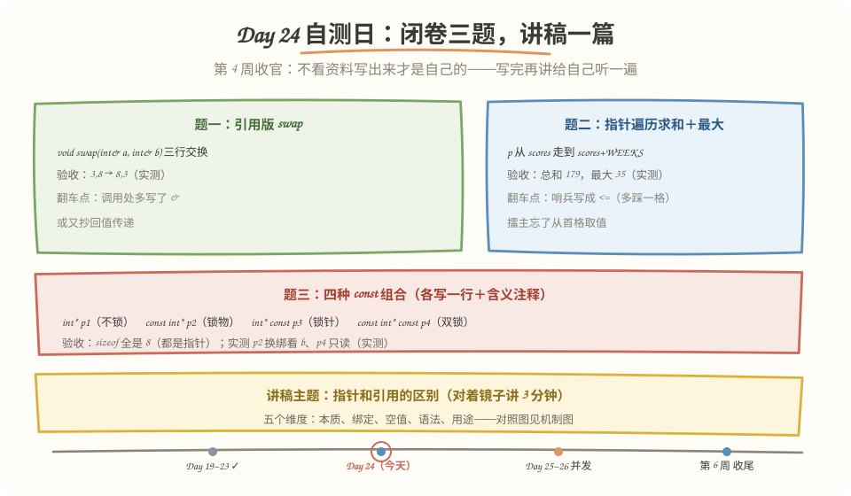
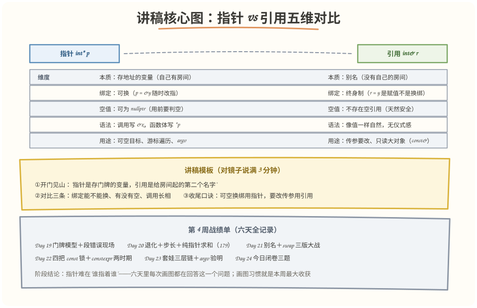
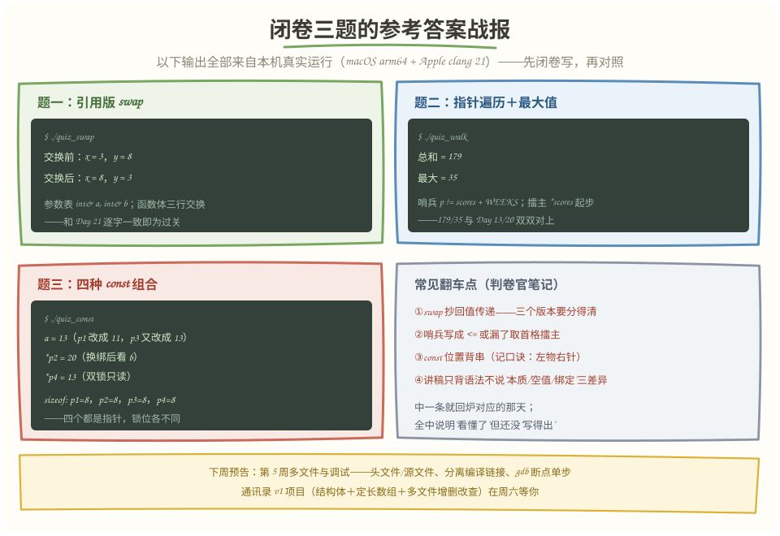

# 第 24 天（自测日）：闭卷三题——指针周的验金石

> **今日目标**：完成本教程后，你能做到：不看任何资料独立写出引用版 swap、纯指针遍历（求和＋最大）、四种 const 组合；把"指针和引用的区别"对着镜子讲满 3 分钟（本质、绑定、空值三条硬差异）；中招的翻车点能立刻定位回炉哪一天。
> **预计时间**：闭卷 40 分钟＋对答案复盘 30 分钟（自测日不学新知识）
> **前置准备**：完成 Day 19~23；找一个不受打扰的时段，把前六天的教程全部合上。
> **今日产出**：三份闭卷代码＋运行结果，一段自己讲给自己的"指针 vs 引用"录音级讲稿。

## 1. 今天解决什么问题？

学了一个星期指针，"看懂"和"写得出"是两回事。今天的问题是计划指定的老规矩：**闭卷检验**——三道题全部不看资料写出来、跑出正确结果，再用自己的话把"指针和引用的区别"讲一遍。讲不清楚的地方，就是理解还没长牢的地方。

自测日的规则：先写后看。本页 5 节的参考答案**在你动手之前不要翻**——它们的作用是对答案，不是预习。

## 2. 先看全貌：今天的内容位于哪里？



**图 1**：三道闭卷题分列三卡——题一引用版 swap（验收：3,8 变 8,3）、题二指针遍历（验收：总和 179、最大 35）、题三四种 const 组合（验收：sizeof 全 8、锁位各异），每题标注了高频翻车点。下方黄卡是讲稿主题。路线图：第 4 周今天收官。

三步概括今天：

1. 闭卷三题，每题写完立刻编译运行，用输出对答案；
2. 对照参考答案找差异——**差异就是回炉坐标**；
3. 讲稿三分钟，卡壳处即薄弱处。

## 3. 核心概念：先用直觉，再给准确定义

### 3.1 闭卷的意义：检验"提取"而非"再认"

- **一句通俗解释**：看懂答案是"认得出"，闭卷写出是"拿得出"——考试和实战要的都是后者。
- **一个类比**：背单词——选择题全对（再认）不代表作文里用得出（提取）。
- **对应到技术上是**：本周六个主题各自有"再认容易提取难"的陷阱：swap 的参数表、哨兵条件、const 位置——它们看一眼都对，闭卷一写就露馅。类比的边界：闭卷不是目的，**暴露弱点**才是——中招了高兴才对，正好知道回炉哪里。
- **建议**：一题一测，写完立刻跑；不要三题攒一起写（错误会互相污染）。

### 3.2 讲稿：把知识串成自己的话

- **一句通俗解释**：能把一个概念讲给外行听明白，才算真懂（费曼学习法）。
- **一个类比**：旅游回来给人讲路线——讲得顺说明地图真装进脑子了；卡壳的地方就是没走过的路。
- **对应到技术上是**：讲稿模板三段式——开门见山（指针是存门牌的变量、引用是房间的第二个名字）、对比三条硬差异（绑定能否换、有无空值、调用长相）、收尾口诀（可空换绑用指针、要改传参用引用）。类比的边界：背概念清单不算讲——**每条都要带"为什么"**（比如"没有空引用"带来"不用判空"的安全性）。
- **常见误区**：讲成语法对比（"一个写 * 一个写 &"）——那是符号，不是本质。

### 3.3 复盘：从翻车点回炉

- **一句通俗解释**：每条翻车点都精确指向某一天的内容——中招即回炉。
- **一个类比**：体检指标异常挂号对应科室——不自测就不知道挂哪科。
- **对应到技术上是**：swap 抄回值传递 → 回炉 Day 9＋Day 21；哨兵写错 → Day 20；const 位置背串 → Day 22；讲稿说不出本质 → Day 19＋21。类比的边界：回炉不是重读全程——**只重做当天对应的一个实验**即可痊愈。

## 4. 图解核心机制



**图 2**：上方是五维对比表——本质（变量 vs 别名）、绑定（可换 vs 终身）、空值（可为 null vs 不存在）、语法（有仪式感 vs 自然）、用途（游标/argv vs 传参/const&）——左蓝右绿各一列。中部黄卡是讲稿模板；底部灰卡是本周六天的战绩单和阶段结论。

按图逐步讲（也是讲稿的展开顺序）：

1. **先讲本质**：指针自己是变量（有房间有门牌），引用只是名字——这一条决定了后面所有差异；
2. **再讲绑定与空值**：可换绑 → 有"没指着"的状态 → 需要判空；终身绑定 → 永不空 → 天然安全；
3. **后讲语法与用途**：仪式感（`&`/`*`）是灵活的代价；选型口诀收尾；
4. **战绩单对账**：六天的关键实验数字（179、3×8、sizeof 8/20、exit=139……）能随口报出几个？报得出的是真掌握。

## 5. 动手实践：完成一个最小可运行例子

### 5.1 准备文件

```bash
cd ai-compiler-roadmap/tutorials/day-024/examples
```

**先别打开这三个文件**——它们是参考答案。先在自己的空白目录里写完三题并运行，再回来对照。

### 5.2 编写代码（参考答案）

题一 `quiz_swap.cpp`：

```cpp
#include <iostream>

// 自测题一（闭卷参考答案）：引用版 swap
void swap_ref(int& a, int& b) {
    int t = a;
    a = b;
    b = t;
}

int main() {
    int x = 3, y = 8;
    std::cout << "交换前：x = " << x << "，y = " << y << std::endl;
    swap_ref(x, y);
    std::cout << "交换后：x = " << x << "，y = " << y << std::endl;
    return 0;
}
```

题二 `quiz_walk.cpp` 的核心三行：

```cpp
int max_val = *scores;                      // 首格当擂主（指针解引用取值）
for (const int* p = scores; p != scores + WEEKS; ++p) {
    sum += *p;
    if (*p > max_val) max_val = *p;
}
```

题三 `quiz_const.cpp` 的四行声明（配含义注释）：

```cpp
int* p1 = &a;               // 都不锁：可改 *p1，可换 p1
const int* p2 = &a;         // 锁物（const 在 * 左）：*p2 只读，p2 可换绑
int* const p3 = &a;         // 锁针（const 在 * 右）：p3 终身指 a，*p3 可改
const int* const p4 = &a;   // 双锁：*p4 只读且 p4 不换绑
```

### 5.3 运行与观察

三份参考答案的真实输出（本机）：

```text
$ ./quiz_swap
交换前：x = 3，y = 8
交换后：x = 8，y = 3
```

```text
$ ./quiz_walk
总和 = 179
最大 = 35
```

```text
$ ./quiz_const
a = 13（p1 改成 11，p3 又改成 13）
*p2 = 20（换绑后看 b）
*p4 = 13（双锁只读）
sizeof: p1=8，p2=8，p3=8，p4=8（都是 8——都是指针）
```



**图 3**：左上题一战报（3,8 → 8,3）；右上题二战报（179/35，与 Day 13、Day 20 双双对上）；左下题三战报（a 的值是 p1 和 p3 两度修改的结果——每种锁的行为都在输出里）；右下灰卡是判卷官笔记：四条高频翻车点和回炉坐标。

### 5.4 修改一个输入再观察：讲稿的自检实验

讲完"指针 vs 引用"后，做一个 10 秒小实验验证讲稿里的断言："引用不能换绑"。闭卷写出你预测的输出（`int& r = x; r = y;` 之后 x、r 各是多少？），再实际运行（本机实测：x 和 r 都变成 y 的值——`r = y` 是赋值）。预测对了，讲稿里"终身绑定"那条才算真正长住脑子里；预测错了，回炉 Day 21 的 3.1 节重看那个最反直觉的段落。

## 6. 常见错误与排查

**错误 1：三题全对，但讲稿卡在"本质"那一关**

- 现象：语法、锁位都对，一问"指针和引用根本差在哪"就开始背符号区别；
- 原因：练习集中在"写"，缺少"讲"的输出训练；
- 定位：讲稿第一句就卡壳即是；
- 修复：重看 Day 19 的门牌模型和 Day 21 的别名模型，各画一张图再讲。

**错误 2：题二哨兵写成 `p <= scores + WEEKS`**

- 现象：多遍历一格，sum 多出一个垃圾值或触发崩溃；
- 原因：把终点线当格子踩（Day 20 黄卡内容）；
- 定位：数输出行数是否多一；
- 修复：条件 `!=` 或 `<`，终点只看不踩。

**错误 3：题三只写出两种组合**

- 现象：双锁 `const int* const` 想不起来；
- 原因：口诀没背全（左物右针，两边都有双锁）；
- 定位：对照四行声明找缺；
- 修复：白纸重默写，直到四行全出。

## 7. 今日练习

### 必做练习

把三道闭卷题**明天再做一遍**（间隔重复）：同样不看资料，目标是比今天快且对。预期产出：两天的用时和正确率记进 `notes.md`——数字会诚实地告诉你记忆是否巩固。

### 选做挑战

给自己加一道综合题：写 `void min_max(const int* begin, const int* end, int& out_min, int& out_max)`——指针区间（题二）+ 引用输出（题一）+ const 锁物（题三）三合一。8 周成绩应输出 min=9、max=35。写完这题，本周三道题就融会成一道了。

## 8. 今日验收

- [ ] 我闭卷写出了引用版 swap，输出 3,8 → 8,3
- [ ] 我闭卷写出了指针遍历，总和 179、最大 35 与参考一致
- [ ] 我闭卷写出了四种 const 组合，并配了正确的含义注释
- [ ] 我对着镜子讲满了 3 分钟，覆盖本质、绑定、空值三条硬差异
- [ ] 我的翻车点都记了回炉坐标，且当天就完成了回炉

## 9. 一句话总结与明天预告

今天的问题是"一周的指针功力有多少真正长在自己身上"；机制上没有新知识——闭卷三题检验提取能力，讲稿检验本质理解，翻车点就是回炉坐标；实践上，三题参考答案全部实测，五维对比表和战绩单归档；验证标准是不看资料三题全对、讲稿不卡壳。第 4 周收官——明天进入 **第 5 周 · Day 25：头文件与源文件**——声明 vs 定义、`#include`、头文件守护，把 Day 9 埋的"名片与机器"伏笔展开成真正的多文件工程，周六的通讯录 v1 在等你。
