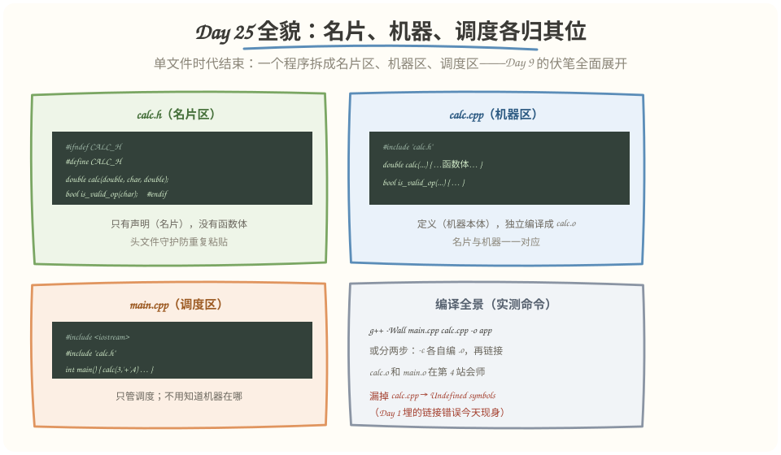
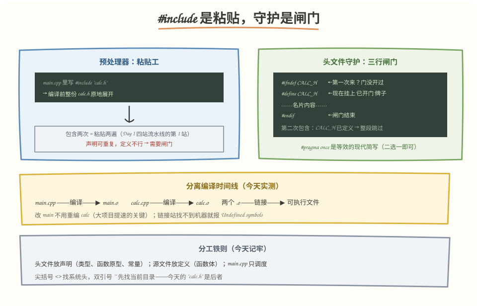
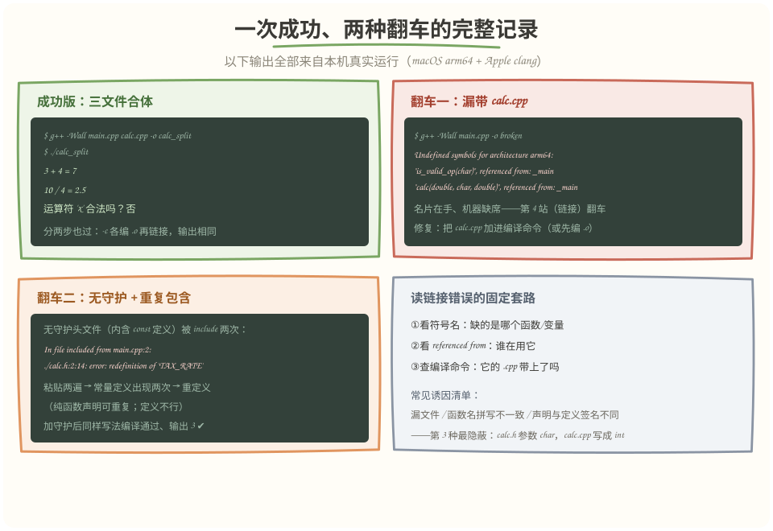

# 第 25 天：头文件与源文件——名片、机器、调度各归其位

> **今日目标**：完成本教程后，你能做到：把一个程序拆成 `.h`（声明）＋`.cpp`（定义）＋`main.cpp`（调度）三个文件并正确编译；解释 `#include` 的粘贴本质和 `<>`/`""` 的区别；写出三行头文件守护并演示没有它会怎样；按固定套路排查 `Undefined symbols` 链接错误。
> **预计时间**：学习 25 分钟＋实践 45 分钟
> **前置准备**：完成 Day 9（声明与定义分离——今天全面展开）；Day 1 的四站流水线今天正式回收两站。
> **今日产出**：三文件计算器（分离编译成功），两种真实翻车现场（漏文件、缺守护）与修复记录。

## 1. 今天解决什么问题？

24 天来所有代码都挤在一个文件里——第 5 周开工第一件事：**拆文件**。计划指定的练习是"把计算器拆成 3 个文件"，正好把 Day 9 埋的伏笔全部展开：声明（名片）进 `.h`、定义（机器）进 `.cpp`、调度进 `main.cpp`。

拆开立刻冒出两个新问题，都是今天的实验素材：**编译命令要带上谁**（漏了 `.cpp` 就是著名的 `Undefined symbols`）；**头文件被重复包含怎么办**（`#include` 是纯粘贴，需要三行守护当闸门）。这两个错误恰恰是 Day 1 四站流水线预告过的"第 1 站（预处理）"和"第 4 站（链接）"的真实工作。

## 2. 先看全貌：今天的内容位于哪里？



**图 1**：绿卡是 `calc.h`（名片区：只有函数原型，配三行守护）；蓝卡是 `calc.cpp`（机器区：函数本体，独立编译成 `.o`）；橙卡是 `main.cpp`（调度区：包含名片就调用，不管机器在哪）。右下灰卡是编译全景：一条命令全编，或 `-c` 分编再链接——**漏掉 calc.cpp 就在第 4 站翻车**。

三步概括今天：

1. 分工铁则：声明进头文件，定义进源文件，main 只调度；
2. `#include` 是文本粘贴：`<>` 找系统头，`""` 先找当前目录；
3. 头文件守护三行 `#ifndef/#define/#endif`，防重复粘贴。

## 3. 核心概念：先用直觉，再给准确定义

### 3.1 声明与定义的分工（ODR）

- **一句通俗解释**：名片（声明）可以到处发，机器（定义）全程序只能造一台——这就是"单一定义规则"（One Definition Rule）。
- **一个类比**：连锁店加盟——菜单（名片）每家店都能挂，中央厨房（定义）只有一间。
- **对应到技术上是**：`calc.h` 里 `double calc(double, char, double);` 是声明，可以被包含无数次（声明可重复）；`calc.cpp` 里的函数体是定义，出现两次就报 `redefinition`。类比的边界：头文件里也能放定义（`constexpr` 常量、`inline` 函数——它们天生豁免 ODR 的重复限制），但**函数本体默认放源文件**。
- **最小例子**：今天的三个文件就是标准布局。
- **常见误解**："头文件里写函数体更省事"——多文件一包含就重定义；除非加 `inline`（进阶话题）。

### 3.2 #include：粘贴工的两个地址簿

- **一句通俗解释**：`#include` 在编译前把目标文件**原样粘贴**进来——它是预处理器（Day 1 第 1 站）的指令，不是 C++ 语句。
- **一个类比**：合同模板合并——把"通用条款"那页复印一份订进你的合同，订几次就有几份。
- **对应到技术上是**：`#include <iostream>` 从系统目录找；`#include "calc.h"` 先在当前目录找（找不到再退回系统路径）。粘贴意味着**包含两次就出现两份**——声明无所谓，定义就撞车（5.3 的翻车二）。类比的边界：粘贴发生在**每个源文件内部**——`calc.cpp` 和 `main.cpp` 各自粘贴一份 `calc.h` 完全正常，撞车只发生在**同一个源文件里**粘贴两次。
- **常见误解**：`#include` 会"连接"两个文件——不，它只是复制文本；真正的"连接"发生在链接站。

### 3.3 头文件守护：三行闸门

- **一句通俗解释**：守护让头文件"只被粘贴第一次生效，之后的粘贴自动跳过"。
- **一个类比**：景区门票——第一次检票进门发手环（`#define CALC_H`），再排队时看见手环直接放行不重复检（整段跳过）。
- **对应到技术上是**：`#ifndef CALC_H`（宏没定义过？）→ `#define CALC_H`（现在定义它）→ 内容 → `#endif`。本机实测：无守护的头文件（内含 `const double TAX_RATE = 0.13;`）被包含两次，报 `error: redefinition of 'TAX_RATE'`；加守护后同样写法编译通过。类比的边界：`#pragma once` 是主流编译器都支持的等效简写——现代项目二选一即可，本教程用经典三行（看得见原理）。
- **为什么纯声明不怕重复**：函数声明只是"报户口"，报几次都行；`const` 变量带初值是"造实物"，造两台就违规——守护防的是后者。
- **常见误解**："守护是防 `.h` 被多个 `.cpp` 包含"——不是！跨文件包含本来就没问题；防的是**同一个文件内**的重复粘贴（常因间接包含引发：a.h 包含 calc.h，main 又包含两者）。

## 4. 图解核心机制



**图 2**：左卡是预处理器：`#include` 把整份头文件原地展开（包含两次 = 粘贴两遍）；右卡是守护三行的闸门逻辑——第一次挂"已开门"牌，之后整段跳过；下方黄卡是分离编译时间线：两个 `.cpp` 各自编成 `.o`，在链接站会师——**改 main 不用重编 calc**，这正是大项目提速的关键。灰卡是分工铁则和两种引号的区别。

按图逐步讲：

1. **先看时间线**：`-c` 分别编译、再链接——两个 `.o` 互不知晓，链接器拿着 `main.o` 里的"名片存根"去 `calc.o` 里找机器；
2. **再看闸门**：守护的宏名习惯用文件名大写（`CALC_H`）——保证全局唯一即可；
3. **两个翻车点各有套路**：链接错误三步查（看符号名→看谁引用→查编译命令）；重定义错误找"哪个头文件没守护、被谁粘贴了两次"；
4. **提速红利**：大项目里改一个文件只重编它对应的 `.o`——今天两文件看不出，第 24 周的 CMake 会让你感谢这条时间线。

## 5. 动手实践：完成一个最小可运行例子

### 5.1 准备文件

```bash
cd ai-compiler-roadmap/tutorials/day-025/examples
ls    # calc.h  calc.cpp  main.cpp
```

### 5.2 编写代码

三个文件（完整内容）：

**calc.h（名片区）**

```cpp
#ifndef CALC_H                // 头文件守护开始：防止本文件被重复粘贴
#define CALC_H

// 名片区：只放声明（Day 9 的原型），机器本体在 calc.cpp
double calc(double a, char op, double b);
bool is_valid_op(char op);

#endif                        // 守护结束
```

**calc.cpp（机器区）**

```cpp
#include "calc.h"             // 自己的头文件也要包含：让编译器核对声明与定义是否一致

// 机器区：函数本体（定义）放在源文件里
double calc(double a, char op, double b) {
    if (op == '+') return a + b;
    if (op == '-') return a - b;
    if (op == '*') return a * b;
    return a / b;
}

bool is_valid_op(char op) {
    return op == '+' || op == '-' || op == '*' || op == '/';
}
```

**main.cpp（调度区）**

```cpp
#include <iostream>
#include "calc.h"             // 拿到名片就能调用；机器在哪由链接器负责

int main() {
    std::cout << "3 + 4 = " << calc(3, '+', 4) << std::endl;
    std::cout << "10 / 4 = " << calc(10, '/', 4) << std::endl;
    std::cout << "运算符 'x' 合法吗？" << (is_valid_op('x') ? "是" : "否") << std::endl;
    return 0;
}
```

### 5.3 运行与观察

```bash
g++ -Wall main.cpp calc.cpp -o calc_split && ./calc_split
```

实际执行结果（本机）：

```text
3 + 4 = 7
10 / 4 = 2.5
运算符 'x' 合法吗？否
```

分两步走（分离编译全景，本机实测同样通过）：

```bash
g++ -Wall -c calc.cpp        # 得到 calc.o
g++ -Wall -c main.cpp        # 得到 main.o
g++ calc.o main.o -o linked  # 链接成可执行文件
```



**图 3**：左上成功版输出；右上翻车一（漏带 `calc.cpp` 的链接错误）；左下翻车二（无守护重复包含的重定义错误）；右下是读链接错误的三步套路和常见诱因清单。

### 5.4 修改一行再观察：两种翻车亲手复现

**翻车一：漏掉机器文件（预期链接错误）**

```bash
g++ -Wall main.cpp -o broken
```

实际报错（本机）：

```text
Undefined symbols for architecture arm64:
  "is_valid_op(char)", referenced from:
      _main in main-24b42d.o
  "calc(double, char, double)", referenced from:
      _main in main-24b42d.o
```

名片在手、机器缺席——编译站不报错（它只看名片），第 4 站链接时才对不上号。**Day 1 预告的链接错误今天亲手复现**。

**翻车二：无守护 + 重复包含（预期重定义）**

做一个无守护的头文件（内容含 `const double TAX_RATE = 0.13;`），让 main 连续 `#include` 两次（本机实测）：

```text
In file included from main.cpp:2:
./calc.h:2:14: error: redefinition of 'TAX_RATE'
```

粘贴两遍、常量造了两次——重定义。给头文件加回三行守护，同样的双重包含**编译通过、输出 3**（实测）。一错一对，守护的价值眼见为实。

## 6. 常见错误与排查

**错误 1：`Undefined symbols ... "calc(double, char, double)"`**

- 现象：编译各步没红字，最后链接报缺符号；
- 原因：编译命令漏了 `calc.cpp`（机器没上桌）；
- 定位：三步套路——看符号名、看 referenced from、查命令行文件清单；
- 修复：`g++ -Wall main.cpp calc.cpp -o app`，或分编 `.o` 再链接。

**错误 2：`error: redefinition of 'xxx'`**

- 现象：加了新头文件后突然报某常量/类型重定义；
- 原因：该头文件没守护，被间接包含了两遍（a.h 包含它、main 又包含两者）；
- 定位：看报错的"In file included from"链——它会列出粘贴路径；
- 修复：给头文件加 `#ifndef/#define/#endif` 三行（或 `#pragma once`）。

**错误 3：声明与定义签名不一致，链接找不到**

- 现象：头文件声明 `double calc(double, char, double)`，源文件把某个参数写成 `int`——链接报 Undefined；
- 原因：参数类型参与修饰名，两个符号名字不同，名片对不上机器；注意只改返回类型时修饰名不变、链接反而静默通过（Day 27 会实测这颗暗雷）；
- 定位：逐字比对 `.h` 和 `.cpp` 的函数签名；
- 修复：签名改一致——这就是 `calc.cpp` 顶部包含自己头文件的意义：让编译器当场核对（只改返回类型也会被拦下）。

## 7. 今日练习

### 必做练习

把 Day 12 的计算器 v1 也拆成三文件：`calc_io.h/.cpp`（`read_number`、`read_op`）、`calc_core.h/.cpp`（`calc`、`is_div_zero`）、`main.cpp`。编译命令会变成 `g++ -Wall main.cpp calc_io.cpp calc_core.cpp -o calc_v1`。预期产出：功能与 Day 12 完全一致的拆分版（用同一组输入记录输出对照）。

### 选做挑战

体验"改一处只重编一半"：给三文件工程先全量编译出两个 `.o`；然后只改 `main.cpp`（加一行打印），重跑 `g++ -Wall -c main.cpp && g++ calc.o main.o -o app`——观察 `calc.o` 不需要重编（看它的时间戳没变）。用 `ls -l *.o` 前后对比记录进 `notes.md`。

## 8. 今日验收

- [ ] 我能独立完成三文件拆分：声明进 `.h`、定义进 `.cpp`、调度在 `main.cpp`
- [ ] 我能说出 `#include` 的粘贴本质和 `<>`/`""` 的寻址区别
- [ ] 我能默写三行头文件守护，并实测过"无守护重复包含会重定义"
- [ ] 我能用三步套路排查 Undefined symbols，并复现过这个错误
- [ ] 我理解 `-c` 分编 `.o` 再链接的流水线，知道它对大项目的意义

## 9. 一句话总结与明天预告

今天的问题是"程序怎么拆成多个文件"；机制上，声明可重复定义唯一（ODR），`#include` 是预处理器的文本粘贴，守护是防重复粘贴的闸门，链接站负责按名片找机器；实践上，三文件计算器编译运行成功，两种翻车（漏文件、缺守护）亲手复现又修复；验证标准是任何链接错误都能按三步套路定位。明天 **Day 26：命名空间**——给名片加姓氏防撞名，`using` 声明和指令的区别，以及为什么"using namespace std"写进头文件是坏习惯。
