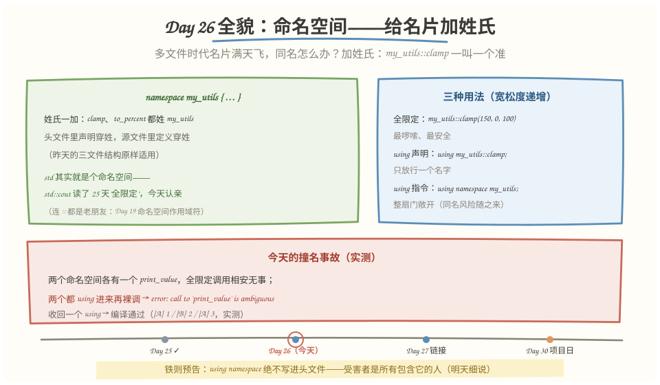
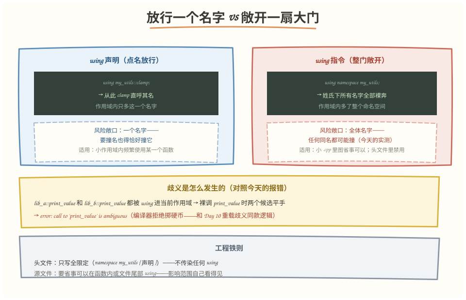
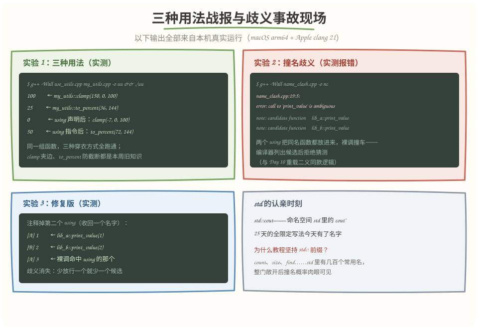

# 第 26 天：命名空间——给名片加姓氏

> **今日目标**：完成本教程后，你能做到：创建自己的命名空间（头文件声明、源文件定义都穿姓）；用三种方式使用它（全限定、using 声明、using 指令）并说出风险差异；复现"两个 using 撞名"的歧义错误并修复；解释为什么 `using namespace std` 不能写进头文件。
> **预计时间**：学习 25 分钟＋实践 40 分钟
> **前置准备**：完成 Day 25（多文件三件套结构今天原样复用）。
> **今日产出**：穿姓的工具库（两文件）、三种用法战报、一次歧义事故的现场与修复。

## 1. 今天解决什么问题？

昨天拆成多文件后，名片满天飞——如果两个库里都有叫 `clamp` 的函数，谁是谁？今天的问题：**名字怎么隔离**。答案是命名空间（namespace）：给名字加姓氏，`my_utils::clamp` 一叫一个准。

同时揭晓一个迟到 25 天的认亲：**`std` 本身就是命名空间**——`std::cout` 你一直在写"全限定"，今天终于知道这个写法的学名。计划指定的练习"组织自己的工具命名空间"今天落地：`my_utils` 库放两个函数，再用三种方式使用它，最后亲手制造并修复一次撞名事故。

## 2. 先看全貌：今天的内容位于哪里？



**图 1**：左卡是 `namespace my_utils { … }`——姓氏一加，`clamp`、`to_percent` 从此姓 my_utils，头文件声明穿姓、源文件定义穿姓（昨天的三文件结构原样适用）。右卡是三种用法的宽松度梯度：全限定（最安全）→ using 声明（放行一个）→ using 指令（整门敞开）。下方红卡预告今天的撞名事故。

三步概括今天：

1. 定义：`namespace 名字 { 声明/定义 }`，头尾一致穿姓；
2. 使用：三种方式按"风险敞口"从小到大选；
3. 铁则：头文件只写全限定，using 绝不外传。

## 3. 核心概念：先用直觉，再给准确定义

### 3.1 命名空间：姓氏防撞

- **一句通俗解释**：命名空间是名字的"姓氏"——两个班都有"小明"，加上班级（namespace）就不混。
- **一个类比**：全校点名"三年级二班的小明"——班级是命名空间，`::` 是那个"的"。
- **对应到技术上是**：`namespace my_utils { int clamp(...); }` 后，全名是 `my_utils::clamp`；头文件里声明包在 namespace 内、源文件里定义也包在同名 namespace 内——**名片和机器同姓**（昨天的三文件结构不动，只加了姓）。类比的边界：点名能说"就叫他小明吧"（using），也能把全年级名字混着叫（using namespace）——方便程度和撞名风险同步上升。
- **认亲时刻**：`std::cout` = 命名空间 std 里的 cout——`::` 这个符号你已经用了 25 天（它叫作用域解析运算符，Day 11 的 `std::cin` 前缀同理）。
- **常见误解**："namespace 是文件或目录"——不是，它是**代码里的姓氏标签**，可以跨文件、可嵌套、甚至可以拆开多次声明（同姓自动合并）。

### 3.2 三种用法：风险敞口递增

- **一句通俗解释**：全限定永远写全名；using 声明放行**一个**名字；using 指令放行**整族**名字。
- **一个类比**：通讯录——A 方案每次拨号都念全名（安全）；B 方案把一个联系人设为快捷键（点名的便利）；C 方案把整本通讯录设为免提直拨（全家桶的赌博）。
- **对应到技术上是**：本机实测三种方式全跑通——`my_utils::clamp(150,0,100)` 得 100；`using my_utils::clamp;` 后裸调 `clamp(-7,0,100)` 得 0；`using namespace my_utils;` 后 `to_percent(72,144)` 得 50。类比的边界：便利是**作用域内**的——using 写在函数里只影响这个函数，写在文件顶部影响整个文件（写在头文件里就传染给所有包含者——铁则的根源）。
- **选型建议**：默认全限定；某个函数用得频繁就在**函数内** using 声明；using 指令只在小 `.cpp` 里偶尔图省事。
- **常见误解**："using namespace std 写了 25 天也没事"——教程从没让你写过；小例子裸调没撞上是运气，库一大必撞（下一节实证）。

### 3.3 撞名与歧义：编译器不掷硬币

- **一句通俗解释**：两个同姓不同家的名字都被放行后裸调，编译器拒绝猜测——歧义错误。
- **一个类比**：会议室里两个"王总"同时应答——秘书只能要求你说全名。
- **对应到技术上是**：本机实测——`lib_a::print_value` 与 `lib_b::print_value` 全限定调用相安无事；两个 `using` 声明都写上再裸调 `print_value(3)`，报 `error: call to 'print_value' is ambiguous`，note 把两个候选都列了出来；注释掉第二个 using 立即恢复（输出 `[A] 1 / [B] 2 / [A] 3`）。类比的边界：这与 Day 10 的重载二义**同款逻辑**——都是"平手候选，拒绝猜"；但重载是同名不同参（编译器设计的机制），歧义是同名同参（using 引发的意外）。
- **常见误解**："歧义时报错的那个调用改了就行"——治标；治本是把 using 收窄（改全限定或只放行一个）。

## 4. 图解核心机制



**图 2**：左卡是 using 声明——点名放行一个名字，风险敞口只有一个；右卡是 using 指令——整门敞开，全体名字裸奔，任何同名都可能撞（红字标注今天的实测）。下方黄卡解剖歧义的发生链：两个 using → 同名平手 → ambiguous；灰卡是两条工程铁则：头文件只写全限定，源文件的 using 收窄到函数内。

按图逐步讲：

1. **先比风险敞口**：一个名字 vs 一族名字——using 指令的方便是按风险买的；
2. **再看歧义链**：和 Day 10 重载二义对照着记——"平手即报错"是编译器的一贯操守；
3. **头文件为什么禁 using**：头文件被粘贴进**每一个**包含者——一个 using namespace 就把全体名字的裸奔强加给整个项目（受害者名单无限长）；
4. **std:: 前缀的价值**：几百个常用名的大家族，全限定是唯一稳态——本教程 25 天的坚持今天有了完整理由。

## 5. 动手实践：完成一个最小可运行例子

### 5.1 准备文件

```bash
cd ai-compiler-roadmap/tutorials/day-026/examples
ls    # my_utils.h  my_utils.cpp  use_utils.cpp  name_clash.cpp
```

### 5.2 编写代码

**my_utils.h（穿姓的名片）**

```cpp
#ifndef MY_UTILS_H
#define MY_UTILS_H

// 自己的工具命名空间：名片（声明）放在 namespace 里
namespace my_utils {

int clamp(int value, int low, int high);          // 夹在区间内
double to_percent(int part, int total);           // 化成百分比

}

#endif
```

**my_utils.cpp（穿姓的机器）**

```cpp
#include "my_utils.h"

// 机器（定义）也放进同名 namespace：名片和机器同姓
namespace my_utils {

int clamp(int value, int low, int high) {
    if (value < low) {
        return low;
    }
    if (value > high) {
        return high;
    }
    return value;
}

double to_percent(int part, int total) {
    return part * 100.0 / total;                   // Day 3：先乘 100.0 防截断
}

}
```

**use_utils.cpp（三种用法）** 和撞name实验 `name_clash.cpp` 见本目录——后者故意把两个 `using` 都写上，是 5.3 的事故素材。

### 5.3 运行与观察

```bash
g++ -Wall use_utils.cpp my_utils.cpp -o uu && ./uu
```

实际执行结果（本机）：

```text
100
25
0
50
```

四行依次来自：全限定 `clamp(150,0,100)`（夹到上限）、全限定 `to_percent(36,144)`（25%）、using 声明后 `clamp(-7,0,100)`（夹到下限）、using 指令后 `to_percent(72,144)`（50%）——三种穿衣方式全跑通。



**图 3**：左上三种用法战报；右上是歧义报错原文（note 列出两个候选）；左下是修复版输出；右下是 std 认亲卡。

### 5.4 修改一行再观察：歧义的制造与修复

**事故版**（`name_clash.cpp` 原样编译，预期失败）：

```bash
g++ -Wall name_clash.cpp -o nc
```

实际报错（本机）：

```text
name_clash.cpp:19:5: error: call to 'print_value' is ambiguous
   19 |     print_value(3);               // 歧义现场
      |     ^~~~~~~~~~~
name_clash.cpp:5:6: note: candidate function
    5 | void print_value(int v) { std::cout << "[A] " << v << std::endl; }
      |      ^
```

**修复版**（注释掉第二个 `using lib_b::print_value;`，本机实测）：

```text
[A] 1
[B] 2
[A] 3
```

一错一对之间只差一行注释——**少放行一个名字，就少一个平手候选**。注意修复版里前两行的全限定调用从头到尾没受影响：全限定是唯一在任何复杂度下都稳定的写法。

## 6. 常见错误与排查

**错误 1：`error: call to 'xxx' is ambiguous`**

- 现象：加了 using 后某次裸调编译失败，note 列出多个候选；
- 原因：两个命名空间的同名函数都被放行到当前作用域；
- 定位：读 note 的候选列表——它们来自哪些命名空间一目了然；
- 修复：调用处改全限定，或删掉一个 using（今天的修复版）。

**错误 2：在头文件里写了 `using namespace std;`，全项目莫名撞名**

- 现象：某个源文件定义了自己的 `count`/`swap`，突然报歧义或解析到错的重载；
- 原因：头文件的 using 被粘贴进每个包含者，std 的几百个名字全体注入；
- 定位：检查所有头文件有没有 using 指令（哪怕在注释里也别留）；
- 修复：头文件只写全限定；图省事的 using 挪到各 `.cpp` 的函数内部。

**错误 3：声明在 namespace 里、定义忘了穿姓，链接报 Undefined**

- 现象：`my_utils::clamp` 声明了，`.cpp` 里写成全局 `int clamp(...)`，链接找不到 `my_utils::clamp`；
- 原因：名片姓 my_utils、机器没姓——两个不同符号；
- 定位：链接错误的符号名带着 `my_utils::` 前缀，而定义处没有；
- 修复：定义也包进 `namespace my_utils { }`。

## 7. 今日练习

### 必做练习（计划指定：组织自己的工具命名空间）

扩充 `my_utils`：加入 `int max3(int a, int b, int c)`（三个数取最大）和 `bool is_leap(int year)`（闰年判断：能被 4 整除且不被 100 整除，或能被 400 整除）。头文件加声明、源文件加定义，写个 `test_utils.cpp` 全限定调用验证（`max3(3,9,7)` 得 9；`is_leap(2024)` 真、`is_leap(1900)` 假、`is_leap(2000)` 真）。预期产出：四个真值全对。

### 选做挑战

体验命名空间嵌套：`namespace study { namespace week5 { int day = 26; } }`，用 `study::week5::day` 访问；再用 C++17 的嵌套简写 `namespace study::week5 { … }` 重写一遍。想想嵌套命名空间适合组织什么（提示：库的模块分层）。

## 8. 今日验收

- [ ] 我能创建穿姓的两文件库（声明和定义都在 namespace 里）
- [ ] 我能说出三种用法的风险敞口排序和各自的适用场景
- [ ] 我亲手制造并修复了 using 撞名的 ambiguous 错误
- [ ] 我能解释 std:: 前缀的本质和"头文件禁 using"的原因
- [ ] 我知道声明穿姓、定义不穿姓会导致什么链接错误

## 9. 一句话总结与明天预告

今天的问题是"多文件时代的名字怎么隔离"；机制上，命名空间给名字加姓氏，全限定最稳、using 声明放行一个、using 指令敞开大门但风险同步放大，平手候选一律报歧义；实践上，my_utils 库三用法全通、撞名事故一错一对完整归档；验证标准是看到任何 `::` 都能读出"谁家的谁"。明天 **Day 27：分离编译与链接**——`.o` 文件的生成流程、`undefined reference` 的系统排查法，把昨天和今天遇到过的链接错误升级成完整的排错方法论。
