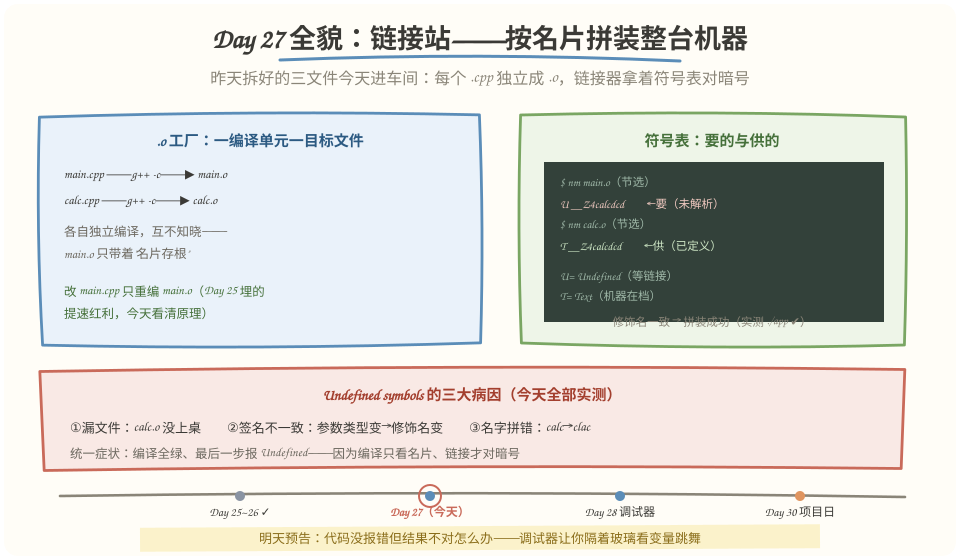
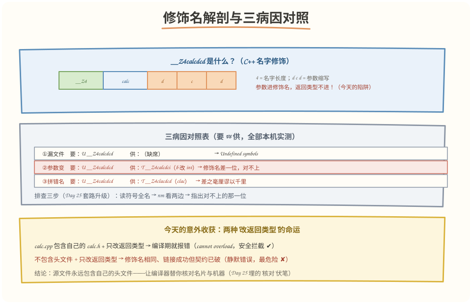
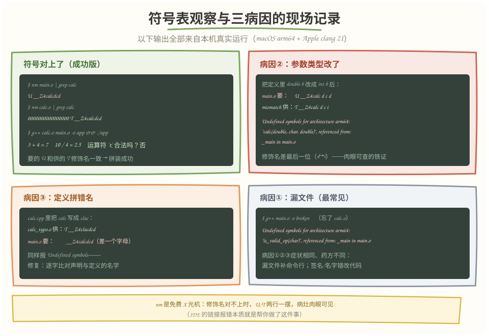

# 第 27 天：分离编译与链接——Undefined symbols 的系统排查

> **今日目标**：完成本教程后，你能做到：说出 `.o` 文件的来历和链接站的两项工作（符号解析＋地址拼装）；用 `nm` 查看目标文件的 U/T 符号并解释 `__Z4calcdcd` 的构成；独立复现并修复 Undefined symbols 的三大病因；解释"源文件包含自己头文件"为什么能拦住签名事故。
> **预计时间**：学习 25 分钟＋实践 45 分钟
> **前置准备**：完成 Day 25~26（三文件结构和命名空间；今天的实验材料沿用 Day 25 的计算器）。
> **今日产出**：符号表观察记录、三大病因的一错一修档案、修饰名解剖图。

## 1. 今天解决什么问题？

昨天的三文件已经能编译运行，但"链接"在你眼里还是个黑箱：`.o` 是什么、链接器在忙什么、`Undefined symbols` 到底哪里 undefined？今天把黑箱拆开——计划指定的练习"故意制造链接错误并修复"正是最好的探照灯：**三种病因各造一次，看着它报错，再看着它好**。

另外今天有个意外收获：实验中发现"改返回类型"在包含头文件时是编译期拦截、不包含时是静默通过——一好一坏两种命运，直接解释了 Day 25 那句"源文件要包含自己的头文件"的深层原因。

## 2. 先看全貌：今天的内容位于哪里？



**图 1**：左卡是 `.o` 工厂——每个 `.cpp` 是一个编译单元，`g++ -c` 各自产出 `.o`，互不知晓；右卡是符号表——`nm main.o` 看到 `U __Z4calcdcd`（要的、未解析），`nm calc.o` 看到 `T __Z4calcdcd`（供的、已定义），修饰名一致即拼装成功。下方红卡预告三大病因。路线图：第 5 周第 3 站。

三步概括今天：

1. 链接站两件事：把各家 `.o` 的"要/供"符号对上号（解析），再拼装地址成可执行文件；
2. `Undefined symbols` = 某张名片全项目没人兑现——三大病因各有药方；
3. `nm` 是免费的 X 光机，U/T 两行一摆，病灶肉眼可见。

## 3. 核心概念：先用直觉，再给准确定义

### 3.1 目标文件与符号表

- **一句通俗解释**：`.o`（目标文件，object file）是编译单元的"半成品包"——机器码都在，但留了两份清单：我**要**哪些函数（U，未解析）、我**供**哪些函数（T，已定义）。
- **一个类比**：装修分包——水电工（main.o）完工时留了张单子"灯具安装等总包安排"（U）；灯具商（calc.o）的货单写着"灯具安装，本店提供"（T）——总包（链接器）对单拼装。
- **对应到技术上是**：本机实测 `nm main.o | grep calc` 得 `U __Z4calcdcd`，`nm calc.o` 得 `T __Z4calcdcd`——`U`/`T` 一致，链接成功。类比的边界：分包商之间**从不直接通话**——这就是"独立编译"的含义，也是改一个文件只重编一个 `.o` 的依据。
- **常见误解**：".o 是压缩包"——不是；它是带符号表的机器码半成品，缺的只是"跨文件跳转的最终地址"。

### 3.2 名字修饰：签名进名字

- **一句通俗解释**：C++ 编译器把函数的**参数信息**编进符号名（name mangling），让"参数不同的同名函数"在符号表里天然不冲突——重载的底层实现。
- **一个类比**：班级点名不只记"小明"还记"三二班的小明"——重名同学天然分开了。
- **对应到技术上是**：`__Z4calcdcd` = `__Z`（C++ 修饰前缀）+ `4`（名字长度）+ `calc` + `d c d`（三个参数类型缩写：double/char/double）。**参数进名字，返回类型不进**——这句是今天陷阱的根源。类比的边界：修饰名格式因编译器而异（MSVC 与 clang 不同），所以**不同编译器编的 .o 不能直接混链**。
- **常见误解**："链接器认的是源代码里的函数名"——不是，是修饰名：`calc(double,char,double)` 和 `calc(double,char,int)` 在链接器眼里是两个毫不相干的符号。

### 3.3 三大病因与排查套路

- **一句通俗解释**：Undefined symbols 的三种病因——机器没上桌（漏 `.o`）、名片和机器对不上（签名变了）、机器挂牌名字写错（拼错名）。
- **一个类比**：相亲失败三原因：人没来、来的人和照片差太多、名字根本不是同一个。
- **对应到技术上是**（全部本机实测）：①漏文件：`g++ main.o` 忘了 `calc.o`；②参数不一致：定义把 `double b` 写成 `int b`，供的是 `T __Z4calc d c i`，要的是 `__Z4calc d c d`——差最后一位；③拼错名：定义写成 `clac`，供 `T __Z4clacdcd`。排查三步：读报错里的符号全名 → `nm` 看两边 → 指出对不上的那一位。类比的边界：三种病因**症状相同、药方不同**——①补命令行，②③改代码；先分清病因再动手。
- **常见误解**："报错在最后一行就是最后一行代码的错"——链接错误指向的是**整个项目的拼装**，位置仅供参考。

### 3.4 今天的意外收获：两种"改返回类型"的命运

- **一句通俗解释**：同样把返回类型改错，包含自己头文件会被编译器当场拦下；不包含则修饰名不变、链接通过、契约已破。
- **一个类比**：出口前安检（编译期核对）能拦下贴错标签的行李；不安检则一路畅通到目的地才发现拿错了。
- **对应到技术上是**：实测一（含 calc.h + 返回类型改 int）→ 编译报 `functions that differ only in their return type cannot be overloaded`，**编译期安全拦截**；实测二（不含头文件 + 同样改）→ `T __Z4calcdcd` 与原修饰名**相同**（返回类型不进修饰名），链接成功但调用方按 double 解读 int 返回——静默错误。类比的边界：这不是让你钻空子，而是反证**"源文件包含自己的头文件"是自我核对的安全带**（Day 25 那行 include 的深层含义）。
- **常见误解**："编译通过 = 声明和定义一致"——只在包含头文件时成立；这正是要包含的原因。

## 4. 图解核心机制



**图 2**：上半部分解剖 `__Z4calcdcd` 的五段构成（前缀/长度/名字/三个参数缩写），红字标注关键规则"参数进、返回类型不进"。中间灰卡是三病因对照表——每行"要什么 vs 供什么"，对不上的位置一目了然。下方黄卡是两种"改返回类型"的命运对照，结论落在"源文件永远包含自己的头文件"。

按图逐步讲：

1. **先会拆修饰名**：看到 `__Z4calcdcd` 能倒推回 `calc(double, char, double)`——报错信息里的符号名就从天书变成情报；
2. **再用对照表诊断**：U 行和 T 行并排一放，差在哪一位（缺整行？末位 d/i？calc/clac？）病因自现；
3. **三步套路背熟**：读符号全名 → nm 看两边 → 指出差异位——比"盯着报错发呆"快十倍；
4. **安全带记牢**：`.cpp` 包含自己的 `.h`，让编译器替你做名片-机器核对——今天的一好一坏两种命运就是证据。

## 5. 动手实践：完成一个最小可运行例子

### 5.1 准备文件

```bash
cd ai-compiler-roadmap/tutorials/day-027/examples
ls    # calc.h  calc.cpp  main.cpp（沿用 Day 25 的三文件）
```

### 5.2 编写代码

代码与 Day 25 完全相同（今天的重点是**流程和错误**，不是新功能）：

```bash
g++ -Wall -c calc.cpp        # 产出 calc.o
g++ -Wall -c main.cpp        # 产出 main.o
g++ calc.o main.o -o app     # 链接
```

### 5.3 运行与观察

**成功版与符号观察（本机实测）**：

```text
$ nm main.o | grep calc
                 U __Z4calcdcd
$ nm calc.o | grep calc
0000000000000000 T __Z4calcdcd
$ ./app
3 + 4 = 7
10 / 4 = 2.5
运算符 'x' 合法吗？否
```



**图 3**：左上成功版的 U/T 对号入座；右上病因②（`dcd` vs `dci`，末位差异肉眼可见）；左下病因③（`calc` vs `clac`）；右下病因①（最常见也最好修）。底部黄条：nm 是免费 X 光机。

**三大病因逐一实测（均为本机真实报错）**：

```bash
# 病因①：漏文件
g++ main.o -o broken1
```

```text
Undefined symbols for architecture arm64:
  "is_valid_op(char)", referenced from:
      _main in main.o
```

```bash
# 病因②：参数类型不一致（把 calc.cpp 里的 double b 改成 int b 再 -c）
g++ main.o calc_mismatch.o -o broken2
```

```text
Undefined symbols for architecture arm64:
  "calc(double, char, double)", referenced from:
      _main in main.o
```

```bash
# 病因③：拼错名（calc.cpp 里把 calc 写成 clac 再 -c）
g++ main.o calc_typo.o -o broken3
```

同样报 Undefined——但 `nm calc_typo.o` 供的是 `T __Z4clacdcd`，差一个字母。

### 5.4 修改一行再观察：两种"改返回类型"的命运

**命运 A（安全拦截）**：把 `calc.cpp` 复制为 `calc_int.cpp`，保留 `#include "calc.h"`，把返回类型 `double` 改成 `int` 再编译：

```text
calc_int.cpp:4:5: error: functions that differ only in their return type cannot be overloaded
./calc.h:5:8: note: previous declaration is here
```

编译期就拦下——头文件那张名片让编译器当场发现不一致。

**命运 B（静默通过，危险！）**：删掉 `#include "calc.h"`，同样只改返回类型，编译链接**全部通过**——因为返回类型不进修饰名，`T __Z4calcdcd` 和原来一模一样。但调用方按 `double` 解读返回值，契约已经悄悄破裂。

两种命运合起来就是今天的结论：**源文件永远包含自己的头文件**——那行 include 是免费的安检机。

## 6. 常见错误与排查

**错误 1：`Undefined symbols` 且报错函数确实写了**

- 现象：函数明明在某个 `.cpp` 里定义了，链接还是报缺；
- 原因：三选一——那个 `.cpp` 没进编译命令（病因①）、签名和声明不一致（病因②）、名字拼错（病因③）；
- 定位：三步套路——读符号全名、`nm` 两边对照、指出差异位；
- 修复：按病因对号入座：补命令行 / 改回签名 / 改正拼写。

**错误 2：声明在 namespace 里、定义没穿姓（Day 26 埋的雷）**

- 现象：`my_utils::clamp` 报 Undefined；
- 原因：修饰名里含姓氏——`my_utils::clamp` 和裸 `clamp` 是两个符号；
- 定位：nm 一看便知（供的符号没有 `N my_utils` 前缀）；
- 修复：定义也包进 `namespace my_utils { }`。

**错误 3：改了一个 `.cpp`，链接的还是旧 `.o`**

- 现象：改完代码重跑 `g++ *.o`，行为没变；
- 原因：忘了重新 `-c`，链接的是旧目标文件；
- 定位：`ls -l *.o` 看时间戳；
- 修复：养成"`-c` 重编改动文件 → 链接"的固定节奏，或直接一条命令全编（第 24 周 CMake 自动化这事）。

## 7. 今日练习

### 必做练习（计划指定：制造链接错误并修复）

按今天的剧本自己走一遍：复制三文件到新目录，依次制造三大病因（漏 `.o`、参数改型、拼错名），每次先**预测报错内容**再编译、记录真实报错、修复并确认通过。预期产出：三段"预测—实测—修复"记录抄进 `notes.md`。

### 选做挑战

用 `nm -C` 看符号表（`-C` 是 demangle，把修饰名还原成人话）：`nm -C main.o | grep calc` 应显示 `U calc(double, char, double)`。再对比 `nm calc.o` 和 `nm -C calc.o` 的差别——以后读报错时，报错信息里的 `"calc(double, char, double)"` 就是链接器 demangle 后给你看的。

## 8. 今日验收

- [ ] 我能说出 .o 的来历和 U/T 符号的含义
- [ ] 我能拆解 `__Z4calcdcd` 的五段构成，并说"参数进、返回类型不进"
- [ ] 我独立复现并修复了三大病因的 Undefined symbols
- [ ] 我能解释两种"改返回类型"的命运和"源文件包含自己头文件"的原因
- [ ] 我掌握了三步排查套路：读符号全名 → nm 对照 → 指出差异位

## 9. 一句话总结与明天预告

今天的问题是"链接站到底在忙什么、报错怎么读"；机制上，每个编译单元产出带 U/T 清单的 `.o`，链接器按修饰名对号拼装，参数进修饰名而返回类型不进（后者是包含自己头文件的理由）；实践上，nm 观察、三病因一错一修、两种命运对照全部实测归档；验证标准是看到任何 Undefined symbols 三分钟内说出病因。明天 **Day 28：调试器入门**——断点、单步、查看变量：代码没报错但结果不对时，学会隔着玻璃看变量跳舞。
