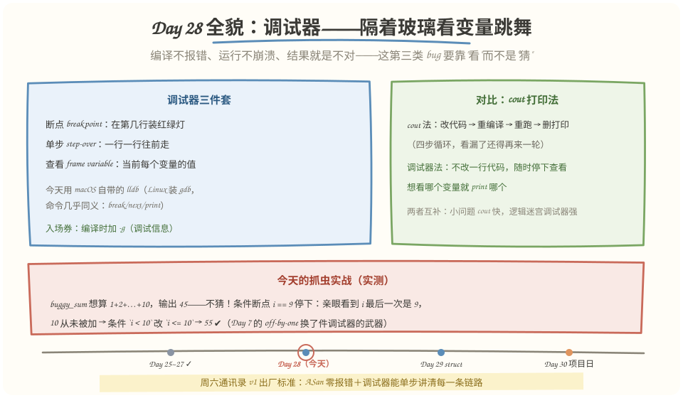
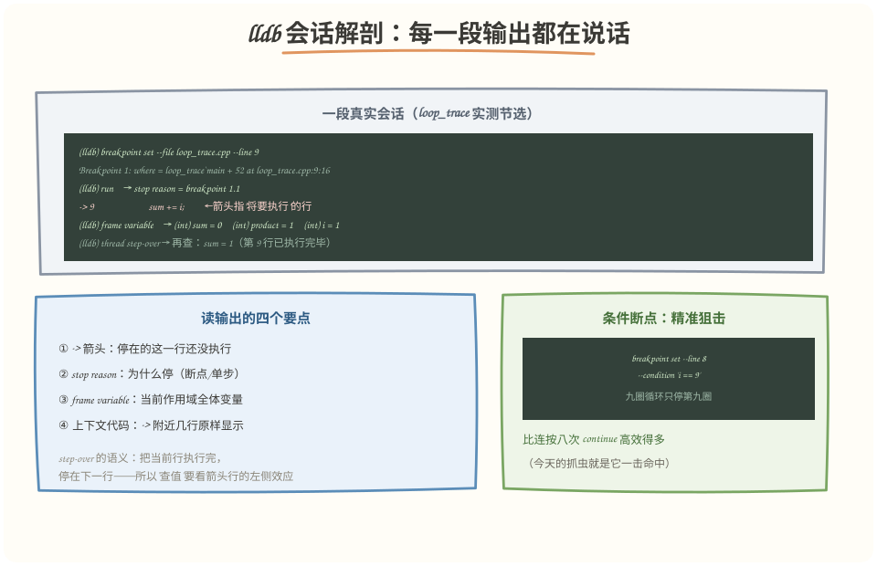
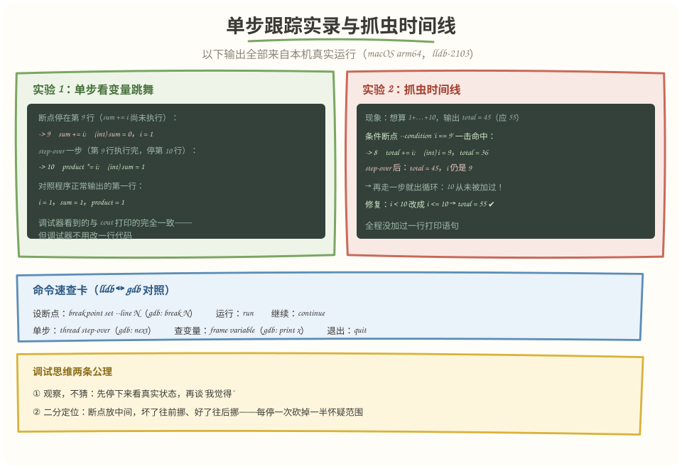

# 第 28 天：调试器入门——断点、单步、查看变量

> **今日目标**：完成本教程后，你能做到：用 `-g` 编译并在 lldb 里完成"断点 → run → frame variable → step-over"完整闭环；读懂 `->` 箭头和 stop reason；用条件断点精准狙击第 N 次循环；独立用调试器抓出一只 off-by-one bug。
> **预计时间**：学习 25 分钟＋实践 45 分钟
> **前置准备**：完成 Day 1~27；macOS 自带 lldb（Linux 用户装 gdb，命令对照见 5.3）。
> **今日产出**：单步跟踪循环的变量变化实录、一段条件断点抓虫的完整时间线。

## 1. 今天解决什么问题？

bug 分三类：编译错误（编译器抓）、运行崩溃（ASan/系统抓）、**结果不对但一声不吭**——第三类今天登场。过去你只能往代码里塞 `cout` 打印，看漏了还得重编译再来一轮；今天学会调试器（debugger）：**不改一行代码，让程序在任何一行停下来，把当前所有变量的值摆给你看**。

计划指定的练习"单步跟踪一个循环的变量变化"是最佳入门：五行循环，断点一停、单步一走，`sum` 从 0 变 1 的全过程尽收眼底。再用一只真实的 off-by-one bug（想加到 10 结果只加到 9）验收——条件断点一击命中。

## 2. 先看全貌：今天的内容位于哪里？



**图 1**：左卡是三件套——断点（在哪行装红绿灯）、单步（一行一行走）、查看（变量值随停随看）；右卡是与 cout 打印法的对比（四步循环 vs 零改动），两者互补不互斥。下方红卡预告今天的抓虫实战。路线图：第 5 周第 4 站，周六通讯录的出厂标准里从此多了"调试器能讲清每条链路"。

三步概括今天：

1. 入场券：编译加 `-g`（调试信息），`lldb ./程序` 进入调试器；
2. 闭环四命令：`breakpoint set --line N` → `run` → `frame variable` → `thread step-over`；
3. 思维公理：观察不猜、二分定位。

## 3. 核心概念：先用直觉，再给准确定义

### 3.1 断点与单步：程序的暂停键和慢放键

- **一句通俗解释**：断点让程序**停在某行之前**；单步让它**每次只走一行**；查看把当前作用域的变量值**全部摆出来**。
- **一个类比**：看体操动作回放——在起跳前定格（断点）、逐帧慢放（单步）、教练同时报出每个关节的角度（frame variable）。
- **对应到技术上是**：本机实测——断点设在 `loop_trace.cpp` 第 9 行，`run` 后停在 `-> 9 sum += i;`，此时 `sum = 0, product = 1, i = 1`（**箭头行尚未执行**）；`thread step-over` 一步后停在 10 行，`sum = 1`（第 9 行的副作用已发生）。类比的边界：录像带回放是假的重复，调试器的每次 run 都是**真执行**——状态真实、结论可靠。
- **常见误解**："断点那行的变量值是执行后的"——恰恰相反，`->` 指向的行**还没执行**；想看执行后，step 一步再看。

### 3.2 读会话输出：四件信息

- **一句通俗解释**：每次停下来，lldb 给四样东西——箭头位置、停止原因、附近代码、变量值。
- **一个类比**：行车记录仪的事故片段——时间地点（箭头+原因）、前后路况（上下文代码）、车内仪表（变量）。
- **对应到技术上是**：`stop reason = breakpoint 1.1`（为什么停）、`-> 9 sum += i;`（停在哪）、上下文五行源码（来龙去脉）、`(int) sum = 0`（当前状态，类型都标着）。类比的边界：`frame variable` 只显示**当前函数作用域**的变量——出了作用域的名字看不到（Day 11 的围栏在调试器里照样生效）。
- **常见误解**："step-over 会进入函数内部"——不会，它把函数调用当一行执行完（进内部的是 step-into，进阶操作，下周再说）。

### 3.3 条件断点：精准狙击

- **一句通俗解释**：给断点加条件——只有条件成立时才停，其余次直接放行。
- **一个类比**：门禁系统只拦"工号 9"的员工——其他人都顺畅通行。
- **对应到技术上是**：`breakpoint set --file buggy_sum.cpp --line 8 --condition 'i == 9'`——九圈循环只停第九圈。今天的抓虫实战：停住时 `i = 9, total = 36`；step 一步后 `total = 45` 且 `i` 仍是 9——**10 从未被加过**，`i < 10` 改 `i <= 10` 得 55。类比的边界：条件在**每次到达该行时**求值——条件写错（如永假）会导致"断点不命中"，别以为是调试器坏了。
- **常见误解**："条件断点和 if 打印差不多"——差在没有改代码：不重编译、不留垃圾打印、想换条件随时换。

## 4. 图解核心机制



**图 2**：上半部分是一段真实会话的逐行标注——断点设置回显、stop reason、`->` 箭头（未执行的行）、frame variable 的输出格式；左下蓝卡是读输出的四个要点；右下绿卡是条件断点的语法和"九圈只停第九圈"的狙击图。

按图逐步讲：

1. **先认箭头**：`->` 行是"将要执行"的行——所有变量值都是这一行执行**前**的状态；
2. **再读 stop reason**：`breakpoint 1.1` 是断点命中、`step over` 是单步停下——知道"为什么停"才不会迷路；
3. **frame variable 一览无余**：不用一个一个猜着 print——当前作用域全体变量一次列出（含类型）；
4. **条件断点省九次 continue**：怀疑"第几圈出问题"时，直接给断点加 `--condition '循环变量 == N'`。

## 5. 动手实践：完成一个最小可运行例子

### 5.1 准备文件

```bash
cd ai-compiler-roadmap/tutorials/day-028/examples
g++ -Wall -g loop_trace.cpp -o loop_trace    # -g：调试信息入场券
lldb ./loop_trace                            # 进入调试器
```

### 5.2 编写代码

练习场 `loop_trace.cpp`（完整代码）：

```cpp
#include <iostream>

// 调试器练习场：单步跟踪一个循环的变量变化
int main() {
    int sum = 0;
    int product = 1;

    for (int i = 1; i <= 5; ++i) {
        sum += i;
        product *= i;
        std::cout << "i = " << i << "，sum = " << sum
                  << "，product = " << product << std::endl;
    }
    return 0;
}
```

抓虫素材 `buggy_sum.cpp` 见本目录——想算 `1+2+…+10`，实际输出 45。

### 5.3 运行与观察

程序正常输出（本机）：

```text
i = 1，sum = 1，product = 1
i = 2，sum = 3，product = 2
i = 3，sum = 6，product = 6
i = 4，sum = 10，product = 24
i = 5，sum = 15，product = 120
```

调试器实录（本机 lldb 会话节选）：

```text
(lldb) breakpoint set --file loop_trace.cpp --line 9
Breakpoint 1: where = loop_trace`main + 52 at loop_trace.cpp:9:16
(lldb) run
* thread #1, ... stop reason = breakpoint 1.1
-> 9   	        sum += i;
(int) sum = 0
(int) product = 1
(int) i = 1
(lldb) thread step-over
-> 10  	        product *= i;
(int) sum = 1
```



**图 3**：左上是单步实录（`sum` 从 0 到 1 的瞬间被逮个正着，与正常输出第一行完全对上）；右上是抓虫时间线（条件断点命中 → `i=9` 铁证 → 一步看到 45 → 修复得 55）；下方蓝卡是 lldb/gdb 命令速查，黄卡是调试思维两条公理。

### 5.4 修改一个输入再观察：抓虫实战全记录

**现象**：`buggy_sum` 想算 `1+2+…+10`（应为 55），输出 `total = 45`。

**狙击**：条件断点只在第九圈停（本机实录）：

```text
(lldb) breakpoint set --file buggy_sum.cpp --line 8 --condition 'i == 9'
(lldb) run
-> 8   	        total += i;
(int) i = 9
(int) total = 36
(lldb) thread step-over
-> 9   	    }
(int) i = 9
(int) total = 45
```

**推理**：停在循环体最后一圈时 `i = 9`——这一圈加完 total 才 45，下一圈根本不存在：**10 从未被加过**。看第 7 行 `for (int i = 1; i < 10; ++i)`——`< 10` 在 i 变 10 时直接退出。Day 7 的 off-by-one 换了武器重现。

**修复**：`i < 10` 改成 `i <= 10`，重新编译运行 → `total = 55`（实测）。全程没有加过一行打印语句。

## 6. 常见错误与排查

**错误 1：`error: Command requires a process which is currently stopped`**

- 现象：程序已退出还在发 frame variable；
- 原因：进程跑完了（比如最后一步 continue 后自然退出）；
- 定位：看上一次输出有没有 `exited with status`；
- 修复：重新 `run`；批处理模式下注意命令序列在进程退出后不再有效。

**错误 2：断点设置成功但 run 从不停**

- 现象：程序一口气跑完；
- 原因：断点行在循环/分支里但那条路径没走到；或条件永假；
- 定位：`breakpoint list` 确认位置；条件断点先去掉条件试试；
- 修复：把断点挪到必然执行的行（如 main 第一句），或修正条件。

**错误 3：变量值"不对劲"，其实是箭头行未执行**

- 现象：停在 `sum += i;` 却看到旧值，以为加法错了；
- 原因：`->` 行还没执行——看到的是执行前状态；
- 定位：看箭头位置；step 一步再查；
- 修复：养成"箭头行 = 未执行"的条件反射（3.1 的重点）。

## 7. 今日练习

### 必做练习（计划指定：单步跟踪循环）

给 `loop_trace.cpp` 的断点改设到第 10 行（`product *= i;`），完整走一遍"run → 查 → step → 查"并手抄三轮的 `i / sum / product` 值，和程序输出的三行对照。预期产出：一张"调试器视角 vs 输出视角"的对照表（值应完全一致，差一行的执行时机）。

### 选做挑战

自己埋一只 bug：把 `loop_trace.cpp` 的 `product *= i` 改成 `product += i`（乘改加），先预测输出，再用调试器的条件断点 `i == 3` 验证预测——停在第三圈看 `product` 是 6（阶乘）还是 6（1+2+3，恰好相同！）——再停在第四圈区分两者。体会"巧合同值"为什么更需要观察而不是猜。

## 8. 今日验收

- [ ] 我能用 -g 编译并完成 breakpoint → run → frame variable → step-over 闭环
- [ ] 我能说出 `->` 箭头行的语义（未执行）并因此不误读变量值
- [ ] 我用条件断点抓出了一只 off-by-one bug，全记录在案
- [ ] 我能背出 lldb 四命令的 gdb 对照（break/next/print/continue）
- [ ] 我记住了两条公理：观察不猜、二分定位

## 9. 一句话总结与明天预告

今天的问题是"结果不对又一声不吭的 bug 怎么抓"；机制上，调试器用断点暂停、单步慢放、查看摆状态，条件断点实现精准狙击；实践上，单步实录与抓虫时间线双双落地，全程零打印语句；验证标准是停在任何一行都能说出"这行执行前后变量各是什么"。明天 **Day 29：struct 结构体与 enum 枚举**——把相关的变量打包成"卡片"，通讯录的一条联系人、成绩单的一行记录，都是 struct 的舞台，周六项目日的地基明天打好。
