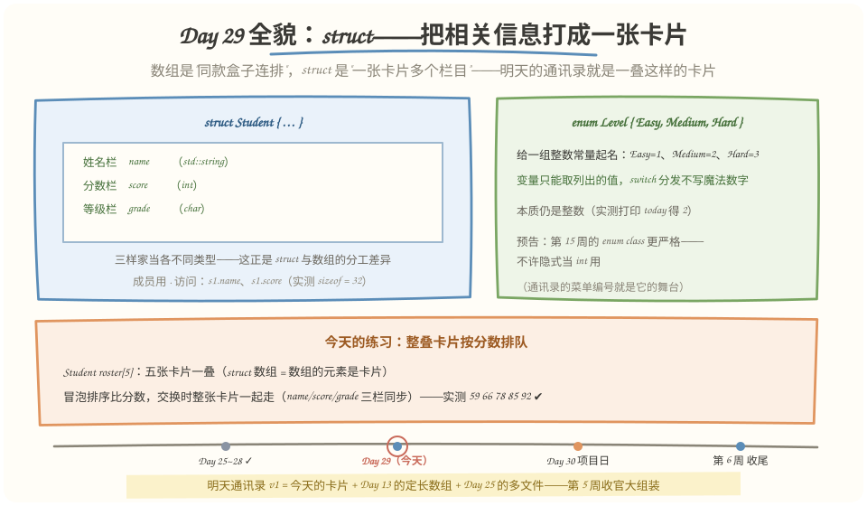
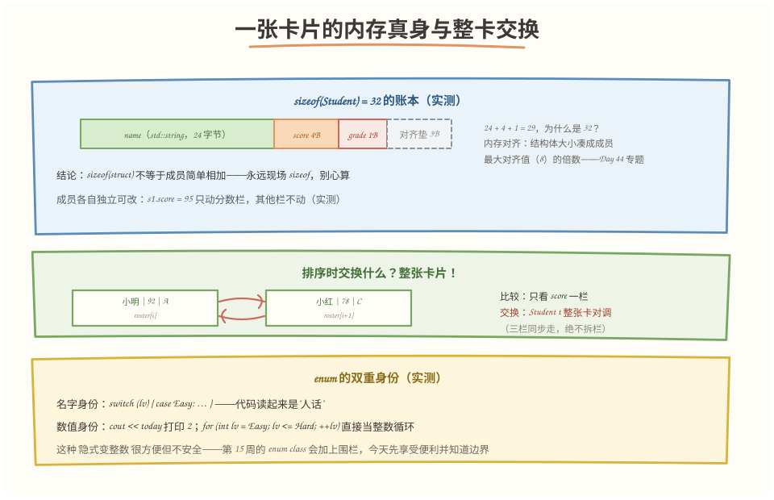

# 第 29 天：struct 与 enum——卡片与挂牌

> **今日目标**：完成本教程后，你能做到：定义 struct 并用两种方式初始化、用 `.` 读写成员；解释 `sizeof(struct)` 为什么不等于成员简单相加（对齐垫的初识）；完成 Student 数组按分数排序（整卡交换）；用 enum 消灭代码里的魔法数字并说出它的整数本质。
> **预计时间**：学习 25 分钟＋实践 45 分钟
> **前置准备**：完成 Day 1~28（冒泡排序的雏形 Day 7 嵌套循环就能写；多文件是明天的主菜）。
> **今日产出**：Student 卡片程序、五人成绩排序（实测 59→92）、enum 三档难度分发。

## 1. 今天解决什么问题？

记录一个学生要三个变量（name、score、grade）——五个学生就是十五个变量，传参要带一串、排序要换十五次。今天的问题：**相关的不同类型信息怎么打包**？答案是 struct（结构体）：一张卡片多个栏目，整卡声明、整卡传递、整卡交换。

配套的 enum（枚举）解决另一个小烦恼：代码里 `case 1:` `case 2:` 这种魔法数字——给它们挂牌成名（`Easy`、`Medium`、`Hard`）。今天的两个新工具都是明天通讯录 v1 的直接零件：Contact 卡片 + 菜单枚举。

## 2. 先看全貌：今天的内容位于哪里？



**图 1**：左卡是 `struct Student`——三个不同类型的成员（string/int/char）打成一张卡，`s1.name` 用 `.` 访问；右卡是 `enum Level`——一组整数常量挂牌成名，switch 分发零魔法数字。下方橙卡是今天的练习：五张卡片按分数排队（实测 59 66 78 85 92）。底部黄条：明天通讯录 = 今天的卡片 + Day 13 数组 + Day 25 多文件。

三步概括今天：

1. struct 定义类型、声明卡片、`.` 访问成员；
2. struct 数组 = 一叠卡片；排序时**整卡交换**；
3. enum 给整数挂牌，switch 按名分发。

## 3. 核心概念：先用直觉，再给准确定义

### 3.1 struct：异构信息的卡片

- **一句通俗解释**：struct 把几个相关变量打包成一个新类型——之后这个类型可以像 int 一样声明变量。
- **一个类比**：病历卡——姓名栏、年龄栏、血型栏各不同格式，但整卡一体：挂号递一张卡，不用分别报三样。
- **对应到技术上是**：`struct Student { std::string name; int score; char grade; };` 定义类型；`Student s1 = {"小明", 92, 'A'};` 按成员序初始化，或 `s2.name = "小红"` 逐栏填写；`s1.score = 95` 只动一栏。本机实测 `sizeof(Student) = 32`。类比的边界：卡片各栏**仍然独立**——改分数栏不动姓名栏；而卡片之间的赋值是**整卡复制**（三栏一起拷）。
- **与数组的分工**：数组装"同类型的一排"（8 周成绩），struct 装"一体的几样"（一个学生）——struct 数组就是"一叠同样规格的卡片"。
- **常见误解**："struct 是多个变量的缩写"——不，它是**新类型**：能声明、能传参、能作数组元素、能整体赋值。

### 3.2 对齐垫：sizeof 的意外

- **一句通俗解释**：struct 的实际大小常比成员之和多几字节——编译器在"对齐"。
- **一个类比**：行李箱里放长杆——杆子太长放不进剩余空隙，只能空着那格另起一行；空格就是垫料。
- **对应到技术上是**：本机实测 24（string）+ 4（int）+ 1（char）= 29，实际 32——编译器把总大小凑成最大成员对齐值（8 字节）的倍数，末尾垫了 3 字节。**结论：永远现场 `sizeof`，别心算**。类比的边界：垫料不影响成员访问（`.name` 照用），只影响总大小和数组步长——细节留到 Day 44 内存对齐专题。
- **常见误解**："sizeof 算错了"——不是错，是规则；跨平台结果还可能不同。

### 3.3 enum：给整数挂牌

- **一句通俗解释**：枚举把一组相关整数常量组织成带名字的集合，变量只能取集合内的值。
- **一个类比**：游戏难度旋钮——不是任意数字，只有 1/2/3 三档，每档有名字。
- **对应到技术上是**：`enum Level { Easy = 1, Medium = 2, Hard = 3 };`——`Level today = Medium;` 合法；`switch (lv) { case Easy: … }` 代码读成人话。**双重身份（实测）**：`cout << today` 打印 2（整数本质）；`for (int lv = Easy; lv <= Hard; ++lv)` 直接当整数循环。类比的边界：普通 enum 会**隐式**转 int（方便但不设防）——第 15 周的 `enum class` 加围栏，今天享受便利、知道边界即可。
- **常见误解**："enum 是字符串"——不是，是穿着名字外衣的整数；要显示中文得自己写 switch 映射（今天的 `level_name`）。

## 4. 图解核心机制



**图 2**：上半部分是 `sizeof(Student) = 32` 的账本——name 24 + score 4 + grade 1 = 29，末尾垫 3 字节凑 8 的倍数（Day 44 预告）；中间绿卡是排序时的整卡交换图——**比较只看 score 栏，交换的是整张卡**（三栏同步）；下方黄卡是 enum 的双重身份对照（名字身份读代码、数值身份跑循环）。

按图逐步讲：

1. **先看账本**：sizeof 是打包后的**含垫**大小——struct 数组的步长也按它算（`&roster[1] - &roster[0]` 差 32 不差 29）；
2. **再看交换**：`Student t = roster[i];` 一行完成整卡备份——若是三个独立变量就得写三对临时变量；
3. **成员级读写**：排序比较用 `roster[i].score`（下标选卡片、`.` 选栏目——两层访问记牢）；
4. **enum 两副面孔**：写代码用名字（可读），做运算用数值（方便）——`level_name` 函数是两副面孔的翻译官。

## 5. 动手实践：完成一个最小可运行例子

### 5.1 准备文件

```bash
cd ai-compiler-roadmap/tutorials/day-029/examples
```

三个程序：`struct_basics.cpp`、`student_sort.cpp`、`enum_demo.cpp`。

### 5.2 编写代码

排序主角 `student_sort.cpp`（核心部分）：

```cpp
struct Student {
    std::string name;
    int score;
    char grade;
};

void print_roster(const Student roster[], int count) {
    for (int i = 0; i < count; ++i) {
        std::cout << "  " << roster[i].name << "："
                  << roster[i].score << " 分（" << roster[i].grade << "）" << std::endl;
    }
}

int main() {
    Student roster[5] = {
        {"小明", 92, 'A'}, {"小红", 78, 'C'}, {"小刚", 85, 'B'},
        {"小丽", 66, 'D'}, {"小强", 59, 'F'},
    };

    for (int round = 0; round < 4; ++round) {          // 冒泡：每一轮把最小分"沉"到前面
        for (int i = 0; i + 1 < 5 - round; ++i) {
            if (roster[i].score > roster[i + 1].score) {
                Student t = roster[i];                  // 交换整张卡片（三个成员一起走）
                roster[i] = roster[i + 1];
                roster[i + 1] = t;
            }
        }
    }
    …
}
```

冒泡排序今天是**工具**（第 16 周算法日才正式研究它的原理与亲戚们）；重点看两处：比较用 `.score` 选栏、交换用 `Student t` 整卡。

### 5.3 运行与观察

```bash
g++ -Wall struct_basics.cpp -o sb && ./sb
```

实际执行结果（本机）：

```text
小明：92 分，等级 A
小红：78 分，等级 C
改分后 小明：95
sizeof(Student) = 32（三样家当打包后的大小）
sizeof(s1) 与 sizeof(Student) 相同：是
```

```bash
g++ -Wall student_sort.cpp -o ss && ./ss
```

```text
排序前：
  小明：92 分（A）
  小红：78 分（C）
  小刚：85 分（B）
  小丽：66 分（D）
  小强：59 分（F）
按分数升序后：
  小强：59 分（F）
  小丽：66 分（D）
  小红：78 分（C）
  小刚：85 分（B）
  小明：92 分（A）
```

```bash
g++ -Wall enum_demo.cpp -o ed && ./ed
```

```text
今天的练习难度：中等
它背后的数值：2（枚举本质是整数）
升级后：困难
难度 1：刷 10 题
难度 2：刷 20 题
难度 3：刷 30 题
```


**图 3**：左上卡片读写（两种初始化、单栏修改、sizeof 实测）；右上五卡排队（三栏同步换位）；左下枚举三档（名字与数值双身份）；右下是三种数据组织方式的选型对照——独立变量/数组/struct 各归其位。

### 5.4 修改一个输入再观察：只改一栏的精确性

给 `struct_basics.cpp` 加一行实验（本机实测）：`s1.grade = 'A' + 1;` 后打印——分数栏、姓名栏纹丝不动，只有等级变成 B。**成员级修改的精确性**正是卡片模型的价值：改血型不用换整张病历卡。再试整卡赋值 `s2 = s1;`——s2 三栏全部变成 s1 的值（整卡复制），之后改 s1.score 不影响 s2（两张独立的卡）。

## 6. 常见错误与排查

**错误 1：`error: aggregate 'Student s' has incomplete type`**

- 现象：漏了结构体定义末尾的分号；
- 原因：`struct X { … };` 的分号是类型声明的一部分，漏了编译器把后面的 main 当成员；
- 定位：报错行通常在 struct 后一两行——回去检查分号；
- 修复：补上分号（这是 struct 的头号新手坑）。

**错误 2：排序只交换了 score，名字和等级原地不动**

- 现象：排序后分数有序，但名字和分数对不上；
- 原因：把 `Student t` 写成了 `int t`，只换分数栏；
- 定位：看交换块的临时变量类型；
- 修复：交换整卡 `Student t = roster[i];`。

**错误 3：给 enum 变量赋了列表外的整数，编译器不报错（或警告）**

- 现象：`today = 7;` 居然能过（最多警告）；
- 原因：普通 enum 与 int 可隐式互转——围栏形同虚设；
- 定位：`-Wall` 会给部分场景警告；
- 修复：养成只赋枚举名的习惯；要严格围栏等第 15 周 `enum class`。

## 7. 今日练习

### 必做练习

给 `student_sort.cpp` 加"按姓名排序"版本：以 `roster[i].name > roster[i+1].name` 为比较条件（string 的 `>` 按字典序比较，Day 16 的伏笔）。预期产出：输出按姓名排序的五张卡（小刚/小红/小丽/小明/小强的字典序），并回答：交换代码变了吗？（没变——整卡交换与比较维度无关。）

### 选做挑战

把 Student 加一个成员 `Level level;`（今天的枚举），按等级初始化五人（如 A→Hard 练习量、F→Easy）。再写 `void assign_homework(Level lv)`，switch 分发刷题量——enum 和 struct 在一张卡片上会师，明天的通讯录菜单也这么写。

## 8. 今日验收

- [ ] 我能定义 struct、两种方式初始化、用 . 读写成员
- [ ] 我能解释 sizeof(Student)=32 的账本（对齐垫初识），知道要现场 sizeof
- [ ] 我完成了五卡排序，交换的是整张卡（三栏同步）
- [ ] 我能用 enum + switch 消灭魔法数字，并演示过它的整数本质
- [ ] 我知道 struct 的分号、整卡交换、enum 隐式转 int 三个坑

## 9. 一句话总结与明天预告

今天的问题是"相关而异构的信息怎么打包"；机制上，struct 是新类型——成员用 `.` 访问、sizeof 含对齐垫、赋值整卡复制；enum 给整数挂牌，名字身份可读、数值身份可算；实践上，卡片读写、五卡排队、三档难度全部实测；验证标准是看到任何数据组合能选对组织方式（独立变量/数组/卡片）。明天是**第 5 周收官项目日：通讯录 v1**——Contact 卡片 + 定长数组 + 多文件三件套 + 增删改查菜单，本周全部零件的总装大考。
