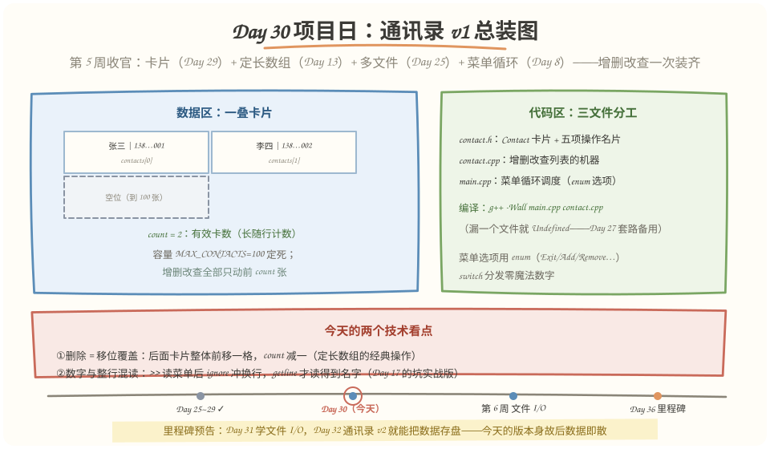
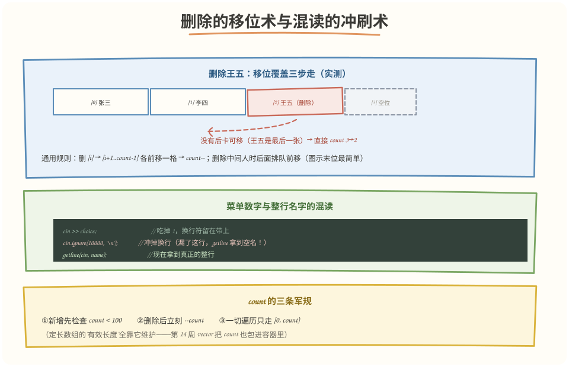
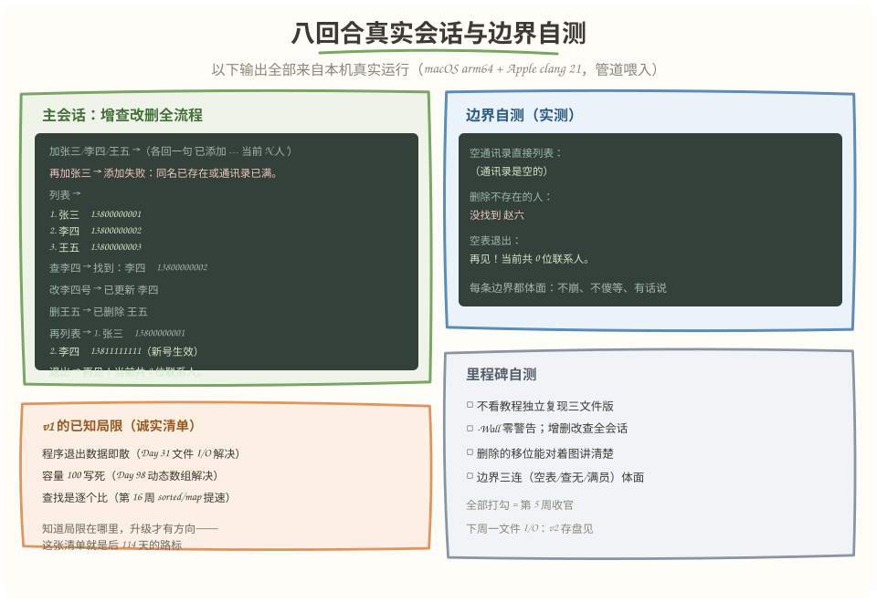

# 第 30 天（项目日）：通讯录 v1——卡片、数组、多文件的总装

> **今日目标**：完成本教程后，你能做到：独立搭建"Contact 卡片 + 定长数组 + count 计数"的通讯录三文件工程；实现增删改查列表五项操作（含同名拒绝与移位删除）；处理菜单数字与姓名整行的混读；对空表、查无此人、满员三类边界给出体面回应。
> **预计时间**：学习 15 分钟＋实践 60 分钟（项目日实践加重）
> **前置准备**：完成 Day 25~29——今天的每个零件本周都造过，只差总装。
> **今日产出**：三文件通讯录 v1（`-Wall` 零警告），八回合混合操作真实会话 + 边界自测全记录。

## 1. 今天解决什么问题？

第 5 周攒了一整箱零件：多文件（25）、命名空间（26）、链接排查（27）、调试器（28）、卡片（29）。计划指定的收官项目是**通讯录 v1**：结构体 + 定长数组 + 多文件，实现增删改查。这是计划里第一个"里程碑产出"级的项目（第 1 周的换算器只是热身）。

总装中两个技术看点值得单独说：**删除的移位术**（定长数组没有"抽走一格"的操作，只能让后面卡片整体前移）和**数字与整行的混读**（`>>` 读菜单后必须 ignore，getline 才拿得到名字——Day 17 的坑在真实项目里现身）。

## 2. 先看全貌：今天的内容位于哪里？



**图 1**：左卡是数据区——一叠 Contact 卡片（前 count 张有效，容量 100 定死）；右卡是代码区——三文件分工（contact.h 名片、contact.cpp 机器、main.cpp 调度，菜单选项用 enum）。下方红卡点出今天两大技术看点。底部黄条预告：Day 31 学文件 I/O，v2 就能存盘。

三步概括今天：

1. 数据：`Contact contacts[100]` + `int count`（有效长度全靠它维护）；
2. 操作：增（查重+检查满员）、删（移位覆盖）、改（找到改栏）、查（找到打印）、列（全表带序号）；
3. 混读：菜单数字 `>>` 之后 ignore 冲换行，再 getline 读姓名。

## 3. 核心概念：先用直觉，再给准确定义

### 3.1 count 军规：定长数组的"有效长度"

- **一句通俗解释**：数组容量 100 是"书架格子数"，count 是"实际放了几本书"——所有操作只碰前 count 格。
- **一个类比**：停车场 100 个车位、当前停了 3 辆——调度只管这 3 辆，99 号空位不关心。
- **对应到技术上是**：三条军规——新增前查 `count < 100`、删除后立刻 `--count`、一切遍历只走 `[0, count)`。本机实测：加 3 人 count 到 3、删 1 人 count 到 2，列表只显示 2 张卡。类比的边界：空位里可能残留**旧数据**（被"删除"的卡片其实还在内存里，只是不被计数）——所以列表绝不能按容量遍历，否则"尸体复活"。
- **常见误解**："删除就是把那格清空"——我们的实现是移位覆盖 + count 减一，被删的格子会被后面的卡片占用；物理清空没有必要（count 之外皆无效）。

### 3.2 移位删除：定长数组的手术

- **一句通俗解释**：删除中间一张卡，就让后面每张卡前移一格，最后 count 减一。
- **一个类比**：排队买票时中间走了一人——后面的人集体向前挪一步，队伍尾缩短一格。
- **对应到技术上是**：`for (int j = i; j + 1 < count; ++j) contacts[j] = contacts[j+1];`（整卡赋值，Day 29 的整卡复制派上用场）。本机实测删王五（末位）时循环体一次都不执行——末位删除最简单，只需 `--count`。类比的边界：队伍挪完就完了，而数组挪完的最后一格留着旧卡片的**残影**——无害，因为 count 已经不认它。
- **成本预告**：每次删除要移动最多 count 张卡——第 16 周会学到链表（不用移位的另一种结构），各有取舍。
- **常见误解**："删除后要不要把最后一格清零"——不必；count 减一后那格是"界外之地"。

### 3.3 混读冲刷：菜单数字与姓名整行

- **一句通俗解释**：`>>` 读菜单号后换行符留在传送带上，紧接着的 getline 会拿到空串——必须先 ignore。
- **一个类比**：Day 17 的坑原样搬家——数字后跟姓名的场景在交互程序里无处不在。
- **对应到技术上是**：`std::cin >> choice;` 之后立刻 `std::cin.ignore(10000, '\n');`，然后 `std::getline(std::cin, name);` 才能拿到真名（本机实测八回合会话全部正确）。类比的边界：全程只用 `>>`（无 getline）时不需要 ignore——本项目的姓名要支持空格（"张 三"），所以选了 getline。
- **常见误解**：漏了 ignore 的症状是"姓名栏永远读到空"——见过 Day 17 的实验，今天一眼识破。

## 4. 图解核心机制



**图 2**：上半部分是删除王五的三步图——末位删除最简单（无卡可移，直接 count 3→2），并标注通用规则（删 `[i]` → 后面的卡前移一格）；中间绿卡是混读冲刷的三行代码（漏掉中间那行的后果红字标出）；下方黄卡是 count 三条军规。

按图逐步讲：

1. **先看末位删除**：图示刻意选了最简单的情形——理解"移位"概念后，中间删除只是多走几步同一循环；
2. **再看冲刷三行**：`>>` → ignore → getline 的顺序是交互程序的固定舞步；
3. **军规守 count**：所有函数签名里 count 要么 `int&`（增删要改），要么 `int`（查改列只读）——Day 21 的选型在参数表上直接体现；
4. **残影无害**：被删卡片还在内存里，但 count 之外皆无效——"逻辑删除"靠计数不靠擦除。

## 5. 动手实践：完成一个最小可运行例子

### 5.1 准备文件

```bash
cd ai-compiler-roadmap/tutorials/day-030/examples
ls    # contact.h  contact.cpp  main.cpp
g++ -Wall main.cpp contact.cpp -o contacts    # 两个 .cpp 都要带上（Day 27 教训）
```

### 5.2 编写代码

**contact.h（名片区，完整）**

```cpp
#ifndef CONTACT_H
#define CONTACT_H

#include <string>

// Contact：一张联系人卡片（Day 29 的 struct）
struct Contact {
    std::string name;
    std::string phone;
};

const int MAX_CONTACTS = 100;          // 定长数组的容量（Day 13）

int  add_contact(Contact contacts[], int& count, const std::string& name, const std::string& phone);
bool remove_contact(Contact contacts[], int& count, const std::string& name);
bool update_contact(Contact contacts[], int count, const std::string& name, const std::string& phone);
bool find_contact(const Contact contacts[], int count, const std::string& name);
void list_contacts(const Contact contacts[], int count);

#endif
```

签名三看：增删带 `int& count`（要改数量）、查改列只读 count；查找/列表的数组参数是 `const Contact[]`（Day 22 的锁物——承诺不改）。机器区 `contact.cpp` 和调度区 `main.cpp`（菜单枚举 + switch 分发 + 混读冲刷）见本目录完整文件。

### 5.3 运行与观察

八回合混合会话（本机真实执行，管道喂入；提示与回显挤行属正常）：

```bash
printf '1\n张三\n13800000001\n1\n李四\n13800000002\n1\n王五\n13800000003\n1\n张三\n13999999999\n5\n4\n李四\n3\n李四\n13811111111\n2\n王五\n5\n0\n' | ./contacts
```

实际输出（节选）：

```text
已添加 张三（当前 1 人）
已添加 李四（当前 2 人）
已添加 王五（当前 3 人）
添加失败：同名已存在或通讯录已满。
  1. 张三　13800000001
  2. 李四　13800000002
  3. 王五　13800000003
  找到：李四　13800000002
已更新 李四
已删除 王五
  1. 张三　13800000001
  2. 李四　13811111111
再见！当前共 2 位联系人。
```



**图 3**：左上是八回合全流程（注意重复添加被拒、改号后的新号在第二次列表里生效）；右上是边界自测；右下灰卡是里程碑清单；左下橙卡是 **v1 的已知局限清单**——程序退出数据即散、容量写死、查找慢——这张清单就是后面 114 天的路标。

### 5.4 修改一个输入再观察：边界三连

空表与查无此人（本机实测）：

```bash
printf '5\n2\n赵六\n0\n' | ./contacts
```

```text
  （通讯录是空的）
没找到 赵六
再见！当前共 0 位联系人。
```

三条边界都体面：空列表有话说、删除不存在有回应、EOF 正常退出。满员分支（第 101 人）逻辑上同理（返回 2 被拦截），想实测可以把 `MAX_CONTACTS` 临时改成 3 再加第 4 人——代码一行不用改，这就是**容量用常量管**的红利（Day 13 军规的再次兑现）。

## 6. 常见错误与排查

**错误 1：新增后列表里出现"僵尸卡片"**

- 现象：列表显示出已删除的人；
- 原因：遍历写成了 `i < MAX_CONTACTS`（按容量不按 count）——残影复活；
- 定位：检查所有循环上限；
- 修复：一律 `i < count`（军规③）。

**错误 2：姓名永远读到空串**

- 现象：新增的人名字是空的；
- 原因：`>> choice` 后没 ignore，getline 吃到残留换行（Day 17 坑）；
- 定位：在 getline 后立刻打印 name.size()——0 就是踩坑；
- 修复：`>>` 与 getline 交界处插 `std::cin.ignore(10000, '\n');`。

**错误 3：删除中间卡片后列表顺序错乱**

- 现象：删了 [0]，列表第一张显示的是原来 [2] 的内容；
- 原因：移位循环写成 `contacts[i] = contacts[i + 1];` 只移了一格（没有循环）；
- 定位：删除中间人后立刻列表；
- 修复：套上 `for (int j = i; j + 1 < count; ++j)` 循环逐格前移。

## 7. 今日练习

### 必做练习

给通讯录加"批量导入"：菜单加 6) 导入——从一段多行输入连续添加（空行结束），报告成功几人、跳过几人（同名）。预期产出：一次导入 4 人（其中 1 人与已有同名）的报告：`导入完成：成功 3 人，跳过 1 人`。

### 选做挑战

用 Day 28 的调试器给移位删除"拍慢动作"：在 `remove_contact` 的移位循环上设条件断点（第 j 次移动时停），单步看 `contacts[j]` 前后两张卡的内容变化。预期产出：一段调试器实录，证明"整卡前移"名不虚传。

## 8. 今日验收

- [ ] 我能独立搭建三文件工程并正确编译（两个 .cpp 都上桌）
- [ ] 我的增删改查全会话通过，同名拒绝与移位删除都实测过
- [ ] 我能对着图讲清移位删除和 count 军规（含"残影无害"）
- [ ] 我的混读冲刷正确（>> 后 ignore 再 getline），姓名可含空格
- [ ] 边界三连（空表/查无/EOF）体面，满员分支逻辑可达

## 9. 一句话总结与明天预告

今天的问题是"一周的零件能不能装成一个像样的系统"；机制上，卡片数组 + count 计数构成数据核心，移位术实现删除，冲刷术打通混读，三文件各司其职；实践上，八回合会话与边界三连全部实测，局限清单诚实立档；验证标准是每个操作都能预测 count 的变化。第 5 周收官——明天进入 **第 6 周 · Day 31：文件 I/O**——`ifstream`/`ofstream` 读写文件：通讯录 v2 的存盘能力、以及"程序退出数据不散"的救赎，下周一见。
