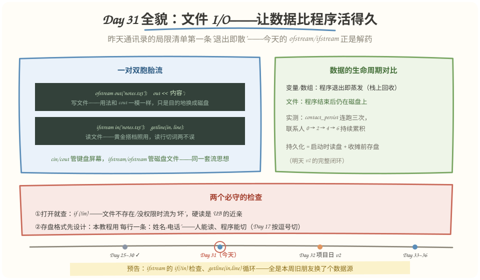
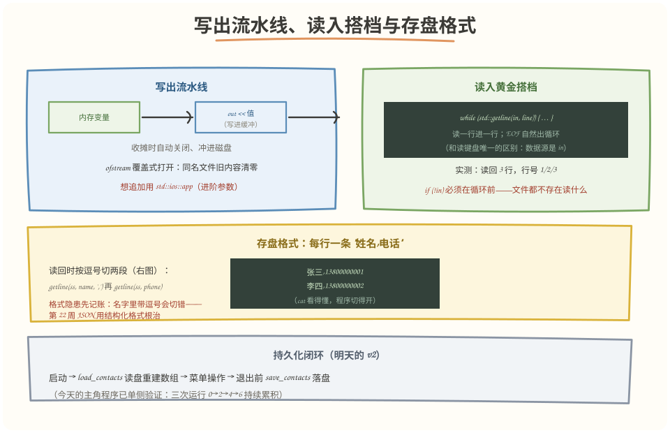
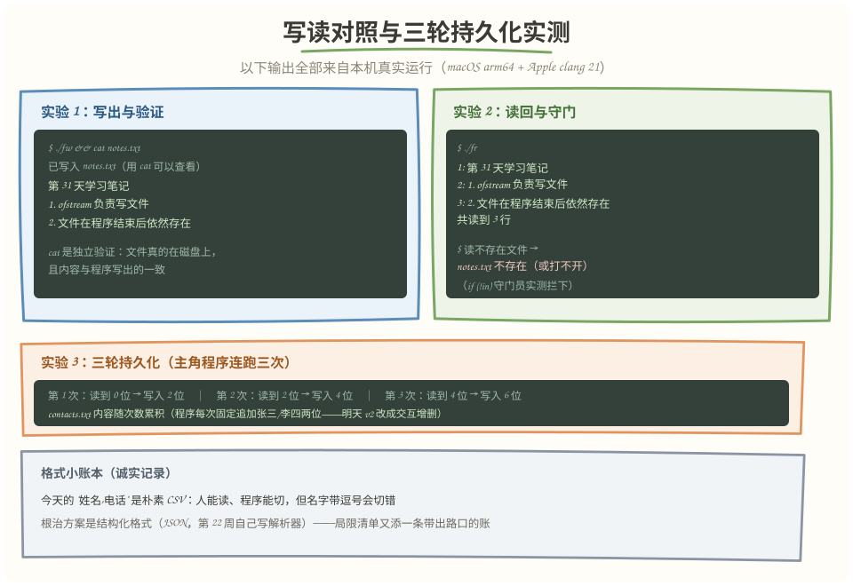

# 第 31 天：文件 I/O——ifstream / ofstream 让数据比程序活得久

> **今日目标**：完成本教程后，你能做到：用 `ofstream` 写文件、`ifstream` + getline 读回，并用 `cat` 独立验证；在读取前用 `if (!in)` 守门；设计"每行一条"的存盘格式并按逗号切回；用"启动读盘 + 收摊存盘"实现跨程序运行的数据持久化。
> **预计时间**：学习 25 分钟＋实践 45 分钟
> **前置准备**：完成 Day 30（通讯录 v1 的局限清单第一条就是今天的目标）；Day 17 的 getline/stringstream 今天火力全开。
> **今日产出**：写出-读回对照实验、打开失败守门实验、Contact 存读盘三轮持久化（0→2→4→6）。

## 1. 今天解决什么问题？

昨天通讯录 v1 的局限清单第一条写得明明白白：**程序退出数据即散**。今天的问题就是它——怎么让数据活过程序的生命周期？答案是文件 I/O：`ofstream` 把内存数据写到磁盘文件，`ifstream` 在下次启动时读回来。

好消息是几乎不用学新姿势：写文件的 `out << 内容` 和 `cout <<` 一模一样，读文件的 `while (getline(in, line))` 就是 Day 17 黄金搭档换了数据源——**流思想一以贯之**。计划指定的练习"通讯录存盘与读盘"今天以单侧实验完成（完整闭环留到明天 v2）。

## 2. 先看全貌：今天的内容位于哪里？



**图 1**：左卡是一对双胞胎流——`ofstream`（写，用法同 cout）、`ifstream`（读，getline 照用）；右卡是数据生命周期对比——变量随程序蒸发、文件在磁盘上常驻（三轮实测 0→2→4→6）。下方红卡是两个必守检查：打开就查 `if (!in)`、存盘格式先设计。路线图：第 6 周开篇，明天项目日 v2。

三步概括今天：

1. 写：`ofstream out("文件名");` 后 `out << …`，作用域结束自动关闭；
2. 读：`ifstream in("文件名");` 先 `if (!in)` 守门，再 getline 循环到 EOF；
3. 持久化闭环：启动读盘重建数组，收摊存盘落盘。

## 3. 核心概念：先用直觉，再给准确定义

### 3.1 ofstream：对着文件的 cout

- **一句通俗解释**：`ofstream`（输出文件流）是把 `<<` 的目的地从屏幕换成磁盘文件。
- **一个类比**： cout 像对着白板写字（擦了就没），ofstream 像对着笔记本写字（合上本子字还在）。
- **对应到技术上是**：`std::ofstream out("notes.txt");` 打开（不存在则创建）；`out << "内容" << std::endl;` 写入；离开作用域自动关闭并冲盘。本机实测：程序退出后 `cat notes.txt` 三行内容俱在。类比的边界：笔记本翻开可以续写，而 ofstream **默认覆盖式打开**——同名文件旧内容先清零（想追加要 `std::ios::app`，进阶参数）。
- **常见误解**："忘了 close 数据就丢了"——不会；作用域结束自动关闭（这是"自动收摊"，第 9 周（Day 51）RAII 思想的预告）。但**程序崩溃**时未冲盘的缓冲可能丢——重要数据要主动存。

### 3.2 ifstream：换了个数据源的黄金搭档

- **一句通俗解释**：`ifstream`（输入文件流）把 getline 的数据源从键盘换成文件——读行循环原样照用。
- **一个类比**：同一台录音机，换一盘磁带——播放键（getline）还是那个播放键。
- **对应到技术上是**：`std::ifstream in("notes.txt"); if (!in) { … }` 守门；`while (std::getline(in, line))` 逐行读到 EOF 自然出循环（实测读回 3 行）。读不存在的文件，`if (!in)` 拦下（实测打印"不存在"）。类比的边界：键盘流 cin 的 EOF 是 Ctrl+D（Day 8 的暗门），文件流的 EOF 是**读到文件尾**——同一个机制，不同的触发方式。
- **常见误解**："文件打开失败程序会自己报错"——不会：流只是进入失败态，不查就硬读是未定义行为的近亲（Day 4 失败旗的文件版）。

### 3.3 存盘格式：每行一条，逗号分隔

- **一句通俗解释**：存盘前先设计格式——本教程用"每行一条：姓名,电话"（朴素 CSV）。
- **一个类比**：账本记账——一行一笔账，逗号隔开科目和金额；人翻得懂，程序切得开。
- **对应到技术上是**：存：`out << name << "," << phone << std::endl;`；读：`getline(ss, name, ',')` + `getline(ss, phone)`（Day 17 的 stringstream 第三参数——自定义分隔符）。类比的边界：**名字里带逗号会切错**——朴素 CSV 的固有局限；根治靠结构化格式（JSON，第 22 周亲手写解析器）。局限先记账，不装看不见。
- **常见误解**："结构体能整个写进文件"——直接写对象字节是二进制序列化（进阶且脆：对齐、平台相关）；文本格式简单可读，是本周的正道。

## 4. 图解核心机制



**图 2**：左卡是写出流水线——内存变量 → `<<` 进缓冲 → 收摊自动关闭冲进磁盘，红字标注覆盖式打开的语义；右卡是读入黄金搭档（与键盘版唯一的区别是数据源）；黄卡是存盘格式的账本（两段切分 + 逗号隐患记账）；灰卡是明天的完整闭环。

按图逐步讲：

1. **先看流水线的"缓冲"**：`<<` 先写进内存缓冲，关闭时才批量冲盘——所以"写完立刻 cat"要等作用域结束（今天的程序里 main 结束自动触发）；
2. **覆盖语义记牢**：v1 的 contacts.txt 每次存盘都是**全量重写**——对通讯录这是正确策略（内存数组就是权威版本）；
3. **守门在前、循环在后**：`if (!in)` 不通过就没资格进 getline 循环——顺序不能反；
4. **格式即契约**：写和读必须遵守同一格式——今天"姓名,电话"三处代码（存、读、切）都对着这张契约写。

## 5. 动手实践：完成一个最小可运行例子

### 5.1 准备文件

```bash
cd ai-compiler-roadmap/tutorials/day-031/examples
```

三个程序：`file_write.cpp`、`file_read.cpp`、`contact_persist.cpp`（主角）。

### 5.2 编写代码

主角 `contact_persist.cpp` 的存读两函数（完整代码见本目录）：

```cpp
const std::string FILE_NAME = "contacts.txt";

void save_contacts(const Contact contacts[], int count) {
    std::ofstream out(FILE_NAME);
    for (int i = 0; i < count; ++i) {
        out << contacts[i].name << "," << contacts[i].phone << std::endl;
    }
    std::cout << "已把 " << count << " 位联系人写入 " << FILE_NAME << std::endl;
}

int load_contacts(Contact contacts[]) {
    std::ifstream in(FILE_NAME);
    if (!in) {
        return 0;                              // 文件不存在：空通讯录起步
    }
    int count = 0;
    std::string line;
    while (std::getline(in, line) && count < 100) {
        std::istringstream ss(line);           // Day 17：按逗号切两段
        if (std::getline(ss, contacts[count].name, ',') &&
            std::getline(ss, contacts[count].phone)) {
            ++count;
        }
    }
    return count;
}
```

两个细节：文件不存在返回 0（首次运行的合法状态，不是错误）；`count < 100` 防止文件比容量大时越界（Day 13 军规延伸到读盘）。

### 5.3 运行与观察

```bash
g++ -Wall file_write.cpp -o fw && ./fw && cat notes.txt
```

实际执行结果（本机）：

```text
已写入 notes.txt（用 cat 可以查看）
第 31 天学习笔记
1. ofstream 负责写文件
2. 文件在程序结束后依然存在
```

```bash
g++ -Wall file_read.cpp -o fr && ./fr
```

```text
1: 第 31 天学习笔记
2: 1. ofstream 负责写文件
3: 2. 文件在程序结束后依然存在
共读到 3 行
```



**图 3**：左上写出与 `cat` 独立验证；右上读回与守门（读不存在的文件被拦）；下半橙卡是三轮持久化——0→2→4→6 累积；底部灰卡是格式小账本（逗号隐患记账，JSON 路标）。

### 5.4 修改一个输入再观察：三轮持久化

主角程序连跑三次（每次启动读盘、加两位、存盘，本机实测）：

```text
第 1 次：启动时从文件读到 0 位联系人 → 已把 2 位联系人写入 contacts.txt
第 2 次：启动时从文件读到 2 位联系人 → 已把 4 位联系人写入 contacts.txt
第 3 次：启动时从文件读到 4 位联系人 → 已把 6 位联系人写入 contacts.txt
```

`cat contacts.txt` 六行俱在——**数据完全活过了三次程序生命周期**。（每次固定追加张三/李四是演示脚本的安排；明天 v2 改成交互增删，读到的就是上次会话的真实结果。）

## 6. 常见错误与排查

**错误 1：读文件不查 `if (!in)`，读到一堆空行**

- 现象：getline 全部失败，循环体空转或数据全空；
- 原因：文件名拼错/文件不存在，流一直处于失败态；
- 定位：循环前加 `std::cout << (bool)in;`——0 就是没打开；
- 修复：守门在前；文件名用常量统一管理（今天 `FILE_NAME` 的做法）。

**错误 2：写完立刻 cat，内容缺最后一截**

- 现象：程序没退出时查看文件，末尾几行还没落盘；
- 原因：缓冲未冲——数据还在内存里等批量写出；
- 定位：等程序退出（作用域结束自动关闭）再看；
- 修复：需要中途落盘时显式 `out.close()` 再重开（追加模式），或就用"收摊存盘"策略。

**错误 3：读回的数据串位（名字里是电话）**

- 现象：切分后 name 拿到了整行、phone 是空的；
- 原因：格式契约不匹配——存的分隔符和读的不一致，或名字里含逗号；
- 定位：cat 文件对照格式；打印切分后的两段长度；
- 修复：读写两端对齐同一格式；含逗号问题记账给第 22 周 JSON。

## 7. 今日练习

### 必做练习

给 `contact_persist.cpp` 做"第 100 位保护"的完整实测（本机真实经历，含一次翻车）：先造一个 102 行的 contacts.txt（shell 循环 `echo "人N,1380000000N" >> contacts.txt`）再运行——**初版程序翻车了**：读盘正确停在 100，但后面两位"张三/李四"照加不误，报告"写入 102 位"（其中两位写进了数组界外！`load` 有守卫、`main` 没有的经典漏网）。加上 `if (loaded + 2 <= 100)` 守卫后重测：读 100、加 0、写 100，`wc -l` 确认文件恰好 100 行。预期产出：这次"翻车—修复"的完整记录抄进 `notes.md`——读盘守卫和写入守卫一个都不能少。

### 选做挑战

给 `file_write.cpp` 换成追加模式：`std::ofstream out("notes.txt", std::ios::app);`，连跑两次后 cat——两段内容共存（不再覆盖）。对照默认覆盖语义，各写一句适用场景（覆盖：全量重写的存盘；追加：日志流水）。

## 8. 今日验收

- [ ] 我能用 ofstream 写文件并用 cat 独立验证内容
- [ ] 我能用 ifstream + getline 读回全部行，读前守门 if (!in)
- [ ] 我能设计并实现"每行一条、逗号分隔"的存读格式（含第三参数切分）
- [ ] 我实测了三轮持久化，能画出"启动读盘 → 操作 → 收摊存盘"闭环
- [ ] 我知道覆盖式打开、缓冲冲盘、逗号隐患三件事的存在

## 9. 一句话总结与明天预告

今天的问题是"数据怎么活过程序的生命周期"；机制上，ofstream/ifstream 是换目的地的双胞胎流，覆盖式写出、守门式读入、每行一条的文本格式构成持久化三件套；实践上，写读对照、守门拦截、三轮累积（0→2→4→6）全部实测；验证标准是 cat 看到的与程序写的一致、读回的与存入的一致。明天 **Day 32（项目日）：通讯录 v2**——把今天的存读盘接进 v1 的菜单循环：启动自动加载、退出自动保存、新增输入校验（空名拦截），昨天的局限清单正式划掉第一条。
