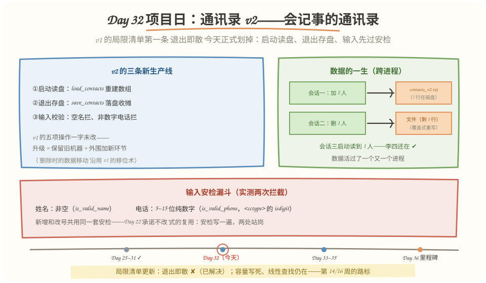
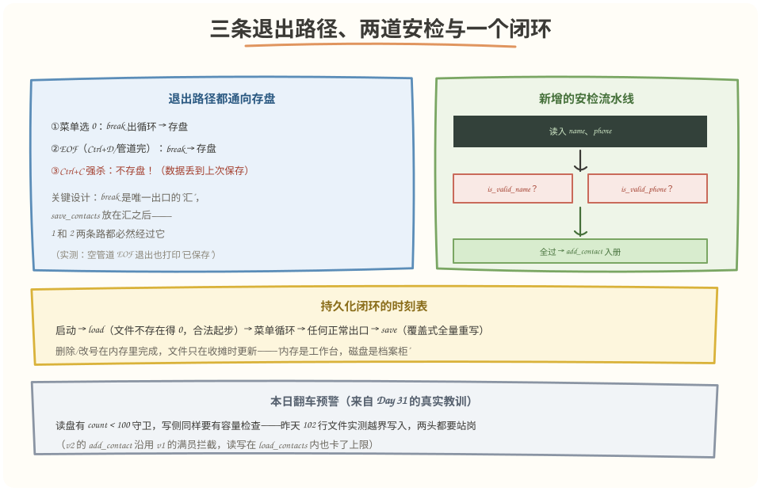
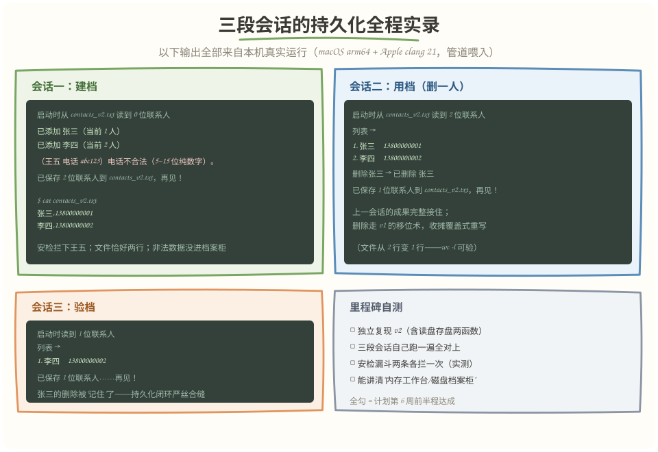

# 第 32 天（项目日）：通讯录 v2——数据持久化

> **今日目标**：完成本教程后，你能做到：把 v1 升级为"启动读盘、退出存盘"的持久化版本；给新增和改号加输入安检（空名拦截、电话 5~15 位纯数字）；用三段独立会话验证数据跨进程存活；说出"内存是工作台、磁盘是档案柜"的分工。
> **预计时间**：学习 15 分钟＋实践 60 分钟（项目日实践加重）
> **前置准备**：完成 Day 30（v1 的五项操作今天原样沿用）和 Day 31（存读盘两函数今天直接接线）。
> **今日产出**：通讯录 v2 三文件工程，三段会话的持久化全程实录（含安检拦截与 EOF 出口存盘）。

## 1. 今天解决什么问题？

昨天单侧验证了存盘和读盘，今天的任务是**接线成闭环**：v2 在 v1 的菜单循环外面套上两道新工序——启动时 `load_contacts` 从文件重建数组，任何正常出口先 `save_contacts` 再告别。同时补上计划指定的**输入校验**：空姓名、非数字电话在入册前被安检拦下。

升级的工程哲学值得注意：v1 的五项操作**一字未改**——好的升级是"保留旧机器、外围加环节"，而不是推倒重来。今天的另一条暗线是把 Day 31 的翻车教训（读盘有守卫、写入没有）编进 v2 的检查单。

## 2. 先看全貌：今天的内容位于哪里？



**图 1**：左卡是 v2 的三条新生产线（启动读盘、退出存盘、输入安检）——v1 五项操作原样保留；右卡是数据的一生：会话一存 2 行 → 磁盘 → 会话二删 1 人覆盖重写 → 会话三读到 1 人（李四还在）。下方红卡是安检漏斗（`is_valid_name` + `is_valid_phone`，新增和改号共用）。底部黄条是局限清单更新：**"退出即散"正式划掉**。

三步概括今天：

1. 闭环：`load`（启动）→ 菜单循环 → `save`（收摊）；
2. 安检：姓名非空、电话 5~15 位纯数字（`<cctype>` 的 `isdigit`）；
3. 出口汇流：选 0 和 EOF 都 break 到同一处存盘（Ctrl+C 强杀除外）。

## 3. 核心概念：先用直觉，再给准确定义

### 3.1 工作台与档案柜

- **一句通俗解释**：内存是工作台（快、随进程蒸发），磁盘是档案柜（慢、长久保存）——程序的工作全在工作台做，开工取档、收摊归档。
- **一个类比**：上班开柜取文件、桌上干活、下班把文件放回柜里锁门——桌上再乱也不影响柜里的昨日存档。
- **对应到技术上是**：增删改查全部操作内存数组（快），文件只在启动和退出各碰一次（本机实测三段会话）。类比的边界：桌上没归档的改动，**断电（Ctrl+C 强杀）就丢**——只有走到存盘出口的数据才进柜；今天的程序把选 0 和 EOF 都汇到存盘出口，强杀不在保护范围（预告：第 9 周 RAII 的析构函数能进一步兜底）。
- **常见误解**："每次操作后都该立即存盘"——可以但浪费：文件 I/O 比内存操作慢几个量级；交互程序的常见节奏就是"收摊归档"。

### 3.2 出口汇流：一个 break 汇聚两条路

- **一句通俗解释**：菜单选 0 和 EOF 两条退出路径都先 break 出循环，汇到循环后的 `save_contacts` 一行。
- **一个类比**：商场多个出口都先汇到同一个大厅——安检（存盘）只设一处。
- **对应到技术上是**：v1 里 EOF 是 `return 0` 直接走人；v2 改成 `break`——把"直接离开"改成"去大厅过安检再走"（本机实测空管道 EOF 退出也打印"已保存"）。类比的边界：Ctrl+C 是信号强杀，不经过任何代码路径——这类"异常退出"的数据安全要靠别的机制（定期自动存档/日志），进阶话题。
- **常见误解**："break 和 return 差不多"——在循环后有收尾代码时差一个存盘。

### 3.3 安检漏斗：两道闸门复用两处

- **一句通俗解释**：新增和改号都要过同一套安检——姓名非空、电话合规。
- **一个类比**：机场安检——不管你是出发还是转机（新增还是改号），同一台仪器照同一套标准。
- **对应到技术上是**：`is_valid_name`（非空）与 `is_valid_phone`（5~15 位纯数字，`std::isdigit` 逐字符检查）；新增路径两道全查，改号路径只查电话（姓名是查"已存在"的钥匙）。本机实测：王五的电话 `abc123` 被拦（`电话不合法（5~15 位纯数字）`），档案柜里没有脏数据。类比的边界：校验规则是人定的——位数范围、纯数字都是本项目的选择；真正的通用格式（国际电话码）复杂得多，先按项目需求来。
- **常见误解**："校验写在使用处最方便"——两处复制两份将来改规则就漏一处；写成函数两处站岗（今天的做法）。

## 4. 图解核心机制



**图 2**：左卡是退出路径图——选 0 和 EOF 汇到 break，存盘在汇点之后；红字标注 Ctrl+C 是不设防的第三条路。右卡是安检流水线——读入 → 两道闸门 → 全过才入册。下方黄卡是闭环时刻表和"工作台/档案柜"分工；灰卡重申 Day 31 的翻车教训（读写两头都要容量守卫）。

按图逐步讲：

1. **先看汇点**：save 放在循环后而不是每个 case 里——一处收摊，两条路都经过；
2. **再看闸门顺序**：先姓名后电话，报错精确到哪道闸（用户好纠正）；
3. **时刻表背下来**：load（启动）→ 循环 → save（收摊）——v2 的 main 结构就是这三个节点；
4. **两头站岗**：读盘 `count < MAX`、写入满员拦截——Day 31 用一次真实越界换来的教训写进了 v2。

## 5. 动手实践：完成一个最小可运行例子

### 5.1 准备文件

```bash
cd ai-compiler-roadmap/tutorials/day-032/examples
g++ -Wall main.cpp contact.cpp -o contacts_v2
```

### 5.2 编写代码

main 的闭环骨架（完整三文件见本目录）：

```cpp
int main() {
    Contact contacts[MAX_CONTACTS];
    int count = load_contacts(contacts, FILE_NAME);       // v2：启动先读盘
    std::cout << "启动时从 " << FILE_NAME << " 读到 " << count << " 位联系人" << std::endl;

    while (true) {
        // ……菜单循环（与 v1 相同，新增/改号加安检）……
    }

    save_contacts(contacts, count, FILE_NAME);            // v2：收摊存盘
    std::cout << "已保存 " << count << " 位联系人到 " << FILE_NAME << "，再见！" << std::endl;
    return 0;
}
```

安检两函数（`contact.cpp`）：

```cpp
bool is_valid_name(const std::string& name) {
    return !name.empty();
}

bool is_valid_phone(const std::string& phone) {
    if (phone.length() < 5 || phone.length() > 15) {
        return false;
    }
    for (std::size_t i = 0; i < phone.size(); ++i) {
        if (!std::isdigit((unsigned char)phone[i])) {
            return false;
        }
    }
    return true;
}
```

### 5.3 运行与观察

**会话一：建档（本机实测）**

```bash
printf '1\n张三\n13800000001\n1\n李四\n13800000002\n1\n王五\nabc123\n0\n' | ./contacts_v2
```

```text
启动时从 contacts_v2.txt 读到 0 位联系人
已添加 张三（当前 1 人）
已添加 李四（当前 2 人）
电话不合法（5~15 位纯数字）。
已保存 2 位联系人到 contacts_v2.txt，再见！
```

`cat contacts_v2.txt` 恰好两行（`张三,13800000001` / `李四,13800000002`）——王五被安检拦下，脏数据没进档案柜。



**图 3**：左上会话一建档（安检拦截 + 文件验证）；右上会话二用档（读 2 人 → 删张三 → 存 1 人）；左下会话三验档（读 1 人，列表只剩李四——删除被"记住"）；右下是里程碑自测清单。

**会话二：用档（本机实测）**

```bash
printf '5\n2\n张三\n0\n' | ./contacts_v2
```

```text
启动时从 contacts_v2.txt 读到 2 位联系人
  1. 张三　13800000001
  2. 李四　13800000002
已删除 张三
已保存 1 位联系人到 contacts_v2.txt，再见！
```

**会话三：验档（本机实测）**

```bash
printf '5\n0\n' | ./contacts_v2
```

```text
启动时从 contacts_v2.txt 读到 1 位联系人
  1. 李四　13800000002
已保存 1 位联系人到 contacts_v2.txt，再见！
```

### 5.4 修改一个输入再观察：EOF 出口也存盘

空管道直接喂 EOF（本机实测）：

```bash
printf '' | ./contacts_v2
```

```text
启动时从 contacts_v2.txt 读到 1 位联系人
已保存 1 位联系人到 contacts_v2.txt，再见！
```

EOF 没有直接 return，而是 break 汇到存盘出口——**数据在任何正常退出路径下都不丢**。再对照一个反例：运行中按 Ctrl+C 强杀（可用 `sleep` 配合演示），文件停留在上次存盘状态——第三条路（信号）不设防，这就是"收摊归档"策略的边界，也是第 9 周 RAII 要补的课。

## 6. 常见错误与排查

**错误 1：退出后文件是空的或丢了新改动**

- 现象：明明加过人，下次启动读到 0；
- 原因三查：EOF 路径写了 return 没汇到 save；save 文件名和 load 不一致；Ctrl+C 强杀；
- 定位：退出时看有没有打印"已保存 N 位"；cat 文件对照；
- 修复：所有正常出口 break 汇流；文件名用常量统一（`FILE_NAME`）。

**错误 2：安检拦下了合法输入**

- 现象：11 位手机号被拒；
- 原因：长度范围写错（如 `< 5 || > 11`）；或 isdigit 的参数传了负值字符（char 直接传给 isdigit 是 UB 边缘——本教程统一转 `(unsigned char)`）；
- 定位：打印被拒的串和长度；
- 修复：范围按需求定；isdigit 前加强转。

**错误 3：改号绕过了安检**

- 现象：改号能把电话改成 abc；
- 原因：只在新增处校验，改号分支忘了；
- 定位：对照两条路径的代码；
- 修复：改号也过 `is_valid_phone`（v2 的做法）——安检写函数、两处站岗。

## 7. 今日练习

### 必做练习

给 v2 加"6) 搜索"：按**电话尾号**搜人（输入后 4 位，列出所有匹配者）。预期产出：通讯录里两人尾号 0001/0002，搜 0001 命中张三，搜 9999 报"无匹配"。提示：`phone.rfind(tail) == phone.size() - tail.size()` 或比较 `substr`。

### 选做挑战

加"7) 存档备份"：把当前通讯录另存为 `contacts_backup.txt`（提示：save 函数本来就吃文件名参数——直接换个名字调用一遍）。再想想：自动定期备份该怎么做？（第 33 周算法练习可以写"每 10 次修改自动备份一次"的计数器。）

## 8. 今日验收

- [ ] 我的 v2 能启动读盘、收摊存盘，三段会话全程数据无损
- [ ] 安检两道闸（空名/非法电话）都实测拦截过，新增和改号共用
- [ ] EOF 出口也走存盘（实测空管道），我能说出 Ctrl+C 为什么是例外
- [ ] 我能讲清"工作台/档案柜"的分工和"收摊归档"的节奏
- [ ] 我记得读写两头都要容量守卫（Day 31 教训入册）

## 9. 一句话总结与明天预告

今天的问题是"升级怎么做才不伤旧机器"；机制上，闭环三节点（load/循环/save）、出口汇流、安检漏斗给 v1 套上持久化和防护的外壳；实践上，三段会话从建档到验档全程实录，安检与 EOF 出口都实测；验证标准是关掉程序再打开，数据一个不少。第 6 周前半程收官——明天 **Day 33：算法练习日**（LeetCode/洛谷简单题 3~5 道，纯语法层面），用今天的功底去陌生题目里遛一圈。
