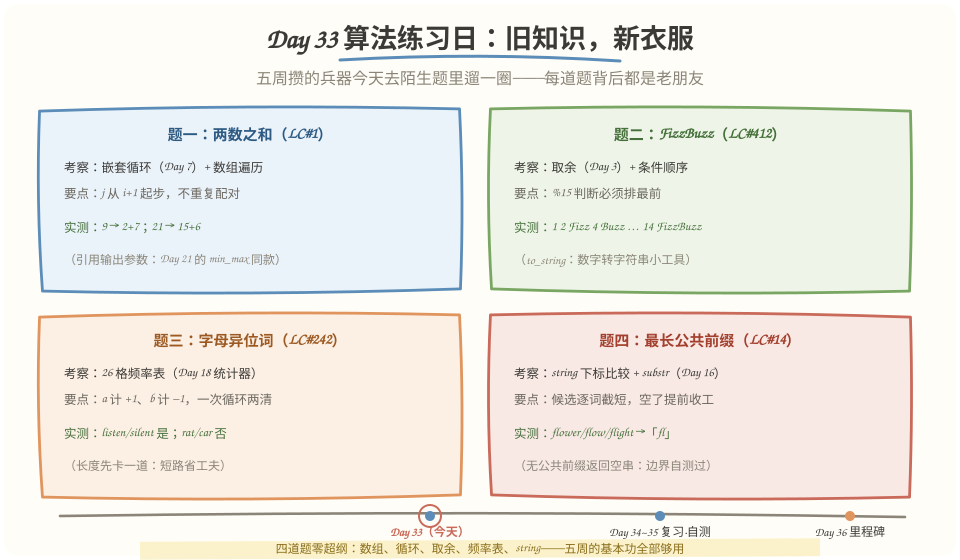
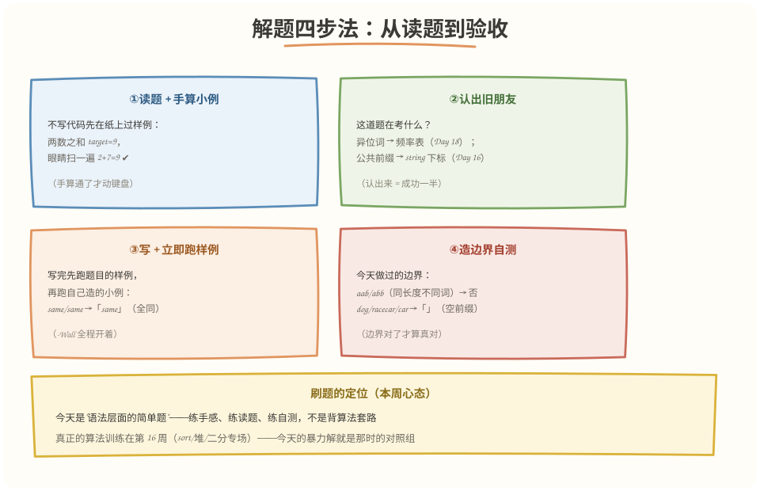
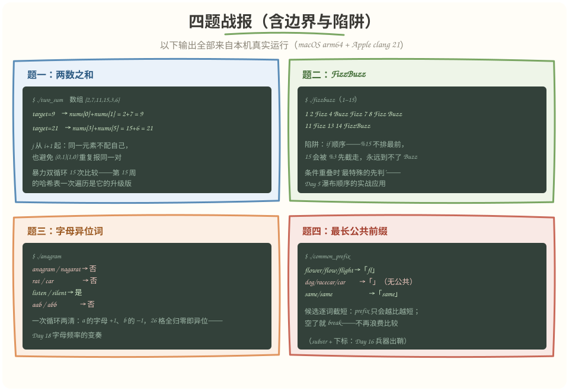

# 第 33 天：算法练习日——四道简单题，五周基本功的拉练

> **今日目标**：完成本教程后，你能做到：独立解出两数之和、FizzBuzz、字母异位词、最长公共前缀四道经典简单题；每道题先手算小例再动键盘、写完自造边界测试；说出每道题考察的是哪一周的哪个知识点。
> **预计时间**：闭卷做题 50 分钟＋复盘 30 分钟
> **前置准备**：完成 Day 1~32；四道题全部零超纲——数组、循环、取余、频率表、string，五周的基本功全部够用。
> **今日产出**：四道题的可运行解答（`-Wall` 零警告）+ 边界自测记录 + 每题的知识出处清单。

## 1. 今天解决什么问题？

五周学了三十二天，知识都是"在教程环境里"练的——今天换到**陌生题面**下检验：LeetCode 风格的四道简单题，题目描述是新的，考点全是旧的。这类练习练的不是新知识，而是三样东西：**读题能力**（从题面里认出旧朋友）、**小例先行**（动手前手算样例）、**边界意识**（样例过了不算过，自造的边界过了才算过）。

先自己闭卷做，再看本页的参考解答——顺序不能反。参考解答附了每题的"知识出处"，对完答案顺便把五周的兵器谱复习一遍。

## 2. 先看全貌：今天的内容位于哪里？



**图 1**：四张卡片就是今天的四道题——每张标注考察点和实测结果：题一两数之和（嵌套循环 + 数组）、题二 FizzBuzz（取余 + 条件顺序）、题三字母异位词（26 格频率表）、题四最长公共前缀（string 下标 + substr）。底部黄条点破：**零超纲**。

四步概括今天：

1. 读题 + 手算小例（纸上过样例）；
2. 认出旧朋友（这题在考哪天的知识）；
3. 写 + 立即跑样例（`-Wall` 开着）；
4. 造边界自测（全同、全无、同长度不同词）。

## 3. 核心概念：先用直觉，再给准确定义

### 3.1 读题认旧友

- **一句通俗解释**：题面千变万化，考点屈指可数——读题的功夫在于"翻译"：把新衣裳翻译成旧朋友。
- **一个类比**：换了一身新衣服的老同学——认人认的是脸，不是衣服。
- **对应到技术上是**：异位词 → 频率表（Day 18 文本统计器的核心零件）；公共前缀 → string 逐下标比较 + substr 截短（Day 16）；两数之和 → 双层循环扫对（Day 7 嵌套循环）；FizzBuzz → 取余与条件顺序（Day 3 + Day 5）。类比的边界：翻译不是套模板——题面细节（"同一元素不能用两次"）才是得分差。
- **常见误解**："刷题要背题型"——现阶段恰恰相反：基本功扎实了，题面怎么换都认得出。

### 3.2 小例先行

- **一句通俗解释**：动键盘前先在纸上把样例手算一遍——手算通了，代码只是把手算翻译成循环。
- **一个类比**：裁缝先画样再下剪——样都不画就剪，废布率高。
- **对应到技术上是**：两数之和 target=9，眼睛扫一遍 2+7=9——这一眼告诉你循环里要比较什么。类比的边界：手算样例**不能替代**边界思考——样例通常是"普通情况"，边界（空前缀、同长度不同词）要自己造。
- **常见误区**："直接写，写完再理解题"——返工率最高的路径。

### 3.3 边界自测

- **一句通俗解释**：样例过了只答对了"一般情况"，边界过了才算真的对。
- **一个类比**：驾考——场地日常开得溜不算过，侧方压线照样挂。
- **对应到技术上是**：今天实测过的边界——公共前缀的"无公共"（dog/racecar/car → 空串）与"全同"（same/same → 整词）；异位词的"同长度不同词"（aab/abb → 否，频率表净差 1 揪出）；FizzBuzz 的 15（Fizz 与 Buzz 的交集）。类比的边界：边界想不全很正常——刷题平台"提交后挂在一个用例上"就是替你找边界的机制，挂了别沮丧，那是免费的边界发现。
- **常见误解**："输出对了就行"——对样例对、对边界错，是四道题里最常见的"假通过"。

## 4. 图解核心机制



**图 2**：四张卡片是解题四步——①读题手算小例、②认出旧朋友（这题考哪天）、③写完立即跑样例、④造边界自测；底部黄卡校准心态：今天是语法层面的拉练，不是算法套路速成——真正的算法训练在第 16 周，今天的暴力解就是那时的对照组。

按图逐步讲：

1. **顺序不能乱**：手算没通就写代码，等于路线没查就出发；
2. **认旧朋友的收益**：认出"频率表"，异位词的解法三秒成型——知识出处清单（图 1 各卡）就是你的兵器谱；
3. **跑样例要快**：写完立刻跑，别攒——小错早发现早改（Day 28 的"观察不猜"在刷题里的应用）；
4. **边界清单化**：每题至少造一个"全同/全无"的极端例子——养成习惯，第 22 周写单元测试时它升级为正式用例。

## 5. 动手实践：完成一个最小可运行例子

### 5.1 准备文件

```bash
cd ai-compiler-roadmap/tutorials/day-033/examples
```

四个程序：`two_sum.cpp`、`fizzbuzz.cpp`、`anagram.cpp`、`common_prefix.cpp`——**先别打开**，自己闭卷写完再对照。

### 5.2 编写代码（参考解答核心）

题三 `anagram.cpp` 的核心（一次循环两清的技巧）：

```cpp
bool is_anagram(const std::string& a, const std::string& b) {
    if (a.size() != b.size()) {
        return false;                          // 长度不同直接出局
    }
    int freq[26] = {0};
    for (std::size_t i = 0; i < a.size(); ++i) {
        ++freq[a[i] - 'a'];                    // a 的每个字母 +1
        --freq[b[i] - 'a'];                    // b 的每个字母 -1（一次循环干两件事）
    }
    for (int k = 0; k < 26; ++k) {
        if (freq[k] != 0) {
            return false;                      // 有净多或净少 → 不是异位词
        }
    }
    return true;
}
```

题四 `common_prefix.cpp` 的核心（候选逐词截短）：

```cpp
std::string prefix = words[0];                 // 拿第一个词当候选
for (int i = 1; i < n; ++i) {
    std::size_t k = 0;
    while (k < prefix.size() && k < words[i].size()
           && prefix[k] == words[i][k]) {
        ++k;                                   // 和当前词比到第一个不同处
    }
    prefix = prefix.substr(0, k);              // 候选截短到共同部分
    if (prefix.empty()) {
        break;                                 // 没有公共前缀，提前收工
    }
}
```

### 5.3 运行与观察

四题参考解答的真实输出（本机）：

```text
$ ./two_sum
target=9　→ nums[0]+nums[1] = 2+7 = 9
target=21　→ nums[3]+nums[5] = 15+6 = 21
```

```text
$ ./fizzbuzz
1 2 Fizz 4 Buzz Fizz 7 8 Fizz Buzz 11 Fizz 13 14 FizzBuzz
```

```text
$ ./anagram
anagram / nagarat → 否
rat / car　　　　→ 否
listen / silent → 是
aab / abb　　　 → 否
```

```text
$ ./common_prefix
flower/flow/flight →「fl」
dog/racecar/car　　→「」
same/same　　　　　→「same」
```



**图 3**：四张卡片各附战报和陷阱注解——题一 j 从 i+1 起的用意、题二 if 顺序陷阱（%15 必须排最前）、题三一次循环两清、题四候选截短 + 提前收工。

### 5.4 修改一个输入再观察：陷阱亲测

**FizzBuzz 的 if 顺序陷阱**（亲测）：把 `%15` 的判断挪到 `%3` 之后，重新编译——15 输出变成 `Fizz`（被 %3 先截走），`FizzBuzz` 永远不出现。**条件重叠时最特殊的必须先判**——Day 5 瀑布规则在刷题里的现身。

**两数之和的 j 起点**（亲测）：把 `j = i + 1` 改成 `j = 0`，target=4（数组里有两个 2 的场景需要构造）时同一元素会和自己配对——题目明说"同一元素不能重复使用"，j 从 i+1 起就是这条约束的代码化。

## 6. 常见错误与排查

**错误 1：FizzBuzz 输出里没有 FizzBuzz**

- 现象：15 输出了 Fizz；
- 原因：%15 的判断被 %3 抢先（if 顺序错）；
- 定位：找 15 的输出行；
- 修复：条件从特殊到一般排列（%15 → %3 → %5 → 数字）。

**错误 2：两数之和返回了同一元素两次**

- 现象：target=4 时输出 [0][0]（2 配自己）；
- 原因：内层 j 从 0 开始；
- 定位：检查内层循环起点；
- 修复：`j = i + 1`。

**错误 3：公共前缀越界比较**

- 现象：短词和长候选比较时读越界（可能崩溃或垃圾）；
- 原因：while 条件漏了 `k < words[i].size()`；
- 定位：拿 "fl" 候选和 "f" 比较——第二字符就是越界点；
- 修复：三个条件缺一不可（候选界、当前词界、字符相等）。

## 7. 今日练习

### 必做练习

给自己加第五题（LC#9 回文数）：判断整数是否回文（如 121 是、-121 否、10 否）。提示：循环取余反转数字（Day 3 的取余功），反转前先想负数和末尾为 0 的边界。预期产出：三个边界 + 一个普通例的全对记录。

### 选做挑战

把今天的四道题改写成"带断言的自动测试"：不用肉眼看输出，用 `if (实际 == 期望) std::cout << "通过" << std::endl;` 逐条判——这是第 22 周单元测试的雏形。四题共 10 条断言全绿即通关。

## 8. 今日验收

- [ ] 我闭卷做出了至少三道题（先做后看）
- [ ] 我每题都先手算了样例、写完造了边界
- [ ] 我能说出每道题的知识出处（哪一周的哪个零件）
- [ ] 我亲测了 if 顺序和 j 起点两个陷阱
- [ ] 我的四份代码 `-Wall` 零警告

## 9. 一句话总结与明天预告

今天的问题是"旧知识在陌生题面下还灵不灵"；方法上，四步法（手算小例→认旧友→跑样例→造边界）把刷题变成结构化流程；实践上，四题全解、边界全测、两个陷阱亲手复现；验证标准是不看解答能独立做出同难度的新题。明天 **Day 34：复习日**——整理前五周笔记、闭卷重写五个最重要的示例程序：今天的拉练正好告诉你哪五个最"值钱"。
