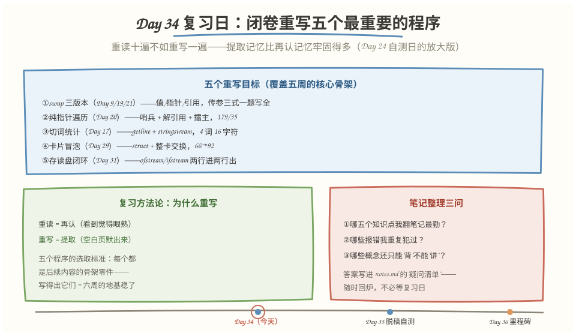
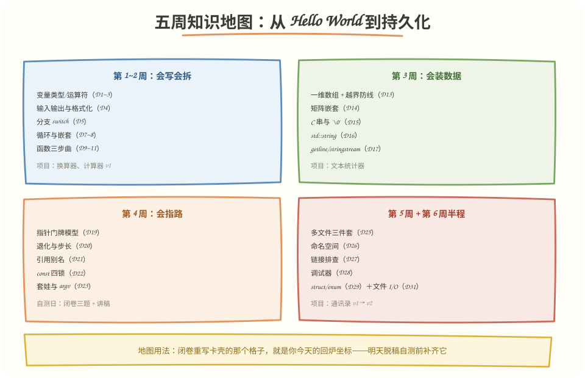
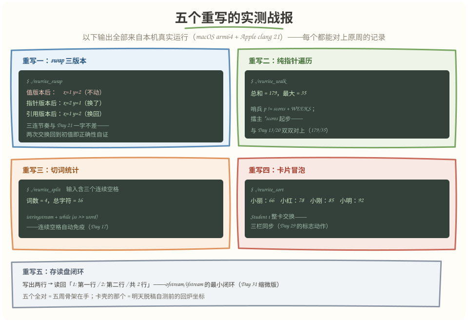

# 第 34 天：复习日——闭卷重写五个最重要的程序

> **今日目标**：完成本教程后，你能做到：不看教程独立重写五个骨架程序（swap 三版本、纯指针遍历、切词统计、卡片冒泡、存读盘闭环）并全部运行通过；用"五周知识地图"定位自己的薄弱格子；整理出属于自己的疑问清单。
> **预计时间**：闭卷重写 50 分钟＋笔记整理与复盘 40 分钟
> **前置准备**：完成 Day 1~33；合上前五周的全部教程，只留一个空编辑器。
> **今日产出**：五份闭卷重写代码（全部 `-Wall` 零警告、输出对上原周记录）+ notes.md 里的疑问清单。

## 1. 今天解决什么问题？

五周（32 个学习日）攒下大量知识，但"看懂"和"写得出"之间隔着一条沟——昨天算法练习日已经量出这条沟的宽度。今天的问题是计划指定的老规矩：**整理笔记 + 重写 5 个最重要的示例程序**。

为什么是"重写"而不是"重读"？重读是再认（看到觉得眼熟），重写是提取（从空白里默出来）——记忆研究早就证明提取更牢。五个程序的选取也有标准：每个都是后续内容的**骨架零件**（传参三式、指针遍历、字符串流水线、struct 排序、文件闭环）——写得出它们，第 7 周起的面向对象就有地基。

## 2. 先看全貌：今天的内容位于哪里？



**图 1**：上方蓝卡列出五个重写目标（各标注出处周次和验收数字：179/35、4 词 16 字符、66→92……）；左下绿卡是复习方法论（重读 vs 重写的再认/提取之别）；右下红卡是笔记整理三问（翻得最勤的知识点、重复犯过的报错、只能背不能讲的概念）。路线图：今天重写、明天脱稿、后天里程碑。

三步概括今天：

1. 闭卷重写五个程序，每个写完立刻编译运行、对上原周记录；
2. 卡壳处精确定位到"周 + 主题"，当场回炉；
3. 笔记整理成疑问清单，随时回炉不必等复习日。

## 3. 核心概念：先用直觉，再给准确定义

### 3.1 提取练习：重写为什么比重读牢

- **一句通俗解释**：重读是在"认旧脸"，重写是在"默全文"——后者逼着大脑把知识从存储里完整拉出来。
- **一个类比**：看菜谱十遍，不如关上菜谱做一遍菜——做的时候才知道哪步其实没记住。
- **对应到技术上是**：今天五个程序全部闭卷重写、编译、对答案（本机实测五个全过，输出与原周记录一致）。类比的边界：卡壳不等于失败——**卡壳的位置就是回炉坐标**，比"全会了"的错觉值钱得多。
- **常见误解**："重读快，重写慢"——单位时间收益恰恰相反：重写十分钟暴露的问题，重读一小时也盖不住。

### 3.2 骨架优先：为什么是这五个

- **一句通俗解释**：五个程序分别是五块骨架的"最小完整样本"——每块都是后面几周的承重墙。
- **一个类比**：练琴不练所有曲子，练音阶和琶音——它们藏在几乎所有曲子里。
- **对应到技术上是**：swap 三版本（传参三式，类方法、STL 算法的底座）；指针遍历（迭代器的前身，第 14 周 vector 的 `begin/end` 就是它）；切词统计（一切文本处理的流水线）；卡片冒泡（struct + 泛型排序的雏形）；存读盘（持久化最小闭环）。类比的边界：五个之外不是不重要——是"写得出这五个"和"六周地基稳"的相关性最高。
- **常见误解**："我项目都做了三个，还用重写小程序？"——项目允许查资料；闭卷重写检验的是脱离资料的提取能力，两者互补。

### 3.3 疑问清单：把"不会"变成"待办"

- **一句通俗解释**：复习的产出不是"我都看过了"，是一张诚实的疑问清单。
- **一个类比**：体检报告——指标异常不是坏消息，是下一步的挂号单。
- **对应到技术上是**：三问生成清单——翻得最勤的知识点（勤翻=没记住）、重复犯过的报错（如混用坑、哨兵 off-by-one）、只能背不能讲的概念（比如引用和指针的"本质"差异）。清单记进 notes.md，每周日复盘时勾掉能讲清的。类比的边界：清单不求一次清空——它是活文档，后面每周都会新增和销账。
- **常见误解**："疑问多说明学得差"——恰恰相反：能列出具体疑问的人，比说"都懂了"的人离真懂更近。

## 4. 图解核心机制



**图 2**：四张卡片是五周（加第 6 周半程）的知识地图——每周列出核心主题和项目产出；底部黄条是地图的用法：**闭卷重写卡壳的那个格子，就是今天的回炉坐标**。配合图 1 的"三问"，今天的复习形成闭环：重写暴露坐标 → 地图定位 → 回炉当天 → 疑问清单销账。

按图逐步讲：

1. **先重写后看图**：卡壳了才翻开地图找格子——顺序反了就变成重读；
2. **坐标精确到"周 + 主题"**：比如"swap 引用版写成了值传递"→ 第 2 周函数 + 第 4 周引用，两个格子都回炉；
3. **回炉动作轻量**：不是重读全天教程——重做当天对应的一个实验即可（Day 24 的老规矩）；
4. **地图常新**：第 7 周起每周往地图上添新格子，它将陪你走完全部 24 周。

## 5. 动手实践：完成一个最小可运行例子

### 5.1 准备文件

```bash
cd ai-compiler-roadmap/tutorials/day-034/examples
```

五个参考实现：`rewrite_swap.cpp`、`rewrite_walk.cpp`、`rewrite_split.cpp`、`rewrite_sort.cpp`、`rewrite_io.cpp`——**先自己闭卷写**，写完再对照。

### 5.2 编写代码（参考实现示例）

重写一的完整参考（三版本合订本，18 行）：

```cpp
#include <iostream>

// 重写一：swap 三版本（Day 9/19/21 的合订本）
void swap_by_value(int a, int b) { int t = a; a = b; b = t; }
void swap_by_ptr(int* a, int* b) { int t = *a; *a = *b; *b = t; }
void swap_by_ref(int& a, int& b) { int t = a; a = b; b = t; }

int main() {
    int x = 1, y = 2;
    swap_by_value(x, y);
    std::cout << "值版本后：　x=" << x << " y=" << y << std::endl;
    swap_by_ptr(&x, &y);
    std::cout << "指针版本后：x=" << x << " y=" << y << std::endl;
    swap_by_ref(x, y);
    std::cout << "引用版本后：x=" << x << " y=" << y << std::endl;
    return 0;
}
```

### 5.3 运行与观察

五个参考实现的真实输出（本机）：

```text
$ ./rewrite_swap
值版本后：　x=1 y=2
指针版本后：x=2 y=1
引用版本后：x=1 y=2
```

```text
$ ./rewrite_walk
总和 = 179，最大 = 35
```

```text
$ ./rewrite_split
词数 = 4，总字符 = 16
```

```text
$ ./rewrite_sort
小丽：66　小红：78　小刚：85　小明：92
```

```text
$ ./rewrite_io
1: 第一行
2: 第二行
共 2 行
```



**图 3**：五张卡片各附战报与对账注解——每个输出都能对上原周记录（179/35 对 Day 13/20；切词对 Day 17；排序对 Day 29；存读盘对 Day 31）。**你的闭卷版输出也照此对账**。

### 5.4 修改一个输入再观察：给重写加一点压力

光复现还不够，给每个重写加一个小改造验证理解而非背诵：swap 版改成"三变量轮转"（a→b→c→a）；指针遍历改求**最小值**；切词改统计最长的词；排序改**降序**（`>` 改 `<`）；存读盘改存**三行**读回验证。五个改造各跑一遍——改得动，才算真理解。

## 6. 常见错误与排查

**错误 1：重写时频繁"偷看"原代码**

- 现象：写两行翻一次教程；
- 原因：提取练习做成了抄写练习；
- 定位：数一下翻看次数——超过三次说明该格子先回炉；
- 修复：先回炉当天实验再回来闭卷；卡壳超过五分钟就看答案，但看完**合上再完整写一遍**。

**错误 2：五个全对，但说不出为什么这么写**

- 现象：肌肉记住了顺序，问"为什么哨兵是 != 不是 <"答不上；
- 原因：提取练了手，没练嘴（Day 24 讲稿法的缺失）；
- 定位：对每个程序自问三个"为什么"；
- 修复：给卡壳的"为什么"写一句话答案进疑问清单。

**错误 3：笔记整理成"目录抄写"**

- 现象：笔记变成了知识点罗列，没有自己的痕迹；
- 原因：整理变成了抄书；
- 定位：笔记里有没有"我"（我的疑问、我的错误、我的比喻）；
- 修复：按三问重写——每条都从"我"出发。

## 7. 今日练习

### 必做练习

完成"疑问清单"初版：按三问各列至少两条，共六条以上，写进 `notes.md`。每条格式：`疑问 + 回炉坐标（周/天）+ 状态（待回炉/已回炉）`。预期产出：一张活的体检报告，明天脱稿自测前先处理"待回炉"里最碍眼的两条。

### 选做挑战

把五个重写程序改造成一个"复习自测器"：一个 main 里依次跑五个小测试，每个打印"通过/未通过"（用期望值断言，Day 33 选做挑战的延伸）。以后每次想快速体检，编译运行一遍，十秒出结果——第 22 周单元测试的私人雏形。

## 8. 今日验收

- [ ] 我闭卷重写了五个程序，输出全部对上原周记录
- [ ] 我给每个程序做了一个小改造并验证（5.4 的压力测试）
- [ ] 我在知识地图上标出了自己的卡壳格子并当场回炉
- [ ] 我的疑问清单初版有六条以上，格式含回炉坐标
- [ ] 我能对五个程序各说出一个"为什么"（不是背，是讲）

## 9. 一句话总结与明天预告

今天的问题是"五周的知识有多少真正长在手上"；方法上，闭卷重写把再认升级为提取，五个骨架程序覆盖五块承重墙，知识地图把卡壳变成精确坐标；实践上，五个参考实现全部实测、五个改造全过、疑问清单立档；验证标准是合上一切资料，五个程序从空白到运行不超过四十分钟。明天 **Day 35：阶段自测**——不看任何资料，从空文件写出通讯录的核心功能（存取盘 + 增删查）——今天的地基，明天整栋验收。
