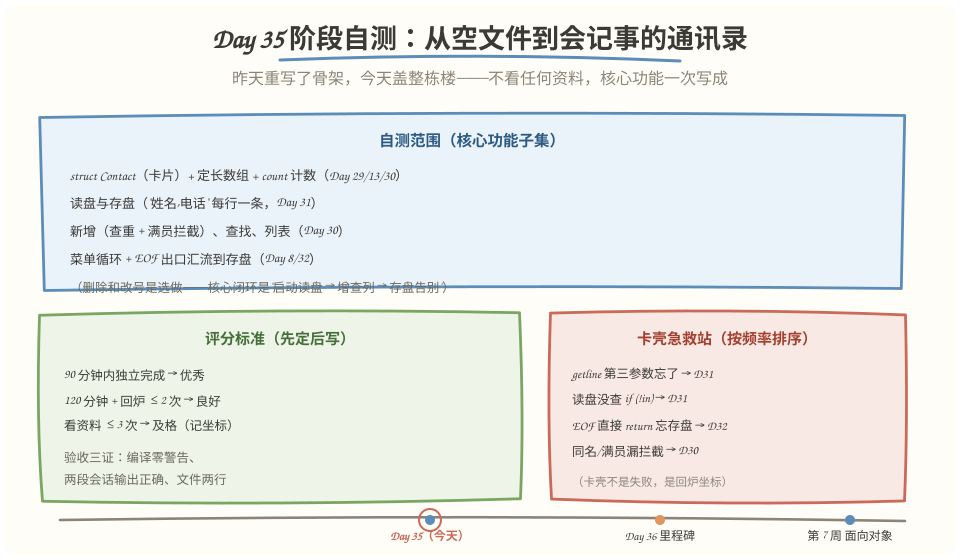
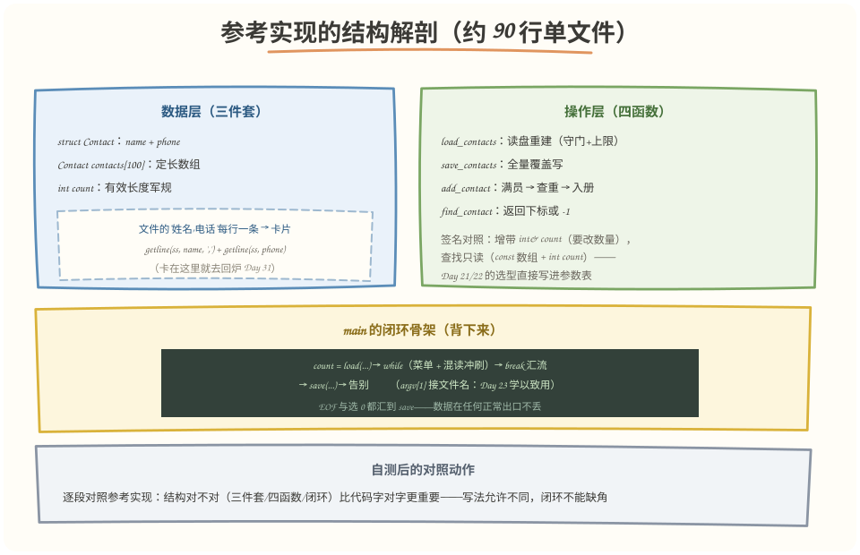
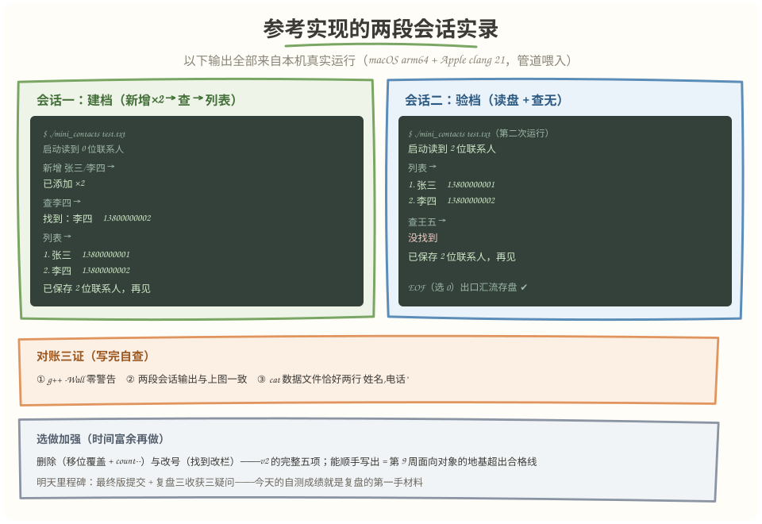

# 第 35 天：阶段自测——从空文件写出通讯录核心功能

> **今日目标**：完成本教程后，你能做到：不看任何资料，从空文件写出"读盘 → 新增（查重+满员拦截）→ 查找 → 列表 → 存盘"的通讯录核心闭环；90 分钟内独立完成；写完按"对账三证"自查。
> **预计时间**：闭卷自测 90 分钟＋对照复盘 40 分钟
> **前置准备**：完成 Day 1~34（昨天重写的五个骨架就是今天的预制梁）；合上全部教程，只留空编辑器。
> **今日产出**：一份脱稿写成的通讯录核心（可运行、零警告、两段会话验证），外加自测用时和回炉记录。

## 1. 今天解决什么问题？

第 6 周收官前的大考：昨天重写了五个骨架（预制梁），今天要**盖整栋楼**——不看任何资料，从空文件写出会记事的通讯录核心。这是计划指定的阶段自测：五个半星期学的东西（类型、循环、函数、数组、字符串、指针/引用、struct、文件 I/O、多文件思想）全部要在一次闭卷写作里融会贯通。

规则与 Day 24 自测日相同：**先写后看**。本页 5 节的参考实现是对照答案，动笔之前不要翻。

## 2. 先看全貌：今天的内容位于哪里？



**图 1**：上方蓝卡是自测范围（核心功能子集——删除和改号是选做）；左下绿卡是评分标准（90 分钟独立完成优秀、120 分钟+回炉≤2 次良好）；右下红卡是**卡壳急救站**——按频率排好序的四个高频卡壳点和回炉坐标。

三步概括今天：

1. 定标准再动笔（评分线和对账三证先立好）；
2. 闭卷写闭环（启动读盘 → 增查列 → 存盘告别）；
3. 对照复盘（结构对不对比字对字重要）。

## 3. 核心概念：先用直觉，再给准确定义

### 3.1 闭卷大考：检验整合而非记忆

- **一句通俗解释**：昨天重写是"单兵科目考核"，今天是"合成演习"——零件要自己拼成机器。
- **一个类比**：驾照路考——单项都练过，今天看能不能一把开完全程。
- **对应到技术上是**：核心闭环 5 个环节（读盘/增/查/列/存盘）任何一个掉链子整条就断——整合能力就是发现环节之间怎么接。类比的边界：卡壳允许且有记录价值——**每个卡壳点都是精确的回炉坐标**，比"顺利写完但不知为什么"信息量更大。
- **常见误解**："自测不过说明白学了"——恰恰相反：自测暴露的每个洞都是明天复习日（Day 36 复盘）的第一手材料。

### 3.2 验收三证：怎么算"写成了"

- **一句通俗解释**：不看过程看证据——编译、运行、文件三张证书。
- **一个类比**：装修验收——口头说得天花乱坠，水电压根不通就是不通。
- **对应到技术上是**：①`g++ -Wall` 零警告；②两段会话输出正确（第一次建档、第二次读回）；③`cat` 数据文件恰好两行"姓名,电话"。三证齐全才算闭环。类比的边界：三证不检验代码美感——写得笨但跑得通，今天就是合格。
- **常见误解**："功能对了就行，警告无所谓"——警告是免费的质检员（本周多次实测过它拦下的坑）。

### 3.3 时间盒：90 分钟的意义

- **一句通俗解释**：给自测设时间盒——防止无限拖延，也留下量化进步的基线。
- **一个类比**：跑步计圈——不计时也可以跑，计时才知道配速在涨。
- **对应到技术上是**：90 分钟优秀线不是拍脑袋——五个骨架昨天各重写过一遍，整合时间约为重写总和的一半。第 12 周还会再考同款（那时代码量翻倍），今天的时间就是对照基线。类比的边界：超时≠失败——超时完成仍记录，重点是把卡壳坐标记全。
- **常见误解**："慢慢写到对为止"——没有时间盒的自测容易变成开卷重写。

## 4. 图解核心机制



**图 2**：数据层三件套（struct/数组/count）、操作层四函数（load/save/add/find，含签名里 const 与 `int&` 的选型注解）、main 的闭环骨架（load → 循环 → 汇流 → save）——**结构对这三层先对照，再看代码细节**。底部灰卡：写法允许千差万别，闭环一环不能缺。

按图逐步讲：

1. **先对数据层**：struct 两栏、定长数组、count——三件套缺一件后面全歪；
2. **再对操作层**：四个函数的签名本身就是知识（增带 `int&`，查带 const）；
3. **后对闭环**：EOF 与选 0 汇流到 save——这一环最容易漏（Day 32 的实测点）；
4. **参考实现的一个新意**：文件名从 `argv[1]` 来——Day 23 的套娃知识在真实工具里的落点。

## 5. 动手实践：完成一个最小可运行例子

### 5.1 准备文件

```bash
cd ai-compiler-roadmap/tutorials/day-035/examples
```

**先别打开 `mini_contacts.cpp`**——先在自己的空目录里闭卷写完并跑通三证，再回来对照。

### 5.2 编写代码

参考实现约 90 行（单文件版，便于对照核心结构）。main 的闭环骨架：

```cpp
int main(int argc, char* argv[]) {
    if (argc < 2) {
        std::cout << "用法：" << argv[0] << " 数据文件" << std::endl;
        return 1;
    }
    const char* file = argv[1];              // 文件名从命令行来（argv 学以致用）

    Contact contacts[100];
    int count = load_contacts(contacts, file);
    std::cout << "启动读到 " << count << " 位联系人" << std::endl;

    int choice = 0;
    while (true) {
        std::cout << "1)新增 2)查找 3)列表 0)退出：";
        if (!(std::cin >> choice)) {
            break;                            // EOF 也走存盘出口
        }
        // ……菜单分发（新增/查找/列表）……
    }

    save_contacts(contacts, count, file);
    std::cout << "已保存 " << count << " 位联系人，再见" << std::endl;
    return 0;
}
```

### 5.3 运行与观察

参考实现的两段会话（本机真实执行）：

**会话一：建档**

```text
$ ./mini_contacts test.txt
启动读到 0 位联系人
（新增张三、李四）→ 已添加 ×2
（查李四）→   找到：李四　13800000002
（列表）→   1. 张三　13800000001
  2. 李四　13800000002
已保存 2 位联系人，再见
```

**会话二：验档**

```text
$ ./mini_contacts test.txt
启动读到 2 位联系人
（列表）→   1. 张三　13800000001
  2. 李四　13800000002
（查王五）→   没找到
已保存 2 位联系人，再见
```



**图 3**：左上会话一建档、右上会话二验档（读盘 + 查无的体面回应）；下方橙卡是对账三证清单、灰卡是选做加强（删除/改号——能顺手写出就超出合格线）。

### 5.4 修改一个输入再观察：你的版本跑同样的脚本

把上面两段管道脚本喂给你自己写的版本，逐行比对输出——**输出一致是最硬的对账**。再喂一个边界脚本：`printf '2\n张三\n0\n' | 你的程序 空文件.txt`（查不存在 + 空表退出），确认"没找到"和"已保存 0 位"都体面。任何不一致，回到图 1 的急救站定位卡壳点。

## 6. 常见错误与排查

**错误 1：第二段会话读到 0（第一段的成果丢了）**

- 现象：明明存过，再启动是空的；
- 原因三查：EOF 直接 return（没汇到 save）；save 的文件名和 load 不一致；写入缓冲没冲盘（程序没走完收摊）；
- 定位：退出时有没有打印"已保存 N 位"；
- 修复：出口汇流 + 文件名单一来源。

**错误 2：新增同名/超量没拦住**

- 现象：同名重复入册，或第 101 人写入越界；
- 原因：add 里漏了查重循环或 count 上限判断（Day 31 翻车的写入侧版本）；
- 定位：构造同名和 101 人两个边界各测一次；
- 修复：add 的三段式——满员查 → 同名查 → 入册 ++。

**错误 3：姓名读成了空串**

- 现象：新增的人名字是空的；
- 原因：`>>` 读菜单后没 ignore，getline 吃到残留换行（Day 17/30 的老坑第三次现身）；
- 定位：打印 name.size()——0 即踩坑；
- 修复：数字与整行交界处固定加 `cin.ignore(10000, '\n');`。

## 7. 今日练习

### 必做练习

把自测过程记录成"成绩单"：用时、卡壳次数与坐标（哪个函数的哪一步）、回炉动作、最终三证是否齐全。预期产出：一张表格抄进 `notes.md`——它是明天复盘（三收获三疑问）的第一手材料。

### 选做挑战

给核心版加"删除"：移位覆盖 + `--count`，然后跑三段会话（建档 → 删一人 → 验档）验证删除被持久化记住。能闭卷写出删除，五项全齐，明天直接把 v2 认定为"最终版"提交。

## 8. 今日验收

- [ ] 我在时间盒内闭卷写出了核心闭环（超时也完成并记录）
- [ ] 对账三证齐全：零警告、两段会话正确、文件两行
- [ ] 我的版本跑参考实现的同款脚本，输出逐行一致
- [ ] 每个卡壳点都记了坐标并当场回炉
- [ ] 成绩单已入档（用时/卡壳/回炉）

## 9. 一句话总结与明天预告

今天的问题是"五个半星期的零件能不能闭卷拼成一台会记事的机器"；方法上，时间盒+对账三证+卡壳急救站把大考变成结构化流程；实践上，参考实现两段会话全部实测，你的版本同款脚本对账；验证标准是三证齐全、输出一致。明天 **Day 36：里程碑**——通讯录最终版提交（顺带 git 管理起来）、复盘三收获三疑问：第 6 周收官，下周开进面向对象的新大陆。
