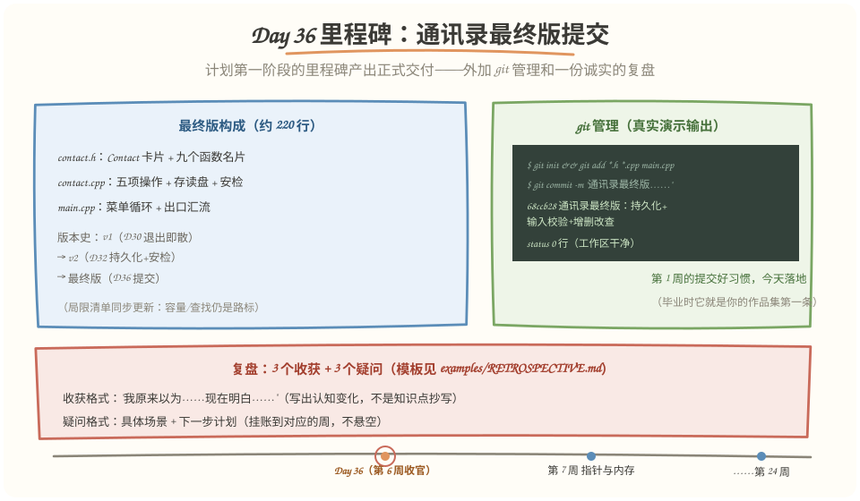
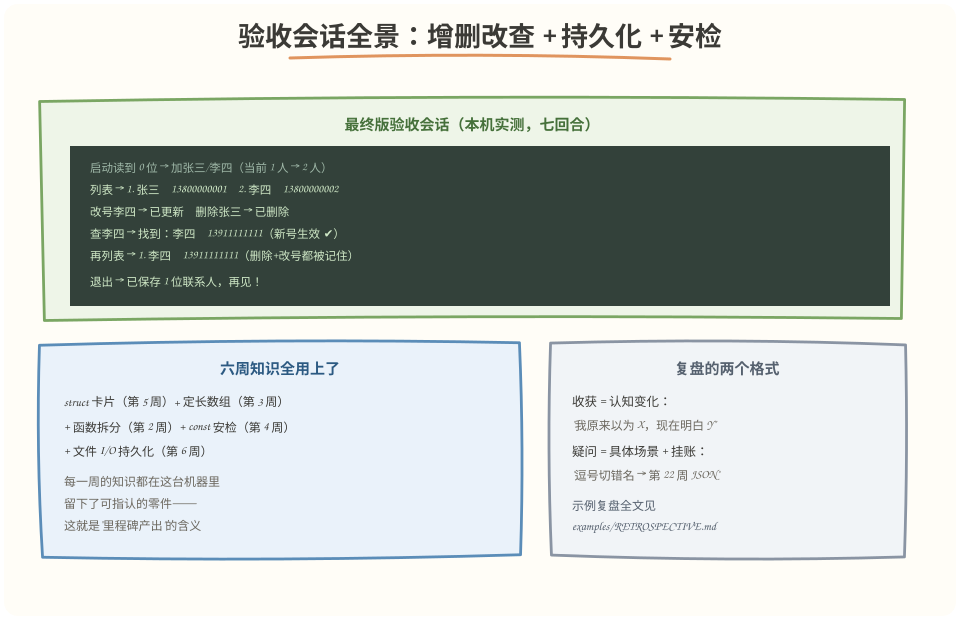
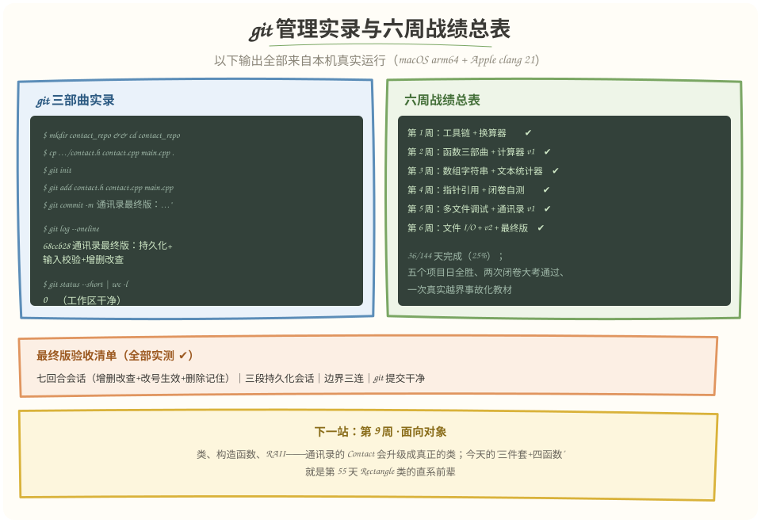

# 第 36 天（里程碑）：通讯录最终版提交与复盘

> **今日目标**：完成本教程后，你能做到：把通讯录最终版跑完整验收（七回合会话 + 持久化 + 边界三连）；用 git 三部曲（init/add/commit）把作品管理起来；写出"3 个收获 + 3 个疑问"格式的复盘——收获写认知变化、疑问带下一步计划。
> **预计时间**：验收 30 分钟＋git 管理 20 分钟＋复盘 40 分钟
> **前置准备**：完成 Day 30~35（v2 是最终版主体，昨天的自测是复盘素材）。
> **今日产出**：提交到 git 的通讯录最终版（工作区干净）+ 一份 RETROSPECTIVE.md 复盘。

## 1. 今天解决什么问题？

第 6 周收官，也是计划**第一阶段的里程碑日**：通讯录最终版正式交付。今天做三件事：**验收**（比 v2 会话更全的七回合：增、删、改、查、列表、改号生效验证、删除持久化验证）；**管理**（git 三部曲把作品提交——计划说"自己 git 管理更好"，从第 1 周的提示今天正式落地）；**复盘**（3 个收获 + 3 个疑问，格式比内容重要——收获要写认知变化，疑问要带下一步计划）。

## 2. 先看全貌：今天的内容位于哪里？



**图 1**：左卡是最终版构成（三文件约 220 行，版本史 v1→v2→最终版）；右卡是 git 管理的真实演示输出（`68ccb28` 提交、status 零行）；下方红卡是复盘的两个格式模板。路线图：**第 6 周今天收官，下周开进指针与内存（阶段二）**。

三步概括今天：

1. 验收：七回合会话 + 三段持久化 + 边界三连，全部实测；
2. 管理：`git init → add → commit`，作品集第一条入库；
3. 复盘：认知变化（收获）+ 挂账计划（疑问）。

## 3. 核心概念：先用直觉，再给准确定义

### 3.1 里程碑验收：全功能会话

- **一句通俗解释**：最终版的验收不是"每项功能各测一遍"，是一条会话里把**功能间的交互**也验掉——改号后查找、删除后再列表。
- **一个类比**：新车交付检查——不只试每个按钮，还要试"开空调时音响会不会断电"。
- **对应到技术上是**：本机实测七回合——加两人 → 列表 → **改李四号 → 查李四（新号生效）→ 删张三 → 列表（只剩李四且带新号）** → 退出存 1 人。改号和删除的**叠加效果**被完整验证。类比的边界：今天的会话仍是抽样验收——第 22 周的单元测试才是全覆盖。
- **常见误解**："功能昨天都测过，今天走个形式"——交互路径（改+查、删+列）昨天没测过，今天才是它们的首考。

### 3.2 git 管理：作品集的第一块砖

- **一句通俗解释**：git 把"作品"变成"有版本史的作品"——init 建仓、add 收货、commit 盖章。
- **一个类比**：房产证——房子昨天就在，今天办了证：从此有据可查、可以交易（放进简历）。
- **对应到技术上是**：本机实测三部曲——`git init`（建仓）→ `git add contact.h contact.cpp main.cpp`（收货）→ `git commit -m "通讯录最终版：……"`（盖章）；`git log --oneline` 显示提交 `68ccb28`，`git status` 零行（干净）。类比的边界：本地仓库还没有远程备份——推 GitHub 的完整流程（remote/push）在进阶阶段第 32 周工程化时正式学。
- **常见误解**："项目写完才需要 git"——最好的时机是第一天：从下周的项目起，**开工先 init**。

### 3.3 复盘：认知变化 + 挂账计划

- **一句通俗解释**：收获写"我原来以为 X，现在明白 Y"（认知的位移），疑问写"具体场景 + 挂账到哪一周"（不悬空的待办）。
- **一个类比**：旅行总结——"到此一游"没有价值，"原来以为的路线和实际走的差在哪"才有；没去成的景点记下来下次补，而不是含糊说"以后再说"。
- **对应到技术上是**：示例复盘（`examples/RETROSPECTIVE.md`）的三个收获覆盖传参三式/持久化闭环/边界测试，三个疑问分别挂账到第 22 周（JSON 转义）、第 16 周（链表 O(1) 删除）、第 10 周（RAII 与强杀）。类比的边界：复盘是**私人的**——示例只是格式示范，你必须写自己的版本，抄的复盘没有记忆效果。
- **常见误解**："收获列得越多越好"——三条写透胜过十条口号。

## 4. 图解核心机制



**图 2**：上半部分是七回合验收会话的完整记录（红字标注两个交互验证点：改号后查到新号、删除后列表只剩李四）；左下蓝卡盘点六周知识在最终版里的落点（每一周都留下了可指认的零件——这就是"里程碑产出"的含义）；右下灰卡是复盘两格式的示范。

按图逐步讲：

1. **看会话找交互**：七回合里"改→查"和"删→列"是新增的交互验证——单功能各自对，不代表串起来还对；
2. **看落点做盘点**：struct（第 5 周）、数组（第 3 周）、函数拆分（第 2 周）、const 安检（第 4 周）、文件 I/O（第 6 周）——对着自己的代码指认"这行来自哪周"；
3. **复盘的原料**：昨天的自测成绩单（用时/卡壳/回炉）+ 六周的 notes.md——两条流水线在这里汇合；
4. **挂账要闭环**：每个疑问写明"挂账到第几周"，到那周翻开复盘核对销账。

## 5. 动手实践：完成一个最小可运行例子

### 5.1 准备文件

```bash
cd ai-compiler-roadmap/tutorials/day-036/examples
g++ -Wall main.cpp contact.cpp -o contacts_final    # 与 v2 同源，编译即验收开始
```

### 5.2 编写代码

最终版与 v2 同源（Day 32 的三文件），本日新增的是**验收方法与档案**：`RETROSPECTIVE.md`（复盘模板 + 示范）。你的复盘写在自己的 `notes.md` 或独立文件里——格式对齐示例，内容必须是自己的。

### 5.3 运行与观察

七回合验收会话（本机真实执行，管道喂入；提示与回显挤行属正常）：

```text
启动时从 contacts_v2.txt 读到 0 位联系人
已添加 张三（当前 1 人）
已添加 李四（当前 2 人）
  1. 张三　13800000001
  2. 李四　13800000002
已更新 李四
已删除 张三
  找到：李四　13911111111　　←改号生效
  1. 李四　13911111111　　　←删除被记住、新号在列
已保存 1 位联系人到 contacts_v2.txt，再见！
```

git 三部曲实录（本机真实执行）：

```text
$ git init
$ git add contact.h contact.cpp main.cpp
$ git commit -m "通讯录最终版：持久化+输入校验+增删改查"
$ git log --oneline
68ccb28 通讯录最终版：持久化+输入校验+增删改查
$ git status --short | wc -l
0
```



**图 3**：左上 git 三部曲完整实录；右上六周战绩总表（36/144 天 = 25%，五个项目日全胜）；下方橙卡是验收清单、黄卡预告下一站（第 7 周：内存布局——指针与内存新阶段）。

### 5.4 修改一个输入再观察：复盘的个人版

写你自己的复盘（这是今天最重要的"实践"）：对照示例格式，写三条**真实发生过的**认知变化（翻 Day 1~35 的 notes.md 找素材——哪一天你说了"原来如此"？）和三个**真实存在的**疑问（哪一天你略过了某个"为什么"？）。写完做一件事：把三个疑问分别抄到对应周的 notes.md 开头，写上"来自 Day 36 复盘"——挂账落位，复盘才闭环。

## 6. 常见错误与排查

**错误 1：验收会话没验交互**

- 现象：增删改查各测一遍就收工，改号和删除的叠加没测；
- 原因：把验收当功能清单而非流程检验；
- 定位：会话里有没有"改 → 查"和"删 → 列"的连招；
- 修复：照 5.3 的七回合脚本跑一遍。

**错误 2：git 提交了编译产物**

- 现象：`git add .` 把可执行文件也收进仓库；
- 原因：没写 .gitignore；
- 定位：`git status` 里出现可执行文件名；
- 修复：加 `.gitignore`（内容一行：可执行文件名或 `*_final`）；本仓库的 .gitignore 从 Day 0 就有（`public/`、`.DS_Store` 等）。

**错误 3：复盘写成知识点罗列**

- 现象："学会了指针、引用、struct……"十条清单；
- 原因：把复盘当成了目录抄写（Day 34 的老坑）；
- 定位：每条收获里有没有"原来以为……现在明白……"的位移感；
- 修复：重写为认知变化；写不出位移的条目说明还没真懂，移进疑问清单。

## 7. 今日练习

### 必做练习

完成个人版 RETROSPECTIVE（3+3 格式）并把三个疑问挂账到对应周。预期产出：一份复盘 + 三处挂账标记——下周开学时它会提醒你哪些"为什么"还欠着。

### 选做挑战

给仓库补第二个提交：把 RETROSPECTIVE.md 也 `git add` + `commit -m "Day 36 复盘：三收获三疑问"`——`git log --oneline` 出现两行提交史。作品集从此有了"代码 + 思考"的双记录。

## 8. 今日验收

- [ ] 最终版七回合验收会话通过（含改号生效与删除记住两个交互验证）
- [ ] git 三部曲完成，log 有提交、status 干净
- [ ] 我的复盘有 3 收获（含认知位移）+ 3 疑问（含挂账计划）
- [ ] 三个疑问已抄到对应周的 notes.md 开头
- [ ] 六周战绩总表我能对着最终版代码逐周指认零件

## 9. 一句话总结与明天预告

今天的问题是"一个阶段的学习成果怎么交付"；方法上，验收测交互、git 管版本、复盘写位移，三件事把"做过"变成"拥有"；实践上，七回合会话与 git 三部曲全部实测，复盘模板与示例入档；验证标准是 log 里有提交、复盘里有位移、挂账都落位。**第 6 周收官——36/144 天（25%），计划第一阶段的里程碑达成。** 明天进入 **阶段二 · 第 7 周（Day 37）：程序内存布局**——栈/堆/静态区/常量区：打印不同变量的地址、观察区域差异，指针与内存的新阶段开航。
