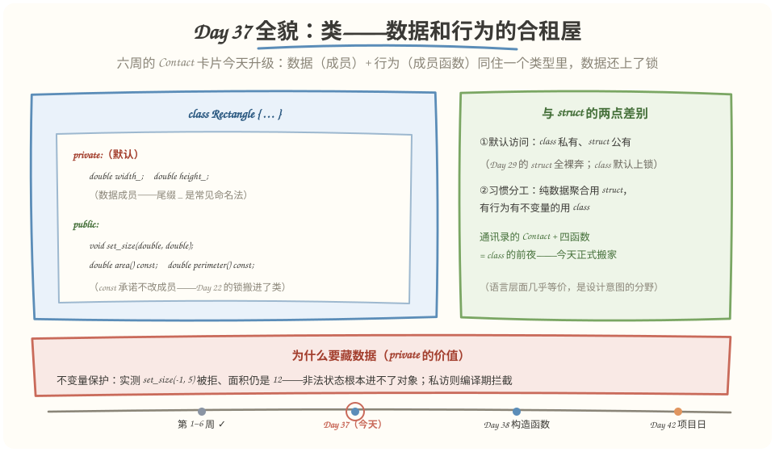
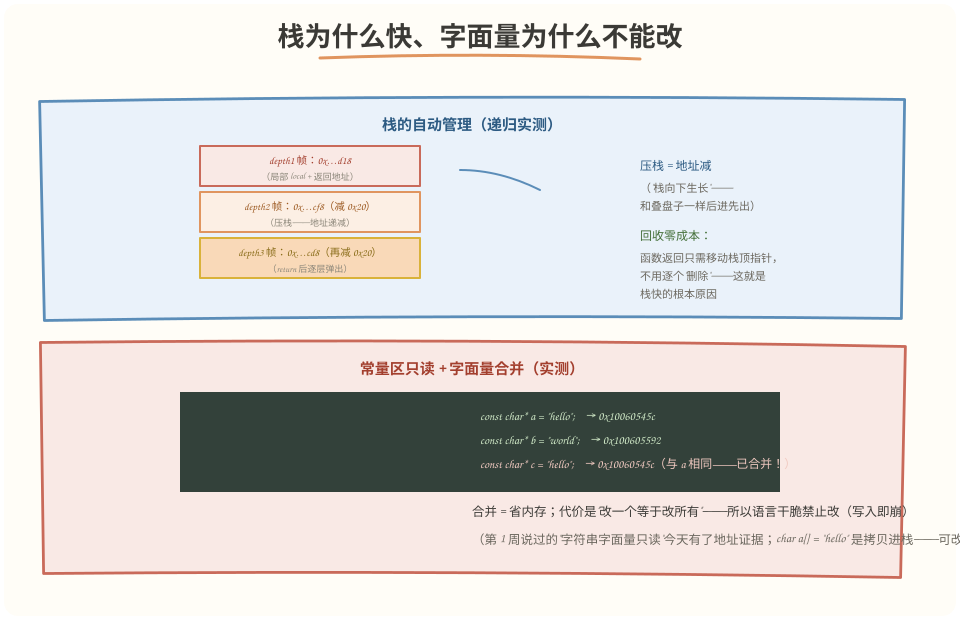
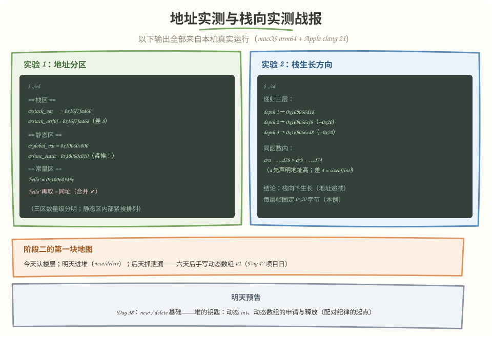

# 第 37 天：程序内存布局——栈、堆、静态区、常量区

> **今日目标**：完成本教程后，你能做到：说出四个内存区各住什么变量（局部→栈、new→堆、全局/static→静态区、字面量→常量区）；用打印地址的实验亲眼看到区域差异（本机实测三区数量级分明）；解释栈"向下生长"和回收零成本的原因；说出字符串字面量只读的地址证据（合并机制）。
> **预计时间**：学习 20 分钟＋实践 45 分钟
> **前置准备**：完成 Day 1~36（第 1 周埋的"字面量只读"、Day 19 的地址观察是今天的伏笔）。
> **今日产出**：地址分区实测（栈/静态/常量三区对比）、递归栈帧的向下生长实测、字面量合并的发现。

## 1. 今天解决什么问题？

阶段二（指针与内存）开篇。前面 36 天的变量都在"用"但没问"住在哪"——今天给程序的内存画一张**楼层图**：栈（局部变量）、堆（new 的地盘）、静态区（全局/static）、常量区（字符串字面量）。计划指定的练习是"打印不同变量的地址，观察地址区域差异"——不是背书，是**亲眼看**。

两个实测发现值得先说：递归三层的栈帧地址**递减 0x20**（栈向下生长的直接证据）；两次取 "hello" 的地址**完全相同**（编译器合并了相同字面量——第 1 周"字面量只读"的原因今天有了地址证据）。

## 2. 先看全貌：今天的内容位于哪里？



**图 1**：从高地址到低地址的楼层图——栈区（0x16f7…，本机实测）、空隙、堆区（Day 38 主角今天留白）、静态区（0x10060c0xx）、常量区（0x1006054xx）；下方绿卡是本机实测的三个证据。

三步概括今天：

1. 四区各住其主：局部→栈（自动回收）、new→堆（手动）、全局/static→静态区（进程结束）、字面量→常量区（只读）；
2. 栈向下生长（递归帧地址递减）、回收只是移动栈顶指针（快的根本原因）；
3. 相同字面量被合并——所以禁止修改（改一个等于改所有）。

## 3. 核心概念：先用直觉，再给准确定义

### 3.1 四区楼层图：变量住在哪

- **一句通俗解释**：程序内存像一栋楼——栈是顶层的工作间（用完即走）、堆是可租用的仓库（自己管钥匙）、静态区是长期储物柜（进程在柜在）、常量区是展柜（只能看不能摸）。
- **一个类比**：酒店住宿——散客（局部变量）住标准间退房即走（栈）；长租客（全局）有固定房间（静态区）；消防图（字面量）贴在墙上不许涂改（常量区）；仓库（堆）按需租用自己上锁（new/delete）。
- **对应到技术上是**：本机实测——栈变量 `0x16f7fad60`、静态区 `0x10060c000` 一带、字面量 `0x10060545c`：**三个数量级分得开开的**（栈在 0x16f7 段、静态/常量在 0x1006 段）。同区内紧挨：`stack_arr` 的 [0] 与 [2] 相差 8（每元素 4 字节、行内连续无填充）、静态区四个变量挤在 0x18 字节内。类比的边界：具体地址因编译器/系统而异（ASLR 地址随机化每次运行都变）——**看相对关系不看绝对值**。
- **常见误解**："static 局部变量在栈上"——不；实测 `&func_static = 0x10060c010` 和全局挤在一起——static 改变的是**生命期**（进程级）不是位置。

### 3.2 栈：自动管理与向下生长

- **一句通俗解释**：局部变量随函数调用入栈、返回出栈——管理全自动、回收零成本；"向下"指地址递减方向。
- **一个类比**：餐厅叠盘子——新盘子放顶上（压栈地址减）、拿走从顶开始（后进先出）；收盘员一次端走整摞（函数返回只移栈顶指针，不逐个擦）。
- **对应到技术上是**：实测递归三层——`0x…d18 → 0x…cf8 → 0x…cd8`（每层减 0x20，即每帧 32 字节）；同函数内 `&a = …d78 > &b = …d74`（本机 clang 先声明者地址高、差 4 = sizeof(int)；兄弟局部的先后高低由编译器决定，gcc/Linux 实测可能相反——稳定的是相邻差 = sizeof(int)）。**回收零成本**是栈快的根本原因：return 只是一条"栈顶指针复原"指令——这解释了为什么值传递（Day 9 的复印件）开销小、为什么深递归会爆栈（每层都占真实空间）。类比的边界：栈大小有限（通常 1~8MB）——无限递归的 stack overflow 就是顶穿了楼板。
- **常见误解**："栈上的变量要手动释放"——从不；出了作用域自动回收（Day 39 析构函数是它的类版本钩子）。

### 3.3 常量区：只读与合并

- **一句通俗解释**：字符串字面量放在只读区，且**相同内容只存一份**（合并）——所以语言禁止修改：改一个等于改所有引用处。
- **一个类比**：共享模板——全公司共用同一份"批准"印章模板；有人私自改字，所有文件全错——所以模板上锁（只读段）。
- **对应到技术上是**：实测——`"hello"` 两次取址都得 `0x10060545c`（合并证据）、`"world"` 在 `0x100605592`（不同内容不同址）；两个区相差约 0x136 字节（常量区内部的排布）。第 1 周说"字面量只读、改它必崩"今天有了机制解释。类比的边界：`char a[] = "hello"` 是**拷贝**进栈数组（可改）；`const char* p = "hello"` 是**指向**常量区（不可改）——第 22 天的 const 指针在此落地。
- **常见误解**："合并是标准保证"——是常见实现（gcc/clang 都做）而非强制；写代码不能依赖"两个相同字面量地址相等"，但**必须**当它们只读。

## 4. 图解核心机制



**图 2**：左上蓝卡是递归栈帧图——三层帧地址递减 0x20（压栈方向）、return 时整摞弹出（回收零成本的原理）；右上红卡是常量区的合并实测——两个 "hello" 同址、"world" 另址，合并省内存但代价是禁止修改。

按图逐步讲：

1. **顺着帧地址走一遍**：d18 → cf8 → cd8——每减一次就是压入一帧；return 反向弹出——**指针移动替代逐个清理**，栈快的本质；
2. **数一数每帧 0x20 字节**：一个 int 局部 + 返回地址 + 寄存器保存——帧结构在第 12 周函数调用约定时再拆细；
3. **看合并的两面**：省内存（一份 "hello" 全程序共享）vs 不可修改（改一个动全身）——只读是设计选择不是限制；
4. **楼层图收尾**：堆今天留白——明天的 new/delete 就是仓库的钥匙。

## 5. 动手实践：完成一个最小可运行例子

### 5.1 准备文件

```bash
cd ai-compiler-roadmap/tutorials/day-037/examples
```

两个程序：`mem_layout.cpp`（地址分区）、`stack_direction.cpp`（栈生长方向）。

### 5.2 编写代码

`mem_layout.cpp` 的关键（完整代码见本目录）：

```cpp
int global_var = 42;               // 全局变量：静态区
const char* const_str = "hello";   // 字符串字面量：常量区（只读）
static int static_var = 7;         // static 全局：仍是静态区

int main() {
    int stack_var = 10;            // 局部变量：栈
    static int func_static = 99;   // 函数内 static：静态区（不进栈！）

    std::cout << &stack_var << " vs " << &global_var << " vs "
              << static_cast<const void*>(const_str) << std::endl;
    // 三区地址对比 + 字面量合并检验（"hello" 取两次比地址）
    …
}
```

### 5.3 运行与观察

```bash
g++ -Wall mem_layout.cpp -o ml && ./ml
```

实际执行结果（本机）：

```text
== 栈区（局部变量） ==
  &stack_var    = 0x16f7fad60
  &stack_arr[0] = 0x16f7fad68
  &stack_arr[2] = 0x16f7fad70

== 静态区（全局/static） ==
  &global_var   = 0x10060c000
  &global_zero  = 0x10060c018
  &static_var   = 0x10060c014
  &func_static  = 0x10060c010

== 常量区（字符串字面量） ==
  (void*)const_str = 0x10060545c

== 代码里的字面量地址对比 ==
  "hello" = 0x10060545c
  "world" = 0x100605592
  "hello" 再取 = 0x10060545c（与第一次相同——已合并）
```

```bash
g++ -Wall stack_direction.cpp -o sd && ./sd
```

```text
== 递归栈帧的地址排列 ==
  depth 1 的局部变量地址：0x16b066d18
  depth 2 的局部变量地址：0x16b066cf8
  depth 3 的局部变量地址：0x16b066cd8

== 同函数内先声明的地址高还是低？ ==
  &a = 0x16b066d78
  &b = 0x16b066d74
  a 先声明，地址高于 b
  a-b 相差 4 字节（int=4）
```



**图 3**：左上地址分区（三区数量级对比 + 静态区内部紧挨）；右上是栈生长方向（递归帧递减、同函数差 4）；下方橙卡是阶段二的路线图。

### 5.4 修改一个输入再观察：再跑一次看 ASLR

把 `./ml` 再运行一次（不改代码）——**地址全变了**（本机实测栈区变成 0x16d… 开头的另一段）！这就是 **ASLR**（地址空间布局随机化）：每次运行把各楼层随机偏移——安全机制（让攻击者猜不到地址）。**但相对关系不变**：三区仍分三段、栈仍递减、字面量仍合并——今天的所有结论都建立在**相对关系**上，这正是 5.3 开头"看关系不看绝对值"的原因。

## 6. 常见错误与排查

**错误 1：把局部变量的地址存下来返回使用**

- 现象：函数返回后用那个地址，值诡异或崩；
- 原因：局部变量在栈上，函数返回帧被弹——地址指向已回收区（悬空指针，Day 39 主题）；
- 定位：返回类型是指针/引用且指向局部变量；
- 修复：返回值拷贝、static、或堆分配（明天学）。

**错误 2：`char* p = "hello"; p[0] = 'H';` 崩溃**

- 现象：写入即 segfault；
- 原因：p 指向常量区（只读段）——写入触发保护；
- 定位：看指向的是字面量还是数组；
- 修复：`char a[] = "hello"`（栈上拷贝可改）；或 `std::string`（自己管理可改缓冲）。

**错误 3：以为 static 局部变量随函数结束消失**

- 现象：第二次调用没"记住"上次的值；
- 原因：变量其实不是 static（漏写关键字）；
- 定位：实测 `&var` 在栈段还是静态段（今天的方法）；
- 修复：加 static——生命期升到进程级（Day 11 的老朋友今天有了地址证据）。

## 7. 今日练习

### 必做练习

在 `mem_layout.cpp` 里加一个 `double d_local` 和一个 `char c_local`，打印它们的地址并算出与相邻 int 的字节差。预期产出：double 占 8、char 占 1 的间隔观察（对齐可能补位——差 4 或 8 都正常，记下实际值）。

### 选做挑战

写一个 6 层递归的 `countdown(int n)`，每层打印 `&n`；然后改成 100 层跑一次。观察：每层差多少字节？100 层时栈用了约多少？（本例每帧 0x20 = 32 字节 → 100 层约 3.2KB——离 1MB 的栈上限还远；约 3.2 万层就会顶到 1MB 上限。把"栈有限"量化成数字。）

## 8. 今日验收

- [ ] 我能说出四区各住什么变量，并实测了三区地址的数量级差异
- [ ] 我用递归实测了栈向下生长（本例每帧 0x20）、同函数内相邻局部变量相差 sizeof(int)
- [ ] 我能解释栈回收零成本的原理（栈顶指针移动）
- [ ] 我实测了字面量合并（两次 "hello" 同址）并知道它解释了"只读"
- [ ] 我知道 ASLR：绝对地址每次变、相对关系不变

## 9. 一句话总结与明天预告

今天的问题是"变量的家在哪"；机制上，四区楼层图各司其职——栈自动管理且回收零成本（向下生长实测）、静态区进程级、常量区只读且合并；实践上，三区地址对比、递归栈帧、字面量合并、ASLR 全部实测；验证标准是看到任何变量声明能说出它在哪个区、谁负责回收。明天 **Day 38：new / delete 基础**——堆的钥匙：动态 int、动态数组的申请与释放，配对纪律从"new 必 delete"开始。
