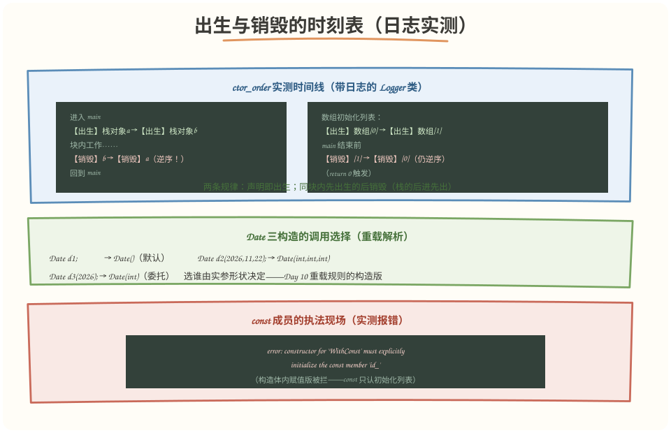

# 第 38 天：new / delete 基础——堆的钥匙

> **今日目标**：完成本教程后，你能做到：用 new/delete 管理动态 int 和动态数组（三种初始化写法的差别）；说出堆相对栈的两个自由（大小运行期定、生命期跨块）和它们的对价（手动配对）；背出配对纪律三条（new 必 delete、new[] 必配 delete[]、delete 后置空）；演示三种典型错误形态并知道它们都"不当场爆炸"。
> **预计时间**：学习 20 分钟＋实践 45 分钟
> **前置准备**：完成 Day 37（四区楼层图——堆在图里留白等今天）。
> **今日产出**：动态 int/数组的申请释放全记录、三种初始化对照、三种错误形态演示（含 -Wall 错配警告实测）。

## 1. 今天解决什么问题？

昨天认完楼层，堆那层留了白——今天拿到钥匙：**new / delete**。堆的自由有两个：**大小运行期才定**（`int n = 5; new int[n]` 合法——栈数组做不到）、**生命期跨块**（出了作用域内存还在，等你亲手还）。自由的对价是**配对纪律**：漏 delete 泄漏、错配 UB、delete 后乱用悬空——三种错误今天全部演示，并发现它们有个共同点：**都不当场爆炸**（静默性——明天的工具课专治这个）。

## 2. 先看全貌：今天的内容位于哪里？


**图 1**：左卡是堆 vs 栈的对表（大小/回收/地址/初始化）；右卡绿是配对纪律三条铁律；下方红卡是悬空指针初见。

三步概括今天：

1. `new T` / `new T[n]` 申请、`delete` / `delete[]` 归还——数组版必配 []；
2. 三种初始化：`new int`（垃圾）、`new int(7)`（指定值）、`new int{}`（零）；
3. 三条纪律：new 必 delete、new[] 配 delete[]、delete 后置空。

## 3. 核心概念：先用直觉，再给准确定义

### 3.1 堆的自由与对价

- **一句通俗解释**：堆是自助仓库——想租多大租多大（运行期定）、想租多久租多久（跨块存活）；但钥匙在你手里，退租（delete）也要你自己来。
- **一个类比**：酒店储物柜（栈）vs 长租仓库（堆）——前者前台自动管理、后者自己拿钥匙自己锁门；忘了退租就一直计费（泄漏）。
- **对应到技术上是**：实测——`int n = 5; int* arr = new int[n]{};` 合法且地址连续（0x…12c0 起、每格差 4）；`new int(7)` 得 7、`new int{}` 得 0。堆地址实测在 0x1029e…（和昨天静态区同段——都在低地址区，与栈的 0x16f7… 分居两端）。类比的边界：栈的"不自由"换来零成本回收（Day 37）——**默认用栈、需要跨块或运行期大小才上堆**，这是选型的第一直觉。
- **常见误解**："new 的内存自动释放"——从不；进程结束由 OS 回收地址空间，但长跑程序里漏掉的每一块都是净损失。

### 3.2 配对纪律三条

- **一句通俗解释**：租了必还（new→delete）、整批租的整批还（new[]→delete[]）、还完把钥匙作废（delete 后置空）。
- **一个类比**：图书馆借书——借了必还；一次借三本就三本一起还（别只还一本）；还完把借书证上这条划掉（置空），防止拿着旧记录再去取书（悬空）。
- **对应到技术上是**：实测三种错误形态——**忘 delete**（400 字节静默泄漏，编译器零反应）；**错配**（new[] 配 delete——`-Wall` 直接警告 `[-Wmismatched-new-delete]`，连"did you mean delete[]?"的修改建议都给了——编译期免费质检的又一例）；**悬空**（delete 后指针值还在、解引用是 UB）。诚实记录：macOS 的 ASan 对 int 数组错配未报——**工具有限度，纪律是底线**。类比的边界：置空（`p = nullptr`）防的是"误用旧钥匙"，不防别人也持有一份别名指针（深层问题 Day 39~41 展开）。
- **常见误解**："delete 会把指针变成 null"——不会；指针值原样保留（dangling）——所以置空要自己写。

### 3.3 初始化：三种写法三个结果

- **一句通俗解释**：`new int` 拿到的是"上一位房客留下的垃圾"；`new int(7)` 指定值；`new int{}` 统一清零——最后这个是稳妥默认。
- **一个类比**：租房——前一任的旧家具（垃圾值）、按你要求布置（指定值）、统一空房（零初始化）。
- **对应到技术上是**：实测——`new int` 解引用得 0（**本机这次碰巧是 0**——新映射的堆页常是零，但它仍是未指定值，换个时机可能就是别的数——"恰好零也是垃圾的一种"）；`new int(7)` 得 7；`new int{}` 得 0（保证）。数组版 `new int[n]{}` 全零起步（Day 57 IntBox 同款写法）。类比的边界：**类类型**（有构造函数）走构造函数不在此列——那是 Day 50 的领域；今天的"垃圾"仅指内建类型。
- **常见误解**："int 会自动清零"——栈上不会（Day 2 的教训）、堆上 `new int` 也不会；只有 `{}` 才保证。

## 4. 图解核心机制



**图 2**：上半部分蓝卡是 `new int[5]{}` 的四步（分配器找内存 → {} 零初始化 → 地址返回 → delete[] 归还）+ 实测地址排列（连续 5 格每格 4 字节）；下半部分绿卡是 -Wall 错配警告的原文——编译期点名 + 修改建议。

按图逐步讲：

1. **走一遍四步**：分配和初始化是两件事（`new int` 有分配没初始化——垃圾的来源）；`{}` 在第二步把每格写成 0；
2. **看地址连续性**：0x…12c0/12c4/12c8/12cc/12d0——指针算术（Day 19）在堆上照常工作：`*(arr+2) == arr[2]`；
3. **读一遍警告原文**：`did you mean 'delete[]'?`——编译器不仅报错还给了修法；把 `-Wall` 常开的理由又添一条；
4. **纪律压轴**：三条铁律背熟——明天工具课（ASan 抓泄漏）就是给纪律装雷达。

## 5. 动手实践：完成一个最小可运行例子

### 5.1 准备文件

```bash
cd ai-compiler-roadmap/tutorials/day-038/examples
```

两个程序：`new_delete_basic.cpp`（主角）、`pairing_discipline.cpp`（错误形态）。

### 5.2 编写代码

主角 `new_delete_basic.cpp` 的核心（完整代码见本目录）：

```cpp
int* p = new int;              // 申请（值未初始化！）
*p = 42;
delete p;                      // 配对纪律第一条

int* q = new int(7);           // 申请并初始化
int* z = new int{};            // 值初始化（零）
delete q;  delete z;

int n = 5;                     // 大小运行期定——栈数组做不到！
int* arr = new int[n]{};       // {} 全部零初始化
for (int i = 0; i < n; ++i) { arr[i] = i * i; }
delete[] arr;                  // 数组用 delete[]——纪律第二条
```

### 5.3 运行与观察

```bash
g++ -Wall new_delete_basic.cpp -o nd && ./nd
```

实际执行结果（本机）：

```text
== 动态 int ==
  未初始化：*p = 0（垃圾值）
  赋值后：*p = 42，p = 0x1029e12c0
  已 delete（p 本身的值未变，但解引用是悬空——别用！）

== new 带初始化 ==
  new int(7)：*q = 7
  new int{}：*z = 0（零初始化）

== 动态数组 ==
  arr[0] = 0 @ 0x1029e12c0
  arr[1] = 1 @ 0x1029e12c4
  arr[2] = 4 @ 0x1029e12c8
  arr[3] = 9 @ 0x1029e12cc
  arr[4] = 16 @ 0x1029e12d0
  相邻元素差 4 字节（int），地址连续
  已 delete[]
```

```bash
g++ -Wall pairing_discipline.cpp -o pd && ./pd
```

```text
== 错误一：忘记 delete（泄漏） ==
  出块时没 delete——这 400 字节到进程结束都拿不回来
  （编译器不报错！静默泄漏——Day 39 的工具课主角）

== 错误二：delete 后继续用（悬空） ==
  delete 后 p 的值还在（ dangling 指针），但 *p 是 UB
  置空后 if (d) 检查能防误用

== 错误三：new[] 配 delete（错配） ==
  new[] 必须配 delete[]（元素的析构只被 [] 版逐个调用）
```


**图 3**：左上动态 int/数组全记录（三种初始化 + 地址连续）；右上是三种错误形态（共同点：不当场爆炸）；下方橙卡是本周期路线。

### 5.4 修改一行再观察：错配的 -Wall 警告亲测

把 `pairing_discipline.cpp` 里 `delete[] arr;` 换成 `delete arr;`（并把正确行注释）——重编译，**-Wall 直接警告**（本机实测）：

```text
warning: 'delete' applied to a pointer that was allocated with 'new[]'; did you mean 'delete[]'?
[-Wmismatched-new-delete]
note: allocated with 'new[]' here
```

编译器不仅指出错误还给了修改建议（`did you mean 'delete[]'?`）——**又一条 -Wall 常开的理由**。诚实记录：把同款错配交给 macOS 的 ASan 跑——**没有报错**（int 是 trivial 类型，无析构差异可查）——工具覆盖有限度，配对纪律必须内化成肌肉记忆。

## 6. 常见错误与排查

**错误 1：内存占用持续增长（长跑程序）**

- 现象：服务跑几天越来越胖；
- 原因：某条路径 new 了没 delete——每次执行净漏一块；
- 定位：Day 39 的 ASan/valgrind（明天的主角）；
- 修复：逐个 new 配对 delete；更好的是用容器/智能指针（后面几周）。

**错误 2：`-Wmismatched-new-delete` 警告**

- 现象：编译时警告 new[] 配了 delete；
- 原因：数组版归还必须 []（逐元素处理）；
- 定位：警告直接指到行号；
- 修复：按建议改成 `delete[]`。

**错误 3：delete 后程序偶发崩溃或值诡异**

- 现象：随机位置的崩溃（难复现）；
- 原因：悬空指针——内存已还但还在用（别名指针是漏网之鱼）；
- 定位：ASan 的 use-after-free 检测（Day 39）；
- 修复：delete 后置空（防自己）；更彻底靠所有权设计（Day 49 智能指针）。

## 7. 今日练习

### 必做练习

写"运行期定大小"的完整演示：从 `std::cin` 读入 n，`new int[n]{}` 申请，填入 n 个随机平方数后打印再 `delete[]`。预期产出：n=3 和 n=7 两次运行的不同输出——栈数组做不到的"大小现场定"亲测。

### 选做挑战

实现"配对自查宏"：`#define SAFE_DELETE(p) do { delete[] (p); (p) = nullptr; } while (0)`，用在本日所有释放点。再想：为什么用 `do { } while (0)` 包起来？（提示：if-else 链中不被拆散——宏的护身符。）把结论写进 notes.md。

## 8. 今日验收

- [ ] 我能写出动态 int/数组的申请释放全流程（-Wall 零警告）
- [ ] 我实测了三种初始化的差别（垃圾/指定值/零）——并知道"恰好 0 也是垃圾"
- [ ] 我能背出配对纪律三条，且亲测了 -Wall 的错配警告（含修改建议）
- [ ] 我知道三种错误形态都不当场爆炸——静默性是堆错误的共性
- [ ] 我能说出堆相对栈的两个自由和它们的对价

## 9. 一句话总结与明天预告

今天的问题是"堆的钥匙怎么用才不出事"；机制上，new/delete 管理堆（大小运行期定、生命期跨块），三种初始化各有效果，配对纪律三条铁律是对自由的约束；实践上，申请释放全记录、三种初始化、三种错误形态全部实测；验证标准是看到任何 new 能说出配对的 delete 在哪、初始化是哪种。明天 **Day 39：内存泄漏与悬空指针——工具课**：写一个泄漏程序并用 ASan/valgrind 定位（计划指定练习）——今天"不报错"的三种错误明天全部现形。
