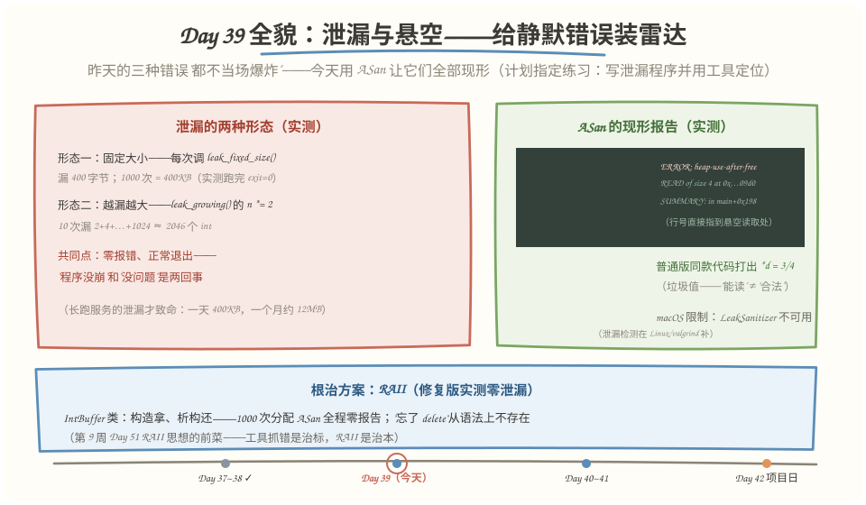
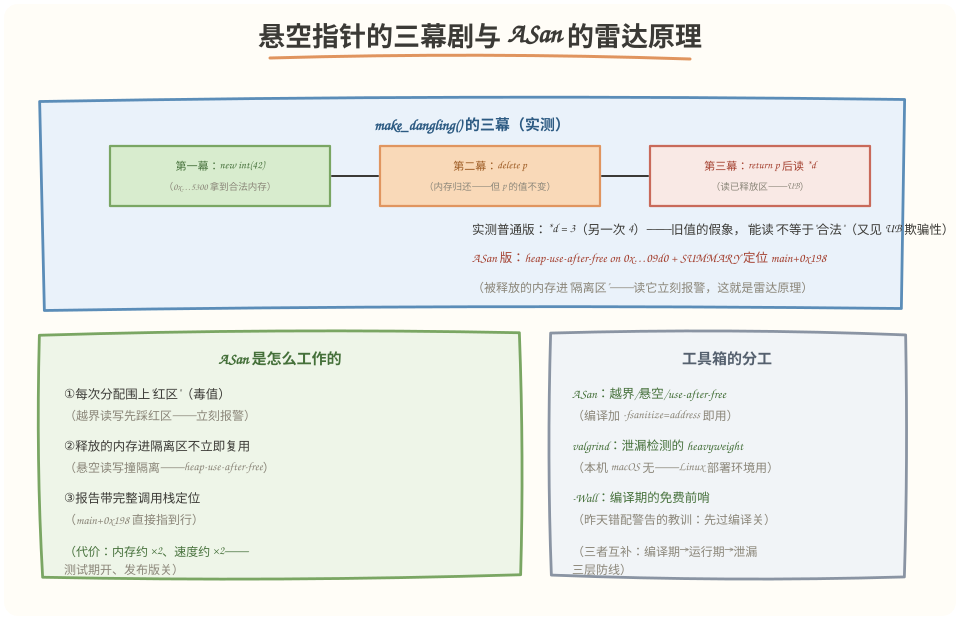
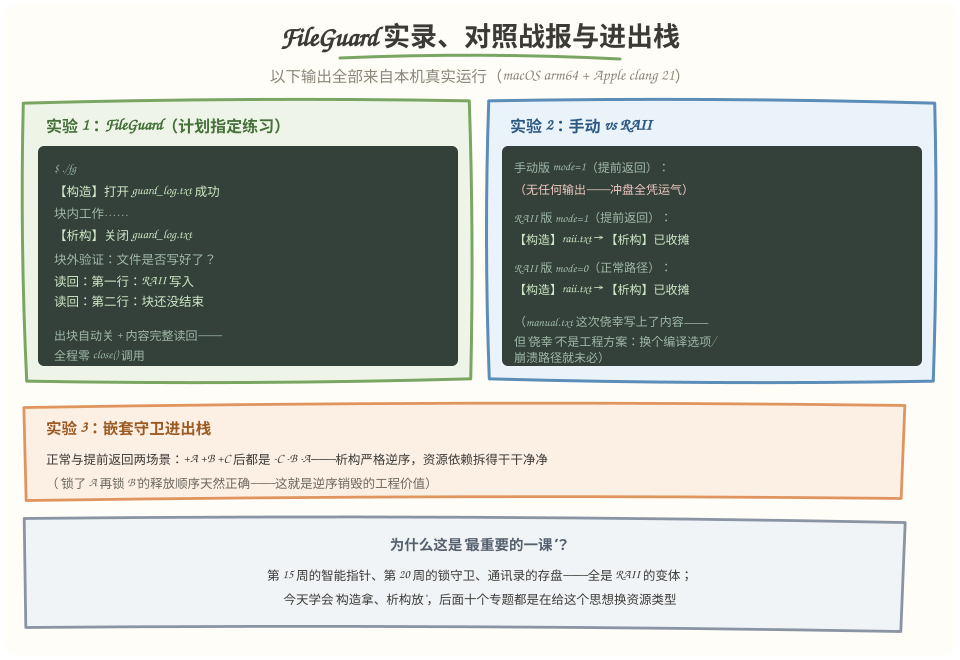

# 第 39 天：内存泄漏与悬空指针——工具课

> **今日目标**：完成本教程后，你能做到：写出两种形态的泄漏程序（固定大小累积、指数增长）并说明其静默性；用 ASan 让悬空读取现形（读懂 heap-use-after-free 报告的定位信息）；说出普通版"能读出旧值"是 UB 假象；用 RAII 版对照根治（零报告实测）；说出 ASan 的雷达原理和工具箱三层分工。
> **预计时间**：学习 20 分钟＋实践 45 分钟
> **前置准备**：完成 Day 38（三种错误"不当场爆炸"是今天的问题来源）。
> **今日产出**：泄漏实验室（1010 次分配的静默 + 悬空读取的 ASan 现形）、RAII 修复版（零报告对照）。

## 1. 今天解决什么问题？

昨天的三种错误（忘 delete / 悬空 / 错配）有个共同点：**都不当场爆炸**——程序正常退出 exit=0。今天的问题：静默错误怎么发现？计划指定的练习正是"写一个泄漏程序并用工具定位"。答案的主角是 **ASan**（AddressSanitizer）：给内存装雷达——被释放的内存进"隔离区"、每次分配围"红区"，踩到立刻报警并定位行号。

顺带一个对照实验：同样的 1000 次分配改成 RAII 类管理——ASan 全程零报告——**工具抓错是治标，RAII 是治本**。

## 2. 先看全貌：今天的内容位于哪里？



**图 1**：左卡红是泄漏的两种形态（固定 400 字节 × 1000 次 / 指数增长 ×10 次——实测全部静默）；右卡绿是 ASan 的现形报告（heap-use-after-free + 定位）和 macOS 的限制；下方蓝卡是 RAII 根治。

三步概括今天：

1. 泄漏静默累积（exit=0 不等于没问题）；
2. 悬空读取是 UB——普通版打出旧值假象、ASan 版现形定位；
3. 三层防线：-Wall（编译期）→ ASan（运行期）→ RAII（根治）。

## 3. 核心概念：先用直觉，再给准确定义

### 3.1 泄漏的静默性

- **一句通俗解释**：漏掉的内存不报错不崩溃——程序照常跑完；代价在时间轴上慢慢显形（长跑服务的内存曲线一路上涨）。
- **一个类比**：慢漏气的轮胎——短途看不出来；跑长途才发现越开越沉——等仪表盘报警时已经漏了很久。
- **对应到技术上是**：实测——`leak_fixed_size()` 跑 1000 次（每次漏 400 字节 = 共 400KB）+ `leak_growing()` 跑 10 次（2+4+…+1024 ≈ 2046 个 int）——**程序正常退出、零输出警告**。类比的边界：进程退出时 OS 回收全部地址空间——所以短命程序的泄漏"看不出来"；**长跑服务**（不退出的服务器）里泄漏是净损失——一天 400KB、一个月 120MB。
- **常见误解**："程序能跑完就没泄漏"——exit=0 和零泄漏毫无关系；今天的实验就是证据。

### 3.2 悬空指针：UB 的假象

- **一句通俗解释**：delete 后指针还存着旧地址；解引用可能"读出旧值"（内存还没被复用）——**能读不等于合法**，下次运行/换个分配序列就可能变垃圾或崩。
- **一个类比**：退房后用旧房卡开门——这次碰巧门没换锁（读出旧值 3）；下次住客换了你打不开（崩）或开进了别人的房（垃圾值）。
- **对应到技术上是**：实测——`make_dangling()` 返回已释放的指针，普通版 `*d` 打出 **3**（另一次实验打出 4）——旧值的假象；ASan 版同款代码立刻报 `ERROR: heap-use-after-free on 0x…09d0` + `READ of size 4` + `SUMMARY: … in main+0x198`（定位到悬空读取处）。类比的边界：普通版的"3"不是幸运也不是安全——UB 的定义就是"什么都可能"；把它和 Day 47 的 static_cast 欺骗性、Day 57 的"能跑不等于对"并排放进错题本。
- **常见误解**："delete 后读一下没关系反正没写"——读和写都是 UB；ASan 连 READ 都抓（今天的报告就是 READ of size 4）。

### 3.3 ASan 雷达与三层防线

- **一句通俗解释**：ASan 给每次分配围红区、把释放的内存送隔离区——越界/悬空一踩就响；报告带完整定位。
- **一个类比**：博物馆的红外线——展品（合法内存）周围布防（红区）；被撤展的展品区直接封锁（隔离区）——越线一步警铃大作并显示位置。
- **对应到技术上是**：原理三件事——①分配围毒值红区（越界现形）、②释放进隔离区不立即复用（悬空现形）、③报告带调用栈。用法：编译加 `-fsanitize=address` 即用。**代价**：内存约 ×2、速度约 ×2——**测试期开、发布版关**。**工具箱分工**（实测）：-Wall 编译期（昨天错配警告）、ASan 运行期（今天悬空）、valgrind 泄漏 heavyweight（本机 macOS 无此工具——诚实记录，Linux 部署环境可用；macOS 上泄漏靠 ASan 的 use-after-free 侧面 + 代码审查）。类比的边界：ASan 抓"踩雷瞬间"——**泄漏**（没人踩的漏掉内存）在 macOS 上检测受限——这正是 RAII 更重要的理由。
- **常见误解**："开了 ASan 就万事大吉"——它抓越界/悬空/UAF；纯泄漏要 LeakSanitizer（macOS 不可用）或 valgrind；而且只能抓"执行到的路径"——测试覆盖是前提。

## 4. 图解核心机制



**图 2**：上半部分蓝卡是 make_dangling 的三幕（new 拿到 → delete 归还但指针不变 → 读取踩雷）+ 普通版旧值假象与 ASan 现形的对照；左下绿卡是 ASan 的三个原理（红区/隔离区/调用栈）和代价；右下灰卡是工具箱三层分工。

按图逐步讲：

1. **走一遍三幕剧**：第二幕是关键——delete 归还的是**内存**，指针变量 p 的**值**原封不动（0x…5300 还在）；第三幕的 `*d` 就是用旧钥匙开已换锁的门；
2. **读一遍 ASan 报告**：`on 0x…09d0`（哪块内存）、`READ of size 4`（什么操作）、`SUMMARY in main+0x198`（哪行代码）——三要素定位法；
3. **记雷达的边界**：隔离区策略让"释放后的内存"暂时不可复用——所以悬空必被抓；但**没人再碰的泄漏**在 macOS 上不在射程（Linux 的 LeakSanitizer 才管）；
4. **防线三层收尾**：-Wall 编译期 → ASan 运行期 → RAII 根治——明天的二维数组就是 RAII 前的最后一课手动管理。

## 5. 动手实践：完成一个最小可运行例子

### 5.1 准备文件

```bash
cd ai-compiler-roadmap/tutorials/day-039/examples
```

两个程序：`leak_lab.cpp`（问题版）、`fixed_raii.cpp`（根治版）。

### 5.2 编写代码

问题版的核心（完整代码见本目录）：

```cpp
void leak_fixed_size() {
    int* p = new int[100];            // 形态一：固定大小，每次调用漏 400 字节
    p[0] = 1;
}                                      // p 出块消失——内存没人管了

int* make_dangling() {
    int* p = new int(42);
    delete p;                          // 正确释放了……
    return p;                          // 但返回的指针指向已释放内存（悬空）
}

// main 里：
for (int i = 0; i < 1000; ++i) { leak_fixed_size(); }   // 400KB 静默泄漏
int* d = make_dangling();
std::cout << *d;                        // 悬空读取（UB）
```

### 5.3 运行与观察

```bash
g++ -Wall leak_lab.cpp -o ll && ./ll; echo "exit=$?"
```

实际执行结果（本机）：

```text
== 泄漏的累积（普通编译看不见） ==
  跑完 1010 次分配，全部没还——程序正常退出 exit=0
  （没有任何报错——这就是'静默'的可怕）

== 悬空指针 ==
  d = 0x104f01300（值还在，但指向已释放内存）
  *d = 3（悬空读取——UB：普通版可能打出旧值 4 的假象）
exit=0
```

```bash
g++ -Wall -fsanitize=address leak_lab.cpp -o lla && ./lla
```

```text
==4707==ERROR: AddressSanitizer: heap-use-after-free on address 0x602000000990
READ of size 4 at 0x602000000990 thread T0
SUMMARY: AddressSanitizer: heap-use-after-free (lla:arm64+0x100ce4c98) in main+0x198
```

```bash
g++ -Wall -fsanitize=address fixed_raii.cpp -o fr && ./fr
```

```text
1000 次分配全部经析构归还——零泄漏（ASan 全程无报告）
（RAII 是根治——'忘了 delete'从语法上不存在）
```



**图 3**：左上泄漏+悬空（普通版静默 vs ASan 现形的同段代码两种命运）；右上是 RAII 修复版（同规模 1000 次对照零报告）；下方橙卡是本周防线升级路线。

### 5.4 修改一个输入再观察：假象的不稳定性

把 `leak_lab.cpp` 的 `make_dangling` 里 delete 前的值从 42 改成 999——本机实测重跑：`*d` 打出的是 **4**（三次都是 4）——**与旧值 999 无关的垃圾**！这比"旧值假象"更强：被释放的内存已被分配器复用/改写，读到的根本不是你放进去的东西。这正说明"能读出一个数"纯属**运气**——UB 的三种呈现（旧值/垃圾/崩溃）今天实际碰到的是第二种。对照：ASan 版无论怎么改都稳定报 heap-use-after-free——**可检查的失败优于不可控的运气**（Day 8 EOF 旗以来的第 N 次回归）。

## 6. 常见错误与排查

**错误 1：程序跑得好好的但内存一直涨**

- 现象：长跑服务内存曲线持续上升；
- 原因：某条路径 new 了没还（今天的形态一/二）；
- 定位：Linux 上 valgrind / LeakSanitizer；macOS 上代码审查所有 new 的配对（今天的诚实边界）；
- 修复：补配对；根治用 RAII（容器/智能指针）。

**错误 2：`ERROR: heap-use-after-free`（ASan 报告）**

- 现象：ASan 版在某次读取崩溃并打印报告；
- 原因：悬空指针——内存已释放还在用；
- 定位：报告的 SUMMARY 指向读取行；往上追这块内存的 delete 在哪；
- 修复：delete 后置空 + 不返回局部堆指针的所有权（或改返回值/用智能指针）。

**错误 3：泄漏了但 ASan 没报**

- 现象：明明漏了、ASan 安安静静；
- 原因：macOS 不支持 LeakSanitizer——纯泄漏（没人踩）不在 ASan 射程；
- 定位：这是工具边界不是"没有泄漏"；
- 修复：Linux 环境跑 valgrind；更重要的是改用 RAII 让泄漏无法发生。

## 7. 今日练习

### 必做练习（计划指定：写泄漏程序并用工具定位）

给 leak_lab 加第三种形态"部分泄漏"：函数里 new 两块、只 delete 一块（`new int[10]` 和 `new int[20]`，只还前者）。ASan 跑一遍（悬空部分现形、纯泄漏安静——工具边界的再验证）；再数一数三种形态各漏多少字节。预期产出：三种形态的清单 + 各自的检测情况表。

### 选做挑战

写"泄漏放大器"演示给未来的自己看：循环 100000 次 `leak_fixed_size()`（约 40MB），用 `ps aux | grep` 或活动监视器前后对比内存——把"静默"变成肉眼可见的数字（跑完立刻 Ctrl+C——别真把机器压垮）。

## 8. 今日验收

- [ ] 我能写出两种形态的泄漏程序并解释静默性（exit=0 ≠ 没问题）
- [ ] 我实测了悬空读取：普通版旧值假象（3/4）、ASan 现形（含定位三要素）
- [ ] 我的 RAII 修复版 ASan 全程零报告（同规模对照）
- [ ] 我能说出 ASan 的三个原理和它的代价（×2/×2、测试期开）
- [ ] 我知道工具箱三层分工和 macOS 的泄漏检测边界

## 9. 一句话总结与明天预告

今天的问题是"静默的内存错误怎么发现"；机制上，泄漏静默累积、悬空读取是 UB（旧值假象）、ASan 用红区和隔离区让踩雷现形——但纯泄漏在 macOS 不在射程；实践上，泄漏实验室、悬空现形、RAII 零报告三组对照全部实测；验证标准是看到任何 new/delete 能说出"错了会怎样、哪个工具能抓"。明天 **Day 40：new[]/delete[] 与二维动态数组**——矩阵的创建、乘法与正确释放（Day 14 二维数组的堆版，也是配对纪律的大型练习场）。
