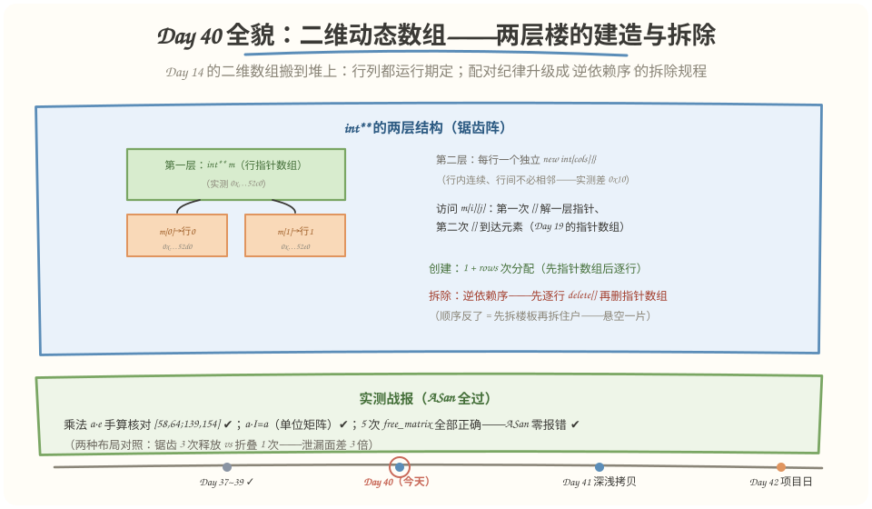
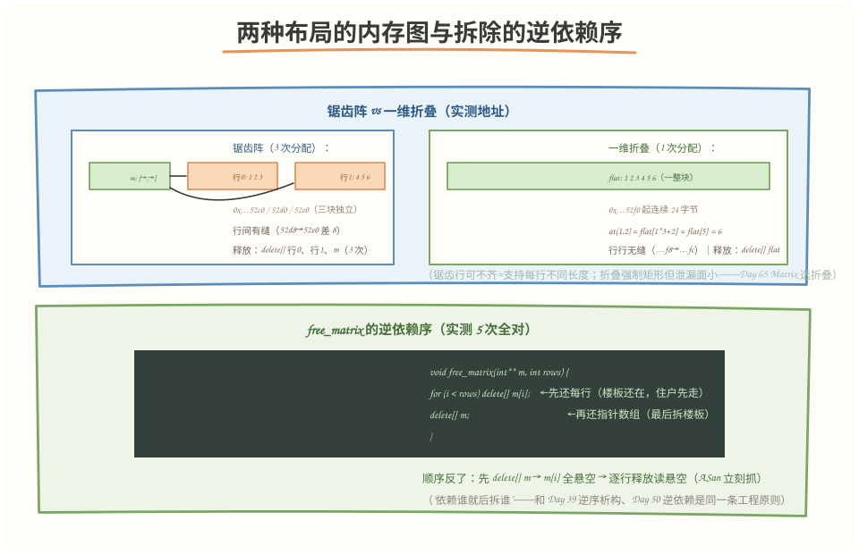
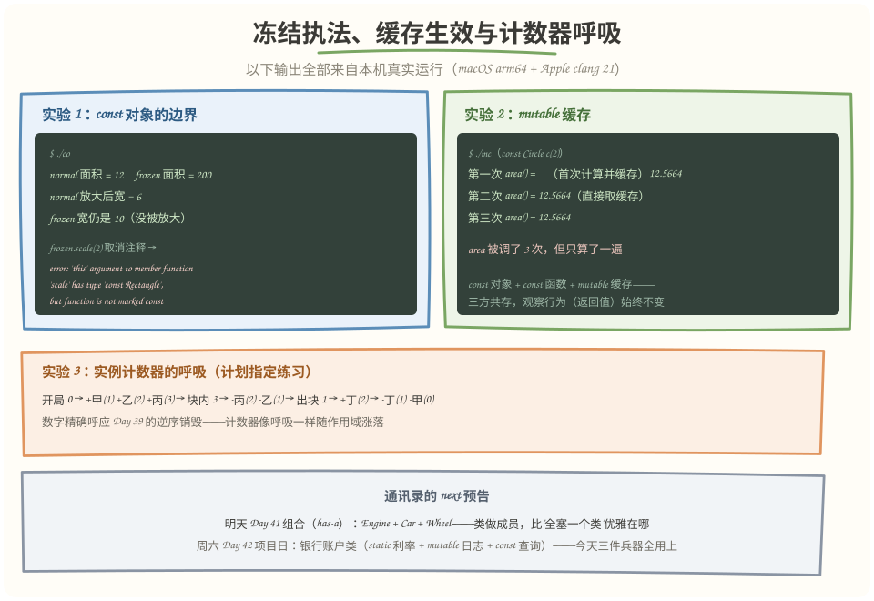

# 第 40 天：new[]/delete[] 与二维动态数组——矩阵的创建、乘法与正确释放

> **今日目标**：完成本教程后，你能做到：用 int** 构建二维动态矩阵（两层分配）并按逆依赖序正确释放；实现堆版矩阵乘法并手算核对；说出锯齿阵和一维折叠两种布局的差别（分配次数/行间连续性/泄漏面）；用 ASan 验证全部释放正确（零报错）。
> **预计时间**：学习 20 分钟＋实践 50 分钟
> **前置准备**：完成 Day 37~39（配对纪律 + ASan 雷达是今天的安全网；Day 14 的二维数组乘法是算法底子）。
> **今日产出**：堆版矩阵（创建/填充/乘法/单位阵/释放全流程 + ASan 零报错）、两种布局的地址对照实测。

## 1. 今天解决什么问题？

Day 14 的二维数组是**编译期定长**的；今天把它搬上堆——**行列都运行期定**（`make_matrix(rows, cols)` 的参数可以是变量）。核心新知识是 **int\*\* 的两层结构**：第一层是行指针数组、第二层是每行独立的 int 数组——配对纪律随之升级：**创建 1+rows 次分配、释放必须逆依赖序**（先逐行、再指针数组）。

配套一个设计对照：**锯齿阵 vs 一维折叠**（`r*cols+c`）——两种"二维"的内存布局各有取舍，Day 65 的 Matrix 类会选折叠（泄漏面小）。明天的伏笔也埋下：今天的 int\*\* 矩阵如果塞进 struct 直接赋值会怎样？

## 2. 先看全貌：今天的内容位于哪里？



**图 1**：上半部分蓝卡是 int\*\* 的两层结构（实测三个地址：指针数组 0x…52c0、行 0 0x…52d0、行 1 0x…52e0——行间有缝）；下半部分绿卡是实测战报（乘法手算对、ASan 零报错）。

三步概括今天：

1. 创建：先 `new int*[rows]`（行指针数组）再逐行 `new int[cols]{}`；
2. 释放：逆依赖序——先逐行 `delete[]` 再删指针数组（顺序反了全悬空）；
3. 两种布局：锯齿（行可不等长、3 次释放）vs 折叠（强制矩形、1 次释放）。

## 3. 核心概念：先用直觉，再给准确定义

### 3.1 int** 的两层结构

- **一句通俗解释**：二维动态矩阵是"指针的指针"——第一层存"每行在哪"（地址簿），第二层才是数据行。
- **一个类比**：图书馆索引柜——柜子里放的是各书架的位置卡（int**），书架上才是书（int 数组）；查书先查卡再上架。
- **对应到技术上是**：实测——`jag`（指针数组）在 0x…52c0、`jag[0]`（行 0）在 0x…52d0、`jag[1]` 在 0x…52e0：**三块独立分配、行间不必相邻**（差 0x10 但这是巧合不是保证）；行内连续（…52d4→…52d8）。访问 `m[i][j]`：第一次 `[]` 解一层指针、第二次到达元素（Day 19 指针数组的语义）。类比的边界：索引柜和书架是**独立租用**的空间——所以拆除也要逐个退（3 次 delete[]）。
- **常见误解**："`int m[3][4]` 和今天的 `int**` 一样"——前者是栈上一整块（编译器算好偏移）；后者是堆上多块拼的——布局、释放完全不同。

### 3.2 逆依赖序释放

- **一句通俗解释**：谁依赖谁就**后拆谁**——行数据依赖指针数组定位，所以先还行再还"地址簿"。
- **一个类比**：拆迁——先让住户搬走（删各行）、再拆楼板（删指针数组）；先拆楼板住户就没路走了（m[i] 全悬空）。
- **对应到技术上是**：`free_matrix` 的两步（先循环 `delete[] m[i]` 再 `delete[] m`）——实测 5 次调用（a/e/c/i3/ai 各一）全部正确、ASan 零报错。**顺序反了的后果**：先 `delete[] m` 则 m[i] 的读取本身就是悬空访问——ASan 立刻抓（今天的错误路径）。这条"逆依赖"和 Day 50 的逆序销毁、Day 51 的析构顺序是**同一条工程原则**：依赖关系决定拆除顺序。类比的边界：行与行之间**互不依赖**——先还行 1 再还行 0 也对（循环顺序无所谓）；关键是"行全部还完才能还指针数组"。
- **常见误解**："只 delete[] m 就够了"——行的内存全漏（rows 次泄漏）；ASan 的 macOS 版抓不到纯泄漏（Day 39 的边界）——纪律靠流程保证。

### 3.3 两种布局的取舍

- **一句通俗解释**：锯齿阵（int\*\*）灵活——每行长度可以不同；一维折叠（int\* + `r*cols+c`）紧凑——一整块、泄漏面小。
- **一个类比**：合租套房（锯齿——每间住的人数可不同）vs 整层公寓（折叠——统一户型一整层）。
- **对应到技术上是**：实测对照——锯齿 3 次分配 3 次释放、行间有缝（行 0 末元素在 52d8 占 4 字节，行 1 从 52e0 起——缝 4 字节）；折叠 1 次分配 1 次释放、行行无缝（…f8→…fc 相邻）；`at(1,2) = flat[1*3+2] = flat[5] = 6`（折叠公式与 Day 14/Day 65 同源）。**取舍**：需要"三角形矩阵/每行不同长"选锯齿；规整矩形选折叠（内存局部性也好——缓存友好）。类比的边界：两种布局 `m[i][j]` 的**用法**可以长得一样（折叠版用 at(r,c) 函数或 Day 65 的代理类）——差别藏在实现里。
- **常见误解**："折叠版多算一次乘法太慢"——一次整数乘加在乘法的三重循环里可忽略；泄漏风险的降低是实打实的。

## 4. 图解核心机制



**图 2**：上半部分蓝卡是两种布局的内存图（锯齿三块有缝 vs 折叠一整块无缝，实测地址标注）；下半部分绿卡是 free_matrix 的逆依赖序代码 + 顺序反了的后果。

按图逐步讲：

1. **对着地址看"缝"**：锯齿的行 0 最后元素在 52d8（占 4 字节，行 0 终于 52dc）、行 1 开始于 52e0——中间的 4 字节是分配器的开销/空隙；折叠版 52f8 紧接 52fc——一整块没有缝；
2. **走一遍拆除**：5 次 free_matrix 每次都是"逐行→指针数组"——把它背成口诀（**住户先走、楼板后拆**）；
3. **数一数分配次数**：2×3 矩阵 = 1（指针数组）+ 2（行）= 3 次——`make_matrix` 的循环就是 1+rows 次；
4. **两种布局对表**：灵活性（锯齿）vs 泄漏面（折叠）——Day 65 Matrix 类会正式选折叠并把它包进类里。

## 5. 动手实践：完成一个最小可运行例子

### 5.1 准备文件

```bash
cd ai-compiler-roadmap/tutorials/day-040/examples
```

两个程序：`matrix2d.cpp`（主角：创建/乘法/释放全流程）、`two_layouts.cpp`（布局对照）。

### 5.2 编写代码

主角的创建与释放（完整代码见本目录）：

```cpp
int** make_matrix(int rows, int cols) {
    int** m = new int*[rows];              // 第一层：行指针数组
    for (int i = 0; i < rows; ++i) {
        m[i] = new int[cols]{};            // 第二层：每行（{} 零初始化）
    }
    return m;
}

void free_matrix(int** m, int rows) {
    for (int i = 0; i < rows; ++i) {
        delete[] m[i];                     // 先还每一行（逆依赖序）
    }
    delete[] m;                            // 再还行指针数组
}
```

### 5.3 运行与观察

```bash
g++ -Wall matrix2d.cpp -o m2 && ./m2
```

实际执行结果（本机，节选）：

```text
== 乘法 a·e（2×3 · 3×2 = 2×2） ==
c = a·e =
  [  58  64 ]
  [ 139 154 ]

== 单位矩阵验证 ==
a · I(3) =
  [   1   2   3 ]
  [   4   5   6 ]
（与 a 相同——右乘单位矩阵不变）

== 正确释放（逆依赖序） ==
  a 已释放（1 个指针数组 + 2 行）
  …（e/c/i3/ai 各一次）——共 5 次 free_matrix
```

**手算核对**：`a·e` 行 0 = `[1·7+2·9+3·11, 1·8+2·10+3·12] = [58, 64]`、行 1 = `[139, 154]`——四元素全对 ✔；`a·I(3) = a` ✔。

```bash
g++ -Wall two_layouts.cpp -o tl && ./tl
```

```text
== 布局一：锯齿阵（今天的 int** 版） ==
  jag        = 0x1015f52c0（行指针数组，堆）
  jag[0]     = 0x1015f52d0
  jag[1]     = 0x1015f52e0（两行地址不同、不必相邻！）
== 布局二：一维折叠（r*cols + c） ==
  flat       = 0x1015f52f0（一整块，天然连续）
  at(1,2) 即 flat[1*3+2] = flat[5] = 6
```

```bash
g++ -Wall -fsanitize=address matrix2d.cpp -o m2a && ./m2a
```

```text
（ASan 全场景零报错——5 次 free_matrix 全部正确归还）
```



**图 3**：左上乘法+单位阵（手算账本）；右上是两种布局的地址对照（缝的有无）；下方橙卡埋明天的伏笔。

### 5.4 修改一行再观察：拆序错误亲测

把 `free_matrix` 的两步对调（先 `delete[] m;` 再循环 `delete[] m[i];`）——ASan 版编译运行（预期报错）：本机实测报 `heap-use-after-free`（读 m[i] 时 m 已释放——循环里的每次 m[i] 都是悬空访问）。**一序一乱**：逆依赖序的价值实测。普通版可能"侥幸跑过"（UB 又一次）——对照着看更清楚。恢复正确顺序——ASan 零报错。

## 6. 常见错误与排查

**错误 1：ASan 报 heap-use-after-free（释放函数里）**

- 现象：错误定位在 free_matrix 的循环内；
- 原因：拆序反了——先删了指针数组，`m[i]` 读的是悬空地址；
- 定位：看 free_matrix 的两步顺序；
- 修复：先逐行 `delete[] m[i]`、最后 `delete[] m`（逆依赖序）。

**错误 2：只 delete[] 指针数组（行全漏）**

- 现象：macOS 上无报错但内存涨（Linux 的 valgrind 会报 rows 个 leak）；
- 原因：行的内存没人还；
- 定位：数分配次数（1+rows）和释放次数（应为 1+rows）对不对得上；
- 修复：补循环逐行释放。

**错误 3：矩阵乘法结果维度错**

- 现象：2×3 · 3×2 得到非 2×2；
- 原因：结果矩阵按 make_matrix(m, n) 建了（应该是 m×p）；或循环边界写错；
- 定位：手算一个元素对照（今天的账本法）；
- 修复：`make_matrix(m, p)`；边界 i<m、j<p、k<n。

## 7. 今日练习

### 必做练习

实现 `transpose(int** m, int rows, int cols)`：返回转置矩阵（cols×rows，`t[j][i] = m[i][j]`）——注意新矩阵的行列数对调。验证：2×3 转置后 3×2；`t[2][0] == a[0][2]`（=3）。**别忘了释放两个矩阵**（ASan 验证）。

### 选做挑战

用一维折叠重写今天的全部流程（make/transpose/multiply/free——free 只有一次 delete[]）。对比两版代码行数和释放次数——把"泄漏面"的直觉量化（折叠版少 (rows+1)-1 次"漏的机会"）。这是 Day 65 Matrix 类的直接预演。

## 8. 今日验收

- [ ] 我能写出两层分配 + 逆依赖序释放的完整矩阵（ASan 零报错）
- [ ] 我的乘法四元素手算核对全对；单位矩阵性质验证通过
- [ ] 我能画出两种布局的内存图并说出取舍（行不等长 vs 泄漏面）
- [ ] 我实测了拆序错误的 ASan 现形（一序一乱对照）
- [ ] 我知道 m[i][j] 在 int** 版要解两次指针（Day 19 的指针数组）

## 9. 一句话总结与明天预告

今天的问题是"二维怎么上堆、怎么安全拆"；机制上，int\*\* 两层结构（行指针数组+数据行）、创建 1+rows 次分配、释放逆依赖序（住户先走楼板后拆）；两种布局各有取舍（锯齿灵活/折叠紧凑）；实践上，乘法+单位阵+5 次释放全流程 ASan 零报错、布局地址对照实测；验证标准是看到任何 int\*\* 能说出分配几次、按什么序释放。明天 **Day 41：深拷贝 vs 浅拷贝**——把今天的矩阵塞进 struct 直接赋值会怎样：复现浅拷贝导致的 double-free（计划指定练习，也是第 10 周三法则的地基）。
