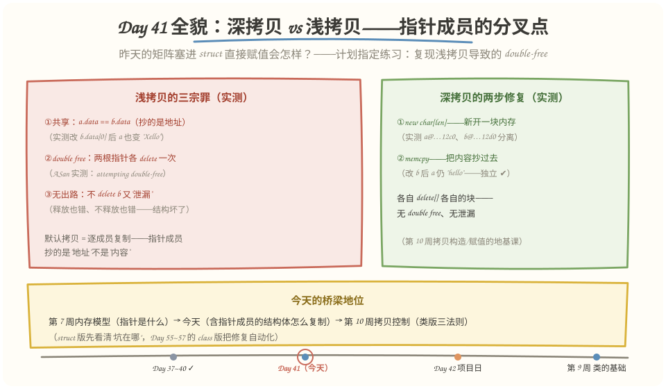
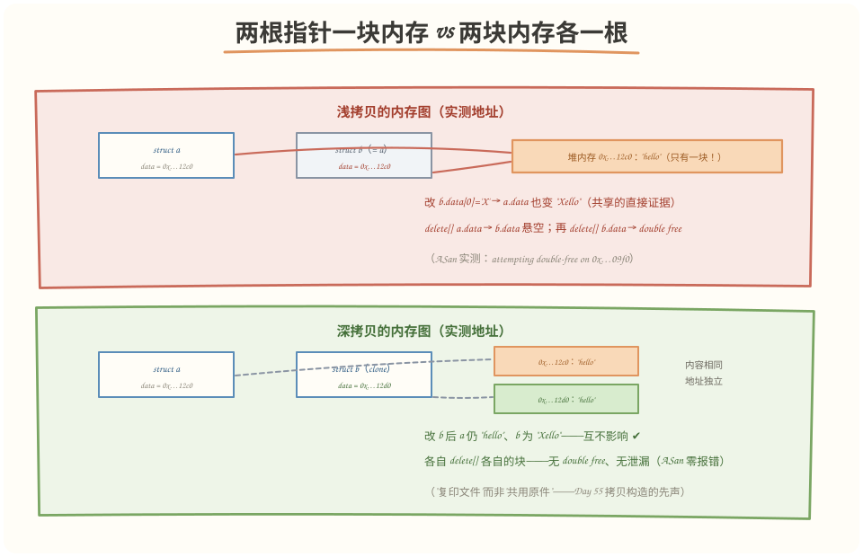
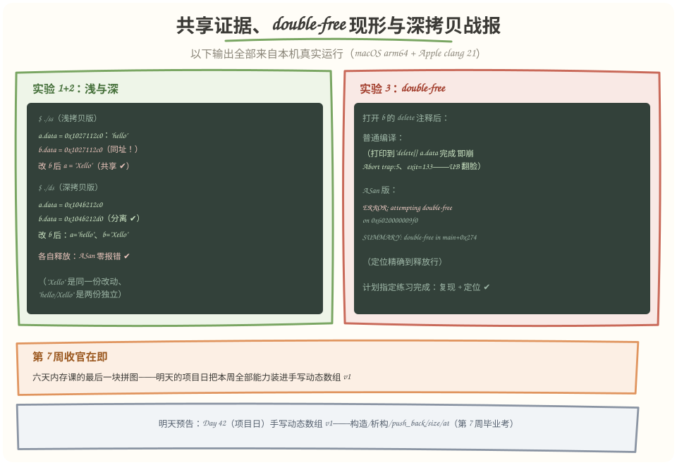

# 第 41 天：深拷贝 vs 浅拷贝——含指针成员的结构体的坑

> **今日目标**：完成本教程后，你能做到：复现浅拷贝的三宗罪（共享改动、double free、无出路）；用 ASan 让 double-free 现形（读懂报告定位）；手写深拷贝两步（new 新块 + memcpy 抄内容）并验证独立性；说出本课与第 10 周拷贝控制的桥梁关系。
> **预计时间**：学习 20 分钟＋实践 45 分钟
> **前置准备**：完成 Day 37~40（指针语义 + ASan 是今天的安全网；Day 40 结尾的伏笔今天回收）。
> **今日产出**：浅拷贝事故现场（共享证据 + double-free 现形）、深拷贝修复版（独立性 + ASan 零报错）。

## 1. 今天解决什么问题？

Day 40 结尾埋的问题：把 `int**` 矩阵塞进 struct 直接赋值会怎样？今天用最简的 `struct RawBuffer { char* data; int len; }` 回答——**默认拷贝是逐成员复制，指针成员抄的是地址**：两个 struct 从此共用一块堆内存。计划指定的练习"复现浅拷贝导致的 double-free"分三步走：先看共享（改 b 也改 a）、再引爆炸弹（两次 delete）、最后两步修复（new + memcpy）。

本课是**桥梁**：第 7 周的指针知识在这里交汇，第 10 周的拷贝控制（Day 55~57 的三法则）从这里出发——struct 版先看清坑，class 版把修复自动化。

## 2. 先看全貌：今天的内容位于哪里？



**图 1**：左卡红是浅拷贝三宗罪（共享/double free/无出路——释放也错不释放也错）；右卡绿是深拷贝两步修复；下方黄卡标出今天的桥梁地位。

三步概括今天：

1. 默认拷贝逐成员复制——指针抄地址 → 两根指针一块内存；
2. 三宗罪：改 b 动 a、两 delete 即 double free、不 delete 又泄漏；
3. 深拷贝两步：new 新块 + memcpy 抄内容——内容相同地址独立。

## 3. 核心概念：先用直觉，再给准确定义

### 3.1 浅拷贝：抄了地址没抄家

- **一句通俗解释**：`b = a` 把 a 的每个成员抄给 b——指针成员抄的是**地址值**，b 的指针从此指向 a 的那块内存。
- **一个类比**：合租房只配了一把钥匙——房东把**钥匙的备份标签**给了室友（抄地址），两人开的是同一扇门（同一块内存）； roommate 换了锁（改数据）你也进不去原来的家。
- **对应到技术上是**：实测——`RawBuffer b = a;` 后 `a.data == b.data`（都是 0x1027112c0）；改 `b.data[0]='X'` 后 `a.data` 变 "Xello"（**共享的直接证据**）。类比的边界：逐成员复制对**值成员**（int len）完全正确——坑只在指针成员；全值成员的 struct（如 Day 29 前的 Contact）默认拷贝毫无问题。
- **常见误解**："=` 会自动深拷贝"——不会；默认逐成员复制从不看指针指向什么。

### 3.2 double free：一颗内存两颗雷

- **一句通俗解释**：两根指针指向同一块内存，各自 delete 一次——第二次释放就是 double free（UB，通常崩）。
- **一个类比**：两张同号钞票——第一个人花掉了（第一次 delete），第二个人再花（第二次 delete）银行系统直接报警。
- **对应到技术上是**：实测——打开 b 的 delete 注释后：普通版**静默跑完**（exit=0——UB 又骗了一次）；ASan 版立刻报 `attempting double-free on 0x6020000009f0` + `SUMMARY: double-free in main+0x274`（定位到释放行）。**第三宗罪更隐蔽**：不 delete b 也不对（那块内存 a 已经还了、b 的"所有权"说不清——**浅拷贝在语义上就没有正确出路**）。类比的边界：malloc 家族的分配器对 double free 的反应依实现而异——崩溃、静默、堆损坏都可能；唯一确定的是**不许**。
- **常见误解**："小心点只 delete 一次就行"——那另一个 struct 的指针就悬空了（用它就 UB）——结构性问题没有纪律解。

### 3.3 深拷贝：复印而非共用

- **一句通俗解释**：拷贝时**另开一块内存、把内容抄过去**——两个 struct 各有一份独立数据。
- **一个类比**：复印文件——复印件和原件内容一样但物理独立；各自涂改互不影响、各自销毁各自的安全。
- **对应到技术上是**：实测——`clone()` 两步（`new char[len]` + `memcpy`）后 `a.data@0x104b212c0`、`b.data@0x104b212d0` **分离**；改 b 后 a 仍 "hello"、b 为 "Xello"；各自 destroy 各自的块——**无 double free、无泄漏**（ASan 零报错）。类比的边界：今天的 clone 是**手动调用**的函数（struct 没有构造函数的自动钩子）——把它变成 `b = a` 时自动触发的**拷贝构造函数**是第 10 周（Day 55）的正课；今天先理解"为什么要这么拷"。
- **与昨天的连接**：Day 40 的折叠布局一维数组同样适用——任何含指针成员的结构都面临今天的选择题。

## 4. 图解核心机制



**图 2**：上半部分红卡是浅拷贝内存图——两个 struct 的 data 都指 0x…12c0 一块（两根线一根蚂蚱）+ 三宗罪的箭头标注；下半部分绿卡是深拷贝——0x…12c0 和 0x…12d0 两块内容相同地址独立。

按图逐步讲：

1. **先看红卡的两根箭头**：都落在同一块内存上——"共享"不是比喻是物理事实；改任何一个字节两边都看得见；
2. **顺着 delete 的箭头走**：第一次 delete 后那块内存进隔离区——b 的箭头指向"已释放"；第二次 delete 就是 double free（ASan 现形）；
3. **看绿卡的两块内存**：内容一样（"hello"/"hello"）、地址不同——箭头各归各；destroy 各炸各的雷（其实没雷）；
4. **桥梁定位**：struct 版的 clone 是手动挡——第 10 周的拷贝构造是自动挡（`= a` 时自动触发）；坑和修法一模一样，只是挂挡方式不同。

## 5. 动手实践：完成一个最小可运行例子

### 5.1 准备文件

```bash
cd ai-compiler-roadmap/tutorials/day-041/examples
```

两个程序：`shallow_struct.cpp`（事故现场）、`deep_struct.cpp`（修复版）。

### 5.2 编写代码

事故现场的核心（完整代码见本目录）：

```cpp
struct RawBuffer {
    char* data;
    int len;
};

RawBuffer a;
a.len = 6;
a.data = new char[a.len]{};
memcpy(a.data, "hello", 6);

RawBuffer b = a;                     // 默认拷贝（浅）：指针抄的是地址！
std::cout << (a.data == b.data);     // 实测：1（相同——两根指针一块内存）
b.data[0] = 'X';                     // a 也变 "Xello"（共享证据）
delete[] a.data;                     // b.data 从此悬空
// delete[] b.data;                  // ✘ 再释放 = double free
```

### 5.3 运行与观察

```bash
g++ -Wall shallow_struct.cpp -o ss && ./ss
```

实际执行结果（本机）：

```text
== 构造源对象 ==
  a.data = 0x1027112c0："hello"

== 默认拷贝（浅拷贝现场） ==
  b.data = 0x1027112c0
  a.data 和 b.data 相同——两根指针一块内存！

== 改 b 看 a（共享的证据） ==
  改 b.data[0]='X' 后：a.data = "Xello"（a 也变了！）

== 析构的连环雷 ==
  delete[] a.data 完成——b.data 现在指向已释放内存
  （b 的 delete 被注释掉——否则 double free；但这本身又泄漏了语义）
  这就是'坑'：释放也错、不释放也错——浅拷贝没有出路
```

```bash
g++ -Wall deep_struct.cpp -o ds && ./ds
```

```text
== 深拷贝版 ==
  a.data = 0x104b212c0："hello"
  b.data = 0x104b212d0
  两块内存不同——各自独立 ✔

== 独立性验证 ==
  改 b 后：a = "hello"，b = "Xello"（互不影响）

== 各自安全释放 ==
  a、b 都已释放（ASan 版零报错）——深拷贝的出路
```



**图 3**：左上浅/深两版对照输出（"Xello" 共享 vs "hello/Xello" 独立）；右上是 double-free 的 ASan 现形（含普通版静默的对照）；下方橙卡预告项目日。

### 5.4 修改一行再观察：引爆炸弹

把 `shallow_struct.cpp` 里 `// delete[] b.data;` 的注释放开——普通编译重跑：**静默跑完**（exit=0——UB 又一次欺骗）；ASan 版重跑：

```text
ERROR: AddressSanitizer: attempting double-free on 0x6020000009f0 in thread T0:
SUMMARY: AddressSanitizer: double-free (df:arm64+0x100000b04) in main+0x274
```

报告三要素（哪块内存 0x…09f0、什么操作 double-free、哪行 main+0x274）——计划指定练习"复现 + 定位"完成。**对照**：deep 版同样放开两个 destroy——各自释放各自的块，ASan 零报错。**一炸一稳**：浅深之差的终极证据。

## 6. 常见错误与排查

**错误 1：ASan 报 attempting double-free**

- 现象：释放阶段崩溃并打印报告；
- 原因：两根指针同一块内存、各 delete 一次（浅拷贝的经典雷）；
- 定位：报告的地址找两处 delete——地址相同即共享；
- 修复：拷贝时深拷贝（new + memcpy）；或干脆禁止拷贝（Day 58 的 =delete 思路）。

**错误 2：拷贝后改一个另一个也变**

- 现象：b 改了 a 莫名其妙跟着变；
- 原因：浅拷贝共享——抄了地址没抄家；
- 定位：打印两个指针的值（== 比较）——相同即共享；
- 修复：深拷贝；或改用值语义成员（char 数组换 std::string——自带深拷贝）。

**错误 3：想深拷贝但 memcpy 抄了指针本身**

- 现象：`memcpy(&b, &a, sizeof(RawBuffer))`——还是共享（struct 逐字节拷贝，指针还是地址）；
- 原因：memcpy 在 struct 层面 = 默认拷贝的翻版；
- 定位：同错误 2 的指针比较；
- 修复：深拷贝要落在**指针指向的内容**上（new 新块 + memcpy data）。

## 7. 今日练习

### 必做练习

把 Day 40 的 `int**` 矩阵包进 `struct Matrix { int** data; int rows, cols; }`，实测 `Matrix b = a;` 的浅拷贝（打印 data 指针相同），然后写 `deep_copy(const Matrix&)`（新指针数组 + 逐行 new+memcpy）验证分离。预期产出：共享/分离两组指针地址对照。

### 选做挑战

设计"第三种方案"：禁止拷贝——给 struct 加个 `bool owner` 标记（a 是 owner、b 是"观察者"只读不释放）——实测能避免 double free 但语义笨重（谁都能声称 owner）。把三种方案（浅/深/禁）的取舍写进 notes.md——这是 Day 57~58 三法则和 =delete 的思想预演。

## 8. 今日验收

- [ ] 我复现了浅拷贝三宗罪：共享（改 b 动 a）、double free（ASan 现形）、无出路
- [ ] 我的深拷贝两步修复通过：地址分离 + 独立改动 + 各自释放零报错
- [ ] 我能画出浅/深两种内存图（两根线一块 vs 两块各一根）
- [ ] 我知道坑只在指针成员——全值成员的 struct 默认拷贝没问题
- [ ] 我能说出本课与第 10 周的桥梁关系（手动挡 clone → 自动挡拷贝构造）

## 9. 一句话总结与明天预告

今天的问题是"含指针成员的结构体怎么复制才安全"；机制上，默认拷贝逐成员复制（指针抄地址）导致共享与 double free，深拷贝 new+memcpy 让内容相同地址独立；实践上，共享证据、炸弹引爆、修复对照三组实验全部实测；验证标准是看到任何含指针的 struct 拷贝能画出两根箭头落在哪里。明天 **Day 42（项目日）：手写动态数组 v1**——构造/析构/push_back/size/at：第 7 周六天所学的毕业考，今天的深拷贝意识将是项目验收的隐藏关卡。
