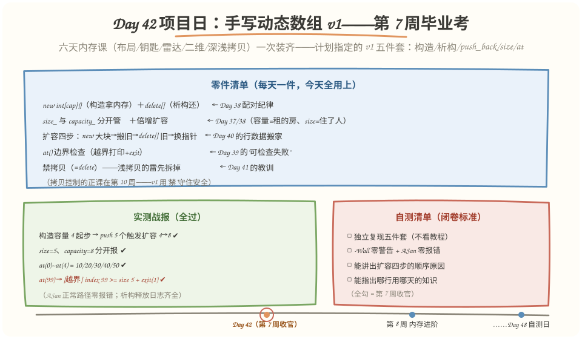
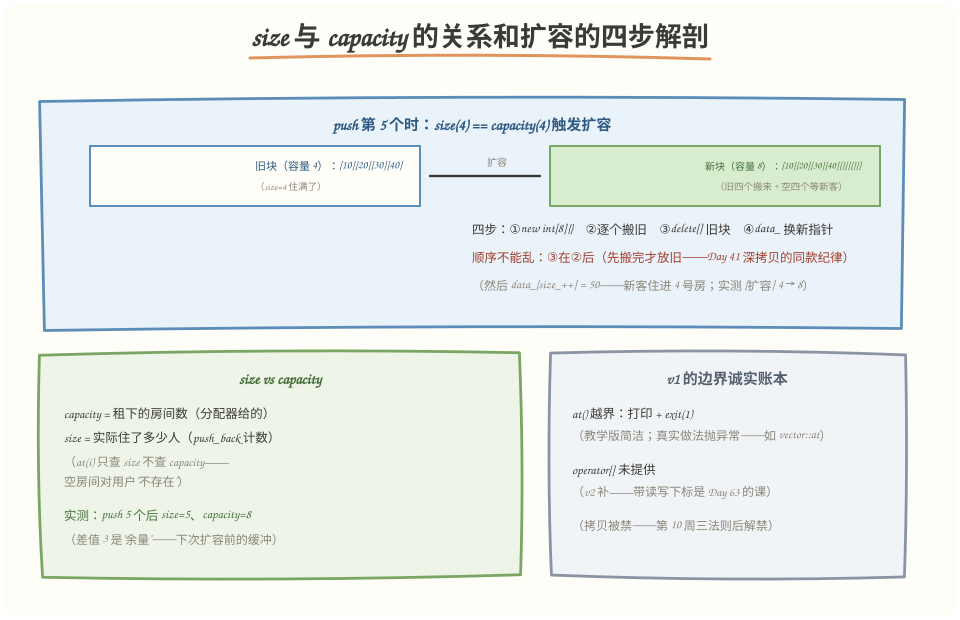
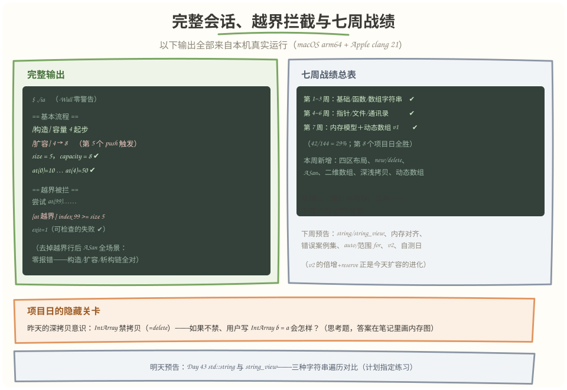

# 第 42 天（项目日）：手写动态数组 v1——第 7 周毕业考

> **今日目标**：完成本教程后，你能做到：闭卷实现 IntArray 五件套（构造/析构/push_back/size/at）；讲出扩容四步的顺序原因（③ 在 ② 后——Day 41 同款纪律）；实测 size/capacity 分开报、越界被 at 拦截（可检查的失败）；对着零件清单逐行指认每天的知识。
> **预计时间**：闭卷实现 60 分钟＋对照核对 30 分钟
> **前置准备**：完成 Day 37~41；合上教程，只留空编辑器——第 7 周的答卷。
> **今日产出**：约 70 行、`-Wall` 零警告的 IntArray，完整会话 + 越界拦截 + ASan 正常路径零报错。

## 1. 今天解决什么问题？

计划第 7 周指定的项目日验收：**手写动态数组 v1——构造/析构/push_back/size/at**。六天零件全部上阵：四区布局（37）、配对纪律（38）、ASan 雷达（39）、二维与搬家（40）、深浅拷贝的教训（41——今天以"禁拷贝"的形式落地，三法则正课在第 10 周）。

两个设计点值得先说：**size 与 capacity 分开管**（租的房间数 vs 住了多少人——push 时 size==capacity 才扩容）；**倍增扩容**（4→8→16……不是精确加一——今天先用，第 47 天的 v2 讲透为什么倍增摊薄成本）。

## 2. 先看全貌：今天的内容位于哪里？



**图 1**：上方蓝卡是零件清单（五件各标注出处天数）；左下绿卡是实测战报；右下红卡是闭卷自测。路线图：**第 7 周今天收官（42/144 = 29%）**。

三步概括今天：

1. 五件套：构造拿内存、析构还、push_back 计数+扩容、size 只读报数、at 带边界检查；
2. 扩容四步：new 大块 → 搬旧 → delete[] 旧 → 换指针（顺序不能乱）；
3. 禁拷贝守住 Day 41 的雷（=delete——第 10 周解禁）。

## 3. 核心概念：先用直觉，再给准确定义

### 3.1 五件套的分工

- **一句通俗解释**：动态数组 = 一块会换大的房子 + 两个计数器（capacity 租的房间、size 住了人）+ 一扇带门禁的门（at）。
- **一个类比**：成长型仓库——开业先租 4 间（构造）；货满（size==capacity）就搬去双倍大的新仓（扩容）；关店退租（析构）；提货要报货位号、超范围拒绝（at）。
- **对应到技术上是**：实测——构造"容量 4 起步"、push 第 5 个触发 `[扩容] 4 → 8`、`size = 5，capacity = 8` 分开报、`at(0)~at(4)` 全对、`at(99)` 打印 `[at 越界] index 99 >= size 5` 后 exit(1)。类比的边界：at 的 exit(1) 是教学版（简洁但不优雅）；真实库抛异常（如 std::vector::at）——但"可检查的失败"原则不变。
- **常见误解**："push_back 就是 data_[size++]"——只对没满的情况；满时先扩容（四步）再写。

### 3.2 扩容四步与顺序

- **一句通俗解释**：搬家四步——租新房（new）、搬家具（循环拷）、退旧房（delete[] 旧）、改地址（data_ = bigger）。
- **一个类比**：公司搬迁——先租好新办公室、打包搬运、退掉旧办公室、最后更新公司地址牌；**先退旧再搬**会把家具扔在已退租的楼里。
- **对应到技术上是**：实测 `[扩容] 4 → 8` 在第 5 个 push 时打出；四步中 **③delete[] 必须在 ②搬运后**——顺序反了就悬空（Day 40 拆序、Day 41 深拷贝的同款纪律第三次出现：**先建后拆**）。倍增（×2）而非加一：今天先用着——第 47 天的 v2 会算账（N 次 push 的总搬运成本从 O(N²) 降到 O(N)）。类比的边界：搬运用循环逐个拷（int 够用）；类型复杂时用移动（第 19 周预告）。
- **常见误解**："扩容后旧指针还能用"——不能；data_ 已指向新块，旧块已还（再碰就是悬空）。

### 3.3 禁拷贝：v1 的安全边界

- **一句通俗解释**：v1 不写拷贝控制——那 `IntArray b = a` 的浅拷贝就是 Day 41 的雷（共享 + double free）；今天直接 `=delete` 禁掉。
- **一个类比**：还没学游泳先别下深水区——围栏（=delete）先围上，等第 10 周学会了（三法则）再开放。
- **对应到技术上是**：`IntArray(const IntArray&) = delete;`——用户写 `b = a` 直接编译错（错误信息指向 deleted function）；这比"能编译但运行爆炸"安全得多。类比的边界：**禁**是权宜；第 10 周写全拷贝构造/赋值后，IntArray 会支持正确的值语义——v2（Day 47）和 MyString（Day 60/66）是后续版本。
- **常见误解**："=delete 了就不能用"——五件套全部可用；禁的只是复制（传引用照常）。

## 4. 图解核心机制



**图 2**：上半部分蓝卡是扩容图——旧块 4 格住满 → 新块 8 格（旧四搬来 + 空四等新客）+ 四步顺序标注；左下绿卡是 size vs capacity 的关系（at 只查 size——空房对用户不存在）；右下灰卡是 v1 的边界诚实账本。

按图逐步讲：

1. **看两块内存的接力**：旧块的四个值出现在新块前四格——搬运是**内容拷贝**不是指针改向（Day 41 深拷贝同款）；
2. **数四步的依赖**：③ 依赖 ② 完成（搬完才退）、④ 依赖 ③（旧块已还才能换地址不漏）——画成箭头就清楚为什么顺序锁死；
3. **记 size/capacity 的用途分工**：扩容看 capacity、越界查 size——两个计数器各司其职（vector 的公开接口也这么分：size()/capacity()）；
4. **零件清单核销**：对着图 1 的五行逐一指认——每一行都是本周某天的主角，今天在同一个类里会师。

## 5. 动手实践：完成一个最小可运行例子

### 5.1 准备文件

```bash
cd ai-compiler-roadmap/tutorials/day-042/examples
```

主角：`int_array_v1.cpp`（约 70 行完整版）。

### 5.2 编写代码

核心骨架（完整代码见本目录）：

```cpp
class IntArray {
private:
    int* data_;
    std::size_t size_;
    std::size_t capacity_;
    static constexpr std::size_t kInitCap = 4;

public:
    IntArray() : data_(new int[kInitCap]{}), size_(0), capacity_(kInitCap) {}

    ~IntArray() { delete[] data_; }

    IntArray(const IntArray&) = delete;            // Day 41 的教训：先禁拷贝
    IntArray& operator=(const IntArray&) = delete;

    void push_back(int v) {
        if (size_ == capacity_) {                   // 满了：扩容四步
            std::size_t new_cap = capacity_ * 2;
            int* bigger = new int[new_cap]{};
            for (std::size_t i = 0; i < size_; ++i) { bigger[i] = data_[i]; }
            delete[] data_;                         // ③ 在 ② 后（先搬完才放旧）
            data_ = bigger;
            capacity_ = new_cap;
        }
        data_[size_++] = v;
    }

    int& at(std::size_t i) {                        // 带边界检查
        if (i >= size_) { std::cout << "  [at 越界] index " << i << " >= size " << size_ << std::endl; std::exit(1); }
        return data_[i];
    }
    std::size_t size() const { return size_; }
    std::size_t capacity() const { return capacity_; }
};
```

### 5.3 运行与观察

```bash
g++ -Wall int_array_v1.cpp -o ia && ./ia; echo "exit=$?"
```

实际执行结果（本机）：

```text
== 基本流程 ==
  [构造] 容量 4 起步
  [扩容] 4 → 8
  size = 5，capacity = 8
  at(0) = 10
  at(1) = 20
  at(2) = 30
  at(3) = 40
  at(4) = 50

== 越界被拦 ==
  尝试 at(99)……
  [at 越界] index 99 >= size 5
exit=1
```

```bash
# 去掉越界行后 ASan 全场景验证：
grep -v "arr.at(99);" int_array_v1.cpp > ia_noob.cpp
g++ -Wall -fsanitize=address ia_noob.cpp -o ia_noob && ./ia_noob
```

```text
（ASan 零报错——构造/扩容/析构链全部正确）
```



**图 3**：左上完整输出（扩容/分开报数/越界拦截三处标注）；右侧是七周战绩和下周预告；下方橙卡是隐藏关卡思考题。

### 5.4 修改一个输入再观察：拷贝禁令亲测

在 main 里加 `IntArray b = a;`（预期编译失败）——本机实测报 `call to deleted constructor of 'IntArray'`（Day 58 的同款拦截）。**对照思考**（隐藏关卡）：如果把这行 `= delete` 删掉——编译过了但 `b = a` 后两个数组共享 data_（Day 41 现场重演：改 b 动 a、析构 double free）。把这两态的内存图画进 notes.md——**禁与不禁的差别就是"编译错"和"运行雷"**，第 10 周三法则的正课会给出第三条路（正确的深拷贝）。

## 6. 常见错误与排查

**错误 1：扩容后旧数据丢失**

- 现象：扩容后读到的全是 0/垃圾；
- 原因：四步顺序错——先 delete[] 旧再搬（读已释放）；或忘了搬运循环；
- 定位：在四步各打一行日志（今天的 [扩容] 就是起点）；
- 修复：严格 ①new ②搬 ③delete ④换指针。

**错误 2：`call to deleted constructor` 编译错误**

- 现象：写了 `IntArray b = a;`；
- 原因：v1 禁拷贝（设计如此）；
- 定位：看类声明的 = delete 行；
- 修复：不拷贝（传引用）；或等第 10 周实现拷贝构造。

**错误 3：at 能读出 size~capacity 之间的"空房"**

- 现象：at(6) 没报越界（capacity=8 时）；
- 原因：边界检查写成 `i >= capacity_`；
- 定位：看 at 的比较对象；
- 修复：`i >= size_`——空房对用户"不存在"（语义边界是 size）。

## 7. 今日练习

### 必做练习

加 `pop_back()`（size_ 减一，注意 size_==0 时不许减）和 `front()`/`back()`（首尾元素，带边界检查）。验证：push 3 个后 pop 1 个 size=2；pop 到 0 再 pop 被拦。预期产出：完整会话 + 边界行为记录。

### 选做挑战

"扩容账本"实验：从空数组 push 100 个，打印每次扩容（4→8→16→32→64→128，共 5 次）；再改成"精确加一"策略（每次 +1）数扩容次数（96 次）。把两种策略的总搬运元素数算出来（倍增 4+8+…+64=124 vs 精确加一 4+5+…+99=4944）——第 47 天 v2 课程的预习材料。

## 8. 今日验收

- [ ] 我闭卷实现了五件套（-Wall 零警告）
- [ ] 我的输出与 5.3 逐行对上（扩容时机、分开报数、越界拦截）
- [ ] ASan 正常路径零报错（构造/扩容/析构链全对）
- [ ] 我能讲出扩容四步的顺序原因（③ 在 ② 后——先搬完才放旧）
- [ ] 我实测了拷贝禁令（编译错）并知道不禁的后果（Day 41 现场重演）

## 9. 一句话总结与明天预告

今天的问题是"六天的内存知识能不能装成一个能用的动态数组"；机制上，五件套分工（拿/还/长/数/查）、扩容四步先建后拆、禁拷贝守住浅拷贝的雷；实践上，完整会话、越界拦截、ASan 验证全部落地；验证标准是闭卷写出且每行能指认出处。**第 7 周收官——42/144 天（29%），第 5 个项目日全胜。** 明天进入 **第 8 周 · Day 43：std::string 与 std::string_view**——三种字符串遍历对比（计划指定练习）：C 字符串/数组/string 三代同堂。
