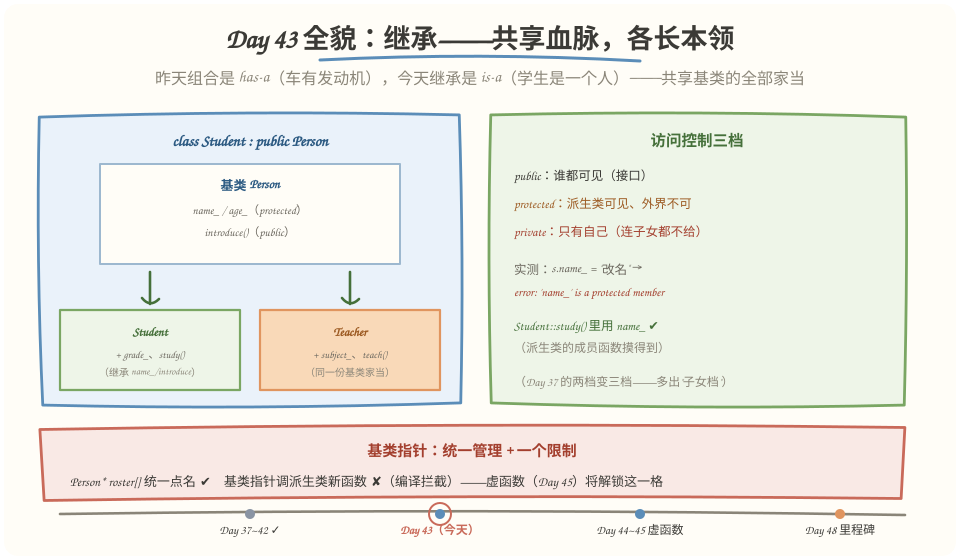
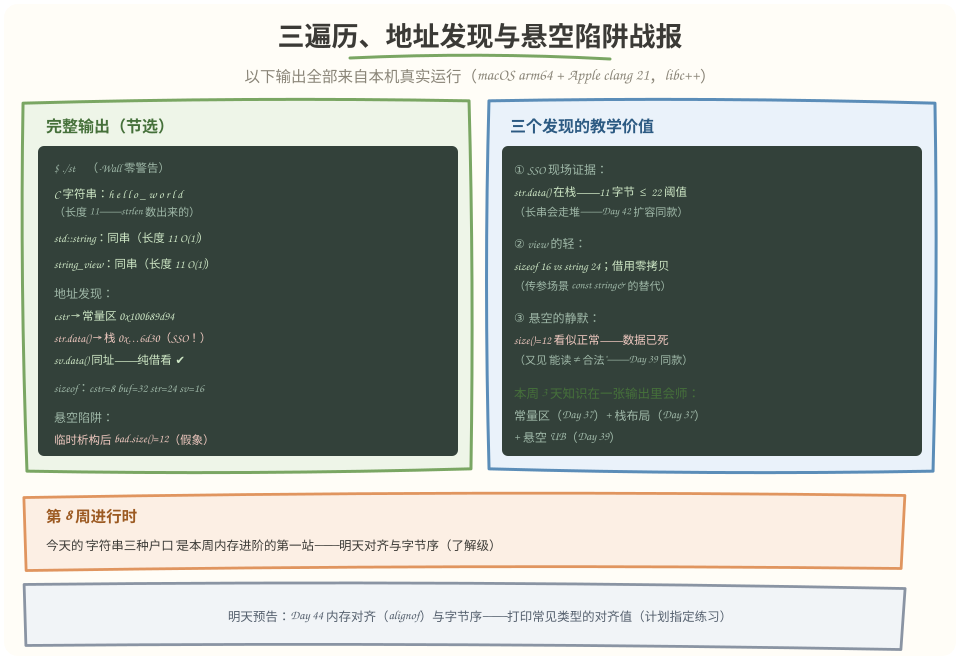

# 第 43 天：std::string 与 std::string_view——三种字符串遍历对比

> **今日目标**：完成本教程后，你能做到：用三种方式遍历同一字符串并说出长度获取的代价差（strlen O(n) vs size() O(1)）；解释 SSO（短字符串内联——实测地址证据）；说出 string_view 的结构和悬空规则（寿命不超过被借者）；完成 C 字符串与 string 的双向互转。
> **预计时间**：学习 20 分钟＋实践 45 分钟
> **前置准备**：完成 Day 37~42（常量区/栈布局是今天地址实验的底子；Day 39 的悬空概念复发）。
> **今日产出**：三种遍历对比、地址大发现（SSO 现场）、悬空陷阱实测、互转三条通道。

## 1. 今天解决什么问题？

六周来我们混用过三种"字符串"：C 字符串（`const char*`，第 1 周起）、`std::string`（通讯录项目起）、还有第 4 周提过一嘴的 `char[]`。计划今天正式对比——**三种遍历 + 内部表示 + 互转**。C++17 的第四位成员 `std::string_view` 今天加入：只借看不管事的"观察窗"。

一个实测惊喜值得先说：`str.data()` 打出来的是**栈地址**（0x16f276d30，不是堆！）——这不是 bug，是 **SSO**（短字符串优化）：libc++ 的 string 对 ≤22 字节的短串**内联存储**（省一次堆分配）。第 1 周的"字面量在常量区"、Day 37 的楼层图、今天的 SSO——三块知识在一张输出里会师。

## 2. 先看全貌：今天的内容位于哪里？



**图 1**：左卡是三代的户口与长度代价；右卡绿是实测地址大发现（含 SSO）；下方红卡是 string_view 的悬空陷阱。

三步概括今天：

1. C 串靠 '\0' 与 strlen（O(n)）；string/view 自带 size（O(1)）；
2. SSO：短串内联在 string 对象里（不进堆）；长串走堆 + 扩容；
3. view = 指针+长度 的借看——悬空规则：寿命不超过被借者。

## 3. 核心概念：先用直觉，再给准确定义

### 3.1 三代字符串的户口

- **一句通俗解释**：C 字符串是"裸奔的字符数组"（'\0' 结尾、长度要数）；std::string 是"带物业的公寓"（自带长度、可增长）；string_view 是"隔窗观望"（只借看不管事）。
- **一个类比**：三种读信方式——放大镜逐字找结尾（C 串 strlen）、信封上写着页数（string 的 size）、别人举着信你看一眼（view 借看）。
- **对应到技术上是**：实测遍历输出三者相同（`h e l l o   w o r l d`，长度 11）；差别在长度获取——`strlen` 走一遍 vs `str.size()`/`sv.size()` 直接读成员。sizeof 对比：cstr=8（纯指针）、stack_buf=32（数组本体）、str=24（libc++ 的 string）、sv=16（指针+长度）。类比的边界：`strlen` 的 O(n) 在短串无感、**长串高频调用**才是坑（如循环条件里写 `i < strlen(s)`——每次都数一遍）；string 的 size 是存的不是数的。
- **常见误解**："`sizeof(str)` 是字符串长度"——不；sizeof 是对象大小（24）；长度要 `.size()`（第 4 周埋过的坑今天正式回收）。

### 3.2 SSO：短串内联的礼物

- **一句通俗解释**：string 对短内容（libc++ ≤22 字节）**不分配堆**——字符直接存在 string 对象内部的缓冲区里。
- **一个类比**：随身笔记本——短便签直接写在本子上（内联）；长文章才需要外接文件夹（堆）。
- **对应到技术上是**：实测——`"hello world"`（11 字节）的 `str.data() = 0x16f276d30`（**栈**！与 stack_buf 同段）；而 cstr 在常量区 0x100b89d94。**SSO 的收益**：短串零堆分配（构造/拷贝都便宜）——高频小字符串场景（名字、键）的大优化；**代价**：string 对象固定 24 字节（比裸指针胖）。类比的边界：SSO 阈值依标准库而异（libc++ 22、libstdc++ 15）——**代码不能依赖具体阈值**，只知道"短串可能内联"即可。
- **常见误解**："string 一定在堆上"——短串内联（今天的地址证据）；长串才走堆+扩容（Day 42 的思路）。

### 3.3 string_view：借看与悬空

- **一句通俗解释**：string_view 只有两个成员（数据指针+长度）——不拥有数据、不能修改、不管生死；**借看**是本质也是险。
- **一个类比**：望远镜——能看到远处（数据在哪就望哪），但楼拆了（对象析构）镜筒里就是废墟；望远镜自己不盖楼也不拆楼。
- **对应到技术上是**：实测——`sv.data() == str.data()`（同址 0x…6d30，纯借看零拷贝）；**悬空陷阱**：借了块级作用域的临时 string，temp 析构后 `bad.size()` 返回 12（假象——数据已死，再读是 UB，Day 39 同款"能读≠合法"）。**主场是函数参数**：`void f(std::string_view s)` 能同时接收 string/C 串/字面量且零拷贝——比 `const string&` 更宽（后者收字面量要临时构造）。类比的边界：view 也能接长串的堆地址（它不关心数据在哪）；但不能从中造出"免费"的 string（反向要拷）。
- **常见误解**："view 是 string 的轻量替代"——它是**只读参数**的替代；需要持有/修改时仍要 string（管生死的还是 string）。

## 4. 图解核心机制


**图 2**：上半部分蓝卡是 string 的两副面孔——短串内联（实测栈地址）/长串三件套（指针+size+capacity 指向堆）；左下绿卡是 string_view 的解剖（16 字节 = 借谁+多长）和寿命规则；右下灰卡是互转三条通道。

按图逐步讲：

1. **看短串的内存图**：字符直接躺在 string 对象里——data() 给出对象内部地址（栈）；这解释了今天的"地址大发现"；
2. **看长串的接力**：对象存指针指向堆块——Day 42 的容量扩容逻辑在长串身上生效；
3. **数 view 的 16 字节**：8（指针）+ 8（长度）——比 string 的 24 还轻；没有 capacity（不管增长）没有所有权（不管生死）；
4. **互转通道过一遍**：c_str() 直通（零拷贝）、C 串造 string 要拷、view 借 string 零拷贝——**方向决定代价**（往"拥有"方向走要拷、往"观察"方向走免费）。

## 5. 动手实践：完成一个最小可运行例子

### 5.1 准备文件

```bash
cd ai-compiler-roadmap/tutorials/day-043/examples
```

主角：`string_trio.cpp`（三代同堂对比）。

### 5.2 编写代码

核心段（完整代码见本目录）：

```cpp
const char* cstr = "hello world";                    // 常量区 + '\0'
char stack_buf[32];
strcpy(stack_buf, cstr);                             // 拷进栈（可改版）
std::string str = "hello world";                     // 自带长度
std::string_view sv = str;                           // 借看

// 遍历对比：strlen（O(n)）vs size()（O(1)）
for (std::size_t i = 0; i < strlen(stack_buf); ++i) { … }   // C 串
for (std::size_t i = 0; i < str.size(); ++i) { … }          // string
for (std::size_t i = 0; i < sv.size(); ++i) { … }           // view

// 地址对比（SSO 发现的关键）：
std::cout << static_cast<const void*>(str.data());   // 栈！SSO
std::cout << (sv.data() == str.data());              // 同址——纯借看
```

### 5.3 运行与观察

```bash
g++ -std=c++17 -Wall string_trio.cpp -o st && ./st
```

实际执行结果（本机，节选）：

```text
== 遍历对比 ==
C 字符串（strlen 先数一遍再走）：
  h e l l o   w o r l d （长度 11）
std::string（size() 直接给）：
  h e l l o   w o r l d （长度 11）
string_view（也是 O(1) 取长度）：
  h e l l o   w o r l d （长度 11）

== 内部表示的差别 ==
  cstr        指向常量区 0x100b89d94
  stack_buf   栈数组     0x16f276d58
  str.data()  堆（或 SSO）0x16f276d30
  sv.data()   借自 str   0x16f276d30（同址——纯借看！）
  sizeof: cstr=8 stack_buf=32 str=24 sv=16

== C 字符串互转 ==
  str.c_str() → hello world，转回 string → hello world

== string_view 的悬空陷阱 ==
  临时 string 已析构，bad.size() = 12（数据已死——再读是 UB）
```

**实测注解**：`str.data() = 0x16f276d30` 是**栈地址**——"hello world"（11 字节 ≤ 22）命中 SSO 内联（代码里的"堆（或 SSO）"注释被实测裁决为 SSO）。



**图 3**：左上完整输出（SSO 发现和悬空假象两处标注）；右侧是三个发现的教学价值；下方橙卡是本周路线。

### 5.4 修改一个输入再观察：长串打破 SSO

只把 `std::string str = "hello world";` 这一处的字面量换成一句 40+ 字节的长句（如 `"这是一个超过二十二字节的很长很长的中文字符串哦"`）——**不要改 `cstr` 那一处**：`stack_buf` 只有 32 字节，`strcpy` 装不下长句会栈溢出。重跑地址部分：`str.data()` 变成**与栈段明显不同的堆地址**（SSO 失效走堆）！`sv.data()` 仍然同址跟随。**一短一长**：SSO 的边界实测——短串内联省分配、长串走堆用扩容（Day 42 思路）。把两个地址记进 notes.md——"string 在哪"从此有答案：**看长度**。

## 6. 常见错误与排查

**错误 1：循环条件里写 `i < strlen(s)`（长串超时）**

- 现象：字符串一长循环奇慢；
- 原因：strlen 是 O(n) 且每次条件都重数一遍——O(n²) 总代价；
- 定位：看循环条件有没有函数调用；
- 修复：先存 `size_t len = strlen(s);`（或直接用 string/view 的 size()）。

**错误 2：string_view 悬空（读出垃圾或崩）**

- 现象：view 的内容随机变/崩；
- 原因：被借的 string 已析构（块级作用域/临时对象）；
- 定位：追 view 的来源对象的生命期；
- 修复：view 只做**函数参数**（调用期间被借者必然存活）；需要持有就拷成 string。

**错误 3：`sizeof(str)` 当长度用**

- 现象：遍历只走了 24 个"元素"或越界；
- 原因：sizeof 是对象大小（24 字节）不是字符数；
- 定位：看用的是 sizeof 还是 size()；
- 修复：`.size()`（或 strlen——C 串场景）。

## 7. 今日练习

### 必做练习

把三种遍历各改成"倒序遍历"（从最后一个字符打到第一个）：C 串版要先 strlen 拿下标、string/view 版用 `size()-1` 下山。验证三者输出一致（`d l r o w   o l l e h`）。预期产出：三段倒序输出 + 一句代价对比。

### 选做挑战

写函数 `void print_all(std::string_view s)`——分别用 string、C 字符串、字面量三种实参调用它（都能编译、零拷贝）。再写一个接收 `const std::string&` 的版本试传字面量——对比哪个更宽（后者要临时构造 string）。把"view 是参数之王"的结论记进 notes.md。

## 8. 今日验收

- [ ] 我的三种遍历输出一致；能说出长度获取的代价差
- [ ] 我实测了 SSO：短串 data() 在栈、长串（5.4 实验）走堆
- [ ] 我能默写 string_view 的 16 字节结构和悬空规则
- [ ] 我的互转三通道通过（c_str 直通/C 串造 string 要拷/view 借用免费）
- [ ] 我知道 sizeof ≠ 长度（24 vs size()）

## 9. 一句话总结与明天预告

今天的问题是"三种字符串各住哪、怎么选"；机制上，C 串 '\0'+strlen、string 自管生死（短 SSO 内联/长串堆+扩容）、view 只借看（悬空规则）；实践上，三遍历对比、SSO 地址发现、悬空假象、互转通道全部实测；验证标准是看到任何字符串能说出它的户口和长度代价。明天 **Day 44：内存对齐（alignof）与字节序**——打印常见类型的对齐值（计划指定练习）：CPU 读内存的"铁轨宽度"。
