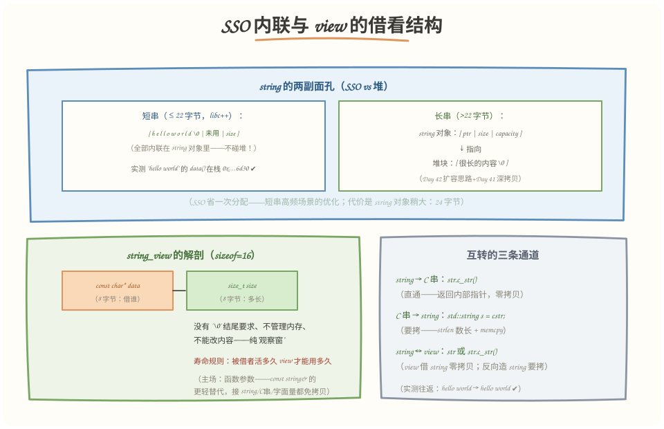

# 第 43 天：继承基础——共享血脉，各长本领

> **今日目标**：完成本教程后，你能做到：写出 `class Student : public Person` 并解释 is-a 关系；说出访问控制三档（public/protected/private）的可见范围差异；用基类指针数组统一管理派生类对象（并知道它的视野限制）；解释继承的构造链顺序（祖先先建后拆）。
> **预计时间**：学习 25 分钟＋实践 45 分钟
> **前置准备**：完成 Day 41~42（组合的 has-a 是今天的对照系；昨天项目日收官）。
> **今日产出**：Person → Student/Teacher 继承体系（计划指定练习）、基类指针统一管理、构造链实录、两条编译错误执法记录。

## 1. 今天解决什么问题？

昨天结尾立的分界牌今天正式开工：**继承（inheritance）解决"X 是一个 Y"的共享**。Student 是一个 Person、Teacher 也是一个 Person——姓名、年龄、自我介绍这些**共同家当**写在 Person（基类）里，两个派生类各自只加新本领。没有继承，这些家当要在两个类里抄两遍；有了继承，改一处、两家同步。

两个新配角：`protected`（访问控制从两档变三档——子女档）；基类指针（统一管理的威力 + 一个视野限制——为 Day 45 的虚函数埋钩子）。

## 2. 先看全貌：今天的内容位于哪里？


**图 1**：左卡是继承树——Person 基类（protected 的 name_/age_ + public 的 introduce()）分出 Student 和 Teacher 两个派生类（各加新成员）；右卡是访问控制三档（public 谁都可见 / protected 子女可见 / private 只给自己）——实测报错原文佐证；下方红卡是基类指针的能与不能。

三步概括今天：

1. `class Student : public Person`——继承基类全部家当，再加新的；
2. protected：派生类成员函数摸得到、外界仍看不见；
3. 基类指针：统一管理派生类对象 ✔，但只认基类接口（新函数看不见）。

## 3. 核心概念：先用直觉，再给准确定义

### 3.1 is-a：血脉共享

- **一句通俗解释**：继承让派生类**自动拥有**基类的全部成员——像子女继承家族的姓氏和家产，还能自己置办新产业。
- **一个类比**：家族企业——爷爷创的基业（Person 的 name_/introduce()）子孙自动有份；孙子（Student）另开线上业务（study()）、另一个孙辈（Teacher）拓展培训业务（teach()）——基业改了（introduce 加新格式），两房同步生效。
- **对应到技术上是**：本机实测——`s.introduce()` 直接可用（继承来的），`s.study()` 是 Student 新增的；Student 和 Teacher **共享同一份 Person 代码**。类比的边界：家产是"分"给子女的拷贝，而基类代码全程序只有一份——派生类对象里包含一个**基类子对象**（构造链实验的 `[Person 构造]` 就是它出生的脚印）。
- **与组合的对表**：Car **有** Engine（零件可换）；Student **是** Person（血脉不可换——你不能给一个人换祖先）。判断法：造句"X 是一个 Y"通顺就用继承，"X 有一个 Y"通顺就用组合；拿不准就用组合（Day 41 口诀）。
- **常见误解**："继承就是为了少写代码"——复用只是副产品；本质是建立**类型间的层次关系**（Day 45 多态的地基）。

### 3.2 protected：子女档

- **一句通俗解释**：访问控制从两档变三档——public 谁都可见、protected 只有派生类（和自己）可见、private 连派生类都看不见。
- **一个类比**：家族相册——公开照片（public）谁都能翻；家庭内部照片（protected）自家和子女能看；私人日记（private）只有本人。
- **对应到技术上是**：两处实测——Student::study() 里直接用 `name_` ✔（派生类成员函数摸得到 protected）；main 里 `s.name_ = "改名"` ✘（`error: 'name_' is a protected member of 'Person'`——外界仍不可见）。类比的边界：protected 的可见性是**编译期按类型判断**的——Student 的友元函数（进阶）也摸得到，但 Student 的**使用者**永远摸不到。
- **常见误解**："protected 就是安全的 private"——恰恰相反：protected 把内部结构暴露给了所有派生类，层级一深就失控；经验法则是**数据成员尽量 private**，protected 只用于精心设计的接口（Day 46 再深化）。

### 3.3 基类指针：统一管理 + 视野限制

- **一句通俗解释**：`Person*` 指针可以指向 Student 或 Teacher 对象（是 Person 的都能指），但**只认 Person 的接口**——派生类新增的函数它看不见。
- **一个类比**：人事系统按"员工"建档——工牌读卡器只认员工通用字段（姓名/工号）；想刷出"学生证号"这种特有字段，读卡器没这个程序。
- **对应到技术上是**：本机实测——`Person* roster[] = {&s1, &s2, &t}` 统一点名 3 行全对（introduce 是基类接口）；`roster[0]->study()` 编译错（`error: no member named 'study' in 'Person'`）。类比的边界：这不是缺陷而是**类型安全**——如果编译器放行，指向 Teacher 的指针调 study() 就是灾难；Day 45 的虚函数会在"基类也声明了该函数"的前提下解锁安全调用。
- **常见误解**："基类指针指向派生类会丢失数据"——对象完好无损（study 还在），丢的只是指针的**视野**。

## 4. 图解核心机制



**图 2**：上半部分是构造链实测——`[Person 构造] → [Student 构造]`（祖先先建），析构反向（后裔先拆）——和组合"零件先就位"是同一套栈规则；左下绿卡是基类指针的能与不能（统一管理 ✔ / 新函数看不见 ✘）；右下灰卡是组合与继承的对表（昨天的分界牌填上今天的内容）。

按图逐步讲：

1. **看构造链理解"基类子对象"**：Student 对象里包含一个完整的 Person 部分——它先出生（所以 Student 的构造函数体里能直接用 name_）；
2. **初始化列表传给祖先**：`Student(…) : Person(name, age), grade_(grade)`——基类没有默认构造时必须这样传（Day 38 红线的继承版）；
3. **指针的视野画个圈**：`Person*` 的圈里只有 Person 的成员——study/teach 在圈外；Day 45 的虚函数把同名函数请进圈内；
4. **判断法过三题**：图形是形状（is-a→继承）、车有引擎（has-a→组合）、账户有日志（has-a→组合）——口诀练到条件反射。

## 5. 动手实践：完成一个最小可运行例子

### 5.1 准备文件

```bash
cd ai-compiler-roadmap/tutorials/day-043/examples
```

三个程序：`inherit_basic.cpp`（主角）、`base_pointer.cpp`、`ctor_chain.cpp`。

### 5.2 编写代码

主角 `inherit_basic.cpp` 的继承骨架（完整代码见本目录）：

```cpp
class Person {
protected:                    // protected：派生类可见、外界仍不可见
    std::string name_;
    int age_;

public:
    Person(const std::string& name, int age) : name_(name), age_(age) {}

    void introduce() const {
        std::cout << "我是 " << name_ << "，" << age_ << " 岁。" << std::endl;
    }
};

class Student : public Person {           // Student 是一个 Person（is-a）
private:
    int grade_;

public:
    Student(const std::string& name, int age, int grade)
        : Person(name, age), grade_(grade) {}       // 基类部分由 Person 构造

    void study() const {
        std::cout << name_ << "（" << grade_ << " 年级）正在学习 C++" << std::endl;
    }
};
```

### 5.3 运行与观察

```bash
g++ -Wall inherit_basic.cpp -o ib && ./ib
```

实际执行结果（本机）：

```text
我是 小明，15 岁。
小明（9 年级）正在学习 C++
我是 王老师，38 岁。
王老师 老师（教 数学）正在上课
```

```bash
g++ -Wall base_pointer.cpp -o bp && ./bp
```

```text
统一点名（基类指针的威力）：
我是 小明
我是 小红
我是 王老师
各自工作（派生类自己的能力，指针直接调不到）：
  小明（9 年级）在学习
  王老师 老师在教 数学
```

```bash
g++ -Wall ctor_chain.cpp -o cc && ./cc
```

```text
声明 Student s（进入作用域）：
  [Person 构造] 小明
  [Student 构造] 小明 9 年级
  ……使用 s……
  [Student 析构] 小明
  [Person 析构] 小明
s 已销毁（离开作用域）
```


**图 3**：左上 is-a 初体验（继承 + 新增 + protected 执法）；右上基类指针点名（统一管理 + 视野限制的报错原文）；下方橙卡是构造链的进出（祖先先建后拆）；灰卡预告明天的虚函数。

### 5.4 修改一行再观察：两条执法线

**执法一（protected）**：把 `inherit_basic.cpp` 里注释的 `s.name_ = "改名"` 放开（预期编译失败，本机实测）：

```text
error: 'name_' is a protected member of 'Person'
```

**执法二（指针视野）**：把 `base_pointer.cpp` 里注释的 `roster[0]->study()` 放开（预期编译失败，本机实测）：

```text
error: no member named 'study' in 'Person'
```

两条错误分别守住两道门：保护档的门（外人不可见）和视野的门（基类指针不见新函数）。对照实验：把 `name_` 改成 public 后执法一消失（但破坏封装——不推荐）；给 Person 加一个空的 `study()` 后执法二消失（但所有 Person 都得有这个空函数——正是明天虚函数要优化的方向）。

## 6. 常见错误与排查

**错误 1：`error: 'xxx_' is a protected member of 'Person'`**

- 现象：外界（main 或其他类）直接访问 protected 成员；
- 原因：protected 只对派生类的**成员函数**开放；
- 定位：报错点名成员名和基类名；
- 修复：走 public 接口，或提供访问器函数。

**错误 2：`error: no member named 'study' in 'Person'`**

- 现象：基类指针调用派生类新增函数；
- 原因：指针的视野只有基类接口；
- 定位：看指针的声明类型（不是它指向什么）；
- 修复：今天先用派生类对象直接调（`s.study()`）；要经指针调需虚函数（Day 45）。

**错误 3：派生类构造忘了传基类参数**

- 现象：`error: constructor for 'Student' must explicitly initialize base class 'Person'`（或隐式调默认构造不存在）；
- 原因：基类子对象也要出生——没有默认构造时必须列表传参；
- 定位：报错指向派生类构造函数；
- 修复：初始化列表加 `Person(name, age)`。

## 7. 今日练习

### 必做练习（计划指定：Person → Student/Teacher）

给 Person 加 `void greet() const`（"你好，我是 XXX"），给 Student 加 `int grade() const`（返回年级）、Teacher 加 `subject() const`。验证：两派生类都能调 greet（继承）；roster 统一调 greet ✔；roster 调 grade() ✘（视野）。预期产出：一组 ✔/✘ 对照的预测与实测记录。

### 选做挑战

三层继承链：Person → Student → GraduateStudent（研究生，加 `thesis_` 论文题目）。观察构造链变成三段（Person → Student → GraduateStudent），析构反向三段——"祖先先建后拆"在三层里依然成立。再想：GraduateStudent 能摸到 Student 的 private 成员吗？（不能——private 连直接子女都不给；换成 protected 就能。）

## 8. 今日验收

- [ ] 我能写出 public 继承并用初始化列表传基类参数
- [ ] 我能说出访问控制三档的可见范围，并实测了 protected 的执法
- [ ] 我用基类指针数组统一管理了混合对象，也知道视野限制（实测报错）
- [ ] 我能解释构造链顺序（祖先先建、后裔先拆）和"基类子对象"
- [ ] 我能用"X 是/有一个 Y"造句判断继承还是组合

## 9. 一句话总结与明天预告

今天的问题是"共同的家当怎么共享"；机制上，public 继承让派生类自动拥有基类成员（is-a 血脉），protected 开出子女档，基类指针统一管理但视野受限；实践上，继承树、指针点名、构造链三组实验落地，两条执法线实测归档；验证标准是看到任何两个类的关系能说出 is-a 还是 has-a 并写出对应语法。明天 **Day 44~45：虚函数与动态多态**——今天被拦的那格（基类指针调派生类函数）即将解锁：Shape 基类的 `area()` 被圆和矩形各自覆盖，一个调用三种行为——面向对象的高光时刻。
