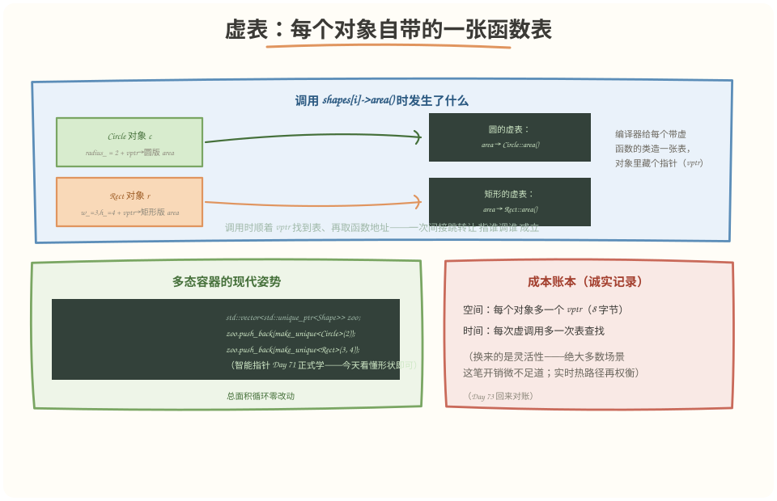

# 第 44 天：内存对齐与字节序——CPU 的轨道规则

> **今日目标**：完成本教程后，你能做到：用 alignof 打印常见类型的对齐值并说出规律（alignof(T)≈sizeof(T)、struct 取最大成员）；解释填充字节的来龙去脉（实测 Big 的成员偏移）；说出字节序是跨机话题（本机实测小端、单机无感）；破案 Day 37 的"地址差 8"悬案（那是 [0] 与 [2] 相差两个 int）。
> **预计时间**：学习 20 分钟＋实践 40 分钟
> **前置准备**：完成 Day 37~43（楼层图是底子；Day 37 栈数组差 8 的悬案今天破案）。
> **今日产出**：对齐值表（arm64 实测）、填充字节的地址证据、小端判定实验。

## 1. 今天解决什么问题？

两个底层话题今天一网打尽（计划标注对齐为练习、字节序为了解级）：**内存对齐**——CPU 按字长读内存，没对齐的数据要么慢要么崩，编译器插"填充字节"把它们推到对齐地址上（`alignof` 让填充可见）；**字节序**——同一个多字节整数在内存里的字节摆放顺序（本机小端），单机程序无感、跨机字节流才要管。

还有一个惊喜的**破案**：Day 37 实验里 `stack_arr` 的地址差 8——当时注了一句"相邻元素差 8（含对齐）"。真相：那次打印比较的是 `stack_arr[0]` 与 `stack_arr[2]`——差 8 恰好是两个 int；相邻元素其实差 4（int 数组内部没有填充，8 字节对齐的邻居也不会把布局撑开）。

## 2. 先看全貌：今天的内容位于哪里？


**图 1**：左卡是对齐值实测表；右卡绿是 Big 结构的填充图（实测偏移标注）；下方黄卡是字节序的定位。

三步概括今天：

1. alignof(T) 通常 = sizeof(T)；struct 的对齐 = 最大成员的对齐；
2. sizeof 比成员总和大——差在填充（对齐换速度的票价）；
3. 字节序：小端（本机）单机无感、跨机字节流要约定（网络序=大端）。

## 3. 核心概念：先用直觉，再给准确定义

### 3.1 对齐：CPU 的轨距

- **一句通俗解释**：CPU 按固定宽度（如 8 字节）一趟趟读内存——数据只有落在"站台"（宽度的倍数地址）上才能一次读走。
- **一个类比**：火车站台——车厢门只对准固定位置停靠（8 的倍数地址）；你的行李（数据）放在两节车厢的接缝处（未对齐），乘务员要开两次门拼给你（慢）或干脆拒绝（某些平台崩）。
- **对应到技术上是**：实测——char=1、short=2、int=4、long/double/void*=8（arm64）；struct 的 alignof 取**最大成员**（Big{char,double,int} 的 align=8）。编译器自动插填充把成员推到对齐地址——你写代码 99% 不用手管。类比的边界：**为什么会有 alignof**——跨机器二进制格式、共享内存、 SIMD 优化时需要显式控制（进阶）；日常知道"填充存在"即可（解释 sizeof 的"虚胖"）。
- **常见误解**："sizeof(结构) = 成员 sizeof 之和"——实测 Big 是 24 而 1+8+4=13——差 11 全是填充。

### 3.2 填充字节：看得见的证据

- **一句通俗解释**：成员之间的空隙（中间填充）和结构尾部的补齐（尾部填充）——都是编译器为对齐买的单。
- **一个类比**：书架摆书——一本薄书旁边留空给厚书对齐书架格（中间填充）；最后一层不满也空着（尾部填充，保证数组里下一个元素也对齐）。
- **对应到技术上是**：实测 Big 的成员偏移——`a` 在 0、`d` 在 **8**（中间 7 字节填充——double 要 8 对齐）、`i` 在 16、**尾部填 4 到 24**（让 Big 数组的每个元素都 8 对齐）。**Day 37 破案**：当时打印的其实是 `stack_arr[0]` 与 `stack_arr[2]`——差 8 正好两个 int；相邻元素恒差 4（int 数组内部没有填充，对齐的邻居也不会把它撑开）。类比的边界：成员**排序**影响填充总量（大成员靠前通常更省）——这是进阶优化，日常以可读性优先。
- **常见误解**："填充里是 0"——填充是未初始化的字节（读它是自找 UB）；它只是空间不是内容。

### 3.3 字节序：跨机的方言

- **一句通俗解释**：多字节整数在内存里的字节摆放顺序——小端（低位字节放低地址，本机实测）vs 大端（高位在低地址，网络序）。
- **一个类比**：日期写法——中国"年月日"（大端感受）、欧洲"日月年"——同一信息不同摆放；**本地交流无碍、跨国合同必须先约定**。
- **对应到技术上是**：实测——`0x01020304` 的内存字节（低→高）是 `04 03 02 01` → 小端；`memcpy` 拷 int 得 258→258（按字节拷不受序影响——单机无感的证据）。**必须管的场景**：网络传输（htons/htonl 的由来）、文件格式（第 23 周序列化读写数据时回来）、硬件协议。类比的边界：字节序是**多字节类型**的事——char 数组/字符串没有字节序问题（每字节独立）。
- **常见误解**："写 C++ 必须天天关心字节序"——单机程序完全无感（C++ 抽象掉了）；只有字节流跨机器时才浮出水面。

## 4. 图解核心机制



**图 2**：上半部分蓝卡是 CPU 轨距图——8 字节一趟车；对齐的 double 一次读走、未对齐的横跨两趟（慢/崩）；下半部分绿卡是字节序的两种摆法（小端 04 03 02 01 / 大端 01 02 03 04）。

按图逐步讲：

1. **看轨距图的双轨**：对齐版 double 完整落在一趟车里；未对齐版骑在接缝上——两次读+拼装的成本就是填充要买断的；
2. **对着 Big 的偏移走**：0→8 中间 7 字节、16 之后 4 字节——两张填充图都对应实测；
3. **两种字节摆法对照**：数值一样、摆放相反——同一台机器写读用同一套规则所以无感；
4. **三个认知落位**（图 3 右）：对齐是性能契约、填充是常见事实（sizeof 虚胖）、字节序是跨机话题（后续实战碰跨机字节流时再正式打交道）。

## 5. 动手实践：完成一个最小可运行例子

### 5.1 准备文件

```bash
cd ai-compiler-roadmap/tutorials/day-044/examples
```

两个程序：`align_probe.cpp`（对齐探测）、`endian_check.cpp`（字节序判定）。

### 5.2 编写代码

关键段（完整代码见本目录）：

```cpp
struct Big { char a; double d; int i; };   // 1 + 填7 + 8 + 4 + 填4

std::cout << alignof(Big) << " " << sizeof(Big);          // 实测 8 24
std::cout << reinterpret_cast<char*>(&b.d) - reinterpret_cast<char*>(&b);  // 实测偏移 8

uint32_t x = 0x01020304;
unsigned char* p = reinterpret_cast<unsigned char*>(&x);
if (p[0] == 0x04) { /* 小端 */ }
```

### 5.3 运行与观察

```bash
g++ -Wall align_probe.cpp -o ap && ./ap
```

实际执行结果（本机）：

```text
== 内建类型的对齐值（arm64 实测） ==
  alignof(char)    = 1
  alignof(short)   = 2
  alignof(int)     = 4
  alignof(long)    = 8
  alignof(double)  = 8
  alignof(void*)   = 8

== struct 的对齐与大小（成员顺序的影响） ==
  Packed1{char}          : align=1 size=1
  Packed2{char,char}     : align=1 size=2
  MixA{char,int}         : align=4 size=8（1+填3+4）
  MixB{int,char}         : align=4 size=8（4+1+填3）
  Big{char,double,int}   : align=8 size=24（1+填7+8+4+填4）

== 填充的地址证据（Big 内部） ==
  &b.a (char)   = 0x16bdc2d70，偏移 0
  &b.d (double) = 0x16bdc2d78，偏移 8
  &b.i (int)    = 0x16bdc2d80，偏移 16
```

```bash
g++ -Wall endian_check.cpp -o ec && ./ec
```

```text
== 内存里的字节排列 ==
  x = 0x01020304 在内存中的字节（从低地址到高地址）：
  4 3 2 1
  低地址放着低位字节（04）→ 小端（little-endian）
  （本机是 Apple Silicon（ARM）——通常小端）

== 为什么你平时不用管 ==
  memcpy 拷 int：258 → 258（正常）
```


**图 3**：左上两实验完整输出（含 Big 偏移标注）；右侧是三个认知的落点和 Day 37 破案注解。

### 5.4 修改一个输入再观察：成员排序省填充

把 `Big` 的成员改成 `struct Big2 { double d; int i; char a; };`（大成员靠前）——重跑：实测 **size=16**（8+4+1+填3——比 Big 的 24 **省 8 字节**）！两种排法的 `align` 都是 8、语义完全一样——但内存占用差 33%。把两种布局的填充图画进 notes.md——"成员按大小降序可省填充"是真实存在的优化（通信协议/嵌入式常用；日常代码以可读性优先，知道这个工具即可）。

## 6. 常见错误与排查

**错误 1：手算的 sizeof 和编译器对不上**

- 现象：结构体大小比成员之和大；
- 原因：填充字节（对齐买的单）；
- 定位：用今天的偏移探测法（成员地址减对象地址）；
- 修复：不用修——这是特性；需要紧凑布局时用 `#pragma pack`（慎用——损失性能）或重排成员。

**错误 2：跨机器读文件得到乱码数字**

- 现象：x86 写的 int 在大端机器读出天文数字；
- 原因：字节序不匹配——两台机器对同一串字节解释不同；
- 定位：打印字节的十六进制（今天的方法）；
- 修复：文件格式规定字节序（读入后按本机序转换）。

**错误 3：假设结构体可以按字节直接 memcmp/传输**

- 现象：两边结构"相同"但比较/传输结果不对；
- 原因：填充字节内容不确定 + 对齐/序可能不同；
- 定位：序列化问题；
- 修复：逐成员读写（第 23 周序列化的正确姿势）。

## 7. 今日练习

### 必做练习

给 `align_probe.cpp` 加自己设计的结构：`struct MyMix { char c; short s; int i; char c2; };`——先手算预测 size（1+1填+2+4+1+填3 = 12？），再实测验证。预期产出：预测 vs 实测对照 + 一句"哪里想错了"（如果有）。

### 选做挑战

写一个"填充计算器"：输入成员的 sizeof 列表（硬编码几个案例），按对齐规则模拟编译器布局（逐个放、算填充、报总大小）。用它对比 `{char,int,char,int}` 和 `{int,int,char,char}` 的差别——把"排序省填充"量化成数字。

## 8. 今日验收

- [ ] 我的 alignof 表实测通过；能说出 struct 对齐取最大成员的规则
- [ ] 我用成员偏移证明了填充的存在（Big 的 0/8/16）
- [ ] 我知道 sizeof 虚胖在填充、破案了 Day 37 的"差 8"悬案（差的是 [0] 与 [2]）
- [ ] 我实测了小端判定（04 03 02 01）并能说出字节序什么时候才要管
- [ ] 我试过成员重排省填充（Big→Big2 省 8 字节）

## 9. 一句话总结与明天预告

今天的问题是"CPU 读内存有什么规矩"；机制上，对齐是性能契约（轨距说）、填充是它的代价（sizeof 虚胖的真相）、字节序是跨机方言（单机无感）；实践上，对齐表、填充偏移、小端判定、重排省填充全部实测；验证标准是看到任何 struct 能手算带填充的 sizeof。明天 **Day 45：内存错误案例集中剖析**——越界 / use-after-free / double free / 泄漏四连，每个配一次 ASan 实验：本周的"错误博物馆"开馆。
