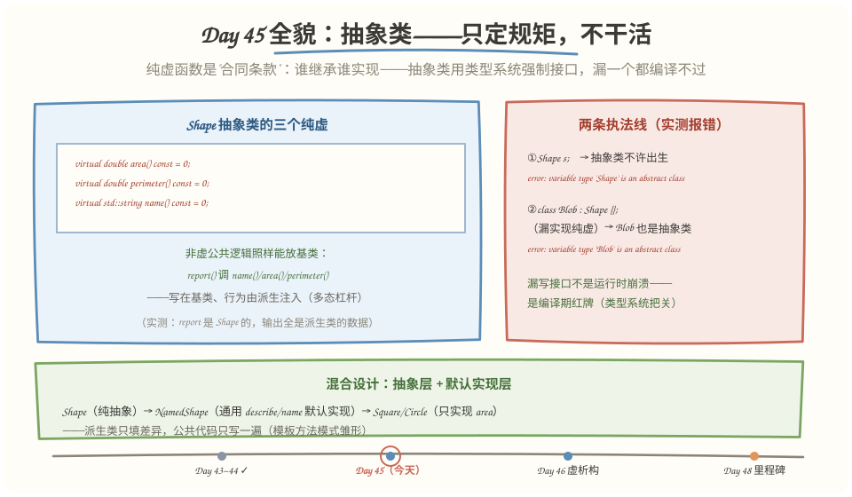
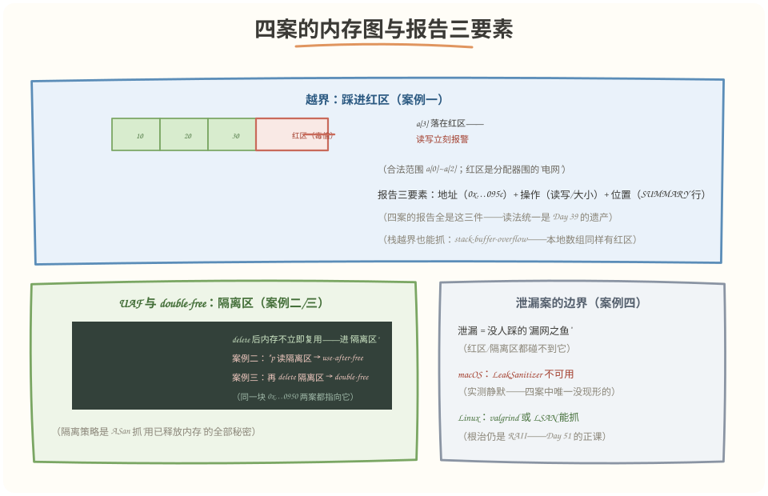
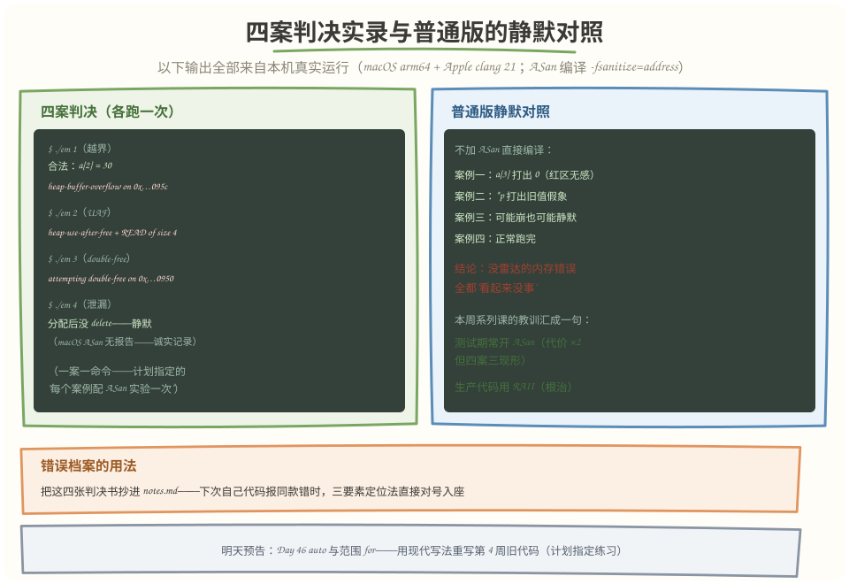

# 第 45 天：内存错误案例集中剖析——四案判决书

> **今日目标**：完成本教程后，你能做到：触发并读懂四类内存错误的 ASan 报告（越界/UAF/double-free/泄漏——各实验一次）；说出红区与隔离区分别抓哪类错；理解泄漏案在 macOS 的工具边界；把"普通版全静默"的对照写进笔记。
> **预计时间**：学习 15 分钟＋实践 50 分钟
> **前置准备**：完成 Day 37~44（Day 39 的 ASan 三要素读法是今天的工具；本周案例分散出场过——今天集中归档）。
> **今日产出**：错误博物馆（一个程序四案切换）+ 四张判决书 + 普通版静默对照。

## 1. 今天解决什么问题？

计划今天的安排是"**内存错误案例集中剖析：越界 / use-after-free / double free / 泄漏；每个案例配 ASan 实验一次**"——把本周散见过的错误（Day 39 的 UAF、Day 41 的 double-free、Day 38 的泄漏）**集中到一个博物馆**，再补上还没正式出场过的**堆越界**。每个案例一次 ASan 实验、一张判决书（报告原文）、一次普通版静默对照。

四案的共同触目惊心之处：**普通编译下全部"看起来没事"**——这就是本周反复强调"测试期常开 ASan"的最终理由。

## 2. 先看全貌：今天的内容位于哪里？



**图 1**：上半部分蓝卡是四案的 ASan 判决书原文（三现形一静默）；左下绿卡是共同点（全静默）；右下灰卡是本周工具课的总复习定位。

三步概括今天：

1. 越界踩红区、UAF/double-free 触隔离区——三案现形；
2. 泄漏没人踩——macOS 的 ASan 不报（诚实边界）；
3. 报告三要素读法统一（地址/操作/位置——Day 39 遗产）。

## 3. 核心概念：先用直觉，再给准确定义

### 3.1 案例一：堆越界（heap-buffer-overflow）

- **一句通俗解释**：读写超出分配范围的元素（`a[3]` 而合法只到 `a[2]`）——踩进分配器围的红区。
- **一个类比**：草坪边的电子围栏——草皮（合法内存）外的窄带通电（毒值）；越界一步警铃响。
- **对应到技术上是**：实测——`new int[3]` 后读 `a[3]`：合法读 `a[2]=30` 正常，`a[3]` 立刻报 `heap-buffer-overflow on 0x…095c`；**普通版打出 0**（红区无感——读到的是未初始化字节）。类比的边界：栈数组越界同样能抓（stack-buffer-overflow）——但 `-Wall` 有时也能静态发现（如常量下标）；ASan 抓的是**运行时才知道**的越界。
- **常见误解**："多读一个没事"——读越界可能读到红区毒值也可能读到别人的数据；**写越界**更糟（改坏堆元数据——后续分配全乱）。

### 3.2 案例二与三：UAF 与 double-free（隔离区两兄弟）

- **一句通俗解释**：delete 后的内存进隔离区（不立即复用）——再读它（UAF）或再释放它（double-free）都立刻被抓。
- **一个类比**：退房后的房间挂"隔离消毒"牌——再刷卡进入（UAF）或再办一次退房（double-free）前台立刻报警。
- **对应到技术上是**：实测——案例二 `delete p` 后读 `*p` 报 `heap-use-after-free + READ of size 4`；案例三二次 `delete p` 报 `attempting double-free on 0x…0950`（**两案指向同一块** 0x…0950——都是隔离区的守卫）。普通版：UAF 打旧值假象（Day 39 的老朋友）、double-free 可能崩可能静默（UB 分裂）。类比的边界：隔离是**暂时的**（内存紧缺时复用）——所以 UAF 的检测不是 100%（但绝大多数触发场景能抓）。
- **常见误解**："delete 两次中间隔远一点就没事"——隔离区不计时辰；第二次 delete 永远是错。

### 3.3 案例四：泄漏（macOS 边界与根治）

- **一句通俗解释**：new 了没人还——**没人踩的漏网之鱼**：红区（在范围外）和隔离区（已释放）都碰不到它。
- **一个类比**：仓库账本漏记——货还在库里（内存还占着）但没人知道归谁；盘点工具（LeakSanitizer/valgrind）能查账，雷达（ASan 红区）查不了。
- **对应到技术上是**：实测——案例四分配 400 字节不还：**macOS 的 ASan 完全静默**（`detect_leaks is not supported`——Day 39 的边界复现）；Linux 上 LeakSanitizer/valgrind 能抓（valgrind 报"definitely lost"、LSan 报"Direct leak"）。**根治不在工具在结构**：RAII（Day 51 正课）让"忘了 delete"从语法上不存在。类比的边界：短命程序的泄漏被进程退出兜底（OS 回收地址空间）——**长跑服务**才是泄漏的主战场（Day 39 的 400KB/天 ≈ 12MB/月）。
- **常见误解**："ASan 开着就不会漏"——它抓"踩"；漏是"不踩"——两类正交。

## 4. 图解核心机制



**图 2**：上半部分蓝卡是越界的红区图（合法三格 + 电网窄带，a[3] 落网）+ 报告三要素标注；左下绿卡是隔离区两兄弟（UAF 读隔离/double-free 二次退房，同一块 0x…0950）；右下灰卡是泄漏案的边界。

按图逐步讲：

1. **对着红区数格子**：合法 `a[0]~a[2]`、电网在右——越界一步的事故形态最小化（一个下标差）；
2. **看隔离区的两扇门**：读门（UAF）和释放门（double-free）都通向同一块隔离内存——两个错误一类守卫；
3. **泄漏为何漏网**：它不碰任何防线——账本类工具才能查；这就是四案里唯一没现形的原因；
4. **三要素统一读法**：地址（哪块）+ 操作（读/写/释放+大小）+ 位置（SUMMARY 行）——四案判决书全是这三件，练到条件反射。

## 5. 动手实践：完成一个最小可运行例子

### 5.1 准备文件

```bash
cd ai-compiler-roadmap/tutorials/day-045/examples
```

主角：`error_museum.cpp`（一个程序、命令行选案例）。

### 5.2 编写代码

骨架（完整代码见本目录）：

```cpp
void case1_overflow() {
    int* a = new int[3]{10, 20, 30};
    std::cout << "  合法：a[2] = " << a[2] << std::endl;
    std::cout << "  越界读：a[3] = " << a[3] << std::endl;   // 踩红区——ASan 现形
    delete[] a;
}

void case3_double_free() {
    int* p = new int(7);
    delete p;
    delete p;                                               // 二进隔离区——ASan 现形
}

int main(int argc, char* argv[]) {
    int which = (argc > 1) ? std::atoi(argv[1]) : 0;
    switch (which) { case 1: … case 4: … }
}
```

### 5.3 运行与观察

```bash
g++ -Wall -fsanitize=address error_museum.cpp -o em
./em 1    # 案例一
```

实际执行结果（本机，四案各跑一次）：

```text
== 案例一：堆越界 ==
  合法：a[2] = 30
ERROR: AddressSanitizer: heap-buffer-overflow on address 0x60200000095c

== 案例二：use-after-free ==
ERROR: AddressSanitizer: heap-use-after-free on address 0x602000000950
READ of size 4 at 0x602000000950 thread T0

== 案例三：double-free ==
  第二次释放同一块……
ERROR: AddressSanitizer: attempting double-free on 0x602000000950

== 案例四：泄漏 ==
  分配后没 delete——静默（macOS ASan 无报告；Linux 可抓）
```

```bash
# 普通版对照（不加 ASan）：
g++ -Wall error_museum.cpp -o em2 && ./em2 1   # 以及 2/3/4 各跑一次
```

```text
（四案全部"正常"输出：a[3]=0 / *p=旧值 / 静默或侥幸 / 正常跑完——没有雷达的内存错误全都看起来没事）
```



**图 3**：左上四案判决（一案一命令——计划指定的"每个案例配一次实验"）；右上是普通版静默对照和本周教训的总结句；下方橙卡是错误档案的用法。

### 5.4 修改一个输入再观察：写越界的破坏力

把案例一的**读**改成**写**（`a[3] = 99;`）——ASan 版同样报 heap-buffer-overflow（但操作从 READ 变 **WRITE**——报告里看得到）。**普通版**对照：可能"正常跑完"——但堆元数据可能已被改坏，**后续的 new/delete 行为诡异**（在 case1 末尾再加一次 `new int[5]` 试试——可能崩在毫不相干的地方）。这就是"写越界比读越界更危险"的实证：**破坏是延迟显形的**——案发现场（a[3]=99）和崩溃点（后续 new）隔着好几行。

## 6. 常见错误与排查

**错误 1：ASan 报 heap-buffer-overflow（READ/WRITE）**

- 现象：报告指向某数组访问；
- 原因：下标超出 [0, size)——常见于循环边界 `<` 写成 `<=`、size 和 capacity 混用（Day 42 的教训）；
- 定位：报告三要素中的位置行 + 分配栈（"allocated here"）；
- 修复：核对循环边界/用 at()（带检查）/换容器。

**错误 2：ASan 报 heap-use-after-free**

- 现象：读/写已释放内存；
- 原因：delete 后继续用、返回了局部堆指针、容器扩容后用旧指针（Day 42 扩容后旧 data_ 作废）；
- 定位：报告的 "freed here" 栈指明哪次 delete；
- 修复：delete 后置空、所有权理清（谁负责释放）。

**错误 3：程序行为随机化（时好时坏）**

- 现象：同一程序有时对有时崩；
- 原因：内存错误的静默性+UB 分裂（今天四案的普通版就是这样）；
- 定位：ASan 全量测试跑一遍；
- 修复：按报告逐个修——**随机的行为背后必是确定的错误**。

## 7. 今日练习

### 必做练习

把四张判决书抄进 notes.md（报告原文 + 一句自己话的成因分析）。然后"角色互换"：把案例一的数组大小改成 5、越界改成 `a[5]`——预测报告地址会落在哪（红区），实测验证。预期产出：四案档案 + 一条新判决。

### 选做挑战

写"第五案"：栈越界——`int local[3]; local[5] = 1;`——ASan 能抓吗？（能：stack-buffer-overflow——栈也有红区。）对比堆越界报告的差异（地址段不同：栈在 0x1[6-7]…、堆在 0x60…）。五案归档，博物馆扩馆。

## 8. 今日验收

- [ ] 我的四案 ASan 实验各跑一次且报告与 5.3 一致（三现形一静默）
- [ ] 我能说出红区抓越界、隔离区抓 UAF/double-free、泄漏两区都碰不到
- [ ] 我实测了普通版的四案静默（"看起来没事"≠没事）
- [ ] 我能背出报告三要素并用于定位（地址/操作/位置）
- [ ] 我知道写越界比读越界更危险（破坏延迟显形——5.4 实验）

## 9. 一句话总结与明天预告

今天的问题是"四大内存错误的形态和检测"；机制上，越界踩红区、UAF/double-free 触隔离区、泄漏是没人踩的漏网之鱼（macOS 工具边界诚实记录）；实践上，四案各配一次 ASan 实验、判决书归档、普通版静默对照全部完成；验证标准是看到任何 ASan 报告能三十秒说出错误类型和成因。明天 **Day 46：auto 与范围 for**——用现代写法重写第 4 周旧代码（计划指定练习）：内存周的紧张之后换换口味，代码变清爽。
