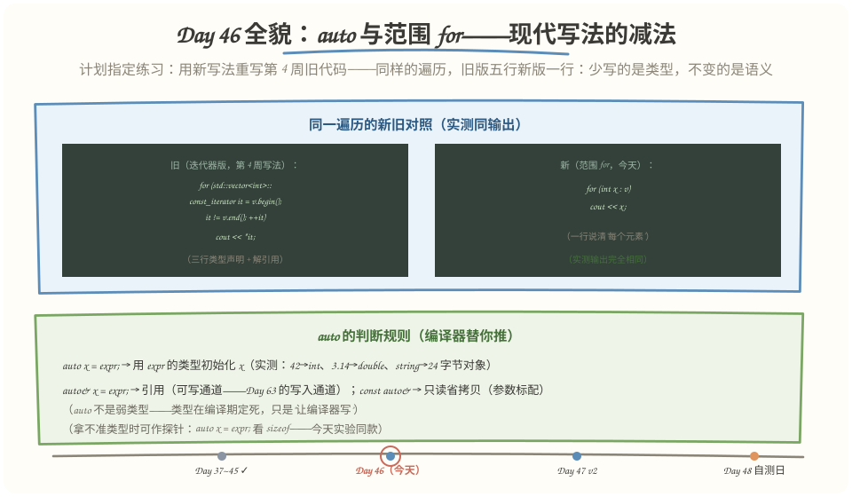
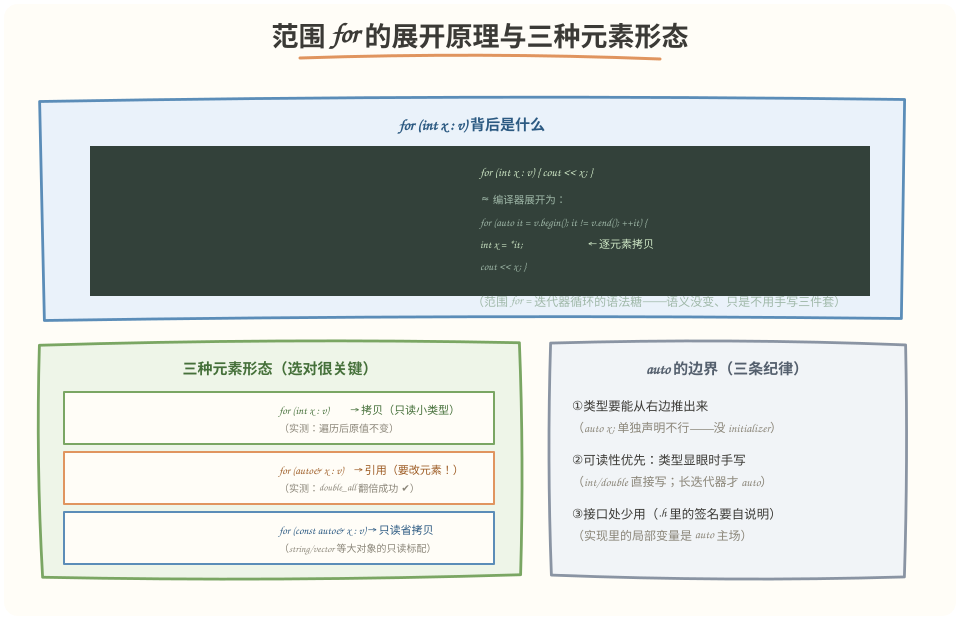
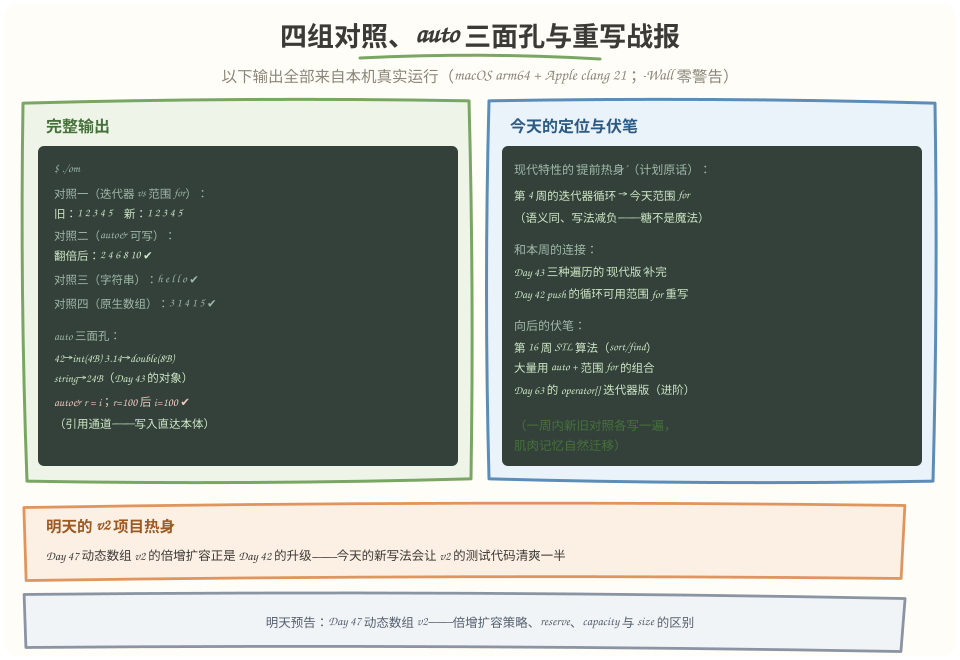

# 第 46 天：auto 与范围 for——现代写法的减法

> **今日目标**：完成本教程后，你能做到：用范围 for 重写迭代器循环（实测同输出、五行变一行）；根据用途选对元素形态（拷贝 `int x` / 可写 `auto&` / 只读 `const auto&`）；说出 auto 的推导规则（编译期定死——不是弱类型）和三条使用纪律；说出范围 for 是迭代器循环的语法糖。
> **预计时间**：学习 15 分钟＋实践 45 分钟
> **前置准备**：完成 Day 37~45（第 4 周的迭代器循环是重写素材；Day 43 的遍历对照是直接前文）。
> **今日产出**：四组新旧对照（迭代器/可写/字符串/原生数组）、auto 三面孔实验、重写练习。

## 1. 今天解决什么问题？

计划本周的"提前热身现代特性"：**auto、范围 for**——练习是"用新写法重写第 4 周旧代码"。核心认识一句话：**这是减法不是魔法**——范围 for 展开后就是迭代器循环（语义一模一样），auto 推导的类型在编译期定死（不是弱类型）；少写的只是冗长的类型声明和三件套（begin/end/++）。

内存周连续五天的紧张之后，今天换换口味——但伏笔不断：明天 v2 项目的测试代码将直接用今天的新写法，第 16 周 STL 算法更是 auto+范围 for 的主场。

## 2. 先看全貌：今天的内容位于哪里？



**图 1**：上半部分蓝卡是同一遍历的新旧代码对照（实测同输出）；下半部分绿卡是 auto 的判断规则。

三步概括今天：

1. `for (int x : v)` = 迭代器循环的语法糖——语义不变、写法减负；
2. 元素形态三选一：拷贝（小类型只读）/ `auto&`（要改）/ `const auto&`（大对象只读省拷贝）；
3. auto 编译期定死；可读性优先、接口处少用。

## 3. 核心概念：先用直觉，再给准确定义

### 3.1 范围 for：只说"要什么"

- **一句通俗解释**：`for (int x : v)` 读作"对 v 里的每个 x"——不用管从哪开始、到哪结束、怎么前进。
- **一个类比**：点菜——旧写法像报菜价清单（"从第一道开始、到最后一道结束、每道加一"）；新写法就是"每道菜都来一份"。
- **对应到技术上是**：实测对照——旧迭代器版（`std::vector<int>::const_iterator it = v.begin(); it != v.end(); ++it` + `*it` 解引用）与新范围 for（`for (int x : v)`）输出完全相同（`1 2 3 4 5`）；**展开原理**：编译器把范围 for 翻译回迭代器循环（图 2 的展开图）——糖衣下面是同一副骨架。适用对象：vector、string（实测 `h e l l o`）、**原生数组**（实测 `3 1 4 1 5`）——有 begin/end 的都能用。类比的边界：范围 for 拿**不到下标**（要 i 的时候还是经典 for）；遍历中**不能改容器结构**（push/erase 会使迭代器失效——第 14 周的坑预告）。
- **常见误解**："范围 for 更快/更慢"——都不；它就是同一个循环换了写法（优化代码不变）。

### 3.2 元素形态：拷贝、引用、只读引用

- **一句通俗解释**：`int x` 拿复印件（改 x 不动原数据）、`auto& x` 拿钥匙（改 x 就是改原数据）、`const auto& x` 隔玻璃看（只读且不复印）。
- **一个类比**：借阅——复印件随便涂（拷贝）、原件要改得本人授权（引用）、珍本只展不借（const 引用）。
- **对应到技术上是**：实测——`double_all` 用 `for (auto& x : v) x *= 2` 翻倍成功（2 4 6 8 10）；auto& 的引用通道在函数版里改 `r = 100` 后 `i = 100`（Day 63 写入通道的预演）。**选型法则**：小类型只读→值（int/double）；要改→`auto&`；大对象只读→`const auto&`（string/vector——省一次拷贝，Day 43 的 view 同思路）。类比的边界：`const auto&` 也能接临时值（右值）——所以它是**函数参数的万能只读形态**（比 `const string&` 更通用）。
- **常见误解**："`for (auto x : strings)` 遍历字符串数组"——每个 string 都**拷贝一份**（可能带堆分配）；大对象遍历忘引用是性能暗坑——`const auto&` 才是标配。

### 3.3 auto：编译期的类型推导

- **一句通俗解释**：`auto x = expr;` 让编译器从右边推类型——**编译期定死**，不是运行时变（和弱类型语言完全不同）。
- **一个类比**：代填表——你提供信息（表达式），办事员（编译器）替你填类型栏；填完就是白纸黑字（静态类型），不会运行中变。
- **对应到技术上是**：实测三面孔——`auto i = 42`→int（4 字节）、`auto d = 3.14`→double（8 字节）、`auto s = std::string("hi")`→string 对象（24 字节——Day 43 的 sizeof 复现）。**三条纪律**：①必须能推（`auto x;` 单独声明不行）；②可读性优先（int/double 直接写；长迭代器/lambda 才 auto 的主场）；③接口处少用（头文件签名要自说明——auto 留给实现里的局部变量）。**探针用法**：拿不准类型时 `auto x = expr;` 看 sizeof/编译错——今天的实验就是模板。类比的边界：auto 推导有细节规则（引用剥除、const 剥除等）——进阶场景（模板）再展开；日常初始化场景它就是"照抄右边"。
- **常见误解**："auto 让 C++ 变成动态类型"——零关系；类型确定了就不能变（`auto x = 42; x = "hi"` 编译错）。

## 4. 图解核心机制



**图 2**：上半部分蓝卡是范围 for 的展开图（编译器翻译回迭代器循环——糖衣下的骨架）；左下绿卡是三种元素形态（拷贝/引用/只读引用——实测标注）；右下灰卡是 auto 的三条纪律。

按图逐步讲：

1. **对着展开图看等价性**：`int x = *it;` 就是"逐元素拷贝"——所以改 x 不动原数据（形态选错的根源图解）；
2. **把 `&` 加进展开图**：`auto& x = *it;` 拷贝变绑定——x 成了元素的别名（改 x 即改元素）；
3. **记三种形态的口诀**：小只读值、要改引用、大只读常引用——三句覆盖 95% 场景；
4. **纪律对着代码找位**：今天的示例里 auto 用在局部（三面孔实验）——接口（函数签名）全部显式类型，正是纪律③的示范。

## 5. 动手实践：完成一个最小可运行例子

### 5.1 准备文件

```bash
cd ai-compiler-roadmap/tutorials/day-046/examples
```

主角：`old_vs_modern.cpp`（四组对照 + auto 三面孔）。

### 5.2 编写代码

核心对照（完整代码见本目录）：

```cpp
// 旧（第 4 周写法）：
for (std::vector<int>::const_iterator it = v.begin(); it != v.end(); ++it) {
    std::cout << *it << ' ';
}

// 新（今天）：
for (int x : v) {
    std::cout << x << ' ';
}

// 可写版（auto& 是关键）：
void double_all(std::vector<int>& v) {
    for (auto& x : v) { x *= 2; }
}
```

### 5.3 运行与观察

```bash
g++ -Wall old_vs_modern.cpp -o om && ./om
```

实际执行结果（本机）：

```text
== 对照一：迭代器 vs 范围 for ==
  旧：1 2 3 4 5
  新：1 2 3 4 5

== 对照二：可写遍历（auto&） ==
  翻倍后：2 4 6 8 10

== 对照三：字符串 ==
  新：h e l l o

== 对照四：原生数组 ==
  新：3 1 4 1 5

== auto 的三个面孔 ==
  auto i = 42        → 4 字节（int）
  auto d = 3.14      → 8 字节（double）
  auto s = string    → 24 字节（string 对象）
  auto& r = i        → 引用（改 r 就是改 i）
  r = 100 后 i = 100
  const auto&（函数参数常见）→ 只读引用省拷贝——Day 43 的 view 同思路
```



**图 3**：左上完整输出（四对照 + 三面孔标注）；右侧是今天的定位（现代特性热身）与向后伏笔（第 16 周 STL）；下方橙卡预告 v2。

### 5.4 修改一行再观察：形态选错的现场

把 `double_all` 的 `for (auto& x : v)` 改成 `for (auto x : v)`（去掉 &）——重跑对照二：**翻倍失效**（输出仍是 1 2 3 4 5）！x 成了复印件——改的是副本、原数据纹丝不动。**一 & 之差**：引用通道（可写）vs 拷贝（只读快照）——这是新手最常见的坑，实测一次胜过读十遍。恢复 `auto&`——翻倍恢复。（顺带一问：输出会变吗？不会警告——语义合法只是不是你要的——**选型错误编译器不管**，只能靠理解。）

## 6. 常见错误与排查

**错误 1：遍历中修改元素不生效**

- 现象：循环里改了值、循环后原数据没变；
- 原因：元素形态用了值（`auto x`）——改副本；
- 定位：看 for 的元素声明有没有 `&`；
- 修复：要改就 `auto& x`。

**错误 2：`error: declaration of variable 'x' with deduced type 'auto' requires an initializer`**

- 现象：`auto x;` 单独声明编译失败；
- 原因：auto 必须从初始化器推导——没有右边推不了；
- 定位：报错直接指出；
- 修复：给初始化（或改回显式类型再赋值）。

**错误 3：范围 for 里 push_back/erase 后行为怪异**

- 现象：遍历中改容器结构——漏元素/崩；
- 原因：结构变化使隐身的迭代器失效（展开原理的推论）；
- 定位：看循环体有没有增删；
- 修复：先遍历记录、循环外改结构；或用索引版经典 for（配合小心边界）——第 14 周正式展开。

## 7. 今日练习

### 必做练习（计划指定：重写第 4 周旧代码）

从第 4 周的作业里挑两个用迭代器或下标循环的程序，用范围 for + auto 重写。验证：输出与旧版逐行一致。预期产出：新旧两版并排 + 一行统计（少写了多少个类型声明）。

### 选做挑战

写"形态三连"演示函数：分别用值/引用/常引用遍历 `std::vector<std::string>`，各执行"读第一个字符 + 尝试修改"——验证值版改不动、引用版能改、常引用版改会在编译期被拦（`const` 执法）。把三种行为对照记进 notes.md——大对象的形态选择从此有据。

## 8. 今日验收

- [ ] 我的范围 for 重写与旧迭代器版输出完全一致
- [ ] 我能背出形态口诀：小只读值、要改 auto&、大只读 const auto&
- [ ] 我实测了 & 的有无之差（5.4：去 & 翻倍失效）
- [ ] 我知道 auto 是编译期定死（三面孔的 sizeof 证据）和三条纪律
- [ ] 我能说出范围 for 是迭代器循环的语法糖（展开图）

## 9. 一句话总结与明天预告

今天的问题是"现代写法减了什么、没减什么"；机制上，范围 for 是迭代器循环的糖（语义不变）、auto 是编译期推导（不是弱类型）、元素形态三选一是正确性的关键；实践上，四组对照、三面孔、& 之差全部实测；验证标准是看到任何循环能选出正确的元素形态并说出为什么。明天 **Day 47：动态数组 v2**——倍增扩容策略、reserve、capacity 与 size 的区别：Day 42 的 v1 升级，今天的新写法让测试代码清爽一半。
