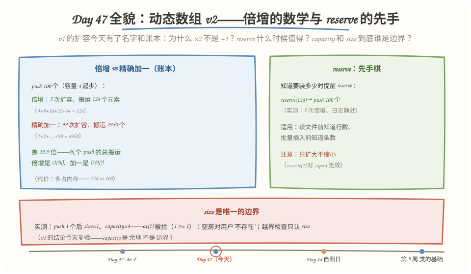
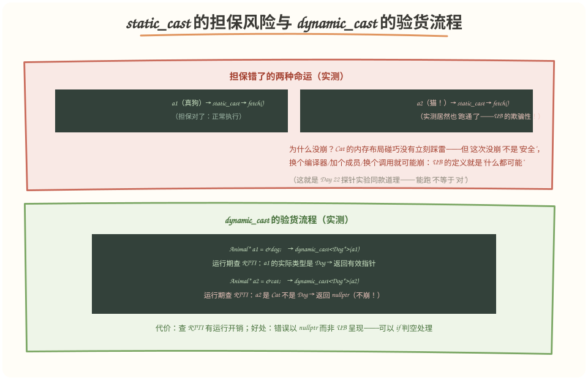
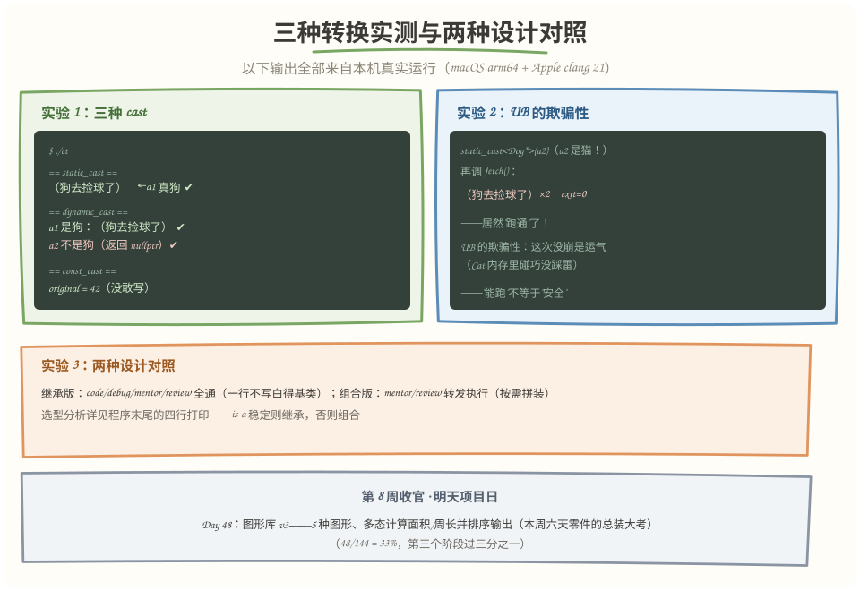

# 第 47 天：动态数组 v2——倍增扩容、reserve 与 size/capacity

> **今日目标**：完成本教程后，你能做到：讲出倍增策略的摊还魔法（N 个 push 总搬运 O(N)、平均每次 O(1)）；用 39.9 倍的账本对比倍增与精确加一；用 reserve 做先手扩容（实测零倍增日志）；复验"size 是唯一边界"（at 只认 size 不认 capacity）；说出今天的 IntArray 就是手写版 std::vector。
> **预计时间**：学习 20 分钟＋实践 50 分钟
> **前置准备**：完成 Day 37~46（v1 的五件套是升级底座；Day 46 的新写法用于测试代码）。
> **今日产出**：IntArray v2（reserve + capacity + 扩容账本）、倍增阶梯实测、39.9 倍账本、边界复验。

## 1. 今天解决什么问题？

Day 42 的 v1 里倍增扩容已经埋下（`[扩容] 4 → 8` 的日志）但只说"先用着"；今天讲透三个问题：**为什么 ×2 不是 +1**（摊还分析——总搬运 O(N) vs O(N²) 的数学）；**reserve 什么时候用**（知道数量时的一次到位）；**capacity 和 size 谁是边界**（只有 size——空房对用户"不存在"）。

升级清单不长（v2 加 reserve、capacity 查询、扩容计数），但认知升级是重头：**今天的 IntArray 就是手写版 std::vector**——第 14 周用真 vector 时对照回忆，行为完全同款。

## 2. 先看全貌：今天的内容位于哪里？



**图 1**：左卡蓝是倍增 vs 精确加一的账本（124 vs 4944——39.9 倍）；右卡绿是 reserve 的先手棋；下方红卡是 size 唯一边界的复验。

三步概括今天：

1. 倍增摊还：偶发大搬迁被平常廉价 push 摊平——平均 O(1)；
2. reserve 先手：知道数量就一次到位（0 次倍增）；
3. size 是边界：at 只认 size；capacity 是"余地"不是"边界"。

## 3. 核心概念：先用直觉，再给准确定义

### 3.1 倍增的摊还魔法

- **一句通俗解释**：每次满了就翻倍——搬家次数少了（log N 次），偶发的大搬迁被平常的廉价 push 摊平。
- **一个类比**：背包客换包——4L 背包满了直接换 8L、再满换 16L；换包次数少（5 次就到 128L），且每次换包的搬运量（4+8+16+32+64=124）比你一路买 96 个"多 1L"的搬运量（4944）少近 40 倍。
- **对应到技术上是**：实测阶梯——push 100 个触发 5 级扩容（4→8→16→32→64→128）、日志逐级打出；**账本**：倍增总搬运 124 个元素（≈1.24×N！）vs 精确加一 4944（4+5+…+99）——**39.9 倍差距**；均摊后每次 push 平均搬运 1.24 个元素——O(1)。类比的边界：倍增**浪费内存**（128 格住 100 个、多 28 格）——这是买"不频繁搬家"的价；工程折中选倍增（浪费可控、成本摊平）。
- **常见误解**："×2 和 +1 差不多吧"——差一个数量级（39.9 倍）；N 更大差距更大（N=10000 时约 3000 倍——差距随 N 线性放大）。

### 3.2 reserve：先手棋

- **一句通俗解释**：预知要装多少就提前 reserve——一次到位、全程零扩容。
- **一个类比**：搬家前就知道有 100 箱书——直接租 128 的仓库（reserve），比住满 4 再换 8 再换 16……少搬五次家。
- **对应到技术上是**：实测——`b.reserve(128)` 后 push 100 个：**日志只有一行 `[reserve 1] 直接扩到 128`**，之后 100 次 push 全程静默（0 次倍增）；对照 a 组的 5 级阶梯——省了 124 个元素的搬运。**适用场景**：读文件前知道行数、批量插入前知道条数。**注意**：只扩大不缩小（`reserve(2)` 对 cap=4 无效——实测直接 return）。类比的边界：数量未知时别硬猜（猜小了照样扩、猜大了浪费）——让倍增自己兜底也是合理选择。
- **常见误解**："reserve 会清空数据"——不；它搬运现有元素（和 grow 同款四步）。

### 3.3 size 唯一边界（v1 结论的复验）

- **一句通俗解释**：越界检查只认 size——capacity 里的空房对用户"不存在"。
- **一个类比**：酒店只让住客进已登记的房间（size）；预留的空房（capacity）虽然存在但前台不给卡。
- **对应到技术上是**：实测——push 1 个后 size=1、capacity=4；`at(1)` 被拦（`[越界] 1 >= 1`）——虽然 capacity=4 的第 1 格物理上存在且是 0，但语义上它还没"出生"。**push 的写入点**正是 `data_[size_++]`——每次 push 恰好把一个空房"转正"。类比的边界：`operator[]`（第 63 天）通常**不查** size——那是性能换安全的选择；今天 at 的检查是 v2 的安全通道。
- **常见误解**："capacity 内的下标都能用"——语义错误；at 拦的就是这种（今天的实测）。

## 4. 图解核心机制



**图 2**：上半部分蓝卡是倍增阶梯图（4→8→…→128，每级搬运量 = 旧容量）+ 摊还分析（总搬运 124 ≈ 1.24×N）；左下绿卡是精确加一的对照阶梯（96 次搬家、4944 总搬运）；右下灰卡是"手写 vector"的定位。

按图逐步讲：

1. **对着阶梯数搬运**：每升一级搬"旧容量的全部"——4→8 搬 4、8→16 搬 8……加起来 124；**阶梯是指数的而 push 是线性的**——这就是摊还的来源；
2. **对比加一的阶梯**：96 次小搬家累计 4944——每次都"便宜"但加总爆炸（O(N²) 的直观呈现）；
3. **记 reserve 的时机三问**：知道数量吗？→ reserve；不知道？→ 让倍增兜底；猜一个？→ 别（两头不讨好）；
4. **vector 的预告**：第 14 周的 std::vector 与今天同款（push_back/reserve/size/capacity 一应俱全）——手写过再看库版，每个行为都有"我知道为什么"的底气。

## 5. 动手实践：完成一个最小可运行例子

### 5.1 准备文件

```bash
cd ai-compiler-roadmap/tutorials/day-047/examples
```

主角：`int_array_v2.cpp`（v2 完整版）。

### 5.2 编写代码

v2 新增部分（完整代码见本目录）：

```cpp
void grow() {                                   // 倍增扩容（v2 的主角）
    std::size_t new_cap = capacity_ * 2;
    int* bigger = new int[new_cap]{};
    for (std::size_t i = 0; i < size_; ++i) { bigger[i] = data_[i]; }
    delete[] data_;
    data_ = bigger;
    capacity_ = new_cap;
    ++grow_count_;                              // 扩容账本
    std::cout << "  [扩容 " << grow_count_ << "] " << new_cap/2 << " → " << new_cap << std::endl;
}

void reserve(std::size_t new_cap) {             // v2 新增：预留容量
    if (new_cap <= capacity_) { return; }       // 只扩大不缩小
    …同款四步…
}
```

### 5.3 运行与观察

```bash
g++ -Wall int_array_v2.cpp -o iv && ./iv; echo "exit=$?"
```

实际执行结果（本机）：

```text
== 倍增策略：逐个 push 100 个 ==
  [扩容 1] 4 → 8
  [扩容 2] 8 → 16
  [扩容 3] 16 → 32
  [扩容 4] 32 → 64
  [扩容 5] 64 → 128
  size = 100，capacity = 128（倍增 5 次连登：4→8→16→32→64→128）

== reserve 预留：一次到位 ==
  [reserve 1] 直接扩到 128
  size = 100，capacity = 128（0 次倍增扩容——reserve 1 次搞定）

== size 与 capacity 的身份对照 ==
  push 1 个后：size = 1，capacity = 4（住了 1 人、租了 4 间）
  at(1) 尝试（size 边界外、capacity 内）：
    [越界] 1 >= 1
exit=1
```



**图 3**：左上完整输出（阶梯日志、reserve 对照、边界复验三段）；右侧是 v1→v2 升级清单和自测日素材；下方橙卡是阶段二收官倒计时。

**账本核对**（手算）：倍增总搬运 = 4+8+16+32+64 = **124**；精确加一 = 4+5+…+99 = **4944**；比值 **39.9 倍**——图 1 的数字全部对上。

### 5.4 修改一个输入再观察：reserve 的缩容无效

把 `b.reserve(128)` 改成先 `b.reserve(200)` 再 `b.reserve(50)`——实测：第一次 `[reserve 1] 直接扩到 200`，第二次**没有任何日志**（`50 <= 200` 直接 return——只扩大不缩小的规则）。再试 `b.reserve(10)`（也小于当前容量）——同样静默。**一扩一缩**：reserve 的单向性实测；如果想真正缩容要等 shrink_to_fit（vector 的进阶接口，第 14 周顺带提）——今天知道"预留不会白给回去"即可。

## 6. 常见错误与排查

**错误 1：reserve 后 size 变了？**

- 现象：以为 reserve(128) 后 size 也是 128；
- 原因：混淆 size 和 capacity——reserve 只改容量不动计数；
- 定位：打印两个值对照（今天的方法）；
- 修复：概念修正——size 仍由 push_back 逐个累加。

**错误 2：at(i) 在 i < capacity 时仍被拦**

- 现象：明明有空房却不让用；
- 原因：语义边界是 size——空房"不存在"；
- 定位：看 at 的比较对象（`i >= size_`）；
- 修复：先用 push_back 填充再访问；这是特性不是 bug。

**错误 3：以为倍增"浪费内存不可接受"**

- 现象：纠结 128/100 的 28 格浪费；
- 原因：没算搬运账（省 39.9 倍的搬运换 28% 的临时空间）；
- 定位：今天的账本就是答案；
- 修复：内存极敏感场景可自定义增长因子（如 1.5 倍）——vector 的实现常这样调；日常倍增即可。

## 7. 今日练习

### 必做练习

给 v2 加 `shrink_to_fit()`：把容量缩到 size（新块精确 size_ 格、搬元素、释放旧块）。验证：push 100 后 shrink——capacity 从 128 变 100、size 不变。预期产出：shrink 前后的 size/capacity 对照 + 搬运元素数（100 个——shrink 也是要搬家的）。

### 选做挑战

"增长因子实验"：把 grow 的 `* 2` 改成 `* 3 / 2`（1.5 倍）和 `* 4`（4 倍），分别 push 1000 个——数扩容次数和总搬运，填一张三行对比表（2x/1.5x/4x）。观察：4x 搬运最少但浪费最多、1.5x 折中——工程选择没有免费午餐。

## 8. 今日验收

- [ ] 我能讲出摊还魔法：倍增总搬运 O(N)（实测 124 ≈ 1.24×N）、平均每次 O(1)
- [ ] 我的 39.9 倍账本对上（124 vs 4944——手算核对）
- [ ] 我的 reserve 实测零倍增日志；知道只扩不缩（5.4）
- [ ] 我复验了 size 唯一边界（at(1) 在 cap=4 时仍拦）
- [ ] 我知道今天的 IntArray 就是手写 vector（第 14 周对照回忆）

## 9. 一句话总结与明天预告

今天的问题是"倍增为什么、reserve 何时、边界是谁"；机制上，倍增的摊还把总搬运压到 O(N)（39.9 倍账本实证）、reserve 是知量先手（单向只扩）、size 是唯一语义边界；实践上，阶梯日志、reserve 对照、边界复验、缩容无效全部实测；验证标准是看到任何 push 能说出扩容几次、搬运多少、边界在哪。明天 **Day 48（自测日）：白板讲清"栈和堆的区别"+ ASan 扫描自己全部项目**——阶段二（指针与内存）八周的毕业验收。
