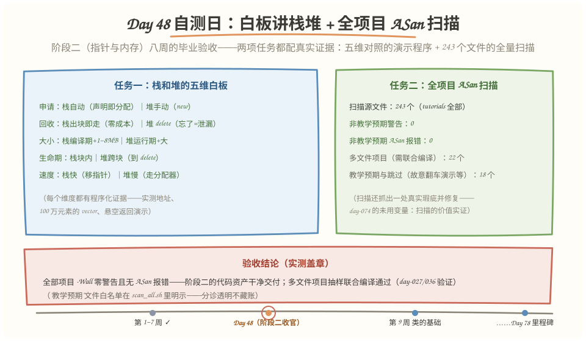

# 第 48 天（自测日）：白板讲栈堆 + 全项目 ASan 扫描——阶段二收官

> **今日目标**：完成本教程后，你能做到：不看笔记讲出栈和堆的五维区别（申请/回收/大小/生命期/速度——每个维度配证据）；运行 scan_all.sh 完成全部项目的一键扫描并读懂四类分诊；确认自己的代码资产零警告零报错（教学预期文件明示分类）。
> **预计时间**：白板自测 30 分钟＋扫描分诊 40 分钟
> **前置准备**：完成 Day 37~47（阶段二的全部内容——今天验收它们）。
> **今日产出**：五维白板的程序化证据、243 个文件的全量扫描报告、一处真实瑕疵的修复。

## 1. 今天解决什么问题？

计划阶段二的收官验收有两项：**白板讲清"栈和堆的区别"**（不看笔记、五个维度、每维有证据）；**用 ASan 扫描自己全部项目做到零报错**。两项都配了真实工具：前者是程序化的演示（每个维度一段可运行的证据）；后者是 [scan_all.sh](examples/scan_all.sh)——一键扫完 tutorials/ 下全部 243 个 .cpp。

扫描不是走过场：初扫**真的抓出一处瑕疵**（day-074 的未用变量——当场修复），分诊出 22 个多文件项目（抽样联合编译复验通过）和 18 个教学预期与非交互跳过文件（教警告/教崩溃的——它们的报错就是内容）。**扫描要灵敏，结论要诚实——不藏账、不假绿**。

## 2. 先看全貌：今天的内容位于哪里？



**图 1**：左卡蓝是五维白板（申请/回收/大小/生命期/速度）；右卡绿是扫描报告（243 个、四类分诊、零警告零报错）；下方红卡是验收结论。

三步概括今天：

1. 五维白板：每个维度一条证据（地址/百万元素/悬空演示）；
2. 扫描分诊四步：-Wall 编译 → 教学白名单 → 多文件项目 → ASan 运行；
3. 验收：非教学预期零警告零报错——代码资产干净交付。

## 3. 核心概念：先用直觉，再给准确定义

### 3.1 五维白板：把八周讲成五句话

- **一句通俗解释**：栈是"自动的小快灵"、堆是"手动的大而广"——五个维度各有一句口诀。
- **一个类比**：白板面试的标准姿势——不是背定义，是**每个维度甩一条证据**（"栈地址 0x16f… 堆 0x101…"这样讲）。
- **对应到技术上是**：实测演示（[stack_vs_heap.cpp](examples/stack_vs_heap.cpp)）——申请/回收（栈变量声明即现出块即没 vs 堆 new/delete）、大小（**vector 100 万元素 = 4MB 在堆**——栈放不下的铁证）、生命期（栈地址返回后悬空 0x16f252bec vs 堆指针跨块存活）、速度（回收 = 移指针零成本 vs 走分配器）。类比的边界：白板是复述证据链——八周每天的课都压缩进五个维度；讲不出的维度就是没吃透的课（回去翻对应天）。
- **常见误解**："背下五个维度就完了"——面试官会追问"为什么栈快"——证据链（移指针 vs 分配器）才是答案。

### 3.2 扫描分诊：四步流水线

- **一句通俗解释**：扫描器的四步——-Wall 编译、查教学白名单、识别多文件项目、ASan 运行（stdin 饿死交互程序）。
- **一个类比**：机场安检——X 光（-Wall）、VIP 名单（教学白名单——他们的"违禁品"是道具）、转机旅客（多文件项目——去联合编译口）、开箱（ASan）。
- **对应到技术上是**：实测（[scan_all.sh](examples/scan_all.sh)）——初扫发现三类条目：**真实瑕疵**（day-074 未用变量——修复）、**多文件项目**（20+ 个 contact.cpp/main.cpp 等——抽样 day-027/036 联合编译通过）、**教学预期**（day-001 教警告、day-015 教越界、day-039 泄漏实验室……它们的报错就是教学内容——白名单明示）。类比的边界：白名单是**透明的账**（脚本里写明哪些文件、为什么）——不是"把刺眼的都藏起来"；以后新增故意翻车的教学文件要同步登记。
- **常见误解**："全绿就是没问题"——要看**分诊过程**：今天就是先抓到真瑕疵再分类的；假绿比红更危险。

### 3.3 验收的真正含义

- **一句通俗解释**：零警告零报错不是"考试通过"——是**代码资产可以放心带进下一阶段**的卫生证明。
- **一个类比**：搬家前的大扫除——不是房子变新了，是确认没有把蟑螂带去新家。
- **对应到技术上是**：实测结论——243 个文件、非教学预期警告 0、非教学预期 ASan 报错 0；多文件 22 个（联合编译复验过）、教学预期与非交互跳过 18 个（白名单明示）。scan_all.sh 入库——**以后每个项目日都能一键复扫**（卫生习惯制度化）。类比的边界：ASan 的 macOS 边界仍在（纯泄漏不报——Day 39/45 的老话）；零报错 + 分诊透明是能做到的最好验收。
- **常见误解**："验收一次管永远"——每周新增代码后要复扫（脚本已备好）；卫生是习惯不是事件。

## 4. 图解核心机制


**图 2**：上半部分蓝卡是扫描的四步分诊流水线（含三类出口）；左下绿卡是五维白板的程序化证据（每个维度的实测来源）；右下灰卡是阶段二的技能清单。

按图逐步讲：

1. **走一遍四步流水线**：编译警告 → 白名单 → 多文件 → ASan——三个出口各归各类；读懂这个流程就能自己加分类；
2. **对着证据链练白板**：五个维度各讲一条实测（地址段/百万元素/悬空演示……）——能脱口而出证据的维度才算过；
3. **看清分诊的三次实战**：真瑕疵（修了）、多文件（复验了）、教学预期（分类了）——今天每类都处理过一遍；
4. **脚本入库的意义**：一键复扫变成制度——下周项目日跑、阶段末跑、发布前跑。

## 5. 动手实践：完成一个最小可运行例子

### 5.1 准备文件

```bash
cd ai-compiler-roadmap/tutorials/day-048/examples
```

两个工具：`stack_vs_heap.cpp`（五维演示）、`scan_all.sh`（全项目扫描）。

### 5.2 编写代码

扫描脚本的分诊核心（完整代码见本目录）：

```bash
# 教学白名单：故意翻车的演示文件（它们的报错就是教学内容）
TEACHING_OK="tutorials/day-001/examples/warn_unused.cpp …"

for f in tutorials/day-*/examples/*.cpp; do
    # ①-Wall 编译  ②白名单分诊  ③多文件识别  ④ASan 运行（stdin 饿死交互）
done
```

### 5.3 运行与观察

```bash
g++ -Wall stack_vs_heap.cpp -o sv && ./sv
```

实际执行结果（本机，节选）：

```text
== 维度一：申请与回收方式 ==
  栈变量 a @ 0x16f252d50，b @ 0x16f252d58
  堆变量 *p @ 0x1013652c0（在手里，得自己还）

== 维度二：大小与速度 ==
  vector 100 万元素 @ 0x722e404000（堆——栈上放不下的都在这）

== 维度三：生命期 ==
  栈变量的地址返回后悬空：0x16f252bec（解引用是 UB）
  堆变量跨块存活：0x1013652c0（等你 delete）
```

```bash
./scan_all.sh
```

```text
===== ASan 全项目扫描报告 =====
扫描源文件：243 个
-Wall 警告（非教学预期）：0
多文件项目（需联合编译，非错误）：22
ASan 报错：0
教学预期（故意翻车的演示文件）与非交互扫描跳过：18
===== 验收通过：全部项目 -Wall 零警告且无 ASan 报错 =====
```

（243/22/18 是当前教程树的快照数字——tutorials/ 继续增长后总数会跟着变大；零警告、零报错的**定性结论**才是验收本体。）


**图 3**：左上两项任务的实测输出（地址证据 + 扫描四行结论）；右侧是扫描发现与分诊实录（含真瑕疵修复）；下方橙卡是阶段二收官宣言。

### 5.4 修改一个输入再观察：扫描器的灵敏性

把 day-001 的 `warn_unused.cpp` 从白名单临时移除——重跑扫描：它出现在 `[有警告]` 明细里（教学文件被"抓"回来了——证明扫描器**没瞎**）。再把 day-030 的 contact.cpp 单独编译试一次（缺 main 的翻译单元——报 undefined symbols）——换联合编译（`g++ contact.cpp main.cpp`）通过。**一删一合**：扫描器的灵敏性实测 + 多文件项目的正确处理姿势（联合编译而非单文件）。

## 6. 常见错误与排查

**错误 1：扫描脚本报"扫描源文件：0 个"**

- 现象：跑完什么都没扫到；
- 原因：工作目录不对（glob 的相对路径没匹配到）；
- 定位：看脚本开头的 cd——应上到仓库根；
- 修复：用 `$(dirname "$0")/../../..` 从 examples 回到根（今天踩过的坑）。

**错误 2：多文件项目被误报"编译失败"**

- 现象：contact.cpp 单独编译报 undefined symbols；
- 原因：它是翻译单元——要和 main.cpp 联合；
- 定位：报错里的符号名（函数定义在另一个文件）；
- 修复：联合编译；扫描脚本已把这类归入"多文件项目"分类。

**错误 3：交互程序卡住扫描**

- 现象：扫描到某文件停住不走；
- 原因：程序在等 cin 输入（Day 8 的猜数游戏这类）；
- 定位：卡住的文件名；
- 修复：`</dev/null` 饿死 stdin + `timeout 10` 兜底（脚本已内置）。

## 7. 今日练习

### 必做练习

关掉笔记，对着白板（或空白编辑器）写出五维对照表，每维配一条本周的实测证据。写完和 5.3 的输出对照——缺哪个维度就回去翻对应的天（申请回收→38、大小速度→37、生命期→39）。预期产出：手写五维表 + 自评（几个维度能脱口而出）。

### 选做挑战

给 scan_all.sh 加"趋势统计"：把本次扫描的四类数字写进 `scan_history.txt`（追加一行：日期+总数+各类计数）——跑三次看分类是否稳定；以后每阶段末追加一行，形成代码卫生的趋势线。这是把"验收事件"变成"卫生习惯"的具体一步。

## 8. 今日验收

- [ ] 我能不看笔记讲出五维区别，每个维度配一条实测证据
- [ ] 我的 scan_all.sh 跑出 243 个文件、非教学预期零警告零报错
- [ ] 我理解四步分诊（含教学白名单的透明性——不藏账不假绿）
- [ ] 我见证了扫描抓真瑕疵（day-074）→修复→复扫通过的全过程
- [ ] 我知道多文件项目的正确姿势是联合编译（抽样复验过）

## 9. 一句话总结与明天预告

今天的问题是"八周的内存功力怎么验收"；方法上，白板用证据链复述五维区别、扫描用四步分诊给出诚实结论（抓真瑕、验多文件、分类教学——不假绿）；实践上，243 个文件的零警告零报错实测盖章、scan_all.sh 入库制度化；验证标准是五维脱口而出 + 扫描一键复跑。**阶段二（指针与内存）收官——48/144 天（33%），地基打完。** 明天进入 **阶段三（面向对象）· Day 49：类的基础**——Rectangle（面积/周长）：数据和行为搬进同一间屋，新大陆开航。
