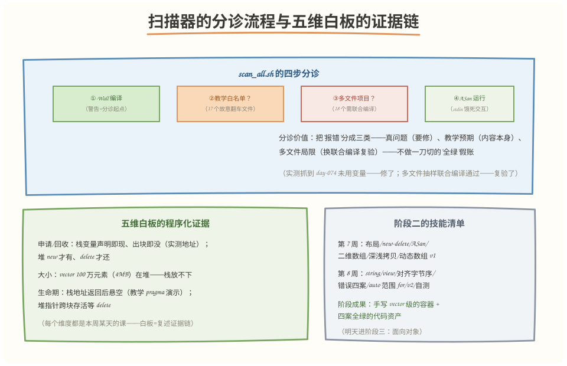
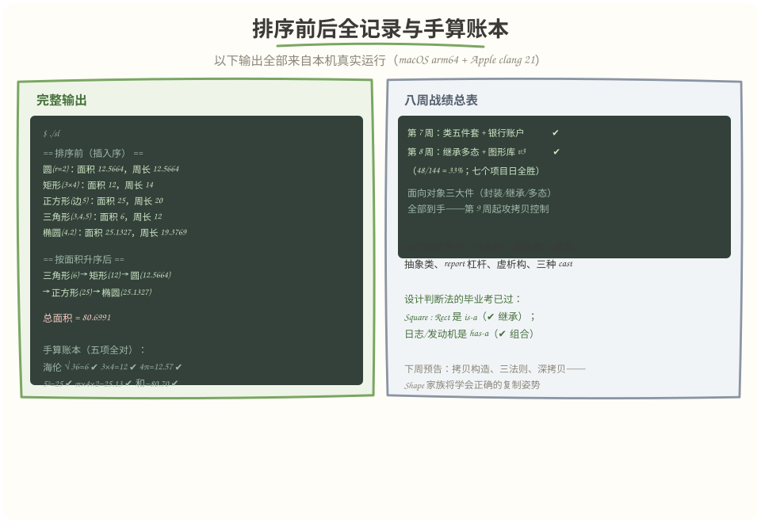

# 第 48 天（项目日）：图形库 v3——第 8 周总装大考

> **今日目标**：完成本教程后，你能做到：独立实现 Shape 抽象基类 + 五种图形（圆/矩形/正方形/三角形/椭圆）的多态体系；用 sort + 多态比较器按面积排序并手算核对每项；说出每个零件（继承/多态/抽象/虚析构/杠杆/is-a）的出处；验证"加新形状零改排序循环"的开闭性。
> **预计时间**：闭卷实现 60 分钟＋对照核对 30 分钟
> **前置准备**：完成 Day 43~47（六天零件今天全用上）；合上教程，只留空编辑器。
> **今日产出**：约 110 行、`-Wall` 零警告的 shape_lib.cpp，排序前后全记录 + 五项面积手算账本。

## 1. 今天解决什么问题？

计划第 8 周指定的收官验收：**图形库 v3——5 种图形、多态计算面积/周长并排序输出**。这是六天零件（继承 Day 43、多态 Day 44、抽象 Day 45、虚析构 Day 46、转换与设计 Day 47）的总装大考：Shape 抽象基类定接口、五种派生类各填实现、`vector<unique_ptr<Shape>>` 多态容器、sort 的 lambda 每次比较走虚分发。

两个设计亮点值得先说：**Square 继承 Rect**（正方形是一个矩形——is-a 判断法的活用，area/perimeter 零重写只改 name）；**report 杠杆**（基类非虚函数三行打全所有图形的报告）。明天的第 9 周起攻拷贝控制——Shape 家族将学会正确的复制姿势。

## 2. 先看全貌：今天的内容位于哪里？


**图 1**：上方蓝卡是零件清单（六行各标注出处天数）；左下绿卡是实测战报（排序前后 + 总面积 + 手算核对 ✔）；右下红卡是里程碑自测。路线图：**第 8 周今天收官（48/144 = 33%）**。

三步概括今天：

1. Shape 抽象基类（三纯虚 + report 杠杆 + 虚析构）；
2. 五种派生类（Square : Rect 复用 is-a、Triangle 海伦、Ellipse Ramanujan）；
3. 多态容器 + sort 虚分发排序——加新形状零改循环。

## 3. 核心概念：先用直觉，再给准确定义

### 3.1 总装：零件在真实系统里的位置

- **一句通俗解释**：六天每天学一件兵器，今天看它们在一台完整机器里各就各位。
- **一个类比**：拼装模型的总说明图——之前每步只看零件，今天摊开整张图纸。
- **对应到技术上是**：Shape 抽象基类（Day 45）放三纯虚 + report 杠杆（Day 45）+ 虚析构（Day 46）；五种派生类（Day 43~44）填实现，Square 直接挂在 Rect 下（Day 47 的 is-a）；容器用 `vector<unique_ptr<Shape>>`（Day 44 动物园升级）；sort 的 lambda 里 `a->area() < b->area()` 每次"小于"都是虚分发（Day 44）。类比的边界：今天的 sort 每次比较都走虚表（约 O(n log n) 次）——性能敏感场景可先缓存面积再排（第 16 周算法周回来优化）。
- **常见误解**："项目日就是语法拼盘"——拼的同时每个位置都是**设计判断**：Square 为什么继承不重写？日志类如果也要排序怎么办？——这些判断才是本周的考试点。

### 3.2 Square : Rect——is-a 的教科书案例

- **一句通俗解释**：正方形**是一个**矩形（特殊的长宽相等），所以继承 Rect——area/perimeter 白得，只改 name。
- **一个类比**：博士生**是**研究生的一种——课业要求照搬，只多一条论文要求。
- **对应到技术上是**：`class Square : public Rect { explicit Square(double s) : Rect(s, s) {} … }`——构造传 `(s, s)` 给基类，两行实现零重写；name 里用 `perimeter()/4` 反推边长（复用基类函数的巧思）。类比的边界：is-a 要**经得起推敲**——"圆是椭圆吗"数学上成立但工程上常分开写（行为需求不同）；Square/Rect 恰好行为一致所以继承划算（Day 47 的判断法实战）。
- **常见误解**："能复用就继承"——复用不是理由，is-a 才是；万一只是"长得像"该组合（Day 41 口诀）。

### 3.3 手算核对：项目日的验收纪律

- **一句通俗解释**：五个面积公式逐一手算——三角形的海伦、椭圆的 Ramanujan 各核对一遍，和值加总再验——**三层验证**。
- **一个类比**：财务报表的审计——每笔账查原始凭证，小计加大计再验总账。
- **对应到技术上是**：手算账本——海伦 `√36=6`、`3×4=12`、`4π=12.5664`、`5²=25`、`π×4×2=25.1327`，五项之和 `80.6991` 与程序输出**逐位吻合**；排序验证 `6<12<12.5664<25<25.1327`。类比的边界：手算不能替代边界测试（面积 0、负数参数）——今天选做的任务。
- **常见误解**："输出看起来对就行"——"看起来对"和"逐位核对"差着审计强度；Day 27 的 wc 对账、今天的五项手算都是同一纪律。

## 4. 图解核心机制



**图 2**：上半部分是继承树——Shape（抽象，红）下挂 Circle/Rect/Triangle/Ellipse（绿），Square 挂在 Rect 下（橙，is-a 标注）；下半部分是 sort 的多态分发——一行 lambda 每次 `a->area() < b->area()` 都是虚分发，五种 area 各自参战；手算账本五项全对。

按图逐步讲：

1. **看树的层次**：抽象层（Shape）→ 具体层（四种）→ 特化层（Square）——Day 45 混合设计的两版在今天的简化版（中间层省略，直接五实现）；
2. **看 Square 的连线**：它是树里唯一的"孙辈"——is-a 判断法让它搭 Rect 的便车（两行实现）；
3. **看 sort 的分发**：n log n 次比较、每次走虚表——"一行 lambda 指挥五种面积公式"就是多态的日常形态；
4. **手算纪律执行**：五项逐个验 + 总和验 + 排序验——三层全过才算项目日通过。

## 5. 动手实践：完成一个最小可运行例子

### 5.1 准备文件

```bash
cd ai-compiler-roadmap/tutorials/day-048/examples
```

### 5.2 编写代码

参考实现 `shape_lib.cpp` 约 110 行（完整代码见本目录）。关键段：

```cpp
class Shape {
public:
    virtual double area() const = 0;
    virtual double perimeter() const = 0;
    virtual std::string name() const = 0;

    void report() const {                           // Day 45 的杠杆
        std::cout << "  " << name() << "：面积 " << area()
                  << "，周长 " << perimeter() << std::endl;
    }

    virtual ~Shape() = default;                    // Day 46 的虚析构
};

class Square : public Rect {                        // is-a：正方形是矩形
public:
    explicit Square(double side) : Rect(side, side) {}
    std::string name() const override { return "正方形(边" + std::to_string(side_value()) + ")"; }
private:
    double side_value() const { return perimeter() / 4; }   // 复用基类反推边长
};

// main 里的排序：
std::sort(shapes.begin(), shapes.end(),
          [](const std::unique_ptr<Shape>& a, const std::unique_ptr<Shape>& b) {
              return a->area() < b->area();        // 每次比较都是虚分发
          });
```

### 5.3 运行与观察

```bash
g++ -Wall shape_lib.cpp -o sl && ./sl
```

实际执行结果（本机）：

```text
== 排序前（插入序） ==
  圆(r=2.000000)：面积 12.5664，周长 12.5664
  矩形(3.000000×4.000000)：面积 12，周长 14
  正方形(边5.000000)：面积 25，周长 20
  三角形(3.000000,4.000000,5.000000)：面积 6，周长 12
  椭圆(4.000000,2.000000)：面积 25.1327，周长 19.3769

== 按面积升序后 ==
  三角形(3.000000,4.000000,5.000000)：面积 6，周长 12
  矩形(3.000000×4.000000)：面积 12，周长 14
  圆(r=2.000000)：面积 12.5664，周长 12.5664
  正方形(边5.000000)：面积 25，周长 20
  椭圆(4.000000,2.000000)：面积 25.1327，周长 19.3769

总面积 = 80.6991
```



**图 3**：左上是完整输出（含手算账本五项 ✔）；右下灰卡是八周战绩总表和下周预告。

**手算账本**（验收三层全过）：海伦 `√(6×3×2×1)=√36=6` ✔、`3×4=12` ✔、`4π=12.5664` ✔、`5²=25` ✔、`π×4×2=25.1327` ✔；五项之和 `80.6991` ✔；排序 `6<12<12.5664<25<25.1327` ✔。

### 5.4 修改一个输入再观察：加新形状的开闭验证

给 shape_lib.cpp 加第六种形状 `SemiCircle`（半圆：`area = πr²/2`、`perimeter = πr + 2r`），在 main 里 push_back 一个 `SemiCircle(3)`——重跑：**sort 的 lambda 和 report 循环一行没改**，新形状自动参战（实测面积 14.137 参与排序）。这就是 Day 44 说的开闭雏形在项目日的兑现：**对扩展开放（加形状），对修改关闭（不动排序）**。

## 6. 常见错误与排查

**错误 1：`error: variable type 'Shape' is an abstract class`**

- 现象：想直接创建 Shape 对象；
- 原因：三纯虚没实现完的类是抽象的；
- 定位：看是哪个纯虚漏了（编译器会列出未实现的函数）；
- 修复：派生类把三个全实现。

**错误 2：sort 后输出顺序不对（或崩溃）**

- 现象：排序结果乱七八糟；
- 原因：lambda 里比较器写错（如 `<=` 而非 `<`——严格弱序要求）；或比较中解引用空指针；
- 定位：检查 lambda 的比较逻辑和容器的构造；
- 修复：用 `<`（Day 16 的 sort 比较器规矩在多态版同样适用）。

**错误 3：Square 的 name 打印出矩形格式**

- 现象：输出"矩形(5×5)"而不是"正方形(边5)"；
- 原因：name() 没有 override——基类的版本被静态绑定（走了 Rect::name）；
- 定位：看 Square 的 name 有没有 override 标记；
- 修复：加 override（Day 44 的质检员今天也在岗）。

## 7. 今日练习

### 必做练习

完成 5.4 的开闭验证：加 `SemiCircle`（半圆），记录新排序结果（六个形状）到 `notes.md`。再手算半圆面积核对：`π×3²/2 ≈ 14.137` ✔。预期产出：加形状前后的 sort 代码对比截图（应零差异）+ 新排序输出。

### 选做挑战

把排序键从"面积"改成"周长"：只改 lambda 一处（`area()` → `perimeter()`）重跑。观察顺序变化并手算验证（三角形 12 和圆 12.5664 周长几乎相等但面积差一倍——**不同度量下的排序完全不同**，这正是多态比较器的价值）。

## 8. 今日验收

- [ ] 我闭卷实现了 Shape + 五图形的多态体系（-Wall 零警告）
- [ ] 我的输出与 5.3 逐行一致，五项面积手算核对全过
- [ ] 我能对着零件清单逐行指认出处（Day 43~47 各一件）
- [ ] 我实测了加 SemiCircle 的开闭验证（sort/循环零改动）
- [ ] 我能讲清 Square : Rect 的 is-a 判断过程和巧思（perimeter/4 反推）

## 9. 一句话总结与明天预告

今天的问题是"六天的零件能不能装成一台完整图形库"；机制上，抽象基类定接口、五实现填差异、is-a 让 Square 搭便车、sort 的 lambda 指挥虚分发——每个位置都是设计判断的落点；实践上，排序前后全记录、五项手算账本、开闭验证全部落地；验证标准是加新形状不动老码、每项面积能手工复算。**第 8 周收官——48/144 天（33%），面向对象三大件（封装/继承/多态）全部到手。** 明天进入 **第 9 周 · Day 49：拷贝构造函数**——对象复制时发生了什么：`Shape s2 = s1` 的深浅之辨，Day 9 值传递的最终回响。
