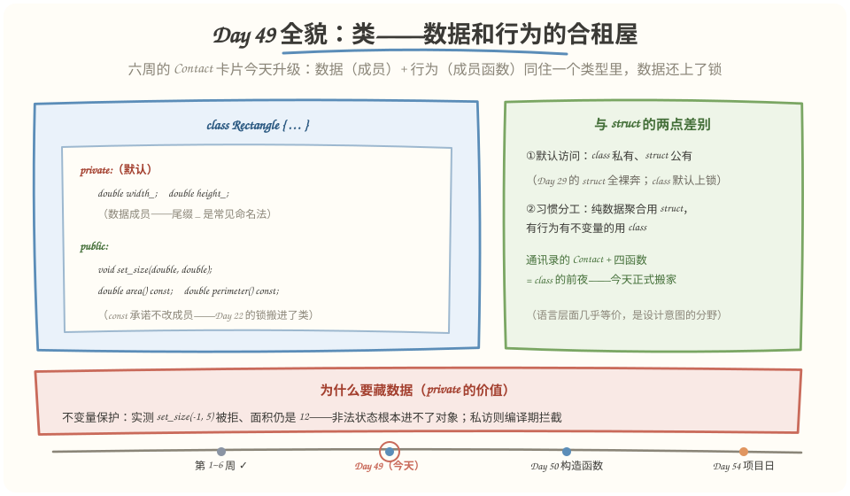
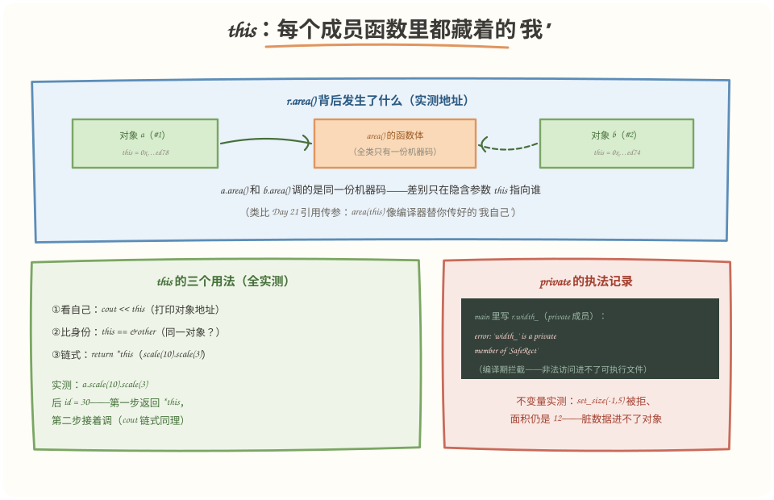
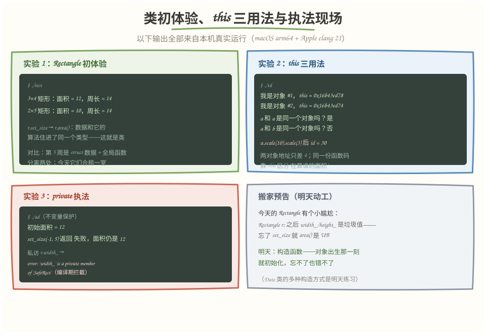

# 第 49 天：类的基础——数据和行为搬进同一间屋

> **今日目标**：完成本教程后，你能做到：定义 class（private 数据 + public 成员函数）并用 `.` 调用接口；说出 class 与 struct 的两点差别；解释 private 保护不变量的价值（实测拦截非法值与非法访问）；说出 this 的三个用法（看自己、比身份、链式返回 `*this`）。
> **预计时间**：学习 25 分钟＋实践 45 分钟
> **前置准备**：完成 Day 1~48（第 7~8 周的内存知识是类的地基）（struct + const 成员函数的知识今天直接搬进类；引用传参是理解 this 的桥）。
> **今日产出**：Rectangle 类（面积/周长）、this 三用法演示、一次 private 执法记录（编译错误 + 不变量保护实测）。

## 1. 今天解决什么问题？

六周攒下的 Contact 是"数据卡片 + 全局函数"——数据和它的算法分居两地。今天的问题：**能不能让数据和操作它的函数住进同一个类型**？这就是类（class）：`private` 区放数据（外界不可见），`public` 区放成员函数（外界唯一入口）。配套两个新认识：为什么要把数据藏起来（不变量保护——实测负宽度被拒）；每个成员函数里藏着的 `this` 是什么（同一份机器码怎么知道在算"谁"的面积）。

计划指定的练习 Rectangle 类（面积/周长）是今天的开胃菜——它同时也是明天构造函数的铺垫。

## 2. 先看全貌：今天的内容位于哪里？



**图 1**：左卡是 `class Rectangle` 的解剖——private 区两个数据成员（`width_`/`height_`，尾缀下划线是命名惯例），public 区三个成员函数（`const` 承诺不改成员——Day 22 的锁搬进类）；右卡是与 struct 的两点差别（默认访问 + 习惯分工：纯数据聚合用 struct、有行为有不变量用 class）；下方红卡预告 private 的执法实测。

三步概括今天：

1. 类 = 数据成员 + 成员函数，默认 private、接口 public；
2. private 的价值：不变量保护（非法状态进不了对象）；
3. this 是成员函数的隐含参数——同一份机器码，this 指谁就算谁的。

## 3. 核心概念：先用直觉，再给准确定义

### 3.1 类：合租屋的户型图

- **一句通俗解释**：类把"数据 + 操作这些数据的函数"打包成一个类型——声明对象就像按户型图开一间新屋。
- **一个类比**：自动售货机——硬币和饮料都锁在机肚里（private），你只能通过按钮（public 接口）拿饮料；不能自己伸手进货架。
- **对应到技术上是**：`Rectangle r; r.set_size(3,4); r.area()`——数据藏在 r 里，外界只认识接口。成员函数体内直接写 `width_`（不用 `r.`）——因为 this 已经替你指好了对象。类比的边界：售货机是工厂造好的整机，而**类是图纸**：每个对象一间独立屋子（各自的数据），共享一份机器码（函数）。
- **与 struct 的关系**：语言层面几乎等价（struct 也能放成员函数）；差别在默认访问（class 私有、struct 公有）和**习惯分工**——纯数据聚合（Day 30 的 Contact）用 struct，有行为有不变量的用 class。
- **常见误解**："每个对象都复制一份成员函数"——不是；函数全类一份，靠 this 区分（见 3.3）。

### 3.2 访问控制：不变量的卫兵

- **一句通俗解释**：private 把数据锁进屋、public 开几扇指定的门——所有进出都过门卫。
- **一个类比**：银行金库——库门（public 方法）有保安核对金额合法性；你不能翻窗（private）自己搬钱。
- **对应到技术上是**：两重执法（全部本机实测）——**编译期**：main 里写 `r.width_` 直接报 `'width_' is a private member of 'SafeRect'`；**运行期**：`set_size(-1, 5)` 校验失败返回 false，面积仍是 12（不变量"宽高非负"保住了）。类比的边界：门卫只拦"翻窗"，**从窗户设计图纸层面**就没有窗——private 的防线在类型系统里。
- **不变量（invariant）**：对象任何时刻都必须满足的条件。"宽高非负"就是 SafeRect 的不变量——private + 校验让破坏不变量的操作无法表达。
- **常见误解**："private 是为了安全（防黑客）"——不是；它防的是**未来的自己和同事**不小心绕过校验直接改数据。

### 3.3 this：成员函数里的"我"

- **一句通俗解释**：调用 `r.area()` 时，编译器偷偷把 r 的地址传给 area——这个隐含参数就叫 this。
- **一个类比**：老师喊"班长，起立"——"班长"这个称呼（this）指向具体哪个学生，取决于在哪间教室（哪个对象）调用。
- **对应到技术上是**（三个用法全实测）：①**看自己**：`cout << this` 打印对象地址（对象 #1 和 #2 地址差 4）；②**比身份**：`this == &other` 判断两个引用是否同一对象（a 和 a 是、a 和 b 否）；③**链式**：`return *this;` 让 `a.scale(10).scale(3)` 连调（id 变 30）——`cout << a << b` 的链式原理相同。类比的边界：this 在成员函数里**大部分时候可以不写**（`width_` 就隐含 this->width_）——显式使用它的三个场景才是它的出场理由。
- **与 Day 21 的桥**：`r.area()` 很像 `area(r)` 的引用传参——编译器真的就是这么实现的（this 就是那个引用的指针形态）。
- **常见误解**："this 是关键字变量可以赋值"——不行；它是常量指针（`Probe* const`），指向不可改。

## 4. 图解核心机制



**图 2**：上半部分是 this 的转发图——对象 a（`0x…ed78`）和对象 b（`0x…ed74`）调用**同一份** area() 机器码，差别只在隐含参数 this 指向谁（与 Day 21 引用传参的桥在此接通）；左下绿卡是 this 三用法（全实测）；右下红卡是 private 的双重执法记录（编译期拦访问 + 运行期拦非法值）。

按图逐步讲：

1. **先看一份机器码**：area() 全类只有一份（省内存）——`a.area()` 和 `b.area()` 的差别被编译器翻译成 this 的不同指向；
2. **再比对象身份**：两个对象地址只差 4（Day 19 邻居布局的类版本）；`this == &other` 是"同一性"的判法（Day 21 说过：两个对象可能相等但不是同一个）；
3. **链式的原理**：scale 返回 `*this`（对象本身的引用）——上一步的输出是下一步的输入；
4. **执法双层**：编译期拦"写不写的出"（private 访问直接编译错误），运行期拦"值合不合法"（set_size 校验）——两层防线保护不变量。

## 5. 动手实践：完成一个最小可运行例子

### 5.1 准备文件

```bash
cd ai-compiler-roadmap/tutorials/day-049/examples
```

三个程序：`rectangle.cpp`、`this_demo.cpp`、`access_demo.cpp`。

### 5.2 编写代码

主角 `rectangle.cpp`（完整代码）：

```cpp
#include <iostream>

// 第 49 天主角：Rectangle 类——数据和行为打包，数据藏起来
class Rectangle {
private:                        // 私有：外界看不见（默认就是 private）
    double width_;
    double height_;

public:                         // 公有：外界能用的接口
    void set_size(double w, double h) {
        width_ = w;             // 成员函数可以直接摸私有数据
        height_ = h;
    }

    double area() const {       // const：承诺不修改成员（Day 22 的锁）
        return width_ * height_;
    }

    double perimeter() const {
        return 2 * (width_ + height_);
    }
};

int main() {
    Rectangle r;                // 类类型声明对象（就像 int x 一样自然）
    r.set_size(3, 4);           // 用接口设置尺寸
    std::cout << "3×4 矩形：面积 = " << r.area()
              << "，周长 = " << r.perimeter() << std::endl;

    r.set_size(2, 5);
    std::cout << "2×5 矩形：面积 = " << r.area()
              << "，周长 = " << r.perimeter() << std::endl;
    return 0;
}
```

### 5.3 运行与观察

```bash
g++ -Wall rectangle.cpp -o rect && ./rect
```

实际执行结果（本机）：

```text
3×4 矩形：面积 = 12，周长 = 14
2×5 矩形：面积 = 10，周长 = 14
```

```bash
g++ -Wall this_demo.cpp -o td && ./td
```

```text
我是对象 #1，this = 0x16b43ed78
我是对象 #2，this = 0x16b43ed74
a 和 a 是同一个对象吗？是
a 和 b 是同一个对象吗？否
a.scale(10).scale(3) 后 id = 30
```



**图 3**：左上 Rectangle 初体验；右上是 this 三用法战报（两对象地址差 4、链式调用生效）；左下是 private 双重执法（不变量保护 + 编译错误原文）；右下灰卡指出今天的小尴尬——**Rectangle r; 之后忘了 set_size 就 area() 是垃圾值**——明天构造函数的登场理由。

### 5.4 修改一行再观察：私访与不设防

**实验 A（私访被拦）**：把 `access_demo.cpp` 里注释的 `std::cout << r.width_;` 放开（预期编译失败，本机实测）：

```text
error: 'width_' is a private member of 'SafeRect'
```

**实验 B（不变量实测）**：`set_size(-1, 5)` 返回失败、面积仍是 12——对照一个**没有校验**的 set_size（去掉 if 判断），面积会变成 -5：垃圾状态一旦进入对象，后续 area 全是错。两实验合起来：private + 校验 = 不变量的双保险。

## 6. 常见错误与排查

**错误 1：`error: 'xxx_' is a private member of 'ClassName'`**

- 现象：main 或其他类外代码直接访问数据成员；
- 原因：private 只对类内开放；
- 定位：报错直指成员名和类名；
- 修复：走 public 接口（set/get 函数）——或者问自己：这个访问本身是不是设计问题。

**错误 2：对象没初始化就调用成员函数，输出垃圾**

- 现象：`Rectangle r;` 直接 `r.area()` 得到诡异数字；
- 原因：数据成员和普通局部变量一样**不会自动清零**（Day 2 的教训在类里重演）；
- 定位：area 输出每次运行都不同即是；
- 修复：今天先靠纪律（声明后立刻 set_size）；**明天的构造函数从语言层面根治**。

**错误 3：在成员函数里写 `r.width_`（带了对象名）**

- 现象：编译报 undeclared identifier；
- 原因：成员函数里直接写成员名（隐含 this->）——对象名 r 是 main 里的局部名，类内看不见；
- 定位：看报错的标识符；
- 修复：类内一律裸写 `width_`。

## 7. 今日练习

### 必做练习（计划指定：Rectangle 面积/周长）

给 Rectangle 加第三个接口 `bool is_square() const`（判断是否正方形）和 `double diagonal() const`（对角线长，`<cmath>` 的 `std::sqrt`）。预期产出：3×4 输出"不是正方形，对角线 = 5"；5×5 输出"是正方形"。（勾股定理：√(3²+4²)=5 正好整数，自测好材料。）

### 选做挑战

把 Day 36 的 Contact 升级成 class 版：name/phone 设 private，public 区放 `bool set(const string&, const string&)`（内嵌 Day 32 的两道安检）和 `void print() const`。对比升级前后：安检逻辑从 main 挪进了类——**以后谁用 Contact 都绕不过安检**。这就是"类保护不变量"在自家项目上的第一次落地。

## 8. 今日验收

- [ ] 我能定义 class（private 数据 + public 成员函数）并完成 Rectangle 练习
- [ ] 我能说出 class 与 struct 的两点差别和习惯分工
- [ ] 我实测了 private 双重执法：编译期拦访问、运行期拦非法值（不变量）
- [ ] 我能说出 this 的三个用法，并演示了链式调用
- [ ] 我知道"对象未初始化"的隐患——明天构造函数要根治的病

## 9. 一句话总结与明天预告

今天的问题是"数据和它的算法怎么住进同一间屋"；机制上，class 用 private 藏数据、public 开接口，不变量靠双重执法保护，this 让一份机器码认得每个对象；实践上，Rectangle、this 三用法、执法记录全部实测；验证标准是任何成员函数调用都能说出"this 现在指着谁"。明天 **Day 50：构造函数、初始化列表、委托构造**——对象出生那一刻就初始化：Date 类的多种构造方式（计划指定练习）登场，今天"忘了 set_size"的隐患从此绝迹。
